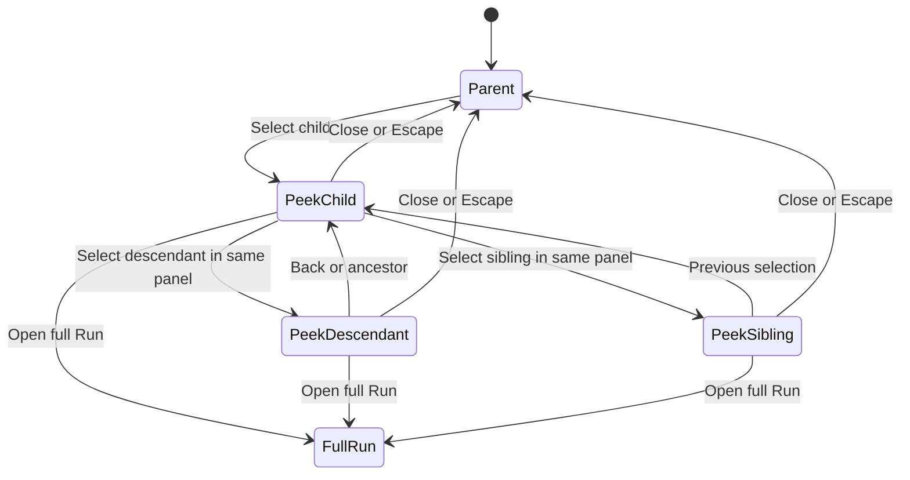

# Implementation Plan: Child Run peek navigation

Created: 2026-11-02
Status: Implementing; Phases 0–3 complete; final integration qualification pending.
Inspection baseline: `7cf28cc96` (also local `master` at inspection).
Branch: `codex/child-run-peek-navigation`; execution uses this plan explicitly.

## Settings and scope

- Delivery: specification-driven development (SDD); complete and validate the canonical specifications before behavior code. Implementation follows test-driven development (TDD): RED → GREEN → REFACTOR for each vertical slice. This plan governs the implementation and its acceptance gates.
- Testing: yes; real-Postgres integration and authenticated Playwright own behavioral coverage. No new unit tests that mirror structure, inflate counts or repeat assertions already owned at another layer.
- Logging: standard INFO/WARN/ERROR at request and stream boundaries, as selected by the user; use existing structured logger controls.
- Docs: yes, limited to changed behavior/contracts; design checkpoint precedes implementation. No roadmap linkage requested.
- Inspiration: the user's Codex Desktop subagent-navigation reference supplies the interaction idea: keep the main conversation visible and inspect another execution beside it. This plan makes no claims about Codex implementation details.
- V1 is read-only. Status, execution/conversation and public results are in scope. Messaging, HITL responses, lifecycle operations, review, promotion and operational acknowledgement/cleanup remain on the full Run page.
- Only persisted MAIster Run relationships qualify. Native runtime subagents that have no Run record are excluded.
- Reuse the current workbench, authorization functions, canonical transcript/result projections and Run stream consumer semantics. A single workbench SSE transport supplies separate parent/selected-child contexts and subtree invalidations; the legacy per-Run SSE endpoint stays compatible. No new Run kind, orchestration primitive, lifecycle status, dependency or workspace assumption.

## Roadmap linkage

Milestone: none.
Rationale: this request specifies a standalone feature plan; no milestone was selected.

## SDD ownership and completion rules

The plan sequences work; the following canonical artifacts own the implementation contract. Write them during Phase 0 of implementation, not during this plan-refinement request.

| Artifact                                                                                           | Required content and boundary                                                                                                                                                                                                                                                                                        |
| -------------------------------------------------------------------------------------------------- | -------------------------------------------------------------------------------------------------------------------------------------------------------------------------------------------------------------------------------------------------------------------------------------------------------------------- |
| New `docs/system-analytics/run-peek-navigation.md`                                                 | Purpose, non-persisted UI entities, Mermaid navigation state machine, open/switch/close/history/panel/focus flows, PKN-01…12 Expectations, refusal/edge cases and linked artifacts, following `docs/CLAUDE.md` R5.                                                                                                   |
| New `docs/system-analytics/run-peek-data.md`                                                       | Existing persisted relationships and projections, read/notification/subscription state machines, authorization and failure matrices, DTO/cursor/projection/notification/migration contracts, PKD-01…12 Expectations, edge cases and source/spec links. It owns the two migrations' purpose and compatibility limits. |
| New `docs/system-analytics/run-peek-traceability.md`                                               | Repository-standard `ID / Contract / Tasks / Primary test / Status` matrix. Every PKN/PKD and named edge case maps to an enforcing task and an actual primary test title; Planned rows become Implemented only after execution.                                                                                      |
| Existing `docs/api/web.openapi.yaml` and `docs/api/async/web-runs.asyncapi.yaml`                   | Exact HTTP/security/query/response/error schemas and workbench SSE frame union, including examples, limits, closure/resync semantics and legacy compatibility. These own the wire shapes; domain docs reference schemas instead of copying them.                                                                     |
| Existing workbench/runs/result/librarian domain docs                                               | Link the new bounded feature contracts. Update only conflicting current claims, including librarian transport suspension/resume in `docs/system-analytics/librarian-surface.md`. Keep execution and result lifecycle semantics in their existing owners.                                                             |
| New `docs/screens/runs/child-run-peek.md`; existing workbench/inspector/Flow/librarian screen docs | Layout, entry points, responsive presentation, accessible names and links to behavior owners. Add new docs to `docs/screens/README.md` and `docs/system-analytics/README.md`.                                                                                                                                        |
| `docs/database-schema.md`, `docs/db/runs-domain.md`, generated `docs/db/erd.dbml`                  | Describe only actual new indexes and notification triggers; existing entities/relationships are unchanged. Regenerate DBML if index metadata is represented; do not hand-edit it or invent an ERD entity.                                                                                                            |

Phase-0 freeze gate: requirements, schemas, examples, UI transitions, refusal responses, migration catalog and test ownership must agree. Mark new behavior **Designed**, not Implemented. Any later implementation-driven contract change must first update its owning spec, traceability and regression scenario, then repeat RED → GREEN → REFACTOR; silently weakening a requirement to fit code is forbidden.

The primary expectations below are one per ID. In the two owner specs, keep at most 12 Expectations bullets each and name the runtime guard/component/test that enforces each. Edge cases get stable `EDGE-PKN-NN` or `EDGE-PKD-NN` IDs and point to an existing primary test parameter or named scenario; an edge ID does not require a redundant new test.

| ID     | Normative expectation / acceptance boundary                                                                                                      | Enforcing tasks | Primary test ownership                                            |
| ------ | ------------------------------------------------------------------------------------------------------------------------------------------------ | --------------- | ----------------------------------------------------------------- |
| PKN-01 | Exactly one peek uses the route Run as an immutable anchor, including for nested main Runs.                                                      | T6              | E2E-PKN-01, browser navigation                                    |
| PKN-02 | Every child entry identifies the Run, kind and execution status separately from public-result status.                                            | T8              | E2E-PKN-02, entry-point labels                                    |
| PKN-03 | Descendant, sibling, previous-selection and ancestor actions update the same panel and correct breadcrumb.                                       | T6              | E2E-PKN-03, nested journey                                        |
| PKN-04 | Peek changes preserve mounted parent view, latest intentional scroll, draft and inspector state.                                                 | T6              | E2E-PKN-04, context preservation                                  |
| PKN-05 | All peek operations produce zero lifecycle/HITL/activity/result-collection/workspace mutations.                                                  | T2,T7           | IT-PKN-05, real read-side state comparison                        |
| PKN-06 | The selected Run has an explicit correct full-Run link; interactive actions exist only there.                                                    | T7,T8           | E2E-PKN-06, action boundary/link                                  |
| PKN-07 | Deep links and Back/Forward preserve parent keys and restore the URL's selected child/view/node.                                                 | T6              | E2E-PKN-07, routing                                               |
| PKN-08 | Peek suspends competing inspector/librarian presentation without losing state and restores the specified visibility/focus.                       | T6              | E2E-PKN-08, coexistence                                           |
| PKN-09 | Dock/sheet/fullscreen transitions retain selection and avoid document overflow at declared widths/zoom.                                          | T6              | E2E-PKN-09, viewport matrix                                       |
| PKN-10 | Keyboard/focus/inner-first Escape and final trigger restoration satisfy the declared modal/docked rules.                                         | T6              | E2E-PKN-10, keyboard                                              |
| PKN-11 | Both EN and RU expose equivalent controls, status names, errors and accessible announcements.                                                    | T8              | E2E-PKN-11, locale parameter of labels/keyboard scenario          |
| PKN-12 | Completion, failure and transient connectivity do not close, switch or refocus peek unexpectedly.                                                | T7              | E2E-PKN-12, terminal/disconnected journey                         |
| PKD-01 | Each returned content class obeys its own existing project/owner/content grant, including positive grants and concealment.                       | T2,T3,T5        | IT-PKD-01, actual HTTP role matrix                                |
| PKD-02 | Server-validated persisted parent chains constrain selection, siblings, lists, breadcrumbs and cursor scope.                                     | T2              | IT-PKD-02, relationship matrix                                    |
| PKD-03 | Existing derived result states and valid-payload-only exposure remain authoritative for every Run status.                                        | T2,T7           | IT-PKD-03, extend existing result DTO suite                       |
| PKD-04 | Read-only Flow/conversation/operational content handles task-less, workspace-free, historic and unsupported Runs explicitly.                     | T2,T7           | IT-PKD-04, snapshot content matrix                                |
| PKD-05 | Child pages, ancestry and caches obey count limits, deterministic order and new-child discovery without eager tree loading.                      | T2,T8           | IT-PKD-05, query/page bounds                                      |
| PKD-06 | Transcript windows obey canonical order, byte/count bounds, mutable-row updates, attempt isolation and bounded projection progress.              | T3              | IT-PKD-06, real transcript pages                                  |
| PKD-07 | Parent/child contexts and generations are isolated; late requests/frames cannot overwrite the current selection.                                 | T5,T7           | E2E-PKD-07, delayed-response race                                 |
| PKD-08 | Committed creation/status/result/execution/projection changes wake the right active view without polling or hidden transcript subscriptions.     | T4,T5           | IT-PKD-08, committed-notification route chain                     |
| PKD-09 | Disconnect/reconnect/abort/shutdown release waiters and connections and resynchronize missed changes without lost-wake windows.                  | T4,T5           | IT-PKD-09, real listener/stream lifetime                          |
| PKD-10 | Validated requests and no-store typed responses distinguish empty, forbidden, unavailable, incompatible, error and disconnected states.          | T2,T3,T5,T7     | IT-PKD-10, HTTP/schema and wire parity                            |
| PKD-11 | Fresh and incremental migrations preserve existing records, enforce the intended indexes/triggers and have consistent journals/snapshots/schema. | T3,T4           | IT-PKD-11, real migration qualification                           |
| PKD-12 | Two visible peek workbenches keep content GETs progressing under HTTP/1.1 without duplicate per-Run sources.                                     | T5,T6           | E2E-PKD-12, two-open-peek HTTP/1.1 journey and one-window handoff |

The existing E1…E10 scenarios below group these requirements for review; they are not another set of duplicated tests. Slash-separated test IDs here abbreviate prose only: the canonical traceability matrix must spell every complete ID and resolve it to an actual test title/parameter. Carry these concrete edge IDs into the owner specs and traceability, using parameters of the primary owners rather than a new test per bullet.

| Edge ID     | Required scenario / oracle                                                                                                                                                                                                                                               | Primary owner               |
| ----------- | ------------------------------------------------------------------------------------------------------------------------------------------------------------------------------------------------------------------------------------------------------------------------ | --------------------------- |
| EDGE-PKN-01 | Direct deep link, nested main anchor, branch to sibling then ancestor, missing prior visit and invalid selected URL keep the original main Run.                                                                                                                          | E2E-PKN-01/03/07            |
| EDGE-PKN-02 | A→B→C, Previous twice yields B then A; tab replace/popstate do not append visits or create A↔B oscillation.                                                                                                                                                             | E2E-PKN-03/07               |
| EDGE-PKN-03 | Parent live refresh, unsent draft, scrolled file/HITL view, inspector tab and vanished opener preserve context and restore a safe focus target.                                                                                                                          | E2E-PKN-04/10               |
| EDGE-PKN-04 | Open docked librarian, resize during peek, suspend queued replies/settings/read-through, then close or switch to librarian; retained draft and canonical state converge.                                                                                                 | E2E-PKN-08                  |
| EDGE-PKN-05 | Inner popover consumes first Escape; sheet traps Tab; 320px/200% zoom and sheet↔dock transitions do not close/reset or focus a hidden trigger. Main Flow fullscreen forces peek sheet presentation at every width.                                                      | E2E-PKN-09/10               |
| EDGE-PKN-06 | Task-less/no-workspace/non-coding and terminal children have correct full-Run links; modifier click works and no interactive child mutation request occurs.                                                                                                              | E2E-PKN-02/06/12, IT-PKN-05 |
| EDGE-PKN-07 | Every introduced empty/error/denied/reconnect/control label has EN/RU parity and an accessible name; an icon/color alone is insufficient.                                                                                                                                | E2E-PKN-11                  |
| EDGE-PKD-01 | Auth-first active/disabled/password-change sessions, positive owner/member/viewer grants, nonmember concealment, foreign same-root selection and independently denied breadcrumb/content.                                                                                | IT-PKD-01/02/10             |
| EDGE-PKD-02 | Equal/unknown immutable launch times, Pending→Running between pages, full-page insertion, deletion/reparenting and a selected sibling outside the loaded first page produce no duplicates/skips or false chronology. Pin the selected summary independently of its page. | IT-PKD-02/05                |
| EDGE-PKD-03 | Empty, malformed, duplicate, oversized, cross-Run/node/parent and stale-attempt cursors refuse with the declared status/reason; maximum depth and a cycle cannot cause an unbounded walk or identity leak.                                                               | IT-PKD-02/06/10             |
| EDGE-PKD-04 | Giant tool JSON, multibyte UTF-8, 100/200/500 row boundaries, mutable streaming rows, old visible windows and usage outside the page obey byte/count/ordering/preview semantics.                                                                                         | IT-PKD-06                   |
| EDGE-PKD-05 | No attempt yet, recorded-prompt tie, incompatible pinned manifest, historical unsupported content and no repository workspace yield distinct supported/empty/incompatible facts.                                                                                         | IT-PKD-04/06                |
| EDGE-PKD-06 | All existing result states, failed Run with an older valid row, stale/superseded/invalid revision and required/optional/no contract keep payload/status fidelity without collect/promotion.                                                                              | IT-PKD-03                   |
| EDGE-PKD-07 | Last event before projection, a held projection claim, no-progress head, more than four quanta, poisoned projection and post-terminal publication eventually show data or an explicit pending/repair state; never spin or claim empty/caught-up falsely.                 | IT-PKD-06/08                |
| EDGE-PKD-08 | Commit vs rollback, INSERT vs late acceptance UPDATE, unchanged/noise fields, message updates, shared-workspace removal and delayed projection trigger the correct scope without content in notifications.                                                               | IT-PKD-08                   |
| EDGE-PKD-09 | Commit between LISTEN/registration/ready/GET, commit during in-flight refresh, two transactions committing in reverse order and notification lost during process restart converge without an event-ID cursor or lost dirty mark.                                         | IT-PKD-09                   |
| EDGE-PKD-10 | Acquisition failure, query-pool max one, exhausted retries, abort/body cancel/unmount/shutdown and grant loss release only owned resources; child denial retains parent updates and clears protected cache at the next auth boundary.                                    | IT-PKD-09/10                |
| EDGE-PKD-11 | Fresh and 0209 upgrade, invalid legacy indexed event position, repeated migrate, unchanged old records/constraints, catalog/snapshot/journal collision and missing migration readiness fail or pass explicitly.                                                          | IT-PKD-11                   |
| EDGE-PKD-12 | Two actually visible HTTP/1.1 peek workbenches keep bounded GETs completing during sustained updates, A→B switching and a one-window librarian handoff; both logical contexts retain correct identities.                                                                 | E2E-PKD-07/12               |

## Current implementation and actual gaps

| Surface                                                                                            | Implemented and reusable                                                                                                                                                | Gap this feature addresses                                                                                                                                                                                                             |
| -------------------------------------------------------------------------------------------------- | ----------------------------------------------------------------------------------------------------------------------------------------------------------------------- | -------------------------------------------------------------------------------------------------------------------------------------------------------------------------------------------------------------------------------------- |
| `web/lib/db/schema.ts` Run relationships                                                           | `parentRunId`, `rootRunId`, delegation snapshots and parent index already exist.                                                                                        | Validate the selected descendant against the original main Run, including when that main Run is itself nested. Sharing `rootRunId` alone does not prove descent.                                                                       |
| `web/lib/queries/run.ts`                                                                           | `ChildRunRef` / `getChildRuns` return direct children, task identity/title, target kind, current step, execution status and independently derived public-result status. | The query is unpaginated and does not authorize its caller. The full Run layout authorizes before calling it. `getRunSubtreeIds` is an unbounded cascade helper, unsuitable for UI loading.                                            |
| `web/components/runs/orchestrator-run-subtree.tsx`                                                 | Meaningful child cards and execution labels.                                                                                                                            | Full-Run links only; no public-result glyph or nested peek navigation.                                                                                                                                                                 |
| `web/components/runs/run-inspector-child-runs-list.tsx`                                            | Compact child list and accessible result glyph vocabulary.                                                                                                              | Full-Run links only; task-less entries share a generic label; execution status needs a readable label beside its dot.                                                                                                                  |
| `web/app/(app)/runs/[runId]/layout.tsx`                                                            | Persistent run-scoped layout keeps heavy parent loaders and client surfaces mounted across query changes.                                                               | Supply a stable peek controller and richer shared child-entry data without keying/replacing the parent shell.                                                                                                                          |
| `web/components/runs/run-shell.tsx`                                                                | Main plus 380px inspector at `xl`; inspector follows main below `xl`.                                                                                                   | No auxiliary-slot arbitration. Inspector uses local visibility and conditional unmounting, losing local state when removed.                                                                                                            |
| `web/components/librarian/{librarian-provider,librarian-panel}.tsx`, `panel-mode.ts`               | App-wide persistent panel, retained draft/conversation/scroll, owner-scoped draft storage, stream, docked/sheet/fullscreen behavior.                                    | It lives outside RunShell. Replacing the inspector alone leaves a competing librarian; suspension must preserve its mounted body and disable hidden modal/focus/read-through effects.                                                  |
| `web/components/runs/run-stream-provider.tsx`, `web/lib/use-run-stream.ts`                         | A shared tick-only stream per Run and cleanup on unmount.                                                                                                               | `useRunPageStream` disables fallback under any provider, including one for a different Run. The hook retains cursor state across ID changes. Selected content needs its own keyed provider, plus guards against late source callbacks. |
| `agent-run-transcript.tsx`, `node-transcript-panel.tsx`, `run-transcript/transcript-view.tsx`      | Shared transcript semantics and display renderer.                                                                                                                       | Agent wrapper opens its own stream; wrappers lack complete loading/permission/error handling. Current reads/refetches are unbounded. Bounded projector work is not bounded history retrieval.                                          |
| `flow-run-center.tsx`, `web/lib/runs/{flow-result-read-model,flow-node-result,flow-result-dto}.ts` | Pinned graph, selected-node/attempt/failure/result projections.                                                                                                         | FlowRunCenter directly reads/writes the main route's `node`, `wb`, `flow`; embedding it unchanged would change the parent's view. Extract only controlled display pieces.                                                              |
| `web/lib/runs/run-result-dto.ts`, `run-public-result-panel.tsx`                                    | Existing explicit public-result DTO and renderer; value only for derived `valid`; seven validity/availability states; completion without promotion.                     | Load the selected child's projection and refresh independently. Execution success must never manufacture a valid result.                                                                                                               |
| `operational-run-result.tsx`                                                                       | Existing operational diagnostic projection.                                                                                                                             | It includes mutation controls and runtime-object links. Reuse display facts only, honoring content permissions.                                                                                                                        |
| `/api/runs/[runId]/stream`, `run-live-refresh.tsx`                                                 | Authorized metadata-only canonical SSE, live transcript ticks, parent status/current-node refresh. Opening the stream does not update Run keepalive/lifecycle.          | Parent refresh does not guarantee new children, sibling status or result updates while its node/status remain unchanged. Terminal Run streams close. Child refresh must stay local and leave peek selected.                            |

### Two concrete backend necessities

1. **Bounded reads:** add a paginated direct-child read and an opt-in paginated transcript read over the existing projections. Do not download an entire tree or transcript and slice it in the browser.
2. **Complete metadata and execution invalidation:** inspection found no universal push signal for ordinary Flow child creation, all status changes and result validity changes. The existing attention stream scans sources on a two-second timer and still misses some of these changes. The process-local Run wake bus relies on timed canonical scans. Neither satisfies this feature's complete, push-only tree refresh requirement.

Use the smallest necessary persistence extensions: migration 0210 adds stable child-page and canonical transcript indexes, and migration 0211 adds transactional notification triggers on existing canonical tables. `run_messages` currently has no index matching either complete transcript order; a LIMIT alone does not prevent a whole-history sort. Current metadata events also lack universal descendant/result coverage. These are concrete exceptions to avoiding schema changes; neither introduces a table, column, lifecycle or orchestration primitive.

A separate child SSE plus metadata SSE would add unnecessary persistent connections. Inspection of `librarian-provider.tsx`, `use-attention-stream.ts`, RunStreamProvider and AgentRunTranscript also exposes duplicate/per-origin connection risk; `.ai-factory/patches/2026-10-31-15.23.md` records this failure class. Use one content-free workbench SSE for parent ticks, selected-child ticks and tree invalidations, adapted into separate Run contexts. Keep the legacy canonical endpoint compatible for its other consumers. No ancestor write fan-out or root locks are needed.

## Layout and navigation decisions

### One auxiliary surface

When the parent Flow is fullscreen, peek is a modal sheet at every width above that retained fullscreen surface. Otherwise, at viewport widths of at least 1536px, peek occupies the existing inspector side of RunShell, widened to 480px; the main Run remains mounted to its left. Below 1536px, use one modal sheet: 560px maximum width from 768px upward, full screen below 768px. This follows the librarian's workbench breakpoint rather than squeezing three columns into the Run screen. The parent's DOM, state and stream stay mounted beneath the sheet. No horizontal document overflow at 320px or 200% zoom.

- Opening peek retains the inspector's open/closed state, selected tab, expanded sections and scroll, and hides its mounted subtree. No inspector lifecycle control remains focusable behind peek.
- Retain the librarian's logical open state, conversation, draft and scroll; register a scoped suspension with its existing provider. During peek, suspend its owner SSE and effective visibility/modal/read-through effects to reserve HTTP connections. On resume, reconnect using its existing durable cursor and refresh conversation/settings/indicator before declaring it current. Queued turns continue server-side. Hidden messages must not be marked read.
- Closing peek releases suspension and restores the inspector exactly. Restore an open librarian when its current mode is docked. If viewport changes would restore it as a modal over the restored child trigger, retain it collapsed with its existing indicator and an explicit reopen action; its draft/conversation remain intact. This exception preserves focus restoration and prevents a second modal from immediately replacing the dismissed peek.
- Activating the librarian trigger while peek is open explicitly switches to librarian: remove peek URL state, release peek resources, then open librarian. Do not reopen peek automatically on librarian dismissal.
- The parent inspector toggle stays visible but disabled with a localized explanation while peek owns the slot. Changing descendants never creates another slot/panel. Parent Flow fullscreen requests first close peek through the same close transition; an already-fullscreen Flow is retained beneath a sheet.

The navigation states keep the route Run as the anchor throughout a peek session.

### Entries, hierarchy and selected content

- Use the same enriched entry model in the inspector, subtree and peek lists: task key plus task title when present; otherwise immutable launch/agent/Flow/runner display name, plus short Run ID. Generic localized Run-kind text plus short ID is the explicit label for older records without a name. Do not expose raw prompts as labels.
- Show localized execution status as text plus dot; independently show public-result status with existing accessible glyph/label semantics. No glyph for no result contract/history. Use existing Run status helpers rather than another terminal-status set.
- Panel header: selected label, short ID, kind, execution status, public-result indicator, Close and **Open full Run**. A breadcrumb starts with the original main Run, followed by authorized persisted ancestors and selected Run; abbreviate visually on narrow screens while retaining accessible full labels.
- Provide a Previous-selection button, ancestor breadcrumbs, a paginated sibling chooser and the selected Run's paginated direct children. The main-anchor breadcrumb closes peek. Selection history is temporal; breadcrumbs express ancestry. They must not be confused.
- Default tab is Conversation for a standalone conversation Run and Execution for a Flow. Also offer Public result where a contract/history exists. Use `peekNode` for Flow node selection. Read-only execution facts include kind, target/current node, latest attempt, failure/terminal cause and relevant workspace presence; show “No repository workspace” when applicable.
- Reuse TranscriptView for messages/tools/thoughts/permission notices, without composers or response controls. Extract controlled Flow node details with run/node props and a selection callback; no parent pathname/search-param reads inside it. Failed/unsupported nodes retain facts and a full-Run link.
- Reuse public-result rendering for schema, revision, collection, failure reason and valid payload; distinguish `pending`, `valid`, `absent`, `missing`, `stale`, `invalid`, `unavailable`, and no contract. Preserve result-only completion semantics. Operational outcome facts use their existing projection with acknowledgement, cleanup retry and other mutation controls omitted.
- Do not instantiate full Run layouts, scratch dialogs, HITL forms, lifecycle actions or review/promotion surfaces in peek. Do not call result `collect` operations, which stamp collection state. Use the non-mutating result loader.
- Full-Run action is a normal anchor to `/runs/<selected>` using existing kind redirects and no query parameters. The parent history entry retains peek for browser Back. Support modifier-click/new-tab behavior; V1 deliberately has no child-tab translation into full-page query state.

### Routing, history and parent preservation

Canonical URL: `/runs/<main>?<existing-parent-params>&peek=<selected>&peekView=conversation|execution|result&peekNode=<node>`.

- Extend `web/lib/runs/run-query-state.ts` with these namespaced keys. Existing `node`, `wb`, `file`, diff, inspector and Flow parameters continue to describe the parent. Query patches preserve unrelated parameters and fragments.
- Use Next-compatible native History API updates for peek-only changes, letting its public adapter retain framework state while passing only feature-owned visit metadata. This is a new use of the installed router integration and needs an early browser smoke check. It avoids rerunning the `?file=` server page solely to switch children. Selection handlers never call `router.refresh()`; the required stream-ready/resync handshake may independently reload canonical parent facts through the existing refresh consumer.
- Push one entry for opening, selecting another descendant/sibling/ancestor, or closing. Replace for changes of selected-child tab/node. Duplicate selections do not add entries. Closing pushes a URL with only peek keys removed; Back can reopen the prior selection. Browser Back/Forward renders exactly the URL selection, including the closed state.
- Previous-selection uses a bounded visit stack (maximum 32 entries containing ID, selected view/node and a non-authoritative visit token, keyed to the main Run). Child tab/node changes replace the current visit. New selections push; Previous pops the current entry and navigates to the preceding entry without appending another stack entry, so repeated Previous cannot oscillate A↔B. Browser popstate restores a known visit token without appending; an unknown/direct entry starts a new stack. Disable Previous when no prior visit exists; breadcrumbs still work. Every resulting selection remains URL-addressable.
- A direct link/refresh reads the three query keys in the stable client controller and resolves ancestry/authorization server-side. It does not trust a serialized browser tree. Default invalid tab/node choices explicitly to supported display state; malformed, self-selected or unrelated Run IDs show an unavailable state, preserving the parent URL/context until Close.
- Keep parent RunShell, provider, main view, composer/HITL draft owners and hidden inspector mounted with stable keys. Key only selected-child content by Run ID. Native history changes must not focus/scroll the main page. Preserve document/parent scroll bookmarks around column reflow; restore focus with `preventScroll`. If the user deliberately scrolls the parent while docked, preserve that latest position on close.
- Parent refreshes caused by its existing execution events may update facts but must reconcile into these same mounted owners. Do not depend on remounting or serializing a draft to preserve it.

### Keyboard and focus

- Use ordinary labelled links/buttons/lists, not a tree widget requiring a second arrow-key model. Enter activates a link; Space activates a button; Tab/Shift+Tab traverse controls; tabs follow the existing accessible tab convention. Selected navigation entry uses `aria-current`.
- Opening moves focus to the labelled panel heading (`tabIndex=-1`), after hidden surfaces release focus. Changing children focuses/announces the new heading, without scrolling the parent. Use a polite live region for selected identity/status and explicit alerts for failed loads.
- Docked peek is a labelled complementary region without a trap; Escape closes only when focus is inside it. Sheet/fullscreen is a labelled modal dialog with focus containment, body scroll lock and inert background, following `use-modal-a11y.ts` conventions.
- Escape dismisses the innermost open chooser/popover first; a handled Escape cannot also close peek. A second Escape closes peek. Switching responsive mode keeps the current child and focused control where possible; it is not a Close transition and must not restore focus to the opener.
- Final close first restores the inspector DOM visibility, then focuses the original main-page child trigger. If it disappeared after a live refresh, focus the retained child-list heading or Run heading. A direct link with no trigger uses the Run heading. Restoring focus never triggers navigation or mutates a Run.

## Data and live-update design

### Authorized read surfaces

Add feature read services in `web/lib/runs/peek-read-model.ts` and serializable types in `web/lib/runs/peek-types.ts`; keep server-only imports out of client components. Reuse authorized route patterns and projections, rather than assuming `getChildRuns` is already gated.

| HTTP surface                                                                       | Response and authorization                                                                                                                                                 | Identifiers and validation                                                                                                                                                                                                                                                                 |
| ---------------------------------------------------------------------------------- | -------------------------------------------------------------------------------------------------------------------------------------------------------------------------- | ------------------------------------------------------------------------------------------------------------------------------------------------------------------------------------------------------------------------------------------------------------------------------------------ |
| New `GET /api/runs/{runId}/children?parent=<id>&cursor=<opaque>&limit=<n>`         | Bounded direct children with labels/status/result status and `nextCursor`; metadata uses `readBoard`. Authorize anchor and requested parent, then each returned Run.       | `runId`: url-param anchor; `parent`, `cursor`, `limit`: untrusted query inputs; principal: auth-context. Projects, target names and relationships: server-state. Parent defaults to anchor; otherwise prove descent. Cursor must match anchor/parent/sort. No body-controlled identifiers. |
| New `GET /api/runs/{runId}/peek?selected=<id>&node=<id>`                           | Selected summary, bounded authorized breadcrumbs, permission capabilities, read-only execution DTO and existing public-result DTO. No transcript or raw evidence embedded. | Anchor: url-param; selected/node: untrusted query inputs. Resolve project, pinned manifest, ancestry and node membership from server-state. Reject self/unrelated selection; validate every breadcrumb before returning identity.                                                          |
| Existing `GET /api/runs/{runId}/transcript` with opt-in `limit`, `before`, `after` | Bounded messages over existing canonical projections; retains `readRepoFiles` for all kinds. Legacy request/response remains compatible when paging keys are absent.       | Selected runId: url-param; optional node and opaque cursors: untrusted query inputs. Bind cursor to Run, node, attempt, direction and ordering. Before/after are mutually exclusive. No arbitrary path/attempt supplied by client.                                                         |
| New `GET /api/runs/{runId}/peek/stream?selected=<id>`                              | One workbench SSE carries scoped parent/child change ticks plus subtree invalidation; existing Run consumers receive isolated contexts.                                    | Anchor: url-param; optional selected: untrusted query input. Principal: auth-context. Authorize anchor, then independently validate selected descent/access. No trusted client project/root or ID list; an unavailable selected Run must not stop the readable parent channel.             |

Authorization rules:

- The anchor, selected Run, listed children and every breadcrumb must independently pass existing project/owner access checks. Preserve not-found concealment for non-members, missing and unrelated resources. A content-level 403 is shown only after Run metadata access is established. Session expiry uses existing authentication behavior.
- Current public-result DTO is explicitly shown on the full Run page after project membership, including for a viewer; retain that public projection policy. Raw transcripts, artifact/runtime-object bytes and repository-derived evidence require `readRepoFiles`. Do not treat “public” as unauthenticated or bypass stricter evidence routes.
- Flow detail is an explicit allow-list of existing read-model fields: no full `getRunDetail` serialization, raw HITL context, settings secrets, absolute host paths or hidden result payloads. Reuse existing redaction for user-visible facts. Operational evidence links obey the underlying content gate.
- For a readable selected Run whose conversation is forbidden, retain its header/result/execution summary and render the denied conversation section. Do not convert this to “no messages”. Reauthorize every HTTP load and stream connection, and before emitting an invalidation for the affected tree; an authorization denial clears cached protected child content and closes its subscriptions. This guarantees enforcement at those boundaries, not immediate revocation during a completely idle connection.
- New GETs have no lifecycle, activity, HITL, collection or workspace writes. Existing transcript projection may materialize canonical read data; this must not extend keepalive or create an execution.

### Concrete HTTP and event contract requirements

T1 must encode these decisions as OpenAPI 3.0.3 / AsyncAPI 2.6.0 schemas, not just prose. All new JSON responses use `Cache-Control: private, no-store`; SSE uses no-cache/no-transform, disabled proxy buffering and explicit abort handling. Authentication runs before resource lookup. Use the existing session gate explicitly on each new operation; the Web spec's global `security: []` must not imply public access. No new bearer/token grant is introduced.

| Contract                 | Required fields / variants                                                                                                                                                                                                                                                                                                                                                                                                                                                                                                              |
| ------------------------ | --------------------------------------------------------------------------------------------------------------------------------------------------------------------------------------------------------------------------------------------------------------------------------------------------------------------------------------------------------------------------------------------------------------------------------------------------------------------------------------------------------------------------------------- |
| `RunPeekChildPage`       | Required `anchorRunId`, `parentRunId`, `items`, `nextCursor` (nullable), `hasMore`, `totalCount`; each item is an explicit metadata DTO with `runId`, `label`, `runKind`, `taskRef` nullable, `delegationTarget` nullable, `status`, `resultStatus` nullable, `launchedAt` nullable, `startedAt`, `hasChildren`, `fullRunHref`. Counts include authorized direct children only. `nextCursor` is null exactly when no later page exists.                                                                                                                              |
| `RunPeekSnapshot`        | Required anchor/selected IDs, `breadcrumbs`, `summary`, `capabilities`, `content` discriminated by supported Run kind, `publicResult` nullable, `terminalCause` nullable using the existing token-only projection, `fullRunHref`. `content` distinguishes readable conversation descriptor, readable Flow node/attempt facts, operational diagnostic facts, forbidden section and incompatible history. No whole DB row, lifecycle action payload, raw HITL context or transcript body is embedded. Public result uses the existing DTO/status predicate, with explicit nullable keys.                     |
| `RunTranscriptPage`      | Opt-in paging keys select a distinct schema; requests without them keep the legacy response. Required `messages`, `usage` nullable, `attemptId` nullable, `beforeCursor`/`afterCursor` nullable, `hasEarlier`, `hasLater`, `window` (stable revalidation bounds), `projection` and compatibility discriminator. Messages are `oneOf` full existing message or explicit `bounded_preview` with stable ID/role, safe text preview, original byte count and `truncated: true`; partial tool JSON is never presented as a full tool record. |
| `projection`             | Existing consumer head, observed accepted canonical head (decimal strings or null), `state: caught_up\|pending\|poisoned`, and progress/continuation availability. Extend the read projection's current summary rather than inventing another worker. A continuation advances only toward the captured head; it must not chase an indefinitely growing stream.                                                                                                                                                                          |
| Child-page cursor        | Versioned opaque encoding bound to anchor, parent and the last `(launchedAt nullable,id)` key. Strictly validate length (maximum 2048 bytes), encoding and scope; reapply all authorized SQL predicates. Opacity is not authorization. Foreign/tampered scope refuses rather than changing parent.                                                                                                                                                                                                                                      |
| Transcript cursor/window | Versioned opaque encoding bound to Run, optional node, latest attempt ID, canonical ordering tuple and direction/window. `before` and `after` are exclusive; direction keys require `limit`. Refresh a visible page using the same stable upper bound, not a moving count offset. Null/empty scope and deleted/changed attempt states are explicit.                                                                                                                                                                                     |
| SSE ready                | `{type: "peek.ready", anchorRunId, selectedRunId: string\|null, selectionState: "none"\|"ready"\|"unavailable"}` after subscription registration; clients immediately reload canonical parent/selected/list snapshots.                                                                                                                                                                                                                                                                                                                  |
| SSE changes              | `{type: "run.changed", runId, kind: "execution"\|"summary"\|"transcript"}` only for authorized anchor/current selected IDs; `{type: "peek.changed"}` invalidates loaded subtree metadata. `peek.resync` includes a bounded reason enum; `peek.selection_unavailable` has no concealed child name/content. Close the affected logical channel, not the parent transport, when only child access fails.                                                                                                                                   |

Reject duplicate known parameters, invalid ID shapes, malformed encoding, noninteger/out-of-range limits, conflicting directions and unsupported query combinations with HTTP 400, existing `CONFIG` and a stable `reason`. Apply strict new parsing to new operations and the opt-in paging branch; legacy no-paging parsing stays compatible. Limits use the declared defaults when absent, not a silent clamp. New route failures use explicit typed errors; known auth statuses and generic safe not-found bodies match the existing auth policy. Do not expose a raw exception or private request data through a response.

| Condition                                          | HTTP / body decision                                                                                   | UI decision                                                                                       |
| -------------------------------------------------- | ------------------------------------------------------------------------------------------------------ | ------------------------------------------------------------------------------------------------- |
| Readable empty collection/history                  | 200, typed empty page and null cursors                                                                 | Empty explanation; not an error.                                                                  |
| Missing/nonmember/unrelated/self selected resource | 404, safe `PRECONDITION`, `reason: run_unavailable`                                                    | Retain parent and unavailable selection. No identifier/name leakage.                              |
| Readable Run, denied transcript/evidence           | 403, existing authorization code                                                                       | Denied section, retain other authorized sections.                                                 |
| Latest attempt changed since cursor                | 409, `CONFLICT`, `reason: transcript_attempt_changed`                                                  | Reset that child-node window to current latest; announce reset, do not mix attempts.              |
| Cycle or depth beyond 64 during relationship proof | 409, `PRECONDITION`, `reason: hierarchy_invalid\|hierarchy_limit` only after permitted metadata access | Explicit unsupported hierarchy; full Run link only if selected metadata independently authorized. |
| Pinned manifest incompatible                       | 200 typed `compatible: false` with the existing incompatibility schema; no guessed graph               | Summary/result and full Run remain; execution section explains incompatibility.                   |
| Transcript projection poisoned                     | 409, `CONFLICT`, `reason: transcript_projection_poisoned`                                              | Durable repair/error state, not empty history or an automatic retry loop.                         |
| SQL/service failure                                | 500 safe `CRASH`; unavailable listener before headers: 503 `EXECUTOR_UNAVAILABLE`                      | Explicit retry/error; transport loss after headers marks stale/disconnected.                      |

Bounded projection continuation: at most four request quanta per reload and only while the consumed projection cursor advances toward its fixed captured head. A held claim/no progress returns pending and waits for the projected-message notification or explicit user retry; it must not busy-loop. Publication after the final execution tick is covered by the `run_messages` notification. A missing runtime object or denied host access stays an explicit projection/content error; do not turn it into caught-up/empty.

Schema validation must execute against actual HTTP bodies and parsed SSE frames in the owning integration suite, including allowed/denied and nullable/result/preview variants. Validating only YAML examples or constructing a second hand-written DTO in the test is insufficient. Use installed contract-validation tooling or existing schema helpers; add a dependency only if no existing helper can validate the required schema, with a documented necessity.

### Bounded tree and transcript loading

- Direct-child pages: default 25, maximum 50, stable keyset by existing `launchedAt ASC NULLS LAST, id`. Scheduler admission rewrites `startedAt` (`scheduler.ts`), so it cannot be a cursor key. Some ordinary Flow/legacy Runs have no immutable launch timestamp: retain an explicit unknown-time group ordered by immutable ID, show no invented launch time, and encode the null group in cursor comparison. This intentionally replaces the old mutable start-time ordering without a new timestamp column. Fetch only active sibling/child lists and expanded ancestor context. Never use the cascade BFS or recursively preload all descendants. Bounded ancestry walk: maximum 64 edges, visited-ID cycle detection and explicit unsupported-depth/corrupt-chain state, with full-Run escape. This is a display limit, not an execution policy change.
- Keep at most 200 child-entry summaries and 32 previous selections in memory per anchor, evicting least recently used slices. Counts and result statuses come from the same authorized projection, not per-row HTTP fan-out. Use bounded batched result queries; do not load result values for list entries.
- On insertion beyond an already full oldest-first page, update the authorized count and show a localized “New children available” action that loads the new page on demand. Never silently skip the new child or automatically replace the user's current page/selection. Small lists update inline.
- Page transcripts by existing canonical ordering: Flow node uses event horizon, prompt tie-break and sequence; standalone uses creation time and sequence. Add an ID tie-break when needed. Preserve latest-attempt semantics; a cursor from a superseded node attempt returns an explicit reset-required response, not mixed messages.
- Initial window is the latest 100 messages, maximum 200 per request, rendered chronologically. Load earlier on demand while preserving the visible scroll anchor. Initial and live loads stay bounded; a bounded page must also enforce a serialized content budget (512 KiB). An oversized individual message uses a clearly labelled bounded preview; never silently drop messages or parse partial tool JSON as a complete record.
- Maintain at most 500 rendered messages. Unload distant pages with an accessible reload affordance. A stream tick refreshes the newest bounded window and the currently visible older window, merging by stable message ID, including updates to an existing streaming message. Other cached windows are marked dirty and revalidated before display; metadata-only ticks cannot identify which older message changed. Preserve usage-summary semantics independently of paging.
- Coalesce events during a request into one pending reload. Use the bounded projection continuation protocol above even after execution settles; wait for the projection notification when progress stops. No interval, unbounded immediate retries, selection jump or automatic scroll to bottom while the user reads earlier messages.
- Public-result rendering respects existing result-size and validity rules; do not add raw-output log reads as a substitute for missing transcripts/results.

### Streams, notifications and cleanup

- One physical `/peek/stream` EventSource belongs to the mounted anchor workbench, including while peek is closed. It replaces that page's direct parent source and serves at most the parent and the admitted selected child plus tree metadata. It never subscribes to every descendant transcript. The standalone `/stream` endpoint and its replay contract remain unchanged.
- Separate context-value providers expose existing `UseRunStreamResult` tick/liveness semantics for parent and child. Extract a provider accepting an already-owned stream value from the existing connection-owning provider; do not add flag-driven multi-mode components. Key the child context by Run ID. AgentRunTranscript must use `useRunPageStream`; it cannot create a duplicate direct subscription under either provider. Correct the mismatched-provider lookup and guard all late callbacks by connection and selection generation.
- The composite route is a snapshot/invalidation channel, not a second event log. Frames are `peek.ready`, `run.changed`, `peek.changed`, `peek.resync`, and `peek.selection_unavailable`, with the exact shapes below. No SSE `id` or Last-Event-ID is used; the already persisted canonical events/messages/results own history. A malformed/unsupported frame is an explicit protocol error that marks the source stale and triggers bounded resync; never silently ignore it while claiming freshness. A newly ready or resynchronized parent/child context causes its existing bounded snapshot consumers to reload. Independent logical ticks cannot be mistaken for another Run's updates.
- Admission ordering: remove old child data/subscription immediately; keep an anchor-only transport while the next selected snapshot is loading/denied; admit a child channel only after authorized snapshot success, rechecked by the stream handler. A concurrent child denial/deletion emits selection-unavailable, removes that channel and clears protected caches while retaining parent updates and the selected error panel. Invalid anchor access ends the whole transport. Do not silently render a different child.
- On selection admission/removal, close the old source before opening its replacement; keep parent mounted, mark the brief reconnection and reload its canonical snapshots on ready. Never overlap old/new transports to avoid a reconnect race. Main `RunLiveRefresh` retains its parent refresh behavior; child snapshot changes never call parent `router.refresh()`.
- PostgreSQL notifications cover committed Run/result/workspace changes plus accepted canonical `execution_events` insertion or late assignment of `run_sequence`, `node_attempts` status/attempt/failure changes, and projected `run_messages` inserts/content changes. The latter is necessary when the autonomous projector finishes after the last ACP event or a competing projector holds its claim. Emit a bounded `{topic, runId, oldParentId, oldProjectId, newProjectId}` private hint, not content. Filter ordinary hints through current persisted relationships/access; deletion/reparenting may conservatively invalidate authorized loaded slices using old hints. Do not require a deleted row to invalidate its old display.
- One lazy process-wide dedicated LISTEN client in autocommit mode serves all workbench subscriptions; derive its connection settings from the existing database configuration, but do not hold a connection from the query pool. A query pool with maximum one must still make progress beside the listener. Start LISTEN and register the scoped subscriber before the initial canonical snapshot; retain a monotonic in-memory dirty generation during reads and drain pending ticks afterward. The dirty marker must be set before awaiting any reload and checked again after it completes; do not clear a newer mark with an older response. Coalesce bursts with one in-flight read and one pending tick per scope, not an unbounded queue.
- Notification loss/connection error marks every dependent browser stale and closes that transport. A new listener establishes LISTEN before a `peek.resync`/ready snapshot handshake, repairing any offline gap. No persistent replay cursor, transaction-ID scan or polling interval is added. Heartbeats and retry backoff are transport-only; they do not query Run state. Use existing `advanceRunStreamLifecycle`/`reconnectDelayMs` limits (500ms, 1s, 2s, then disconnected); retain one manual reconnect action after exhaustion.
- Execution completion/failure marks the corresponding logical Run state settled and requests a final bounded snapshot, but leaves the composite transport and panel active for result/projection changes. Delayed projection completion therefore still wakes a finished child. New descendants refresh only visible/loaded metadata slices; no Run completion can choose another child.
- On switch/close, abort selected HTTP requests, release its waiter/channel and clear child-only tab/node data. Check Run ID, request generation, scope and active transport before adopting any response/frame. Closing retains parent/tree channels. On main-route unmount, release the whole source, pending reads/timers, LISTEN subscription and librarian suspension; integrate final listener release before pool shutdown. Acquisition error, auth refusal, response-body cancellation and peer disconnect each release their pending waiter/client explicitly.
- Connection gate: while peek is open, each visible workbench owns one composite source, uses the existing attention source, and suspends librarian owner SSE. Two visible workbenches therefore consume at most four persistent HTTP/1.1 connections, leaving request capacity. Hidden tabs disconnect composite sources and refetch on visibility return. Reopening librarian first closes peek and tears down selected resources; verify GET progress on that handoff, too. Unlimited simultaneous visible workbenches and cross-tab app-wide stream sharing are outside V1; do not claim that the two-workbench bound covers arbitrary windows.

### Loading and failure states

| State                                        | Visible behavior                                                                                                                                                                       |
| -------------------------------------------- | -------------------------------------------------------------------------------------------------------------------------------------------------------------------------------------- |
| Initial load / fast switching                | New identity skeleton with `aria-busy`; previous child's protected content is removed immediately; header Close remains usable.                                                        |
| No children / no messages / no contract      | Distinct localized empty explanations; no fabricated result glyph or transcript. No workspace still supports status/conversation/result.                                               |
| Pending / completed / failed Run             | Render the corresponding execution facts independently from result state; completion does not close, select a sibling or steal focus.                                                  |
| Missing, deleted, unrelated or concealed Run | Generic selected-Run unavailable state, retained parent and Close. Offer ancestor navigation only from already authorized facts. Do not disclose an inaccessible ID/name.              |
| Forbidden content                            | Localized permission notice in that content section; readable sections/full-Run link remain. Full Run does not imply greater permissions.                                              |
| Unsupported Flow/history/depth               | Existing compatibility explanation or explicit navigation limit, known summary and full-Run action; no guessed graph or runtime-log fallback.                                          |
| Request error                                | Localized retryable section error; preserve current child identity/parent. Retain stale data only for the same authorized child and label it stale. Never reuse previous child's data. |
| Disconnected / reconnecting                  | Independent parent and child liveness labels plus metadata freshness notice; known facts remain marked stale. Reconnect does not mutate persisted status.                              |

## Migration specification and upgrade gates

Allocation is provisional against inspected local `master` maximum idx 209. Recheck the actual integration base before creating SQL. The chronological dependency is paging migration **0210** in T3, then notification migration **0211** in T4; do not allocate 0211 before its predecessor exists or amend an already-applied historical migration.

| Migration                      | Exact planned change                                                                                                                                                                                                                                                                                                                                                                                                                                                                                              | Integrity / compatibility proof                                                                                                                                                                                                                                                                                                                                                                                       |
| ------------------------------ | ----------------------------------------------------------------------------------------------------------------------------------------------------------------------------------------------------------------------------------------------------------------------------------------------------------------------------------------------------------------------------------------------------------------------------------------------------------------------------------------------------------------- | --------------------------------------------------------------------------------------------------------------------------------------------------------------------------------------------------------------------------------------------------------------------------------------------------------------------------------------------------------------------------------------------------------------------- |
| `0210_run_peek_paging_indexes` | Add `run_messages_peek_node_order_idx` on `(run_id,node_attempt_id,COALESCE(supervisor_event_id,'0')::bigint,(prompt_dispatch_key IS NOT NULL),sequence,id)` for non-null node attempts; add `run_messages_peek_run_order_idx` on `(run_id,created_at,sequence,id)` for whole-Run ordering. Also add `runs_peek_parent_launch_idx` on `(parent_run_id,launched_at ASC NULLS LAST,id)` for bounded direct-child pages. No content column in an index; preserve existing uniqueness/NULLS NOT DISTINCT constraints. | Mirror all three indexes/expressions/predicates in `schema.ts`, SQL, journal and 0210 snapshot. Validate all existing indexed event positions before building the cast expression; invalid legacy values fail with a clear diagnosis rather than being rewritten. Real seeded query plans must use a bounded indexed range for large history, not a full-history sort; verify semantics, not exact planner cost text. |
| `0211_run_peek_notifications`  | Add one private bounded notification function/channel plus table triggers listed below. No domain-event kind, per-root counter, table or column.                                                                                                                                                                                                                                                                                                                                                                  | Register SQL/journal/0211 snapshot, preserving 0210 snapshot ancestry; snapshots carry the same table shape plus the 0210 indexes. Catalog assertions prove function/trigger definitions because Drizzle snapshots do not represent trigger SQL. No result/lifecycle data updates or history backfill.                                                                                                                |

Notification allow-list and source inventory (write it literally in the data spec):

- `runs`: INSERT/DELETE; semantic UPDATE of `status`, `current_step_id`, `parent_run_id`, `root_run_id`, `task_id`, `delegation_snapshot`, `result_contract`, `promoted_head_sha`, `merge_commit_sha` and the existing execution/workspace reference columns actually consumed by the snapshot. These cover agent launch in `web/lib/agents/launch.ts`, Flow launch in `web/lib/services/runs.ts` and scheduler/HITL/terminal status writers without patching every caller.
- `run_results`: INSERT/DELETE; UPDATE of validity, revision, schema identity, collection and supersession facts. Cover `publishRunResult`, invalid/stale/collected helpers in `web/lib/run-results/ledger.ts` plus direct agent rework invalidation. Exclude payload bytes from the hint.
- `workspaces`: INSERT/DELETE and ownership/status/removal fields used by the existing workspace-presence model. Resolve shared readers through that model; do not presume each child owns a different workspace.
- `execution_events`: notify only on INSERT with accepted non-null `run_sequence`, or transition into that accepted state. `ingest.ts` may assign sequences in an UPDATE after initial insertion; INSERT-only is incomplete. Other disposition/projection bookkeeping must not create execution noise.
- `node_attempts`: INSERT/DELETE and semantic status/attempt/decision/error/finished facts consumed by read-only Flow details; no unrelated cost/heartbeat fields.
- `run_messages`: INSERT/DELETE and changed display content/role/order/scope fields; this covers autonomous projection completion after the last execution event and updates of an existing streaming message. No trigger loops or writes back into the source row.

Use null-safe `IS DISTINCT FROM` comparisons; unchanged writes produce no hints. Notification payloads contain bounded IDs/topic only (under PostgreSQL's payload limit), never column values containing content. Notifications commit/rollback with their source transactions. They are advisory UI invalidation, not audit evidence. A notification failure is surfaced explicitly; never swallow a database error and claim live delivery. Listener clients must not hold an open transaction that delays notifications/queue cleanup.

Fresh/incremental qualification: migrate an empty database through HEAD and, separately, a real database stopped at 0209 containing existing Runs, messages, results and shared/removed workspaces. Apply 0210→0211 through the normal migrated-test harness, compare all pre-existing content/state/constraints, inspect the catalogs and run the same read/notification scenarios on both. Re-running the normal migrator is a no-op with one ledger row per hash. Assert strictly increasing idx/tag/when, a new UUID snapshot with valid prevId, and newest snapshot presence via the existing journal-integrity suite. `db:generate` must report no schema drift; generated DBML must match the schema.

Rollout: use the existing maintenance/migration workflow, bound index-build lock wait and statement duration using the existing migration session mechanisms, and report a refusal rather than changing to an unplanned concurrent-index recipe. Old binaries already reject an ahead-of-binary migration ledger; do not promise application rollback onto a newer DB. Do not write down migrations or remove live data to recover. A failed migration leaves no partially installed triggers/index catalog; recover through the normal forward migration path. Listener startup validates required trigger/index catalog presence and fails visibly if the upgrade is incomplete.

## TDD execution and code-quality gates

Before each behavior slice: select requirement/edge IDs and read their frozen spec; collect the owning test; then perform **RED → GREEN → REFACTOR**. T9 qualifies completed slices; it is not where tests first get written.

1. **RED:** add the smallest real integration/E2E scenario proving the missing behavior and execute it before production changes. Record exact test title, command, assertion failure and baseline/source ID. Missing imports, compilation failures, bad auth setup, unavailable Docker and timeouts without a functional oracle are setup failures, not RED. Negative/invariant controls already passing need not be made artificially red; pair them with a positive case that distinguishes a missing feature from correct refusal.
2. **GREEN:** implement only the specified behavior needed by that slice. Execute the unchanged primary tests and affected existing consumers. Match actual HTTP/SSE schemas and DB state, not a mock response. Every required branch has a named scenario/parameter and actual result.
3. **REFACTOR:** consolidate only proven shared logic, retain pure transformations/strict types and small single-purpose functions, then rerun the same owner tests and affected integration/browser seams. SOLID is applied as separation of responsibilities and explicit contracts within the current functional architecture; do not introduce classes/frameworks or flag-driven multi-mode components to satisfy a slogan.
4. **Phase exit:** full existing web unit and integration suites are green and new relevant browser owners execute. A broken feature test cannot be skipped, deleted, weakened or reclassified as an environment issue to pass. Demonstrated pre-existing unrelated failures need explicit evidence and a tracked resolution; they do not permit claiming a fully green phase. New contract changes repeat the cycle.
5. **Evidence:** maintain per-slice RED/GREEN/REFACTOR commands/exits/test IDs/source revision in the implementation plan's execution record; canonical specs stay current-state documentation. Update traceability to Implemented only after GREEN and REFACTOR execute. No code coverage percentage target or tests of private function call order.

Test responsibility: service/query integration owns relationship, permission, cursor, result-state, ordering and transaction invariants; real HTTP/SSE integration owns serialization/schema and cancellation/wire behavior; browser tests own composition, navigation, focus/draft/scroll, responsive/locale and connection progress. A browser happy-path assertion does not replace the exhaustive role/result/cursor tables, and those tables are not repeated wholesale in the browser. Reuse existing result/projector/migration owners instead of creating parallel suites for already covered rules. Limited network delay/drop injection tests races only; auth, persistence, canonical data and notifications remain real.

## Implementation tasks and dependencies

Task checkboxes record verified completion. Task numbers are preserved from the original plan; T1 is decomposed to make spec/gate ownership explicit; migration 0210 is named for all paging indexes, not only transcripts. Every T2–T8 task has a mandatory RED/GREEN/REFACTOR cycle and traceability entries, not an optional trailing validation step. Apply Standard boundary logging throughout: no prompts, results, credentials, private paths or per-chunk INFO logs. No unrelated refactoring or test-suite reduction.

### Phase 0 — Freeze the SDD baseline

- [x] **T1.1. Complete navigation and data system analytics.**

  - Targets: the two new owner specs and traceability file listed above; `docs/system-analytics/README.md`; focused cross-links in workbench/runs/run-results/librarian-surface and `docs/database-schema.md`/`docs/db/runs-domain.md`.
  - Deliver all PKN/PKD expectations plus edge IDs, state/action/refusal tables, full-Run navigation policy, Previous-stack algorithm, listener/projection lost-wake protocol and both migration specifications. Every invariant names its enforcement point and primary test. New behavior is Designed. Resolve prose/table/example disagreement before code.
  - Logs: none; specify safe structured diagnostics and explicit error ownership in the contracts.

- [x] **T1.2. Freeze API/event/screen contracts.** Depends on T1.1.

  - Targets: `docs/api/web.openapi.yaml`, `docs/api/async/web-runs.asyncapi.yaml`; new peek screen doc and existing affected screen refs/indexes; librarian lifecycle prose and `docs/api/async/librarian-stream.asyncapi.yaml` only if its documented client connection lifetime needs clarification (existing frames unchanged).
  - Specify every request/response variant, nullable/required field, auth boundary, status/reason, byte/count/cursor limit and composite SSE frame. Keep legacy transcript and per-Run stream branches backward compatible, including the actual standalone `{messages,usage}` response alongside compatible/incompatible Flow branches. Do not expose a read-only endpoint by inheriting global public security.
  - Logs: none; include request/transport failure mapping and no-content logging policy.

- [x] **T1.3. Wire executable traceability and test collection.** Depends on T1.1–T1.2.
  - Targets: existing `scripts/validate-requirement-coverage.mjs` group registry/tests where needed, plan/traceability references, `web/playwright.config.ts` authenticated-spec matcher, existing fixture/test harness registrations.
  - Add group `run-peek` pointing to this unchanged plan path, PKN/PKD owner docs and matrix, with T2–T8 as implementation tasks. Invoke directly with `node scripts/validate-requirement-coverage.mjs --group run-peek`; no new package script is necessary. Planned test IDs are valid before implementation; Implemented IDs must resolve to actual test titles. The gate must reject missing requirements/edges and orphan implementation tasks.
  - Confirm proposed paths match current Vitest include/exclude patterns and register `child-run-peek.spec.ts` in Playwright `authed`. Actual test-title collection occurs in each slice after tests exist and before RED; do not claim future files already executed. Prepare valid seeded fixtures first; no placeholder/skipped or trivial registration-only tests.
  - Logs: ordinary validator/test diagnostics only, with no private payloads.

Phase-0 exit: `pnpm validate:docs`, `pnpm validate:contracts` and the run-peek traceability gate pass; no unowned requirement/edge/task, unresolved schema reference, ambiguous failure state or unallocated migration remains. Record the spec revision and runner-path mapping; record actual collected titles in their owning TDD slices. T1 artifacts were frozen before behavior implementation.

### Phase 1 — Bounded authorized reads

- [x] **T2. Build ancestry-safe child pages and selected snapshots through TDD.** Depends on T1.1–T1.3.

  - Targets: new `web/lib/runs/{peek-types,peek-read-model}.ts`, bounded helpers in `web/lib/queries/run.ts`; new `web/app/api/runs/[runId]/{children,peek}/route.ts`.
  - RED: `IT-PKD-01/02/04/05/10` and `IT-PKN-05` in new `web/app/api/runs/[runId]/peek/__tests__/reads.integration.test.ts` (query and real-wire assertions share this owner to avoid duplicate fixtures). Positive HTTP/read cases must fail for the missing behavior; paired concealment/empty/no-mutation controls may already pass.
  - GREEN: explicit bounded DTO allow-lists, indexed/keyset authorized direct-child queries, batched result metadata, server-validated complete path/breadcrumb, independent content capabilities and safe full-Run href. No full-layout/Git/diff/mutation-policy probes. Reuse current Flow/operational/public-result projections and `deriveResultStatus`.
  - REFACTOR: remove duplicated auth/relationship projection only where genuinely shared, then rerun owners and existing result DTO integration (`IT-PKD-03`). Never weaken per-content permissions or substitute root-ID equality for ancestry.
  - Logs: WARN typed refusals using safe resource disclosure; ERROR queries with correlation/operation/safe IDs; no DTO bodies.

- [x] **T3. Add paging indexes and bounded transcript windows through TDD.** Depends on T1.1–T1.3,T2; reuses T2's HTTP/auth fixture conventions.
  - Targets: `web/lib/db/schema.ts`; migration `0210_run_peek_paging_indexes.sql`, journal and `0210_snapshot.json`; `web/lib/runs/run-transcript-projector.ts`, new `transcript-page.ts`, existing transcript route and shared DTOs; owned DB narrative/ERD references.
  - RED: `IT-PKD-06` in the shared real transcript route owner exercises the existing projector; its existing integration suite remains the compatibility control; `IT-PKD-11` in new `web/lib/db/__tests__/run-peek-migrations.integration.test.ts` first proves the missing indexes/upgrade behavior against 0209. HTTP paging/schema cases use the T2 route owner rather than duplicating all ordering tests.
  - GREEN: exact indexed canonical ordering, byte/count/page limits, explicit preview union, stable windows, latest-attempt cursor reset, usage independence and bounded captured-head projection progress. Preserve legacy API response when paging keys are absent. Test autonomous projection/no-progress/poisoned/late-last-message cases.
  - REFACTOR: retain one projector/read semantics and pure typed page construction; execute before/after legacy route and projector cases, migration fresh/incremental qualification and all new owners. No new unit mirror of cursor implementation.
  - Logs: WARN bad/stale cursor and declared limit; ERROR projection/SQL with safe Run/node/attempt/reason; expected continuation state is not an error.

Phase exit: actual collection and RED/GREEN/REFACTOR receipts exist; the complete web unit/integration suites pass; actual response schemas, query plans and retained-data checks demonstrate bounded, compatible reads.

### Phase 2 — Push delivery without connection exhaustion

- [x] **T4. Install complete transactional hints and the shared listener through TDD.** Depends on T1.1–T1.3 and T3 (migration order).

  - Targets: migration `0211_run_peek_notifications.sql`, journal/`0211_snapshot.json`; new `web/lib/runs/peek-wake.ts`; minimum DB client shutdown integration.
  - RED: `IT-PKD-08/09` in new `web/lib/runs/__tests__/peek-wake.integration.test.ts`; complete `IT-PKD-11` in the same migration owner. Exercise separate writer/listener clients/processes, delayed sequence acceptance and delayed autonomous projection, not just local events.
  - GREEN: exact semantic field allow-lists for runs/results/workspaces/events/attempts/messages; rollback-safe bounded hints, autocommit dedicated listener, process-level sharing and subscriber dirty generations. Do not add polling, ancestor locks/events, result collection, data rewriting or source-row trigger recursion.
  - REFACTOR: combine repeated safe notification composition; rerun rollback/noise controls, deletion/shared-workspace mapping, listener loss/claim race/abort/shutdown and query-pool-max-one progress. Test real migration SQL; handwritten test triggers do not qualify production migration wiring.
  - Logs: INFO listener ready/recovered/stopped with counts, WARN bounded retry/disconnect, ERROR exhaustion/catalog mismatch. Every acquired client/waiter has explicit release paths.

- [x] **T5. Supply one workbench SSE with isolated Run contexts through TDD.** Depends on T2,T4.
  - Targets: new `web/app/api/runs/[runId]/peek/stream/route.ts`, `web/components/runs/run-workbench-stream-provider.tsx`, `run-children-provider.tsx`; minimal context-value extraction in `run-stream-provider.tsx`; new `web/lib/runs/peek-stream-contract.ts` and `web/lib/use-run-workbench-stream.ts`; `agent-run-transcript.tsx` provider consumption and its existing regression test; shared existing lifecycle/SSE helpers.
  - RED: `IT-PKD-08/09/10` wire cases in new `web/app/api/runs/[runId]/peek/__tests__/stream.integration.test.ts`. Validate real frames, auth races, ready/read dirty ordering, terminal result/projection after last event, child denial retaining parent and body cancellation cleanup. Browser E2E-PKD-12 starts in T6 when real panel wiring exists, not as a forward dependency of T5.
  - GREEN: one tick-only physical channel serving authorized parent/current child plus tree invalidation; no direct duplicate Run source in the workbench. Distinct context/generation state, canonical reload on ready/resync and child-channel removal on access loss. Retain legacy canonical SSE unchanged. Add no replay or per-descendant transcript subscription.
  - REFACTOR: reuse frame/lifecycle and current read-model helpers; ensure no independent duplicate DTO/parser schema and no background scan. Re-run wire and legacy stream owners, request-progress and cleanup controls. Context adapter consumers continue to use eventCount/liveness without transport knowledge.
  - Logs: INFO connect/disconnect/resync with correlation/counts, WARN auth loss/transport failure, ERROR server failure; no per-tick INFO or content.

Phase exit: full web suites green, real cross-process notifications and complete framed responses pass, no lost wake/pending waiter/source leak, and parent/child isolation works without extra physical connections.

### Phase 3 — User navigation and read-only content

- [x] **T6. Build URL navigation, panel arbitration and focus through TDD.** Depends on T2,T5.

  - Targets: `web/lib/runs/run-query-state.ts`, `web/components/runs/run-shell.tsx`, new `web/components/runs/run-peek-{controller,panel,navigation}.tsx`; librarian provider/panel suspension and resume; minimal persistent Run layout and existing child-entry href wiring; new EN/RU labels in `web/messages/{en,ru}.json`; authenticated browser fixtures. T8 enriches working entries rather than delaying all entry-point wiring.
  - RED: E2E-PKN-01/03/04/07/08/09/10 and E2E-PKD-12 in `web/e2e/child-run-peek.spec.ts`; begin with selected-summary content so these scenarios do not require T7 transcripts or T8 label enrichment. Extend the existing librarian browser owner only for suspension/resume. Native History API smoke is a behavior test, not an assumed Next integration.
  - GREEN: preserve the parent mount/draft/scroll/inspector state; use the declared visit-stack/popstate rules, anchored sibling/ancestor navigation and panel restoration exception. Suspend librarian transport/read-through while peek owns the slot; refresh its durable state on resume. No general panel framework.
  - REFACTOR: extract only shared pure query and single-purpose focus/selection helpers. Re-run resize/popover Escape/close-restore and actual two-visible-window HTTP/1.1 progress after switching and one-window librarian handoff. Preserve modal host focus; resizing is not closure.
  - Logs: none for ordinary clicks/drafts; boundary failures retain safe correlation/generation fields.

- [x] **T7. Compose bounded read-only content through TDD.** Depends on T3,T5,T6.

  - Targets under `web/components/runs/`: `agent-run-transcript.tsx`, `node-transcript-panel.tsx`, `flow-run-center.tsx` minimal controlled detail extraction, new `run-peek-content.tsx`/`flow-node-details.tsx`, `operational-run-result.tsx` display-only extraction; existing TranscriptView/result renderer; EN/RU content-state labels as each surface lands.
  - RED: E2E-PKD-07 and E2E-PKN-06/12; real `IT-PKD-04/06` own kind/compatibility/history cases, so browser tests cover wiring and a representative valid/denied/failed/empty instance only. Delay A→B→A responses and obsolete transport callbacks deliberately.
  - GREEN: child-context-only data, abort/generation/window guards, correct final result/projection refresh, bounded history previews, explicit denied/error/incompatible/disconnected states. No composer, HITL/lifecycle/review/promotion/operational mutation controls; no collect call. Parent route keys are never read by child display components.
  - REFACTOR: reuse canonical projections and display components, preserve independent permissions and usage; test bundle boundary by affected E2E so server-only imports cannot leak. Update old direct-stream expectations in existing agent transcript tests.
  - Logs: WARN/ERROR only at request/transport failures; expected aborts are cleanup; never log message/result bodies.

- [x] **T8. Wire identifiable bilingual child entries through TDD.** Depends on T5,T6,T7.
  - Targets: `web/components/runs/orchestrator-run-subtree.tsx`, `web/components/runs/run-inspector-child-runs-list.tsx`, Run layout/inspector bounded-data wiring, `web/messages/{en,ru}.json`.
  - RED: E2E-PKN-02/11 for both entry points, task-less labels, execution/result distinction and localized accessible controls. Reuse the routing/keyboard journeys as locale parameters; do not duplicate every data-state scenario in both languages.
  - GREEN: anchored real hrefs, full-Run link through peek, shared metadata/result labels, lazy pages and new-child affordance. Replace the full Run layout's eager unbounded `getChildRuns` load with the bounded initial page/count; do not leave an unbounded SSR preload behind a paginated client.
  - REFACTOR: converge entry DTO/labels without changing unrelated surfaces; run touched existing assertions in `run-inspector-child-runs-list.test.ts`, `run-shell.test.ts`, `agent-run-transcript.test.ts`, `flow-target-delegation.spec.ts` and `m22-workbench.spec.ts`. Change only expectations invalidated by this feature.
  - Logs: no render/translation logs.

Phase exit: full web unit/integration suites and all new/touched browser owners green; no duplicate transport, parent remount, draft loss, competing panel, denied payload or interactive action leak. Repeat a source-based adversarial access/event-order review after every corrective cycle; conclusions must cite implemented spec/requirement IDs.

### Phase 4 — Demonstrate acceptance and reconcile current documentation

- [ ] **T9. Qualify all frozen requirements against the final source.** Depends on T2–T8.
  - This phase reruns tests written RED-first in their owning phases; do not postpone functional tests until T9. Targets: existing new/extended test owners, run-peek traceability and affected canonical docs/status tags. Read `site-docs/AGENTS.md` before updating the existing EN/RU messaging guide with the explicit peek/full-Run boundary.
  - Execute schema validators, requirement gate, complete web unit/integration suites, new/touched authenticated E2E, typecheck, scoped non-mutating lint/format checks, migration integrity and schema/DBML checks. Record real commands/exits/counts/source revision and complete test collection, including no-only/no-skip constraints.
  - For every ID/edge, show an enforcing path, primary test title and GREEN/REFACTOR evidence; every implementation task must map back to a requirement. Remaining failure/missing coverage/contract disagreement blocks completion rather than changing a spec status optimistically. No claim that unavailable hosted/live-agent checks ran.
  - Logs: test diagnostics/receipts only; canonical docs remain current state rather than a chronological test diary.

## Acceptance criteria and minimal meaningful coverage

| ID  | Concrete assertion                                                                                                                                                                                                                                                                                                                                                                                   | Runner / target                                                                                    |
| --- | ---------------------------------------------------------------------------------------------------------------------------------------------------------------------------------------------------------------------------------------------------------------------------------------------------------------------------------------------------------------------------------------------------- | -------------------------------------------------------------------------------------------------- |
| E1  | From each child list, peek preserves parent active node/workbench/file, document scroll and a real unsent composer/HITL draft; closing restores state and trigger focus. Inspector tab/scroll and librarian draft/conversation survive suspension.                                                                                                                                                   | Playwright `authed`, `child-run-peek.spec.ts`; librarian regression in existing spec.              |
| E2  | Child→grandchild→sibling→previous→ancestor uses one panel with correct anchor/breadcrumb/identity; task-less labels are distinct. Selecting the anchor closes. Completion/failure never changes selection.                                                                                                                                                                                           | Same Playwright spec with seeded mixed Run tree.                                                   |
| E3  | Main/selected contexts update independently over one physical transport; late A responses/frames cannot overwrite B. Unselected transcripts have no subscriptions. New descendants appear inline or through the new-child action while the main node/status remain unchanged; deletion/reparenting refreshes old slices.                                                                             | IT-PKD-08/09 and E2E-PKD-07.                                                                       |
| E4  | Done+missing, Failed+old-valid, pending, stale, invalid, absent, unavailable, no-contract and valid payload match the existing full-page derived projection; no stale/invalid payload leaks. Runs without a workspace and non-coding Runs remain inspectable; result-only completion offers no promotion.                                                                                            | Extend `run-result-dto.integration.test.ts` only where needed; representative browser cases.       |
| E5  | Shared direct URL restores a deep child and child node without loading all descendants. Back/Forward traverse open/child/sibling/closed URLs correctly; parent keys survive. Full-Run links resolve the selected Run, and Back returns to parent peek. Modifier-click works.                                                                                                                         | Playwright authenticated routing cases.                                                            |
| E6  | At 1536px, 1024px, 767px and 320px/zoom, no overlapping inspector/librarian/peek or horizontal document overflow. Keyboard opening, tab order/trap, popover-first Escape, final Escape, resize focus and missing-trigger close work. EN/RU names and announcements are present.                                                                                                                      | Playwright viewport/keyboard cases; minimal repeated scenarios across widths.                      |
| E7  | Allowed member can read messages; viewer can read allowed metadata/public result but gets explicit denied transcript/evidence; non-member, unrelated same-root Run and inaccessible breadcrumb expose no content/identity. Access loss followed by a load/event/reconnect authorization check clears protected cache. Opening/navigating/closing emits no lifecycle/HITL/activity/collect mutations. | Real route integration and Playwright positive/negative roles; DB lifecycle/collection assertions. |
| E8  | Empty/forbidden/unavailable/incompatible/error/disconnected are distinct; completion, last-event projection and result publication keep selection. Resync repairs offline gaps without polling; one denied child does not stop the readable parent.                                                                                                                                                  | IT-PKD-04/06/09/10, E2E-PKN-12.                                                                    |
| E9  | Wide/deep tree pages and >500-message histories stay within declared request/cache/render budgets, preserve ordering/scroll and never preload hidden transcripts. Mutable last message and node-attempt changes are handled explicitly.                                                                                                                                                              | Real transcript/read-model integration plus one long-history browser case.                         |
| E10 | Rollback emits no hints; separate-process commits, late sequence acceptance and delayed message projection wake consumers. Abort/disconnect/shutdown release subscribers/listener; query-pool maximum one still permits GET progress.                                                                                                                                                                | IT-PKD-08/09/11.                                                                                   |

Runnability and release checks (execute during implementation, not this planning-only task):

1. `pnpm --filter maister-web exec vitest list --project integration` must collect every promised `.integration.test.ts` target; existing `lib/**` and `app/**` globs already include the proposed paths.
2. `pnpm --filter maister-web exec playwright test --list --project=authed` must collect the new spec after `AUTHED_SPEC` registration. Execute with `pnpm --filter maister-web test:e2e --project=authed child-run-peek.spec.ts`; run touched existing specs through the same harness.
3. Run relevant integration targets, then the full web unit and integration suites at each code-phase checkpoint. Run `pnpm --filter maister-web typecheck` and ESLint without `--fix` for touched code; do not use validation to rewrite unrelated files.
4. `pnpm validate:docs`, `pnpm validate:contracts` and `node scripts/validate-requirement-coverage.mjs --group run-peek` must pass after T1 and final synchronization. Run the existing migration-journal-integrity unit owner. Real fresh/incremental migration tests, `pnpm --filter maister-web db:check`, clean `db:generate` and `pnpm --filter maister-web db:erd --check` qualify indexes/triggers. Scope DB commands to the owned migrated test database, never production.
5. Record actual outcomes and limitations. Actual executions and outcomes are recorded below.

## Contract and deployment touchpoints

| Changed surface                                                  | Canonical owner / gate                                                                                                                                 |
| ---------------------------------------------------------------- | ------------------------------------------------------------------------------------------------------------------------------------------------------ |
| UI selection/history/panel/focus semantics                       | New `run-peek-navigation.md`, linked from existing workbench/librarian and screen refs.                                                                |
| New child-page/snapshot HTTP routes and opt-in transcript paging | `docs/api/web.openapi.yaml`; new `run-peek-data.md`; retain optional-node/legacy compatibility.                                                        |
| Single workbench change SSE; legacy canonical SSE unchanged      | `docs/api/async/web-runs.asyncapi.yaml`; `run-peek-data.md`; actual frame schema validation.                                                           |
| Transcript paging indexes and transactional hints                | Migration 0210/0211 sets, `schema.ts`, `docs/database-schema.md`, `docs/db/runs-domain.md` and generated DBML where represented.                       |
| Public-result validity and allowed display                       | Existing `docs/system-analytics/run-results.md`; reference its predicate rather than redefining it.                                                    |
| Librarian suspension and durable resynchronization               | `docs/system-analytics/librarian-surface.md`, affected screen doc; existing owner stream schemas unchanged.                                            |
| Requirement/test/task completeness                               | New run-peek traceability and existing validator group `run-peek`; all declarations, edges, primary titles and T2–T8 tasks resolve in both directions. |

No new application package, env var, runtime path, port, sidecar or host mount is introduced. The existing E2E harness permits isolated web/stub ports and invocation-owned fixture paths for concurrent checkouts. Deployment work is limited to the existing maintenance/forward-migration sequence, the additional one-per-web-process LISTEN socket, catalog readiness checks and shutdown. Record that extra socket in the existing DB connection budget; it must not occupy the only query-pool connection. No supervisor/ACP/runtime-object wire change is required. The three 0210 indexes are the only planned schema-shape delta; notification trigger definitions are checked through real PostgreSQL catalogs, not treated as represented in generated schema snapshots.

## Commit plan

Keep each behavior commit GREEN after its RED/GREEN/REFACTOR receipts; do not land deliberate RED as a completed implementation. The implementation is committed at these checkpoints:

1. T1.1–T1.3: `docs: specify and trace child Run peek contracts` (plus existing coverage-group registration).
2. T2–T3: `feat: add bounded authorized child Run reads` (paging indexes and tests written before behavior).
3. T4–T5: `feat: stream workbench changes with isolated Run contexts` (notification migration, listener, schemas and lifetime tests).
4. T6–T8: `feat: add accessible child Run peek navigation` (working entry points, bilingual content and browser TDD).
5. T9 qualification prerequisite: `fix: allow bounded retirement of owned Git children` (baseline-proven Git retirement race found by the frozen full suite; preserve refusal for surviving children).
6. T9 qualification prerequisite: `test: retry raced fixture ports after owned cleanup` (proven EADDRINUSE in the production test harness; bounded retries and retained explicit-port behavior).
7. T9: `test: qualify child Run peek against frozen specifications` (complete receipts and current-state status reconciliation).

## Execution record

### Phase 0 — specifications and gates

- Pinned Node 24.15.0; frozen-lockfile installation succeeded. Initial sandbox-denied sockets were setup failures, not RED.
- Full pre-behavior unit baseline: 884 files, 9,234 tests passed, no skips/failures (37.27s).
- `pnpm validate:docs`: 37 Mermaid blocks, 92 ADR anchors, 596 relative links, 173 indexed docs; DBML current.
- `pnpm validate:contracts`: official parsers, nine contract checks and five adapter mirrors passed.
- Coverage owner tests: 12 passed; `--group run-peek`: 43 planned requirements/edges, 7 implementation tasks mapped bidirectionally.
- Wire refinement: poisoned projection is an explicit 409; successful page projection has caught_up/pending only. Legacy standalone transcript response is documented as actually emitted.
- Primary tests remain Planned until the owning slice executes RED/GREEN/REFACTOR. No behavioral implementation is marked complete.

### Phase 1 — bounded read slices

- T2 RED: real route assertions failed (12 failed/3 passed) against the explicit unimplemented read boundary, `/private/tmp/peek-t2-red.log`. GREEN: 15 passed, then expanded role/hierarchy/Flow controls.
- T3 RED: `IT-PKD-06` expected a successful bounded page and received 400; `IT-PKD-11` expected three paging indexes and received none on 0209. Fixtures and PostgreSQL startup were already valid.
- GREEN/REFACTOR: final read/migration owners: 27 passed; legacy transcript/result owners passed in the four-file run (32 tests before the additional edge cases). Snapshot-isolated message reads prevent concurrent updates from producing partial full records. Captured-head tests follow bounded progress rather than assuming every soft-deadline quantum consumes 100 events.
- Migration 0210: generated snapshot/journal and three indexes; fresh installs and normal-migrator 0209 upgrades tested, retained rows unchanged, invalid indexed legacy positions refuse transactionally, forward retry succeeds, repeated migration leaves ledger unchanged.
- `db:generate`: no schema changes. DBML regenerated and `validate:docs` passes. Typecheck and scoped ESLint pass (format-only cleanup remains before commit).
- Full web unit checkpoint: 884 files / 9,234 passed. Complete integration regression is running in the background; this is not a claimed phase-exit receipt. Cross-process delivery work may proceed after the read-owner gates while that wider regression qualifies the checkpoint.

### Phase 2 — shared push delivery

- T4 RED: `IT-PKD-08/09` failed at the absent listener boundary against migrated PostgreSQL. GREEN: four real database scenarios cover commit/rollback/noise, pool maximum one, all six source tables, external Node writer, late acceptance UPDATE, projected-message INSERT/UPDATE, shared workspace removal, listener termination/reacquisition, incomplete catalogs and owned-client release.
- T5 RED: both real-response SSE tests expected 200 and received the unimplemented 503. GREEN/REFACTOR: actual serialized frames validate against the published AsyncAPI schema; child-only ticks, descendant creation, parent grant loss, unavailable child with live parent and cancellation pass. Three stream/listener/migration files: six tests passed before the additional all-sources scenario; final reads/listener run: 30 passed.
- One process-shared autocommit notification client is created only in the DB module, has explicit shutdown ownership and does not borrow the query pool. Composite hooks retain no canonical payloads; current source/identity guards reject late callbacks. Child metadata cache is bounded to eight 25-row pages; only mounted slices refresh.
- Full web unit checkpoint: 884 files / 9,234 passed. Legacy transcript route/renderer and migration-journal owners: 32 passed. Completed strict typecheck passed after correcting the installed Drizzle `accessMode` contract and typed fixtures; a formatting race was corrected and owner tests rerun before finalizing Phase 1 as `c8c563a32`.
- Contract validation passed. Complete integration regression continues; no final all-suite/phase-exit pass is claimed yet.
- Browser setup refusal (invalid activity snapshot fixture) was a setup failure, not RED. After using persisted delegation metadata, E2E-PKN-01/03/07 reached the real current UI and failed because clicking the child navigated to its full Run instead of retaining the anchor. This is the T6 navigation RED oracle.

### Phase 3 — navigation, content and compatibility

- T6 RED against the Phase-2 working tree (`756728252`): selecting a child left the parent URL for the full child Run. Additional functional REDs pinned view loss in Previous, a delayed parent response restoring child A over newer B, and a tall inspector clamping scroll from 3608 to 1618. The same journeys now pass, including Back/Forward after refresh and the latest deliberate parent scroll.
- T7 RED: the metadata-only pane did not display the selected conversation; post-completion publication left parent result state `missing` instead of `valid`, including for an agent parent without a Flow manifest. GREEN reuses isolated stream contexts, canonical projections, the shared result renderer and display-only operational facts. No child mutation controls or collect calls are mounted.
- T8/compatibility RED: the existing delegated-Flow browser owner expected two frozen target badges and received zero. The bounded summary now retains the existing `delegationTarget` kind/ref projection rather than discarding an existing capability. EN/RU entry/status/control coverage and both agent/Flow delegation regressions pass.
- SDD refinements preceded their enforcing behavior: selected snapshots expose nullable token-only `terminalCause` through the existing schema/loader/notice, and summaries retain the existing delegation target. HTTP schemas and examples were updated; no additional migration, entity, column, orchestration primitive or dependency was needed.
- Refactor/guard receipts: bounded readers retain PostgreSQL microsecond ordering in cursors; malformed numeric positions refuse with 400; usage remains independent of the page and ignores malformed/newer non-usage JSON. The visible older transcript window refreshes, rendering stays at most 500 messages, and previews never enter the full-tool parser. Inactive cached child pages revalidate when revisited; later historic pages expose new-child discovery.
- Installed Next history source verified: its public adapter copies framework state itself. Peek passes only its own visit metadata, allowing canonical URL restoration; server refreshes can replace custom metadata, so the controller reattaches the known current visit without appending a visit. Selection handlers do not issue a server refresh; stream-ready/resync retains canonical parent repair. The delayed-real-response browser owner verifies this join.
- The controller reserves the existing parent body scroll extent while the inspector is hidden and restores its owned style on close/unmount. The panel, inspector and librarian retain their owners and drafts; existing modal conventions provide containment and inner-first Escape. No general panel manager or broad Flow-center rewrite was introduced.
- The read/role/cursor/projection/result assertions live in the actual HTTP owner rather than a second query-only suite. Controlled Flow facts compose the existing pinned-manifest/attempt semantics and TranscriptView without importing full interactive Run layouts.
- Final focused data command: `pnpm --filter maister-web exec vitest run --project integration 'app/api/runs/[runId]/peek/__tests__' lib/runs/__tests__/peek-wake.integration.test.ts lib/db/__tests__/run-peek-migrations.integration.test.ts lib/runs/__tests__/run-result-dto.integration.test.ts lib/runs/__tests__/run-transcript-projector.integration.test.ts lib/runs/__tests__/terminal-cause.integration.test.ts`: **7 files / 73 passed**. Actual responses, including every result-state parameter, validate against the published schemas. This includes private owner/member/viewer grants, reverse transaction commits, abort/shutdown and child-only revocation.
- Final browser command: `E2E_PORT=62281 E2E_SUPERVISOR_PORT=62282 pnpm --filter maister-web test:e2e e2e/child-run-peek.spec.ts e2e/m22-workbench.spec.ts e2e/librarian-panel.spec.ts e2e/flow-target-delegation.spec.ts e2e/orchestrator-loop.spec.ts --workers=1`: **51 passed, zero skipped/flaky** (1.8m). Test selectors target the active visible workbench rather than Next's retained hidden markup; the CSS-theme owner still asserts zero document refetches after initial canonical work settles.
- Full unit command `pnpm --filter maister-web test:unit`: **884 files / 9234 passed** (32.60s). Strict typecheck passes. No unit mirror was added. Schema generation reports no changes, and generated DBML is current; real migration qualification also executes the existing `db/check.ts` CLI against the owned upgraded database and checks actual indexed query plans.
- Concurrent-checkout E2E setup collisions were demonstrated before adding test-only stub-port selection and invocation-owned fixture paths. Default application configuration/ports are unchanged. Invalid fixture shapes, denied sandbox sockets and native popup-vs-context-page collection were setup issues, not functional REDs.
- Engineering docs, public EN/RU build/link checks, official contract parsers, nine contract checks and five adapter mirrors passed. Public docs state the peek/full-Run action boundary. Structured request/stream logs contain safe identifiers/reasons, with no message/result bodies.
- Earlier broad integration attempts do **not** qualify phase exits: one ran across source/HEAD/migration changes and reported failures; a second was stopped with exit 130 while sources/build artifacts were changing. Final broad qualification runs only after this phase commit, with no browser/dev build or source/HEAD mutation in parallel. T9 remains open until its real results are reconciled.

### Phase 4 — frozen qualification and baseline blocker correction

- Frozen source `0cc3180c7`, `pnpm --filter maister-web exec vitest run --project integration --passWithNoTests --maxWorkers=4`: **620 files passed / 2 failed / 2 skipped; 5492 tests passed / 3 failed / 2 skipped**, 1728.43s. All feature owners passed. The failures were in existing configuration Git publication/push owners: the unchanged process gate refused Darwin `?E` exiting children; one retained operation also changed the later recovery count. No source, HEAD or build mutation occurred during this run.
- Baseline proof: extracted exact pre-feature source `7cf28cc96` into an isolated temporary directory and ran the same two existing owners with the already-installed Vitest binary, without installing dependencies or changing the active checkout. **28 passed / 4 failed**, 126.85s, including the same `active_child`/`?E` diagnostics. Failure names varied with timing. A separate 500-command read-only gate probe did not reproduce the race; it is not used as the failure proof.
- SDD/TDD correction: updated the existing configuration safety specification first. Added one real-Git integration case, `IT-CPC-10: gated Git retains ownership until a short-lived hook child retires`; it failed on the old gate (**RED**, 749ms), then passed after a command-local retirement bound (**GREEN**, 971ms). The gate allows at most 500ms within the existing command deadline, proves all non-zombie children gone, and still refuses active children, unreadable evidence and signalled Git. It introduces no background job, workbench polling, lifecycle mutation or new API/schema contract.
- REFACTOR/regression: all six existing/new configuration integration owners pass, **58 tests**, 147.25s, including the existing real surviving-hook refusal and owner-death/recovery cases. Strict typecheck, non-mutating scoped ESLint/Prettier, documentation/DBML and the 43-row run-peek requirement gate pass. No test was skipped or weakened to resolve the baseline blocker. T9 remains open for the final frozen full-suite repeat.
- The repeat at `a6cf6e492` encountered an independent test-fixture startup refusal in `P4: delayed checkpoint ACK reaches its original handler after successor epoch without a current-owner write`. Its owned supervisor log proves `listen EADDRINUSE` on wildcard port 56247 before the scenario ran. The preceding complete frozen suite passed that owner. Interrupted only the verified active Vitest parent (PID 59634); this partial repeat is not a passing qualification receipt.
- Harness SDD/TDD correction: documented automatic port allocation in `CONTRIBUTING.md`; aligned the free-port probe with the fixtures' wildcard bind. One shared command-local helper retries only confirmed EADDRINUSE after the existing owned-start cleanup, at most three starts with structured WARNs. Other startup errors fail immediately, and explicit ports are never reassigned. Production application/runtime configuration and contracts are unchanged.
- The real occupied-port test was **RED** with the one-attempt boundary (1.36s), then **GREEN**. The complete real-supervisor harness owner has **3 passed**, 5.30s: transient reallocation, three-attempt exhaustion, preserved competing listener, non-port refusal without retries/state-file mutation, and existing process-group/host-pin checks. The complete production fault-partition owner has **6 passed**, 229.88s, including P4. No mocks or assertions were weakened.
- Final unit repeat after the harness correction: **884 files / 9234 passed**, 63.81s. Strict typecheck, scoped non-mutating ESLint/Prettier, documentation and DBML checks pass. T9 remains open until the complete suite repeats against the committed corrected harness with source/HEAD/build mutations excluded.
