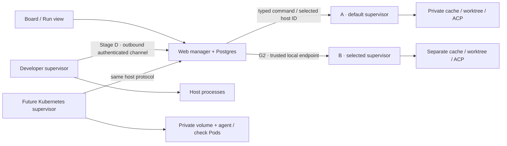
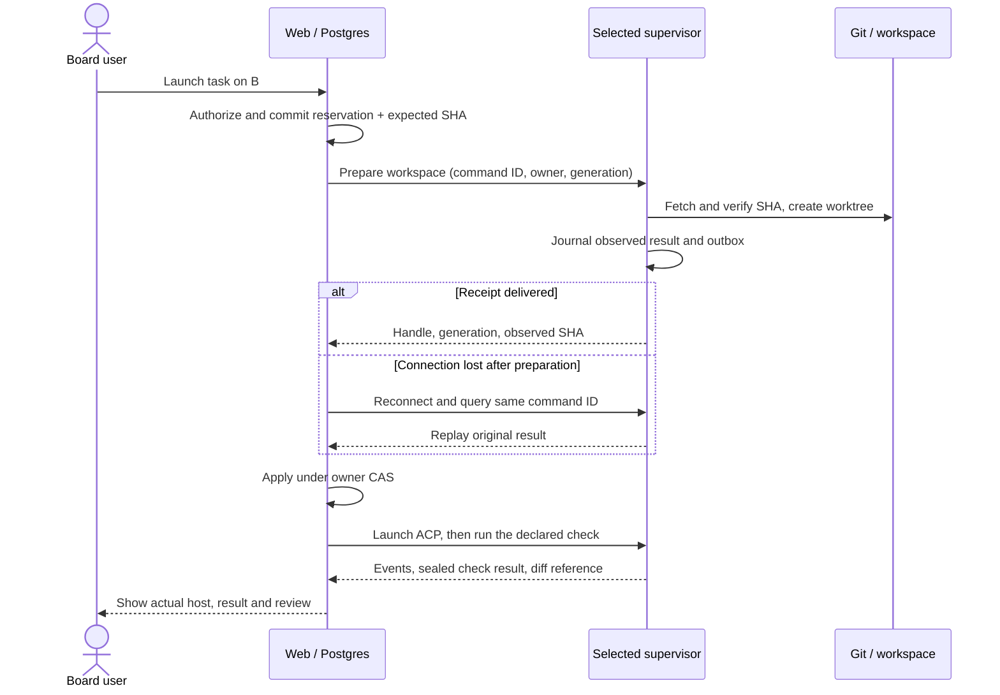

# Run board tasks on a selected supervisor

Branch `feature/stage-c-selected-supervisor` · Base `22df665aa` on local `master` · 2026-11-23 · Full-mode implementation plan. C0 is specified. Local implementation and A/B release qualification can proceed independently.

## Settings

Specification-driven delivery. Freeze the behavior and upgrade contracts in C0. Implement each behavior with RED → GREEN → REFACTOR and retain the test evidence at its checkpoint. Documentation and structured diagnostics are required.

## Roadmap linkage

Milestone [Run board tasks on a selected supervisor](../ROADMAP.md). The operator selects a host on the board, the host prepares and executes a Run, and the existing panel presents its output and diff. The first release supports one explicitly addressable host with private storage. A separately qualified pilot adds a second trusted local host. The subsequent developer-host milestone uses the same execution contracts. [Planning request](../reviews/stage-c-workspace-multihost-aif-plan-prompt.md)

## Baseline and prerequisites

Web currently resolves one global supervisor URL. The registrar can retire its prior identity on replacement. `web/lib/execution-host/placement.ts` defaults to `localHost()`, `resolver.ts` compares assignments to the local identity, and `client.ts` resolves a default transport. Event consumers already have per-host keys. Changing placement alone could send correctly attributed commands to the wrong machine. Preserve the current command IDs, request digests, assignment epochs, stable host key, per-boot identity, supervisor SQLite receipts/outbox, Web Postgres projections, opaque handles, and SSE.

Normal Flow launch creates a worktree in `web/lib/services/runs.ts` before placement. Scratch creation in `web/lib/scratch-runs/service.ts` and agent launch in `web/lib/agents/launch.ts` have distinct paths. Operational agents already have fenced preparation, generation and canonical resource identity. Supervisor adoption validates the manager-supplied real Git paths. Web runs bash for CLI/gates, resolves the MCP executable against its own installation, and still reads Git for review. The isolation branch reviewed at `4554e33ae` has scoped workload dispatch and local Git hardening. Its diagnostic/requirement-probe support and Linux isolation receipts qualify those paths only. Recheck divergence and port the relevant contracts with their tests.

Recorded A/B progress is **44/45**. S5.2/CI-R9d has a historical hosted receipt. S5.3 has local Linux distinct-user browser and binary transport evidence. The corrected 53-case Darwin isolation inventory passes locally. S5.4/C11 requires same-revision hosted release evidence. This gates Stage C rollout to a deployed instance. Local implementation, migrations on disposable or restored test stores, and G1/G2 browser qualification can proceed now. Retain the A/B release candidate and its evidence independently of Stage C branch work. [Stabilization status](stage-ab-stabilization.md#s5--isolated-lifecycle-qualification-and-final-consistency) · [Isolation qualification](s53a-linux-isolation.md) · [Original findings](../reviews/stage-ab-execution-host-audit-2026-09-05.md)

The production Chrome smoke accepts `--chrome --second-supervisor` after the
image tag. It runs two Supervisor processes on ports 7777 and 7778 with
different Linux UIDs, host keys, boot IDs, SQLite stores and workspace roots.
While both were healthy, the board admitted the Run on configured endpoint A.
The admin page and active assignment showed only A. A retained seven command
receipts for that Run and B retained zero. This establishes the singleton
placement baseline before T12. The probe uses a resumable ACP fixture.
In the extended Chrome probe, B ran in a second container with its own
network namespace and private filesystem. Disconnecting B's network
left A reachable. Reconnecting B returned the same host and boot IDs.
Evidence: `/private/tmp/maister-stage-c-isolated-endpoints-chrome.log`.

The compatibility smoke also passed on production image `810010f2c` with
Linux arm64, Node 24.22.2 and Chrome 158. Both supervisors were live before
launch. A handled the Run while B retained zero receipts. Web received
`EACCES` on A's SQLite store. Partitioning B preserved A's board, permission,
checkpoint/resume, cancellation and retained binary content cases. The
smoke uses the legacy assignment topology. Evidence is in
`/private/tmp/maister-stage-c-810010f2c-chrome.log`.

Use one production Web and two real supervisor processes on the development
machine for G2. Give each supervisor a separate network namespace, store,
process identity and private repository/workspace/runtime volumes. Web reaches
each over its own configured HTTP endpoint. Explicitly deny private volume
access from Web and the other supervisor. A per-endpoint network fault must
leave the other peer and Web available. Use the same addressed routing and
workspace protocol that the trusted two-machine configuration will use.

| A/B findings | Release evidence to attach at C0 |
|---|---|
| R01–R04 | Bounded ACP framing, pressure admission, durable restart catch-up, first-batch poison recovery |
| R05–R08 | Durable prompt owner, one terminal writer, unknown delivery after network loss, stale create ACK |
| R09–R11 | Object before HTTP response, retention while recoverable, populated historical import |
| R12–R15 | Browser content policy, current file integrity, fair retention, digest of returned range |
| R16–R17 | Real OS identity/browser lifecycle and binary transport on supported Node versions |

## Target architecture

Transport locates a supervisor. The supervisor's execution backend creates workloads. Web authorizes project access, selects the host and records immutable inputs. For C, use a small operator-configured registry of trusted local endpoints, one default host and an explicit project preference or board override. Resolve it to a specific authorized host at admission. A saved project default is evaluated for new requests. Existing queued requests retain the selected ID and selection provenance. An unavailable pinned host stays visible with its reason. Initial deployment uses existing host process execution. Choose a fresh local Git cache for each project/host and a distinct writable workspace per Run unless its parent explicitly shares one.

| Initiator → peer | Authority and durable owner | Message/result | Disconnect or duplicate |
|---|---|---|---|
| Board → Web | Authenticated actor, current project launch and host-use grants. Web owns intent | Task, preview token, optional host override and request key. Web resolves the project, host and immutable launch inputs. Response names requested host and later actual assignment | Same key/body returns original receipt after access checks, different selection conflicts |
| Web → SV | Registered endpoint and observed host key, assignment or workspace operation fence | Typed materialize/check/Git operation with reproducible request digest. SV journals acceptance and result | Query the same command ID on that host. A lost reply is an unknown outcome |
| SV → Git / runner | Host-scoped Git/adapter identity and approved credential reference. SV owns cache, workspace generation and children | Fetch pinned SHA, create worktree, launch adapter or check, stream bounded output, seal result | Reconcile journal and real Git/process state, preserve unknown or dirty workspace |
| SV → Web over event stream | Host/stream identity, durable outbox and per-stream committed cursor | Events, runtime object references, actual host/attempt/exit and Git witnesses | Replay from ACK, verify object/digest, project idempotently |
| Web → SV after Review | Current review authority, immutable workspace owner and workspace operation claim | Diff, checkpoint, sync/promotion against expected ref, archive/delete receipt | Re-read the actual target ref and retained content before deciding retry or completion |
| Agent MCP → Web | Scoped ephemeral Run token, frozen allowed tools and correct instance origin | Existing facade operations with current authorization | Clear failure when unreachable; redact credentials and keep private workspace paths local |

**Normal sequence.** Web validates the selection, commits the reservation and frozen input, dispatches materialization to B, applies B's observed SHA/handle, then releases the agent or check to run. E2E evidence includes the host-reported execution identity. Web streams progress to the board and uses the saved workspace owner for review even after assignment release.

**Failure sequence.** B accepts a command and loses its connection. Web records uncertain delivery and holds exclusive ownership. On reconnect B proves its identity/incarnation and replays the receipt and event cursor. If B restarted, inventory and the persisted journal determine completed, interrupted or indeterminate state. Require positive quiescence from the owning host before admitting another writer. Recovery of preserved content starts a new attempt with verified input.

## Contracts, state and recovery decisions

- **Identity.** Use existing project/repository authority plus an immutable source revision. Host ID + repository identity key the private cache. Host ID + canonical physical workspace incarnation key exclusion, including ancestor aliases. A workspace handle, generation, Run ID, attempt and command ID are distinct. Record requested host at intake and actual host/epoch at placement. All privileged cross-resource lookups derive from owned rows. Check grants on picker, launch, retry, read and revoke.
- **Modes.** Own worktree gets a separate branch. A shared child inherits the root's host and writer exclusion. A read-only context gets its pinned checkout and permissions. Plain directory, scratch, company and librarian paths keep their actual ownership and empty-directory semantics. A Web-local repository with no approved portable source blocks remote placement with an actionable reason. A remote Git source that cannot supply the frozen SHA also refuses; no checkout of the new branch head. Existing single-host history retains its original owner and remains readable.
- **Inputs and secrets.** Pin package, skills, instructions, context mounts, runtime capabilities and consent before dispatch. Stage verified content outside the writable worktree, then publish the verified generation. Retry, checkpoint recovery, fan-out and result collection read the frozen inputs. Carry references to host credentials. The active agent-memory vault remains central and grant-checked. Migrate a legacy file only under its existing authority and quiescence, or report that it cannot be placed on that host. Resolve MCP command and adapter home on the host.
- **Wire.** Extend the existing command envelope with versioned operations for repository fetch/materialize, workspace prepare/query, CLI/check/cancel, checkpoint/restore, Git query/sync/publish, preserve/release. Describe exact routes and schemas in C0. Every mutation uses a stable command ID, owner, fence and canonical input digest. Bound request/output sizes, object ranges, process time and storage. Keep status, structured test result and evidence bytes distinct. Queries do not grant mutation authority.
- **State transitions.** Host readiness, liveness, pressure and drain are independent. Workspace reservation progresses through preparation, ready, active use, retained review and release. A failed or interrupted preparation enters reconciliation before cleanup. Commands progress from committed intent through accepted and terminal/indeterminate receipt to applied result. Store receipt and outbox change transactionally on the host. Web ACKs the verified host after contiguous ingest and consumer scheduling commit. The independent projector applies verified results with its cursor and owner CAS.
- **Concurrency.** Lock the existing global capacity claim before checking the global budget, then lock the selected host's capacity row, then workspace root/operation claims in deterministic order. Check expected epoch/generation again at effect and result application. Use current host health to admit new work. Stale health preserves the writer claim and capacity. Require positive owning-host quiescence before explicit recovery can claim another epoch. A draining host accepts necessary cleanup/reconciliation for prior owners while refusing new placements.

| Failure or race | Enforced behavior and test witness |
|---|---|
| Host cache creation succeeds, Web transaction fails | Durable pre-effect reservation; retry adopts exactly one matching incarnation or preserves an ambiguous orphan |
| Two launches compete for one slot or shared worktree | Independent DB connections compete on the actual invariant; one reservation/writer, loser queued with reason |
| Config points at the wrong host or old binary | Check host key, incarnation, advertised protocol/capabilities before any command; mark that endpoint unavailable |
| Host-use grant revoked after preview, queue or start | Reauthorize before acceptance and dispatch. Refuse pending work, fence new commands for an active Run, use the existing cancellation path and retain ownership through quiescence. Permit narrowly scoped system reconciliation and cleanup. Check current content grants independently on every read |
| User cancels during fetch, shell or tool session | Fence further work, terminate the owned process group, wait for bounded quiescence and record partial output |
| Host push succeeds, response lost | Compare expected prior ref and observed remote head; apply the existing receipt only on verified outcome |
| Late ACK after new epoch or deleted generation | Retain original receipt and diagnostics; reject writes to current owner. Preserve data on conflicting evidence |
| Web/host restart or pressure on A | Restore each stream/cursor and host budget independently. B continues when it is eligible |
| Shared child requests a different host | Show affinity refusal before dispatch. A dirty root remains on its owner until an authorized recovery |

## Specification baseline for C0

### T01 baseline and call-site ownership

Base revision `22df665aa1e4a560965d49a6af248ad37ac71ff3`. The existing [operation-scoped inventory](../../web/lib/execution-host/__tests__/fixtures/runtime-data-boundary-inventory.ts) and [scanner](../../web/test-support/filesystem-ownership.ts) locate the individual filesystem, Git process and wrapper calls in Web routes, libraries, instrumentation and scripts. Apply the following dispositions by operand and caller. A helper such as `headCommit` or `readBlob` can serve both an execution-owned checkout and a Web-owned configuration source. Rewriting the helper alone would cross the boundary for one of its callers.

| Entry point / call site | Current effect and authority | Stage C owner and compatibility |
|---|---|---|
| `api/projects/route.ts POST` → `resolveProjectSource`, `cloneRepo`, `readRemoteOrigin`, `gitInit` | Administrator registers or initializes a Web-local project source. | Web keeps central source identity, project/config authority and existing Web-local registrations. The supervisor owns the execution cache. A Web-local source without a verified host provisioning path refuses placement. |
| `api/projects/[slug]/remotes` → `listProjectRemotes`, `addProjectRemote`, `setProjectRemoteUrl`, `removeProjectRemote`, `pushProjectRemote`, `fetchProjectRemote`, `pullProjectRemote` | Project grant scopes operations on the registered project checkout. | Keep Web configuration authority. Host caches use the approved named source and host credential profile. A cache must never become a second canonical mutable target. |
| `launchAcceptedTaskRun` / `launchRunStaged`, `launchAgentRunWithAdmission`, `launchScratchRunStaged`, `launchLocalPackageAssistantStaged`, `startAgentSession` | Flow, agent and scratch drivers resolve base/paths and can create or re-open local worktrees. This includes preparation for shared children, operational recovery and session start. | Web reserves Run, authority and frozen inputs. Host resolves the physical target, executes `resolveBaseCommit`/reachability, `addWorktree`/detached equivalents and holds the writer. Existing local history and workspace-less semantics remain readable. |
| `acceptedTaskLaunchExecution`, `assertFrozenTaskLaunchRepository`, `assertTaskLaunchMaterializationReceipt`, `assertTaskLaunchBoundWorkspace`, scheduler `scheduledTaskLaunchAttempts`, `allocateAgentRetryWorktree` | Validate the launch snapshot and use local checkout paths as preparation evidence. | Web keeps intent, idempotency and ownership CAS. Host proves physical identity and digest. Keep legacy provenance bytes versioned and reserve fresh ownership for a new attempt. |
| `workspaceSpecFor`, `loadWorkspaceSpecInput`, `ensureWorkspaceAdopted` → supervisor workspace registry | Web builds a path-bearing specification; the supervisor checks containment, Git identity and adopted handle. | Path-bearing adoption is migration-only for verified local ownership. New preparation and readback use an opaque handle and generation. Reconcile missing handles against the saved host. |
| `runCliStep` → local Bash spawn, `checkFlowRequirements`, `runOneGate`, `runMutationAssertionGate` | Web drives CLI, requirement probes, check commands and Git mutation checks in the Run workspace. | Web validates authored declarations and evaluates structured results. Supervisor checks the fence and owns cwd, process exit, cancellation, quiescence and output. |
| `resolveContextMounts`, `materializeContextMounts`, `materializeOperationalContextMounts`, `releaseContextMounts` | Web checks context grants, creates mounted checkouts and releases them. | Web keeps grant and consent. Host materializes the authorized read-only commit and owns disposal for its mount. |
| `captureTaskAgentPackage`, `prepareTaskLaunchFlowAssets`, `packageSkillMaterializationRoots`, `materializeProjectBundlesIntoWorktree`, `materializeCapabilityProfile`, `ensureWorktreeGitExclude`, `agentFacadeMcpServer` | Manager selects package/skills, copies/writes project-specific content, and resolves a facade executable in its installation. | Web keeps approved package discovery, configuration and captured content. Host stages verified bytes, writes worktree content and resolves its own facade, adapter home and executable. Apply the same split to `resolveAgentMemoryForLaunch` and `applyAgentMemoryForLaunch` with vault authority kept centrally. |
| `captureWorkspaceTree`, `captureCheckpoint`, `restoreNodeCheckpoint`, `applyWorkspacePolicy`, `deleteRunCheckpointRefs`, `resolveArtifactContent`, takeover claim/return | Web opens Git, workspace paths and some artifact bytes under Run/read or takeover authority. | Supervisor proves the workspace generation and seals execution-produced bytes. Web authorizes reads by project and data class, presents review policy and retains manager-authored inline content. Takeover preserves the original host binding. |
| `syncRunTarget`, `prepareSyncResolver`, `resolvePromotionTarget`, `promoteRun`, `finalizeParkedPullRequest`, `inspectDeliveryBase` | Run/review grants and existing claims drive Git reads, delivery-base comparison, merge, rebase, ref updates and provider publication. | Web keeps policy, exact target and durable Git operation claims. Host owns physical Git effects and readback. Preserve the retained workspace owner through assignment release. |
| `runRepoDeliveryScanJob`, `runReconcileSweep`, `checkWorkspaceHandles`, `observeCliDriver`, `recoverOrphanSharedTrees` | Scheduler reads repository history and inspects driver, workspace and descendant state. | Web keeps analytics projection and reconciler decisions. Git history comes from the declared source owner. A live Run gets process/handle/reconciliation evidence from its selected host. Web inspection survives for its own children and pre-cutover records only. |
| `archiveWorkbench`, `snapshotWorkbenchCommit`, `createWorkbenchHandoffBranch`, `dropWorkbench`, `runWorkspaceGcSweep`, `runWorkspaceReconciliationSweep`, `cleanupTaskLaunchPreparation` | Web claims lifecycle actions and physically preserves or deletes paths/refs, including orphans. | Web owns lifecycle and collection authorization. Host applies its own generation fence and supplies preservation and disposal receipts. Ambiguous legacy ownership becomes a finding before any delete. |
| Instrumentation, package/config scripts, `project-config-persistence` and legacy import | Instrumentation starts projections and recovery. Project configuration publishes under its own reviewed authority. Operator tools may inspect legacy roots with explicit lifetimes. | Preserve Web-owned projections, build tooling and its reviewed configuration source. Do not use operator migration rights in the live execution path. Classify newly addressed calls with the existing call-site scanner. |

| Base check | Evidence and limitation |
|---|---|
| Browser regression | `pnpm --filter maister-web test:e2e:execution-ab`, Darwin arm64, Node 24.15.0. Production Web build, real supervisor with deterministic ACP fixture, PostgreSQL in a disposable container. All six tests passed and process sweep reported zero leaks. The browser fixture shares the worktrees root. |
| Hosted CI | [CI run 45222613398](https://github.com/maister-dev/maister/actions/runs/45222613398) failed on the exact base SHA. A/B Web shards, A/B runtime and supervisor on Node 24/26, and isolation parts 1 and 3 passed. Isolation part 2 and its combined gate failed. Both Web unit jobs were red, so the Node 26 browser step did not run. |
| R01–R08 and R09–R15 | Use the existing [finding-to-test map](stage-ab-stabilization.md#final-acceptance-matrix) and S1–S4 checkpoints for the original witnesses. Keep the original revision and topology on each receipt. Apply any current-candidate failures to the A/B gate. |
| R16 and R17 | The A/B isolation and runtime evidence is platform-scoped. The browser lane above and the native Linux driver qualification are separate witnesses. Both deployed units in `deploy/` declare `User=maister`. The base revision predates the S5.3 browser witness and final S5.4/C11 acceptance. |
| Existing isolated lifecycle | `pnpm --filter maister-web test:integration:isolation --part 2/3`, Darwin arm64, Node 24.15.0. I1–I4 passed. D3 timed out waiting for a successor to apply the projection without another event. D1 exceeded its five-minute case budget. The shard exited 1. Exact case results are in `/private/tmp/maister-stage-c-base-22df665aa/maister-ab-isolation-Lgh9xr/vitest.json`. |
| Distinct-user filesystem control | Disposable Linux arm64 container, fixture UIDs 999 and 65534. Real mode-0700 private roots allowed reads by the owner and returned permission denied to the other UID for repository, workspace and runtime sentinels. This proves the filesystem control. The separate-user application deployment still needs qualification. |
| Scratch launch under a denied repository | Reused the production I1–I4 harness on Darwin arm64 and added `worktreesRoot` and `repo` to the first Web boot's kernel denied roots. I1 passed. Authenticated `POST /api/scratch-runs` failed in I2 at base revision resolution with `PRECONDITION`, before any supervisor checkout. The same case passed with the original shared root. The one-off fixture change was restored. Retain full board-to-build qualification as the C-12 witness. |
| Board Flow launch RED | Ran the existing `launchFlowThroughHttp` path in the same production fixture with a seeded Flow containing a CLI build node. Authentication and I1 passed. The board's `GET /api/runs/launch-options` returned 409 `CONFLICT` because the Web Git subprocess could not read its current working directory. No launch was accepted and no build ran. Restored the fixture after capturing the failing result. |
| Ownership inventory regression | The base failed the existing exported-wrapper invariant because `inspectDeliveryBase` was absent. Added it to the repository-worktree inventory. The unchanged nine-case suite passed on Node 24.15.0 and 26.13.1 after the correction. |

The ownership decision is recorded in [ADR-218](../../docs/decisions/adr-218.md). The [designed protocol](../../docs/system-analytics/execution-hosts.md#selected-supervisor-stage-c-designed) records host negotiation, operations, refusals and paired storage constraints. The [v1 schema profile](../../docs/api/stage-c-workspace.schema.yaml) and [examples](../../docs/api/stage-c-workspace-examples.yaml) are verified by `pnpm validate:contracts`. The harness covers 28 operations, strict requests, typed refusals, original acceptance and exact terminal readback, target-bound replay, settings CAS and host event identity. `pnpm validate:docs:all` checks the design links and the unchanged current ERD. Deployment effect, admission and real acceptor parity are tested with each implementation task.

### API and event contracts

| Surface to specify | Contract to freeze before implementation |
|---|---|
| Web board, API and facade | Extend `GET /api/task-launch-intents/options` and the Flow preview `GET /api/runs/launch-options` with authorized host choices, default and settings token. Extend the existing intent create/concurrent, read, replace and cancel operations in `docs/api/web.openapi.yaml`. Accept an optional stable host ID on launch. Resolve authority from the authenticated principal and scoped task, and include the normalized explicit selection in the request digest. Absence of an override resolves once on first acceptance. Preserve existing idempotent replay when the default later changes. Freeze the effective selection, provenance, and approved source identity in the intent. Return the actual host/epoch only once assigned. Keep current 202 acceptance, typed conflicts, origin checks and indistinguishable missing/inaccessible task responses. Update strict runtime schemas, generated task-launch JSON Schema, and all consumers together. |
| Supervisor bootstrap and checkout | Use existing health/capability negotiation before dispatch. Propose `POST /v1/workspaces/prepare` for a durable operation that fetches the approved revision into a private cache and materializes the requested mode. A request carries a version, command ID, Run/assignment fence, repository identity, exact commit, mode, immutable input digest and optional owned parent handle. The supervisor resolves approved Git source and credential profiles. It returns an opaque handle, generation, actual commit where applicable and digest through the receipt. Preserve `POST /workspaces/adopt` for verified legacy local adoption during cutover. A missing handle during recovery requires ownership reconciliation. |
| Supervisor execution, Git and retention | Freeze method, route, operation ID, payload/result discriminant and owner in the designed workspace profile, linked from `docs/api/supervisor.openapi.yaml`. Use the negotiated `/v1` namespace for addressed Git, lifecycle and command receipts. Keep existing workspace head, session checkpoint/cancel and runtime-object surfaces where their semantics match. Give long-running checks an accepted command plus a terminal outcome containing exit/signal, timeout/cancel state, structured result validity and sealed output references. Keep Git restore scoped to a workspace generation and ACP resume scoped to its original session/host. Terminal Git/GC uses the workspace-operation claim described below. |
| Progress, results and disclosure | Specify host stream identity, event version, cursor and command/attempt correlation in `docs/api/async/execution-host-events.asyncapi.yaml`, and the board-visible projection in `docs/api/async/web-runs.asyncapi.yaml` or the existing owning stream for that event. ACK after contiguous ingest and consumer scheduling commit. Owner projection is independent. Use `GET /v1/commands/{commandId}` on the selected host to resolve an unknown reply. The canonical event and receipt must agree before applying results. An unknown or corrupt event follows existing A/B retention and repair policy. Read large outputs through authorized bounded runtime-object ranges with the digest of the returned bytes. |

For each operation put executable success, refusal and replay examples alongside the spec. State which IDs come from the URL, identity, stored owner or body. Specify exact bounds for bytes, range, time, retention and retries, the HTTP status, existing typed error code and bounded reason for each refusal, and whether any durable change is allowed. Cover mismatched host, epoch or digest, unsupported version, inaccessible resource, expired claim, missing SHA, invalid path/ref/tool, truncated output and lost reply. Path and ref validation, argument construction and credential selection stay with the trusted owner. Public receipts contain only authorized identifiers and evidence. Check runtime validation against the same examples on the real HTTP route. Use the existing fake peer for consumer compatibility.

### Storage contracts and cutover

Reserve PostgreSQL 0370 and SQLite 19 for the G1 expansion. Assign the
G2 singleton-index replacement after the G1 migration on the current merge
tip. Check the final journal and SQLite upgrade chain before generating SQL.

| Store and owner | Required migration and qualification |
|---|---|
| Web / PostgreSQL | Begin at the actual merge tip (review baseline 0369). Extend Drizzle host/project eligibility, launch intent selection and workspace ownership. Reference durable host rows with restrictive deletion for retained ownership. Preserve the unique host key and one active assignment per Run. Keep the singleton local-host constraint through G1. In G2 replace it with uniqueness for the live default and operator-configured identity. Index host/status and the claim/recovery predicates used by workers. Verify constraints with competing transactions on independent connections. |
| Workspace and historical data / PostgreSQL | Today `workspaces.worktree_path` is globally unique and required, `parent_repo_path` is required, and existing preparation witnesses can contain absolute paths. Expand with a tagged host-owned form (host ID, opaque handle, incarnation/generation) and a legacy form; establish checks for valid combinations and owner-scoped uniqueness. Reserve logical workspace ownership before a handle exists. Allow identical private paths on different hosts and enforce writer exclusion on the canonical physical root within a host, including aliases and shared children. Inventory project path, scheduled launch, intent preparation and history readers. Keep legacy bytes readable and version new writes. Never synthesize placeholder paths. |
| Supervisor / private SQLite | Baseline `supervisor/src/host-state.ts` uses `PRAGMA user_version = 18`. Extend the existing ordered upgrade chain and fresh-schema path. Migrate handles, materialization identities, generation/fence and command receipt/outbox state in transactional steps with version advancement in the same commit. Preserve host key, receipt tombstones, cursor and uncertain effects. Test a populated v18 store, failure inside migration followed by reopen, a fresh store, and an older reader facing a newer version. Reopening the migrated store preserves the same identities and outcomes. |

**Rollout order.** Expand schema and readers while old-mode writers still serve one host. Backfill only from an unambiguous host identity and verified ownership under a drained or fenced writer. Preserve ambiguous and retired history with a typed repair finding. Block affected mutations until ownership is proved. Validate constraints, row counts, links and representative retained content, then activate the new writer. Enable a second descriptor only after every active manager writer supports addressed routing and the singleton registrar is fenced. Retire obsolete constraints/read-write paths only after the compatibility gate. Record generated SQL, snapshot and journal, update `docs/db/execution-hosts-domain.md`, `docs/db/task-launch-domain.md`, `docs/database-schema.md` and `docs/db/erd.dbml`. Recheck numbers at merge time.

**Upgrade and recovery tests.** Exercise both supervisor-first and Web-first deployments. During mixed versions continue the compatible local mode or return a typed unavailable reason for the requested new operation before effects. Take a coordinated backup of Postgres, each supervisor store and its corresponding Git/workspace/runtime data under quiescence. Restore into isolated roots and verify the host key, outstanding commands, assignments, retained Review and dirty work before admitting writes. After the new format or a second owner is active, refuse incompatible writers. Recover through roll-forward or a verified coordinated restore after reconciling any external Git publication.

### Reservation and ownership transitions

1. Accept the authorized launch intent and freeze the host and inputs. When the request names a mutable ref, obtain its exact commit from an authorized read-only source observation on the selected host or an existing immutable source receipt. Define the observation operation in C0. Persist the resolved commit separately from the caller’s idempotency digest. If the source cannot be resolved, expose the admission refusal before checkout. Replays retrieve the original selection after current access checks. A shared child inherits the root host; a conflicting explicit override refuses before dispatch. For independent work use the authorized override, project default, then configured default. A pinned unavailable host stays pending with a reason. A revoked or ineligible selection requires explicit correction.
2. At dispatch, recheck authority and capacity. Commit the real Run, assignment and epoch, preparation claim, frozen source and stable command intent in one PostgreSQL transaction before the first host mutation. Extend existing admission paths for Flow, agent and scratch. The existing command ledger requires a Run and assignment. Use a durable preparing state or preparation predicate respected by every driver, UI projection, cancel handler and recovery worker. Dispatch and model spawn become eligible only at their respective boundaries. On preparation failure keep the admitted attempt and diagnostic, and release its capacity only after quiescence. Queued intent acceptance alone allocates no worktree.
3. Resolve the committed host ID, verify the configured identity and protocol, then send the original command outside the transaction. The supervisor journals acceptance before Git, validates its fence at effect time, and persists the observed handle/generation, receipt and event at completion. Recover a crash between Git and journal completion by inspecting the exact physical incarnation. Web applies the result once under the original owner/epoch and preparation generation. If ownership cannot be proved, retain the workspace for reconciliation. Only successful application enables the next launch stage.
4. After Run assignment release, derive authority from the retained workspace and the current lifecycle-operation claim. The operation record/receipt must identify its workspace owner, generation, fence, actor and authorized target. Keep historical assignment provenance. Specify the tagged owner and its constraints for terminal commands in C0 so cleanup needs no new active assignment. A publish reply lost after a remote write requires comparison to the intended ref and commit. Unresolved ownership or publication blocks destructive cleanup.

## Implementation tasks and commit plan

For each implementation slice, select a requirement and its primary scenario from the matrix below. **RED:** run it through the production entry point before the fix and capture the failing assertion, expected/actual observation, command and revision. A setup failure does not establish RED. **GREEN:** implement the smallest change that satisfies the frozen spec and rerun the same test. **REFACTOR:** review ownership, strict typing and duplication against SOLID, KISS, DRY and the repository conventions. Simplify within the touched boundary where justified, then rerun the primary test and adjacent suites even if the GREEN implementation is retained. Record evidence by requirement ID. If the desired behavior changes, amend the specification and its failing example before changing production behavior.

Log structured IDs, generation, outcome, measured size/duration and typed refusal reason. INFO records transitions, DEBUG explains selection, WARN records recoverable degradation, ERROR records uncertain effects requiring intervention. Exclude raw credentials, source, private paths and prompt bodies.

### C0 — specifications and prerequisite inventory

- [x] **T01 · Platform / prerequisites.** Reconcile R01–R17 and the two remaining stabilization gates above against current release evidence. Establish baseline for local launch, resume, cancellation and review. Produce a per-function ownership inventory of the paths named in the planning request, including scripts, route/actions, scheduler, package discovery and human takeover. For each record authority, caller, effect, desired owner and compatibility read path. Build the distinct-user fixture. Prove the OS denies a direct private-root read by Web and permits the supervisor. Capture the current board-to-build failure under that fixture for the later G1 test. Record bounded denial reasons.
- [x] **T02 · Architecture / contracts (after T01 inventory).** Deliver the C0 specification baseline above. In the owning analytics document for each requirement, record preconditions, transition, authority, persisted effects, refusal and repair for each reachable mode. Cross-link its API operation/event, DB invariant and primary test. Close open decisions on endpoint names, ownership tags, version negotiation and bounds. Check examples against current routes and consumers. Assign ADR and migration numbers against the merge tip. Exit C0 when every row is specified and its failing behavior can be exercised.
- [x] **T03 · Web storage / PostgreSQL (after T02).** Implement the G1 PostgreSQL expansion and compatibility cutover specified above. Use a populated pre-upgrade fixture containing a running task, retired host, retained Review, ambiguous legacy owner and queued intent. Check constraints, recoverability, actionable refusals and preservation of immutable bytes. T12 owns the second-host constraint replacement.
- [x] **T03S · Host storage / SQLite (after T02).** Implement and exercise the SQLite upgrade contract against real files, including interrupted migration and a newer unsupported store. Confirm fresh and upgraded stores accept the same protocol and recover the same command outcome. **Checkpoint 1** requires T03 and T03S plus the C0 specifications and independent topology fixture.

#### Storage checkpoint evidence

Ran on Darwin arm64 with Node 24.15.0. The RED candidate was
`4584befdc`. The GREEN candidate is the commit containing this checkpoint.

| Requirement | RED | GREEN and regression checks |
|---|---|---|
| C-02 | Populated `0369` rejects the pathless reservation because the ownership columns do not exist. | `pnpm --filter maister-web exec vitest run --project integration lib/db/__tests__/stage-c-workspace-ownership.integration.test.ts lib/db/__tests__/migration-task-launch-admission.integration.test.ts lib/execution-host/__tests__/adoption.integration.test.ts` passed 16 cases on PostgreSQL. Covers preservation, ambiguous-owner repair finding, exact assignment and host constraints, competing reservations, and idempotent real legacy adoption. |
| C-03 | The old store accepts an interrupted-upgrade fixture and a newer schema without rejecting them. | `pnpm --filter @maister/supervisor exec vitest run --project integration` with the host identity, command receipts, runtime event outbox, runtime objects, runtime storage, and inventory suites passed 110 cases. The v18 test rolls back a partial upgrade, retries it, reopens twice, and compares retained identity, handle, fence, receipt and cursor. The newer-version test compares SQLite state before and after refused startup. |

Both package typechecks, `pnpm validate:contracts`, and
`pnpm validate:docs:all` passed with regenerated ERD. Legacy readers now
require actual paths before entering filesystem operations. The checkpoint
qualifies the storage shapes and compatibility readers. The addressed writer
and its real HTTP command outcomes are qualified in T04–T05H.

### C1–C2 — host owns the work

- [x] **T04 · Transport / one addressed host (after T03 and T03S).** Extend registrar, resolver and client to resolve the persisted ID to the configured endpoint and check the observed stable host key and protocol before sending an effect. Keep assignment recovery addressed to the same identity across boots. Substitute a different real supervisor at that endpoint and verify zero mutation requests, preparations or children there. Exercise a same-key restart and a capability mismatch. T12 extends this working path to two descriptors.

  **C-04 evidence.** RED at `91893f602` reached command delivery against
  the replaced endpoint via a cached identity. GREEN on Darwin arm64,
  Node 24.15.0 used two real supervisor processes and one proxy endpoint.
  The incompatible outer version, missing durable capability, and wrong
  host key admitted no mutation. A wrong peer also refused a receipt read
  after a valid binding. Reopening the same SQLite store returned the exact
  receipt and retained the assignment under a new boot. The Web registrar
  and adoption integration suites passed 18 cases, and the supervisor
  capability, receipt and identity suites passed 51. Both typechecks,
  contracts and documentation validation passed. T05H negotiates the
  separate workspace protocol when its addressed command is available.
- [x] **T05 · Web / reservation before effects (after T04).** Convert Flow, agent and scratch creation in `web/lib/services/runs.ts`, `web/lib/agents/launch.ts`, `web/lib/scratch-runs/service.ts` and `web/lib/execution-host/adoption.ts` using the reservation sequence above. Reuse preparation-resource, ownership and workspace claims. Stop the worker after commit and before delivery. The same durable command remains recoverable, no ACP session is eligible, and a retried intent finds exactly one admitted Run. Exercise a transaction rollback and verify no host request.

  **C-05 evidence.** RED on `2f2d4f286` exercised the existing launch entry
  points. Flow and Agent committed legacy worktree paths and Scratch
  reached Running. The addressed capability fixture accepts a pathless
  reservation and leaves the command queued. Two PostgreSQL workers race
  one accepted Flow intent, re-read the same Run and exact command, and
  verify the scheduler leaves it Pending. A trigger abort after command
  insert rolls the Flow reservation back. Agent and Scratch cover their
  separate transactional entry points. Scratch observes zero adoption
  or model children. Ran the three launch-path, agent-worktree-modes and
  scratch-placement integration suites on Darwin arm64, Node 24.15.0
  with PostgreSQL and disposable Git repos. All 48 cases passed. The
  checkout consumer and recovery across the HTTP boundary are T05H.

  The board dispatcher preserves a bound Pending intent when its legacy
  project path is inaccessible and the supervisor is still preparing it.
  RED moved the intent to Held on the manager's repository lock. GREEN
  bypassed that lock for the host-owned reservation. Bound checkout
  validation reads the selected host's live handle and exact base commit.
  The launch-path and real-host suites passed 16 cases and Web typecheck.
  Capture before the initial board reservation and the graph driver still
  require the G1 filesystem-denial test.
- [x] **T05H · Supervisor / checkout and recovery (after T05).** Implement fetch-at-SHA, preparation and Web result application against the reserved owner. Verify Git origin, SHA, canonical root and workspace mode. Serialize cache writes and workspace writers, and guard the apply with owner/epoch/generation CAS. Drop the reply after real Git preparation, restart Web and prove one incarnation and one applied result. A moved ref, unavailable SHA, failed DB apply, alias or child affinity conflict cannot overwrite the first Run’s dirty work. Exercise plain, shared, read-only and empty modes through their actual entry points.

  **C-06 evidence.** RED on `fedd22bf6` returned 404 for the approved
  revision observation. GREEN on Darwin arm64 and Node 24.15.0 used
  real Git, file-backed SQLite, and PostgreSQL. Supervisor HTTP cases
  replayed an acceptance and exact receipt after a same-key restart,
  checked out the original SHA after upstream advanced, and preserved
  the first checkout's edits when allocating the new SHA. They exercised
  all workspace modes plus a stale shared generation, a second directory
  owner, an escaped alias and a missing commit. Real Web ingestion
  ACKed a terminal event after the accepted reply was lost. A forced
  PostgreSQL rollback left the workspace unbound. A fresh Web worker
  process applied the original event and receipt once. The 53 Web and
  52 supervisor integration cases cover these boundaries and adjacent
  regressions. Workspace inputs and session permission enforcement are T06.
- [ ] **T06 · Inputs / host materialization (after T05H).** Move execution-dependent writes from `context-mounts/service.ts`, `capabilities/materialize.ts` and `materialize-bundle.ts` behind the host contract. Verify revision/content hashes, enforce read-only mounts and inter-project access. Keep vault reads under current grants. Resolve MCP facade executable and runtime credentials on B with the correct Web base URL. Prove a pinned package survives an install update and a revoked grant cannot start work. Log digests and capability IDs.

  **C-07 capture and transport checkpoint.** On Darwin arm64 and Node
  24.15.0 the RED host test received 404 for materialization. A second
  RED against real PostgreSQL and the supervisor found no recoverable
  input command after the package source changed. GREEN reserves the
  input bytes with the Run, rechecks current authority, transfers the
  original bytes and derives the generation from the durable event
  and receipt. A revoked project prevents delivery. The supervisor
  rejects altered references, detects altered retained bytes before
  spawn, and replays its original receipt. The recording ACP fixture
  verified the host-local facade command, expected Web origin and
  scoped token fields. The 53 Web and 22 supervisor integration cases
  cover this boundary and adjacent regressions.

  **C-07 context, package and vault checkpoint.** Separate RED checks
  found a missing sibling checkout, missing packaged skill instructions
  on the ACP wire, and an unrelated ambient secret in the adapter child.
  GREEN with real Git, PostgreSQL, the selected supervisor and local ACP
  fixtures verified that the branch can advance while the host keeps its
  pinned sibling commit. Revoking the Flow's sibling membership blocks
  delivery before any input command. The selected session receives its
  context with file write bits cleared and the ACP write guard armed, and
  its first prompt carries the sealed skill path. An actual facade
  subprocess called the manager's vault route under the bound Run
  token. The same token received `agent_memory_disabled` after the
  current attachment changed. The 29 Web and 22 supervisor integration
  cases, both typechecks and the contract and docs validators passed.
  Host-side persistence of per-node adapter settings still requires evidence.

  An independent project Flow can now create an ACP session for a Codex node
  with standard settings using its addressed workspace. RED failed at the
  manager-path materializer before session creation. GREEN used the regular
  board intake, then a local ACP fixture wrote a marker inside the host
  checkout. The next CLI action read that marker, the gate passed and the
  Run reached Review after a driver restart. Passed 45 Web integrations and
  the Web typecheck. Per-node native settings, role-bound materialization
  and OS-level read-only context enforcement remain open.

  A capability-bearing Codex node now uses the legacy redacted profile and
  instructions format without writing them into a Web-side checkout. RED
  failed the node before ACP spawn at the workspace-path requirement. GREEN
  read the two assignment-owned objects from the real fixture process and
  completed the board Flow. The existing capability materialization and
  enforcement integration suites ran alongside that scenario (nine cases).
  The filesystem ownership inventory classifies the manager's package
  capture, launcher discovery and one-time database repair (37 focused
  unit tests passed). Web typecheck and full docs validation passed.
  A Claude model-only node can now start on the addressed supervisor. RED
  failed before ACP creation because it required a native settings file.
  GREEN received the pinned model in the real fixture's ACP launch options
  and child environment, read the sealed profile, edited the checkout and
  reached Review. Four addressed Web and seven supervisor model integration
  cases passed. Native permissions and path-guard settings files still
  refuse explicitly before spawn.
- [ ] **T07 · Flow / command execution (after T06).** Migrate CLI, command-check, requirement probe, setup and cancellation call sites in `web/lib/flows/runner-cli.ts`, `requirements-check.ts` and `graph/gates-exec.ts`. Host owns process group, cwd, environment allow-list and limits. Deliver declared output through `graph/node-output.ts` and runtime objects. Test filtered env, timeout, partial output, death before/after acceptance and wrong epoch. A real project check executes on B and Web can read the result without opening its filesystem. Log process ownership, exit and object reference. **Checkpoint 2:** remote filesystem boundary for checkout, inputs and execution.

  **C-08 workload transport checkpoint.** RED reached a 404 when a
  prepared local supervisor was asked to execute a sealed declaration.
  GREEN uses the host's gated process group and accepts only the
  retained declaration under its workspace generation. Web reserves the
  same workload ID on retry and reads the actual sealed check stdout
  through the catalogue and object API. The supervisor cases cover
  filtered environment, nonzero exit with malformed JSON, timeout and
  cancellation with retained partial stdout and proved group retirement.
  Tested with Darwin arm64, Node 24.15.0, real PostgreSQL, SQLite and a
  local supervisor. Passed 19 Web and 51 supervisor integration tests,
  both typechecks, the contract suite and docs/ERD validation. The main
  Flow drivers remain open.

  A later supervisor regression run caught the child `close` arriving
  before the descendant group retired on Darwin. The workload now waits
  for bounded OS proof and retains the uncertain fence if proof is still
  missing. Passed 12 real supervisor workspace and process ownership cases.

  **C-08 templated workload checkpoint.** RED refused a board Flow command
  containing task and environment tokens. A first replay attempt also showed
  that recomputing the context after driver replacement changed the command
  digest. GREEN retained the original sealed context reference, rendered the
  frozen declaration with the host's allow-listed environment and reused the
  command after driver replacement. The same graph consumed the JSON result
  and reached Review. A separate real-host check refused an oversized render
  before its effect marker appeared. Passed 31 Web and 10 supervisor
  integrations, 44 template/context tests, both typechecks, contracts and
  docs/ERD.

  **C-08 pre-delivery cancellation checkpoint.** RED refused Stop before
  the target workload reached its host. SQLite 21 now commits the cancellation
  fence and acceptance together. GREEN refused late delivery with no shell
  marker, then repeated that refusal after receipt compaction and supervisor
  restart. The same fixture still covers cancellation after process acceptance.
  Passed 53 supervisor integrations including populated migration and retained
  command cases, plus supervisor typecheck.

  **C-08 Web Stop checkpoint.** RED returned 503 from the pathless Run's
  operator action while a real workload group was active. PostgreSQL 0377
  retains the operator and exact assignment and fences subsequent execution.
  GREEN cancelled that live group, fenced a second undelivered workload and
  entered Review after canonical retirement. The supervisor ledger had no
  receipt or process for the undelivered command. A populated migration
  fixture retained the prior assignments and held the first Stop actor
  immutable. Passed 14 Web integrations across the workspace and driver
  suites, a focused accepted/undelivered rerun, six migration cases and Web
  typecheck. Coordinated child retirement and a production Chrome Stop are
  still required for the full delivery scope.

  The selected supervisor also captures a declared `MAISTER_OUTPUT_FILE`
  as a bounded, digest-verified runtime object. The real Web/host fixture
  read the result through the graph output parser and verified the separate
  stdout object. That integration and three focused supervisor cases passed
  with both workspace typechecks.

  The task-to-Run transaction now freezes the compiled Flow's requirement,
  CLI and command-check declarations alongside the other inputs. The C-05
  fixture failed on the missing declaration file before the change and
  passes with the exact probe and gate command bytes captured.

  Migration `0375` holds scheduler and session admission until the frozen
  requirement probes settle in order. RED showed a materialized Run becoming
  ready before any probe. GREEN drove a real `node --version` probe and an
  exit-42 case on the selected supervisor. Applied success opened dispatch.
  Applied failure released the assignment after proved group retirement and
  retained the workspace. The supervisor also refused a stale epoch before
  storing a receipt and truncated a real oversized stream. Passed 16 Web and
  26 supervisor integrations, both typechecks, contracts and docs/ERD.

  In the process-restart fixture a restart before admission left the command
  queued, and a restart after the shell had written its marker found the
  original process group still active. RED terminalized the accepted receipt
  too early. GREEN kept the receipt open, then projected one interrupted
  result after the native group retired. One marker write and one ledger
  admission attempt survived both restarts. Passed 16 Web and 26 supervisor
  integration cases and both typechecks.

  The CLI action now accepts an addressed workload with a stable operation
  key and reads its structured result and streams through the authenticated
  runtime object catalogue. RED ran the fixture shell on Web and lost the
  declared output. GREEN ran on the supervisor, read the sealed JSON and
  left no output file on Web. The same fixture verifies that a quiet accepted
  command stays under receipt recovery without tripping the event stream
  silence detector. Passed 25 Web tests and the Web typecheck.

  The ordinary graph driver now runs CLI/check actions and command-check
  gates through the selected workspace. RED stopped at a path-only workspace
  lookup. A second RED exposed a missing attempt assignment after driver
  withdrawal. GREEN reused the original command after changing drivers,
  executed the gate against the marker in the same checkout, kept one
  admission and one node attempt, and reached Review. Passed 52 Web
  integrations, the Web typecheck, the full docs validator and ERD.

  A literal action referencing `MAISTER_FLOW_DIR` now runs the executable
  script captured at workspace reservation. RED reached the previous CLI
  refusal without a workload command. GREEN replaced the installed script
  after reservation and still ran the original script on the owning host,
  using the ACP edit as input and reaching Review after driver recovery.
  The host verifies each file and mode before copying it into the private
  command directory. Passed three Web and three supervisor integrations
  on Darwin arm64 with Node 24.15.0, both workspace typechecks, contracts
  and the full docs validator. Setup, rendered templates and operator
  cancellation remain open.

  Production Chrome on `92ef552bf` selected and bound the private-repository
  Run but timed out awaiting Review. The fresh prepare command skipped the
  first scheduler sweep as in-flight, and the bound worker repeatedly tried
  to admit the Run while preparation was incomplete. The accepted-launch
  and Flow drivers now deliver new commands through the normal ledger claim.
  The scheduler checks preparation readiness before attempting admission.
  The real board fixture and driver-restart scenario pass without invoking
  manual command recovery for fresh prepare/materialize/action/check.
  Command-recovery and launch-intent integration suites also pass (47
  focused cases across the runs). The in-flight recovery grace and receipt
  application still govern any uncertain delivery.

  Production Chrome on `d5a4a6aed` captured a zero-exit supervisor process
  group and three sealed output objects after real typecheck and Next build.
  RED then failed at graph output validation because action completion
  replaced the host result with an absent Web-side file. GREEN retains
  the sealed JSON in the graph completion record and drives the verified
  result through recovery, the gate and Review. Ten integration cases
  passed, including the existing local output path.

### C3–C4 — review, board and single-host qualification

- [x] **T08 · Git / review (after T07 provides sealed evidence and T05H provides owned handles).** Move status/diff/log, mutation detection, Git checkpoint and restore behind the handle. Cover `flows/graph/workspace-checkpoint.ts`, `artifact-content.ts`, board diff readers and human takeover. Scope read authorization to the content returned. Verify dirty and detached states, bounded diff ranges, authorized read and denied cross-project read. Preserve ACP checkpoint separately. Log expected/actual commit and evidence ID.

  **C-09 status checkpoint.** RED returned 404 for the addressed status
  route. GREEN observed clean and dirty detached checkouts on the same
  retained handle, rejected a stale generation and preserved the dirty
  checkout through a populated SQLite v19 to v20 upgrade. The manager
  read the pathless Run's status through its configured transport. Passed
  26 supervisor and one PostgreSQL/Web integration case, both typechecks,
  and docs/ERD validation.

  The existing Run Git panel now reads this status through its member-level
  API. RED reported no worktree and no HEAD for the prepared remote Run.
  GREEN returned the exact commit and detached/clean state without private
  paths. The 14 Web cases include the real supervisor and existing legacy
  route coverage. Web typecheck and OpenAPI validation passed. Browser
  display qualification is part of G1.

  **C-09 diff checkpoint.** The supervisor seals the exact bytes of a
  bounded patch for the prepared handle and reachable commit range. Working
  tree diffs include untracked files through a temporary index. RED returned
  404 before the host route existed. GREEN verified the exact SHA-256,
  preserved the live index, refused a different range and rejected a patch
  above 64 KiB. The existing Web route projected the sealed object and
  returned the patch after current repository authorization. A foreign Run
  could not address the object. Revoking membership while the second request
  awaited projection caused a 403 with zero diff bytes returned.
  Passed 38 Web integrations, 16 route cases, 24 supervisor integrations,
  both typechecks, contracts and docs/ERD validation.

  Production Chrome on `7f9f3f2f0` reached Review. Its subsequent diff
  request received a host object, but Web ingested the event as `stale_epoch`
  because the assignment was already released. The shared ingest and
  catalogue check now require the exact retained host, handle, generation
  and preparation assignment. The split integration reads the authorized
  patch after release and still refuses a foreign Run and a revoked reader.
  Passed three focused integrations, 48 ingress and object-lifecycle
  cases, and Web typecheck.

  **C-09 history checkpoint.** RED returned 404 from the addressed log
  operation for an owned two-commit checkout. GREEN followed two sealed
  pages, verified content digests, refused cursors after a HEAD change or
  on another handle, and refused a page above 64 KiB. The Web Run endpoint
  returned projected history after assignment release and refused a reader
  whose repository grant had been revoked. Passed one focused supervisor
  and four Web integrations, both typechecks, contracts and docs/ERD.

  **C-09 Git checkpoint and restore.** RED returned 404 from the owned
  checkpoint operation. GREEN captured tracked and untracked changes on the
  detached checkout, restored their original bytes and preserved edits made
  after the first restore when replayed on the restarted supervisor. The
  pathless board Graph records the host checkpoint before its first opted-in
  ACP attempt. A separate real manager/host journey verifies canonical
  checkpoint and restore projection. The populated PostgreSQL 0378 upgrade
  keeps existing command bytes and verifies current-generation ownership,
  completed checkpoint binding and immutable restore identity.

  RED exposed two compatibility gaps. Host rewind removed unrelated files
  created during the failed attempt, and the post-release `last-node` scope
  returned 409. GREEN preserves those untracked files, verifies the retained
  checkpoint before diffing and shows the real selected host's edits in Run
  Diff after capacity release.

  **C-09 Review source.** RED returned 409 for the Review scope of the
  completed pathless board Run. GREEN returned the same source fingerprint
  in Review Diff and Change Summary using one bounded Git snapshot per read.
  Native Git file statistics and the patch share a private index. Tests verify
  the object digest, binary file statistics and a filename with a tab, plus
  the member-authorized manager read after assignment release.

  **C-09 mutation detection.** RED failed the real pathless board graph at
  the legacy local-filesystem guard. GREEN compared the owning supervisor's
  checkpoint and Git tree, so the blocking `must_touch` gate verified the CLI node's new
  file. The advisory gate rejects attributing an earlier ACP node's file to
  the CLI node. The graph reaches Review and its last-node diff shows the
  current node's change. Passed the board integration and 25 mutation cases.

  **C-09 declared diff artifact.** RED failed the required diff output at
  the legacy local-filesystem guard. GREEN the addressed producer stores the
  verified object ID, digest and byte count with the existing artifact
  validity rules. A completed board Run reads the exact patch after releasing
  capacity and verifies the object and artifact digests agree.

  **C-09 declared commit set.** RED rejected the exact SHA-bounded log query.
  GREEN sealed the plain-text range, refused an unreachable head and returned
  an empty object when base equalled head. The pathless board Flow made a real
  Git commit on its selected supervisor and exposed the exact single-commit
  artifact after Review, with the artifact digest matching the sealed bytes.
  RED also exposed the missing default diff for pathless Runs. GREEN creates
  the default artifact against the observed committed HEAD and omits unrelated
  uncommitted content, while declared working-tree diffs retain it.

  **C-09 inherited workspace.** RED refused the first workload in the next
  assignment epoch because authority was tied to the preparation assignment.
  GREEN inherited the same host and handle, rejected the old writer, ran a
  real new-epoch workload against the original sealed inputs and restored
  the prior checkpoint. The Git patch was readable during the new epoch.
  The populated 0379 migration preserved the previous workspace record and
  refused a substituted host or handle. Passed nine PostgreSQL and real-host
  integration cases.

  **C-09 manual takeover.** RED the normal claim route tried to load a Web-local
  checkout. GREEN returned the opaque handle and selected supervisor, rejected
  zero-commit and dirty returns, and accepted the operator's real Git commit.
  The new epoch ran its validation workload on the same checkout and reached
  Review with the retained patch and commit-set artifacts. The EN/RU panel
  shows the owning supervisor and handle. Passed 15 integration and 15
  focused contract/UI cases.

  **C-09 review feedback.** RED showed the preview passing a null checkout
  path to Web Git. GREEN verifies the SHA-256 of the owning supervisor's
  bounded review snapshot without producing an object or waiting for the
  event projector inside the response transaction. Changing a tracked file
  rejects the original preview before claiming a response. Refreshing it
  accepts the same packet, executes the chosen validation workload and
  brings the Run back to Review.

  **C-09 rework workspace policies.** RED the host refused `fresh-attempt`
  and the graph attempted a Web-local restore. GREEN restores the captured
  tree for rewind, or resets to the verified checkpoint parent and cleans
  unignored files for a fresh attempt. Ignored caches and host-owned frozen
  inputs remain available. A repeated fresh command does not erase later
  work. The real HITL rework returned to Review with its chosen validation
  output after the supervisor proved the restored parent tree.

  A real addressed Codex ACP fixture checked that a new host session after
  ACP checkpoint resumes the same ACP session ID on the inherited workspace.
  The original Git restore and checkpoint IDs remained independently readable
  in the Web ledger. Four addressed workspace cases passed with the fixture
  closing both ACP sessions and retiring the local supervisor cleanly.

  The local A/B supervisor lane passed 148 tests in ten suites on `8b9ac8932`
  (Darwin arm64, Node 24.15.0), with one suite worker.

- [ ] **T09 · Git / terminal lifecycle (after T08).** Migrate `runs/sync-target.ts`, `runs/promote.ts`, workbench lifecycle and GC preserve/reconciler. Manager authorizes promotion to a named canonical remote/ref and expected SHA. Host records actual publication under a workspace operation fence even after Run assignment release. Cover conflicting remote tip, lost push response, concurrent cleanup and preservation before delete. Log operation claim, verified ref and disposal receipt.

  Retained publication now runs through SQLite 22 and PostgreSQL 0380. The
  real Git fixture interrupts terminal persistence after the remote ref moves
  and proves one push across restart by counting reflog entries. It also
  refuses a changed target. The Web integration reserves a command after
  assignment release, rejects a mismatched claim and concurrent removal, then
  verifies the Git target and folds the matching host receipt.

  The normal Web promotion route now handles the manual branch-delivery
  strategy for an addressed Run. RED refused the pathless workspace.
  GREEN derived the approved target, delivered a real Git commit, moved
  Review to Done, and returned the same response on replay. The remote
  reflog proved one update. Sync and other promotion strategies still need
  their witnesses.

  The Review panel renders the owning supervisor's sealed diff and submits
  its fingerprint with the reviewed HEAD. RED reproduced publication without
  a reviewed source. GREEN refused a missing source and a source changed by
  a new commit before creating a claim or branch. Publishing the fresh
  snapshot succeeded, replay returned the first response, and the archive
  still preserved subsequent untracked work.

  Manual archive now reserves a preservation and release under the original
  host, handle, generation and claim. RED reproduced the missing host route
  and the path-only Web archive refusal. GREEN retained dirty tracked and
  untracked bytes in a private Git ref, rejected removal after a subsequent
  edit, and recovered one release after a restart between removal and its
  SQLite receipt. Migration 0381 binds the release to the matching applied
  preservation and guards the workspace claim. The normal local Web route
  removed the owned worktree after an addressed publication and returned
  the same archive on repeat. The Git state exposes the authorized Archive
  action through the existing workbench menu. Passed 14 Web and populated
  migration integrations, 29 supervisor integrations with one worker, 129
  legacy-policy and service cases, and the contracts and docs checks.
  Automatic GC and reconciliation remain open.

  The production split-user sweep reproduced a `path.resolve(null)` failure
  while enumerating local agent materialization roots. The existing discovery
  test now contains an addressed workspace row and verifies that valid local
  roots remain discoverable. RED failed on the null path, GREEN passed all
  four GC tests.
- [ ] **T10 · Board / explicit selection (after T05, using the T02 launch contract).** Extend `tasks/launch-{schema,authority,dispatch-claim,capacity,receipt}.ts`, task-launch intent endpoints and `components/board/use-task-launch-intent.ts`. Add project default GET/PATCH with `editSettings`, preference CAS and current operator eligibility checks. Validate overrides against project/user grants. Include selection and provenance in intent digest and persisted queue/approval/retry payload. Display requested versus actual host and typed wait reason via existing SSE; extend the admin execution-host screen and EN/RU accessibly. Exercise allowed and forbidden hosts, stale picker, a queued retry after project default changes, and permitted default-only launch. Log actor, authorized host ID and outcome.

  The launch dialog shows the default and eligible supervisor names in
  EN/RU. Selecting a host refreshes the same preview used for admission.
  The button stays disabled while that selection lacks a current preview.
  RED found no host control. GREEN selected B and submitted B's ID with
  B's token. The real board preview returned the registered host name and
  the existing launch idempotency and project-preference CAS suites stayed
  green. Passed 64 board tests, 31 integrations, Web typecheck, contracts
  and docs. The T11 Chrome run below verifies keyboard selection.

  The board now reads the requested and first-dispatch host separately via
  the existing attention stream. RED omitted actual placement from the
  authorized intent GET after a real addressed Run reached Review. GREEN
  returned its exact dispatch host and epoch after release. The board test
  observed the pending state and then the named assignment after an SSE
  tick. Passed 31 integrations and 18 board interactions.

  A confirmed preparation refusal now holds the bound intent with an
  actionable EN/RU reason and keeps the original receipt and host identity.
  RED left a Run pending indefinitely after an actual supervisor rejected
  its managed root. GREEN reached Hold with one prepare receipt and zero
  child commands. The four focused integration cases and docs suite passed.

  **C-11 preference checkpoint.** The project settings route checks
  `editSettings` and honors the composite ETag under row locks. A real
  PostgreSQL integration refused a member and an ineligible host and allowed
  one of two concurrent writes with the same revision. An operator project
  allowlist change invalidated the ETag without rewriting the saved host.
  A fresh ETag allowed the admin to clear it. Passed 15 integration cases
  and Web typecheck. This phase covers the settings API and direct Flow
  admission.

  Task and Flow options now include the addressed host choice in the settings
  token. First acceptance persists requested and effective IDs, provenance
  and eligibility revision. RED accepted a stale preview after the default
  changed. GREEN refused that preview, retained the accepted ID after the
  default changed again, rejected changed explicit selections under the same
  request key, and rechecked eligibility before dispatch. Passed 28 local
  integration and 24 route cases, Web typecheck, contracts and docs/ERD.
  Multi-host shared-root inheritance remains open.

  The authenticated board preview uses the selected supervisor's approved
  repository ref page. RED tried to list branches in Web's missing checkout.
  GREEN returned `main` from the actual host and the selected identity in
  the response. A separate host integration refused a cursor from another
  repository and returned the second page for the original source. Passed
  3 Web and 3 host integrations, 24 preview regressions, both typechecks and
  docs/ERD.

  Version 3 of the Flow preparation identity carries the selected host and
  pinned commit without paths. RED failed on Web's missing Git checkout.
  GREEN accepted a board preview, retained its commit across an upstream
  advance, applied the host checkout and materialization, and dispatched the
  actual graph to Review. The scheduler held it Pending until the workspace
  was ready. A populated 0375 database applied migration 0376 and preserved
  the retained version 2 preparation byte for byte. The host verified a
  reachable historical pin and refused a full commit outside the branch.
  Passed 41 Web regressions, the 8-case migration/board rerun, 3 supervisor
  integrations, both typechecks and docs/ERD. The addressed identity here
  covers independent project Flows. Agent preparation and shared-root
  ownership require their own cutover.

- [ ] **T11 · Delivery / G1 (after T07, T09 and T10).** Exercise T04 addressed dispatch from board through post-Run operations. Document same-host upgrade, drain, backup of manager plus host stores and rollback compatibility. Wire config in service env samples/systemd, Dockerfile and supported Compose overlays, keeping Postgres-only compose usable. Qualify G1 below using real Postgres/Git, two OS identities and the production browser fixture. Correct any remaining manager path access found by the deny test. Log build/agent owner, host/epoch and resource use. **Checkpoint 3:** one selected-host end-to-end path works locally.

  The exact archived image and Chrome fixture at `7b588d409` repeated the
  two pinned Next builds and retained the original patch. Image digest
  `sha256:288907e48ddae4215308511cf171f010cf7308874ec131649e5044261bcfa982`.
  Linux arm64, Node 24.22.2 and Chrome 158.0.8127.38. Web had no access to
  the host SQLite. Both Runs used the selected supervisor. An earlier
  attempt used the live checkout's newer 0377 migration and was refused at
  image boot before any Run. Re-running the
  fixture from the exact image revision resolved that mismatch.

  **C-12 addressed board-to-Review evidence.** Production image built from
  `9806f69ed` with two Next build workers. The split-user harness passed
  `--chrome --second-supervisor --addressed-build` and the legacy S5.3
  journey without `--addressed-build` on the same image. Linux arm64,
  Node 24.22.2, Chrome 158.0.8127.38, Web UID 1001, selected host UID 1002,
  peer UID 1003. Web received `EACCES` on the private repository and host
  runtime directory. Keyboard selection, permission approval, fixture ACP
  editing, real `tsc --noEmit` and `next build --webpack`, sealed JSON and
  the browser diff reached Review at both source SHAs. The two host
  process groups were 294 and 553 with proved retirement. The first Run's
  patch was unchanged after the second checkout. The peer stayed healthy
  in its separate network namespace. Both addressed Runs used the single
  configured host. Addressed cancel, checkpoint/restore, promotion and
  disposal remain open for G1.

  **C-12 browser delivery slice.** Chrome 158 on Linux arm64 production image
  `aca24539e` (`sha256:b1df0c9fbc341db84413164302d05ab079bff91ac31713b16ab6c26702f796b3`)
  repeated both selected-host Next builds. The driver used the matching 0381
  journal and committed the fixture's Next TypeScript configuration update.
  The production Review button sent the displayed HEAD and sealed digest.
  The approved remote branch pointed at that HEAD. The Archive confirmation
  retained the post-publication untracked bytes in a private commit, then
  removed the original checkout. The second Linux supervisor was healthy and
  independent; it had no assignment in this run. This receipt covers manual
  publication and archive in C-12. The remaining G1 cases still apply.

  The deployment and supervisor samples now describe the verified private
  root, repository approval and stable-key pin. The PostgreSQL-only
  production Compose configuration and full documentation validator pass.

### C5–C7 — separately shippable two-host pilot

- [ ] **T12 · Registry / transport (after local G1).** Extend T04 to two configured endpoints. Activate the G2 PostgreSQL constraint change after draining incompatible registrars. Bind each descriptor to its observed key and distinguish restart from replacement. Update registrar, resolver, client, default transport, event-plane activation, admin status and recovery. Keep one legacy default and require compatible Web writers before enabling a second entry. Start independent event consumers/cursors/ACKs per host. Hold a projector after ingest and confirm its host still receives the ACK. Then prove identical command IDs or cursors cannot cross identities and an unreachable A leaves B usable. Log per-host negotiation, lag, drain and last seen.
- [ ] **T13 · Scheduler / quiescence (after T12).** Reserve host capacity atomically in addition to the global limit; enforce adapter/project/host eligibility and shared-root affinity. Integrate pressure, bounded retries and stale-owner fencing with the existing scheduler. Interrupt during acceptance, heartbeat timeout and cancellation; prove two distinct launches cannot exceed a single slot, old host effects cannot race a new owner, and pinned work never silently relocates. Expose waiting reason and operator recovery. Log reservation, last observed health and quiescence witness.
- [ ] **T14 · Pilot / G2 (after T12–13).** Qualify the two-host matrix below and reconcile actual wire/schema versions, admin guide, metrics, test topology, deployment and error taxonomy. Validate migration/journal against latest master and reject rollback to a singleton writer while a second host owns work. Document shutdown/drain and coordinated restore. Release the pilot only for configurations matching its evidence. **Checkpoint 4:** two-host placement and recovery.

### Proposed commit checkpoints

| Tasks | Reviewable commit intent | Release decision |
|---|---|---|
| C0 design and baseline evidence | `docs(execution-host): specify selected supervisor ownership` | Record independently reviewable design and evidence while the A/B production prerequisite is open |
| T01–T03, T03S | `feat(execution-host): persist host-bound workspace reservations` | Verify both migration and adoption contracts locally before proceeding |
| T04–T07 including T05H | `feat(supervisor): prepare pinned workspaces and execute project checks` | Exercise through the existing single-host path under separate OS identities |
| T08–11 | `feat(board): run and review work on the selected supervisor` | G1 evidence before enabling selected-host operation |
| T12–14 | `feat(execution-host): qualify placement across trusted local supervisors` | Opt-in G2 pilot with two independent stores and upgrade/rollback evidence |

## Acceptance and verification

### Requirement-to-test matrix

The analytics column names the owning document in `docs/system-analytics/`. The last column identifies the primary test boundary and its observable passing result. Reuse the nearest existing suite. Parameterize distinct outcomes within that boundary. A checkpoint may consume an earlier result from the same candidate. The checkpoint column marks the first required proof. Later release gates exercise the composed workflow on the current candidate.

| ID | Owner task / checkpoint | Analytics owner | Primary scenario and observable acceptance |
|---|---|---|---|
| C-01 | T01–T02 / 1 | `execution-hosts.md` | Contract inventory and route parity. Map every execution-side filesystem/process call from the planning request to its new owner or a justified manager read. Check each designed operation has a positive, refusal and replay/read example as applicable, a bound and a named executable scenario. Exercise the distinct-user fixture and capture its OS-level access result. Owning implementation tasks subsequently run route parity for their operations. |
| C-02 | T03 / 1 | `workspaces.md` | PostgreSQL migration integration. Upgrade a populated old schema, run adoption twice, compare historical row identities/content and active assignment counts. Resolve an unambiguous workspace exactly once. An ambiguous owner retains its data and a repair finding. Test legacy and addressed writer compatibility at the declared rollout boundary. |
| C-03 | T03S / 1 | `execution-hosts.md` | Host-state integration with file-backed SQLite. Interrupt the schema upgrade, reopen, finish and reopen again. Match pre-upgrade identity, fences, receipt/tombstone, outbox and retained handles. A newer store refuses startup before migration or mutation. |
| C-04 | T04 / 2 | `execution-hosts.md` | Registrar/client integration with a real endpoint. Wrong key or incompatible protocol results in a typed refusal and zero mutating calls at the peer. Same key/new boot reconciles its outstanding command through that host's receipt. |
| C-05 | T05 / 2 | `agent-preparation.md` | Launch-path integration with real Postgres. Race identical admissions and crash once between reservation and delivery. Count one Run, assignment and recoverable command. No early model spawn. Roll a reservation back and observe zero outbound mutations. Cover Flow, agent and scratch entry points where their transaction paths differ. |
| C-06 | T05H / 2 | `workspaces.md` | Real Git/host preparation integration. Drop an ACK after checkout, then fail Web application once. Retry yields the original handle, SHA and generation. Launch again after the ref advances and verify both revisions and the first Run's edits. Exercise alias escape, missing SHA, shared-root conflict and each supported non-Git mode. |
| C-07 | T06 / 2 | `agent-preparation.md` | Materialization + MCP launch integration. Change a package after capture, then retry. The selected host resolves its local executable, uses the original content digest and reaches the correct Web origin under its scoped token. A tampered input, forbidden mount or revoked grant prevents spawn. Verify read-only inputs and credential isolation on the child. |
| C-08 | T07 / 2 | `execution-hosts.md` | Real host process and command-receipt integration. Execute declared CLI/setup/probe/check in the owned cwd. Inspect actual PID/host, exit and sealed output. Exercise nonzero exit, invalid structured result, oversized output, timeout, cancellation and host death around acceptance. Before reuse verify the process group has stopped or ownership is retained as uncertain. |
| C-09 | T08 / 3 | `execution-runtime-objects.md` | Run review/content integration. Read the authorized range and verify its digest. Deny a cross-project or newly revoked read even with a previously valid object ID. Dirty/detached Git checkpoints restore verified captured content under the current generation fence; ACP resume observes its own session identity. Bound oversized diff/output without disclosing private paths. |
| C-10 | T09 / 3 | `git-integration.md` | Sync/promotion integration against a real disposable Git remote after assignment release. Advance its target concurrently and observe refusal. Lose a successful push reply and verify one target update by comparing the ref and commit. An uncertain outcome or concurrent GC keeps dirty work recoverable. Link the disposal transitions to `reconciliation-gc.md`. |
| C-11 | T10 / 3 | `task-launch-admission.md` | Launch intent API + Postgres. Same key/selection returns the same authorized intent, changed explicit host conflicts, and replay of an omitted override after a default change preserves the saved choice. Test two concurrent project default PATCHes with the same ETag and one winner. Check unauthorized write, stale preview, held offline pin, shared-parent override and queued-then-revoked cases. In the G1 browser flow use the keyboard and verify EN/RU pending reasons, focus and requested/saved/actual placement via SSE. |
| C-12 | T11 / G1 | `execution-hosts.md` | One production browser journey with separate OS identities. Correlate selected host, pinned commit, actual ACP/build processes, sealed check result and displayed diff. Follow the retained workspace through Review to disposition. |
| C-13 | T12 / 4 | `execution-event-plane.md` | Two real supervisors and stores. Use the same private path on both and verify distinct handles resolve to the correct owner. Replay an overlapping cursor and a foreign receipt to the wrong host context. Hold or poison A’s projector, ACK A’s committed ingest, verify B still progresses, then repair A and apply its exact result once without new ingest. Reject an old singleton writer before enabling the second descriptor. |
| C-14 | T13 / 4 | `scheduler.md` | Competing PostgreSQL workers plus the owning supervisor. With one slot and two eligible launches, observe one reservation and one queued reason, then eligibility after release in existing queue order. Partition the owner past the heartbeat deadline, submit a late completion and verify zero second writers. Restart it with retained obligations, confirm capacity is still held, then prove quiescence and allow explicit recovery. Drain refuses new work while the existing owner can reconcile and release. |
| C-15 | T14 / G2 | `execution-hosts.md` | Two-host board/build journey. Accept the pinned build on B, partition it, finish another Run on A, reconnect B. Observe one effect and result on B, zero processes for that Run on A, and evidence in the panel linked to the correct host. Verify coordinated restore using the storage contract before qualifying this topology. |

Use existing suites such as `migration-0130-execution-hosts.integration.test.ts` as migration patterns, `launch-intent.integration.test.ts` for intake, `preparation-ownership.integration.test.ts` for ownership races, `command-receipts.integration.test.ts` for replay, and `sync-target.integration.test.ts` for publication. Run deterministic failure injection at the owning transaction/process boundary. Reuse the G1/G2 browser paths for end-to-end wiring. Add a unit test only for a pure transformation with a distinct failure that these integration scenarios cannot isolate. A parser pass alone cannot qualify a side effect.

### Local engineering acceptance

**G1.** Web lacks OS access to repository, worktree and runtime roots. From the board choose the configured supervisor, fetch a pinned private test repository from an empty cache, execute an ACP edit and project check, then verify the host-produced diff and structured result through Web. Repeat at a new upstream SHA. Exercise HITL, cancel, checkpoint/restore, post-Review promotion and archive/GC. Verify mandatory type-check and actual build child on the selected host for a representative Next task. Keep approvals/effects on disposable test resources. Use the T05H lost-ACK evidence for the matching build and protocol revision. Scope qualification by OS, Node version, adapter and whether the adapter was real or a fixture.

**G2.** Two trusted endpoints, independent SQLite identities and physically disjoint repository/runtime storage, one panel, populated history. Pin project/Run to B; keep independent work on A. Collect host/boot ID, PID/process group or cgroup and build result on B; verify no build on A for that Run. Disconnect B after its command is accepted. Complete independent work on A while B is offline. Reconnect B and verify one effect and one applied result for the pinned Run. Include the same-revision T12/T13 evidence for simultaneous claims, pressure, drain, stale epoch, process restarts and preservation of dirty work. A test that only inspects an assignment row cannot pass this gate.

At each checkpoint record requirement IDs, exact revision, commands, OS/Node,
adapter identity, test counts and RED/GREEN/refactor results. Run the affected
package suites and typechecks, `pnpm validate:contracts` and
`pnpm validate:docs:all`. For storage changes include real migration, journal
and ERD checks. G1/G2 run the production build and matching Chrome topology.
G2 also reruns G1 and the affected A/B durability/deferred-release lanes.
An unexecuted required local check keeps that local checkpoint open.

### Release and physical-host evidence

Before rollout require S5.4/C11 and the supported hosted release matrix on the
candidate. Before declaring support for two physical hosts, run the same G2
browser scenario on two separate machines on a trusted routable network.
Exercise the deployed services and actual DNS/firewall/proxy path. Power off
or reboot B while A completes independent work, then verify B's identity,
storage and exact result after reconnect. Record each machine's platform,
build, service identity and topology with the receipt. Stage D separately owns
outbound authenticated enrollment for laptops and hosts outside that network.

**Contract and deployment checklist.** Update `docs/api/web.openapi.yaml` for board/host reads and selection, `docs/api/supervisor.openapi.yaml` for commands/queries, `docs/api/async/execution-host-events.asyncapi.yaml` and Run SSE contracts for wire changes, `docs/error-taxonomy.md` for reasons. Update DB schema/ERD and Drizzle snapshots/journal, `docs/system-analytics/execution-hosts.md`, execution/workspace/Git analytics, `docs/supervisor.md`, configuration, deployment, operator guides and EN/RU public docs. Document bootstrap in `.env.example`, `deploy/maister.env.example`, `supervisor/.env.sample` and the actual launch units. Test server and local development installs before declaring both supported.

## Subsequent delivery contracts

| Delivery | Stage C supplies | Recommended design, outstanding decision and proof |
|---|---|---|
| D · Pair a developer machine | Host/workspace IDs, portable source, bounded commands, receipts, stream resume, local capacity and grant checks | Proposed operator entry point: `maister supervisor connect --web https://app.imaister.dev`. The daemon creates a local host key, opens outbound TLS to that instance and displays an expiring one-use approval code. A logged-in authorized human confirms the fingerprint, identity and permitted projects in Web. Bind credential to instance, host and owner, persist in OS-protected storage, support revoke/rotate, user-service autostart, pause and disconnect. Choose credential issuance/rotation and proxy-compatible WSS framing in the remote ADR. Reject reused, expired, wrong-origin or revoked approvals; reconnect after laptop sleep and replay by ID. On separate networks test real agent + board build on B, A continuing other work, unauthorized project refusal and revoked host isolation. Keep public relay provisioning optional when direct outbound connectivity suffices. |
| Future container execution backend | Workload identity separate from transport, lease/fence, portable inputs, readbacks and cleanup contract | Supervisor maps an accepted attempt/command to a Kubernetes Job/Pod UID, applies CPU/memory and namespace-scoped secrets, mounts its owned volume, streams logs and seals evidence outside an ephemeral Pod. Use the UID and persisted owner during reconciliation. Decide PVC retention and accelerator/sandbox capability policy before implementation. Test Pod death, controller restart, verified workspace reuse or explicit new attempt, cancel and volume cleanup. Web continues addressing the supervisor. |

Herdr demonstrates reconnecting a client to work that persists on the machine hosting the session. MAIster needs persisted host receipts plus verified workspace ownership to recover interrupted work. [Herdr session model](https://herdr.dev/tui/docs/how-to-work/)

Maestro associates an agent with a chosen SSH remote and working directory. Adopt explicit host selection, with workspace handles replacing operator-provided remote paths. For roaming machines, choose a daemon-initiated connection so the board can dispatch behind NAT. [Maestro CLI](https://github.com/RunMaestro/Maestro/blob/main/docs/cli.md)

Multica connects a local daemon, detects its local tools and controls sharing of its runtime. Use a similarly short pairing flow and explicit sharing, while keeping project authority, placement and revocation in the MAIster control plane. [Multica daemon and runtimes](https://multica.ai/docs/daemon-runtimes)
