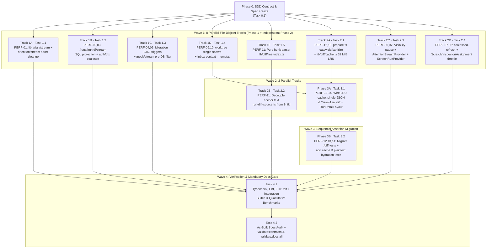

# Implementation Plan: Browser SSE Fan-Out Optimization & Shiki WASM Decoupling

Branch: optimize_browser_sse_shiki
Created: 2026-11-25
Refined: 2026-11-25 (SDD + TDD RED→GREEN→REFACTOR pass)

## Settings
- Testing: yes (strict TDD: RED → GREEN → REFACTOR per task; minimal-overlap behavioral & edge-case coverage, zero trivial tests)
- Logging: verbose (structured `pino` logs gated by `LOG_LEVEL`, zero `console.log` in client code, zero secret/payload leakage)
- Docs: yes (SDD Phase-0 spec freeze + mandatory Phase-4 contract & docs validation gate)

## Roadmap Linkage
Milestone: "none"
Rationale: Cross-cutting performance, concurrency, and memory-leak remediation covering Review Findings #7 (Browser SSE fan-out & leaks) and #10 (Shiki WASM blocking & diff pipeline), outside a numbered feature milestone.

---

## Engineering Principles & SDD/TDD Operating Contract

1. **Spec-Driven Development (SDD):** Phase 0 freezes all OpenAPI 3.0.3, AsyncAPI 2.6.0, PostgreSQL migration, and `docs/system-analytics/*.md` (`docs/CLAUDE.md` R5/R5a/R6/R9) contracts *before* any production code changes. Code implements the frozen specs verbatim — zero silent drift.
2. **Test-Driven Development (TDD — RED → GREEN → REFACTOR):** Every implementation task (`1.1`–`3.2`) executes in three strict steps:
   - **RED:** Write focused, non-overlapping behavioral and edge-case tests first and verify they fail for the exact expected reason. No trivial tests (e.g., testing TypeScript types, constant equality, or mocking the unit under test).
   - **GREEN:** Write the smallest, cleanest spec-compliant implementation that turns all new and existing tests green.
   - **REFACTOR:** Eliminate duplication and dead code (e.g., unused `streamGitDiffTruncated`), enforce SOLID/KISS/DRY boundaries, verify strict TypeScript (no unflagged `any`), `server-only` vs client-safe imports, and zero new ESLint warnings — keeping every test green.
3. **SOLID / KISS / DRY Boundaries:**
   - **Single Responsibility (SRP):** Keep pure unified-diff hunk indexing (`lib/diff/line-index.ts`), byte-bounded LRU caching (`lib/diff/cache.ts`), leading-coalescing scheduling (`lib/runs/coalesced-refresh.ts`), and shared attention-stream ownership (`components/attention/attention-stream-provider.tsx`) in dedicated, small, independently testable modules.
   - **Keep It Simple (KISS):** Use built-in Node primitives (`node:timers/promises` `setTimeout`) and existing repo abstractions (`diffChangeStats`, `streamGitTruncatedTo`, `requireProjectRoleForUser`, `RunStreamProvider`) instead of inventing frameworks or env toggles.
   - **Don't Repeat Yourself (DRY):** Consolidate trailing-debounce refresh logic into one client-safe helper (`createCoalescedRefresher`), consolidate all three `git diff` readers onto one `streamGitTruncatedTo` path, and share one SHA/fingerprint LRU diff cache between `GET /api/runs/[runId]/diff` and `RunDetailLayout`.

---

## Normative SDD Requirements & Traceability Matrix

Every requirement below MUST hold at merge, has an explicit enforcing mechanism, and maps to **non-overlapping** TDD tests.

### Requirements (`PERF-01` .. `PERF-14`)

| ID | Normative Requirement (RFC-2119) | Spec Artifact(s) | Enforcing Mechanism | Primary Non-Overlapping Test(s) |
| :--- | :--- | :--- | :--- | :--- |
| **PERF-01** | `librarianStreamFrames` MUST NOT accumulate `AbortSignal` listeners across poll iterations (`getEventListeners(signal, "abort").length <= 1` while running, `0` after close); `GET /api/attention/stream` MUST wake immediately on `req.signal` abort and remove its abort listener in `finally`. | `docs/system-analytics/attention.md` | `node:timers/promises` `setTimeout(ms, undefined, { signal })` in `lib/librarian/stream.ts` and `app/api/attention/stream/route.ts` | `web/lib/librarian/__tests__/stream-abort-leak.test.ts` (`unit`) |
| **PERF-02** | `GET /api/runs/[runId]/stream` MUST NEVER select or transfer `execution_events.payload` JSONB to Node; it MUST project only safe scalar booleans (`payloadIsNull` and, only when `context=1` and `event_type IN ('session.update','session.line')`, `contextUsageOnly` via safe JSONB equality without `::boolean` casts). | `docs/api/async/web-runs.asyncapi.yaml`, `docs/system-analytics/runs.md` | Scalar Drizzle projection in `readCanonicalRunEvents` (`app/api/runs/[runId]/stream/route.ts`) | `web/app/api/runs/[runId]/stream/__tests__/route.test.ts` (`unit`) |
| **PERF-03** | `GET /api/runs/[runId]/stream` MUST use `requireProjectRoleForUser(userId, projectId, "viewer")` (never re-invoking NextAuth `auth()` inside the stream loop), MUST preserve per-non-empty-batch disclosure/company checks for enrolled/company/vault runs (`web-runs.asyncapi.yaml`), MUST re-verify ordinary non-enrolled project runs and projectless active-user account status at least once every `2_500 ms` (re-verifying no later than `2,500 ms` after the previous check) and before terminal batch emission/close, and MUST coalesce `readContextSnapshot`/`readCurrentAttemptId` to `500 ms` during bursts (+ idle settle + terminal watermark) with parallel run-snapshot + attempt-id reads. | `docs/api/async/web-runs.asyncapi.yaml`, `docs/system-analytics/runs.md` | Split governed vs ordinary recheck cadence + `Promise.all` context coalescing in `app/api/runs/[runId]/stream/route.ts` | `web/app/api/runs/[runId]/stream/__tests__/route.test.ts` (`unit`), `company-agent-context.integration.test.ts`, `findings-disclosure.integration.test.ts` (`integration`) |
| **PERF-04** | PostgreSQL peek notification triggers on `execution_events` and `run_messages` MUST NOT call `to_jsonb(NEW)` or `to_jsonb(OLD)` and MUST filter `pending_gap` / null-`run_sequence` `execution_events` at the trigger `WHEN` clause while preserving all 7 trigger names asserted by `peek-wake.ts:164` and exact `0212` notification semantics. | `docs/system-analytics/run-peek-data.md`, `docs/database-schema.md`, `web/lib/db/canonical/*` | Migration `0369_optimize_peek_hint_triggers.sql` (`maister_execution_events_peek_hint`, `maister_run_messages_peek_hint`, Postgres-valid `WHEN` on `INSERT OR UPDATE`) | `canonical-sql.integration.test.ts`, `run-peek-migrations.integration.test.ts`, `peek-wake.integration.test.ts` (`integration`) |
| **PERF-05** | `GET /api/runs/[runId]/peek/stream` MUST discard unrelated `transcript`, `execution_events`, foreign-`rootRunId`, and unrelated top-level root `runs` hints *before* executing any DB query (`authorizePeekRun` / `belongs`), while preserving immediate auth/selection re-verification on relevant `summary` hints (`IT-PKD-08..10`) and `2_500 ms` coalesced auth recheck on relevant `transcript`/`execution` bursts. | `docs/system-analytics/run-peek-data.md`, `docs/api/async/web-runs.asyncapi.yaml` | Pre-DB `isHintPotentiallyRelevant` gate in `app/api/runs/[runId]/peek/stream/route.ts` | `web/app/api/runs/[runId]/peek/__tests__/stream.integration.test.ts` (`integration`) |
| **PERF-06** | `useAttentionStream` and tick-only `useRunStream` (`retain: false`) MUST close their `EventSource` and cancel reconnect timers when `document.visibilityState === "hidden"` without incrementing error backoff, MUST defer `AttentionLiveRefresh` `router.refresh()` while hidden, and MUST resume cleanly on `"visible"` with ADR-171 D7 cursor/counters (preserving K13 review revalidation) and one catch-up tick for `useRunStream`. | `docs/system-analytics/attention.md`, `docs/system-analytics/runs.md` | Visibility lifecycle listeners in `lib/use-attention-stream.ts`, `components/attention/attention-live-refresh.tsx`, `lib/use-run-stream.ts` | `attention-live-refresh.dom.test.ts`, `use-run-stream-visibility.dom.test.ts` (`unit`) |
| **PERF-07** | One app tab MUST hold at most one `/api/attention/stream` socket (shared across `StatusBar`'s `AttentionLiveRefresh` and `<main>`'s `TaskLaunchIntentStatus` via `AttentionStreamProvider` in `AppLayout`), and a scratch run page MUST hold at most one `/api/runs/[runId]/stream` socket (via `<RunStreamProvider>` in `ScratchRunDetailLayout`), with `ScratchConversation.recover()` calling `router.refresh()` so a recovered `Crashed` run re-activates `RunStreamProvider`. | `docs/system-analytics/attention.md`, `docs/system-analytics/scratch-runs.md` | `AttentionStreamProvider` in `app/(app)/layout.tsx`; `<RunStreamProvider>` in `app/(app)/scratch-runs/[runId]/layout.tsx`; `router.refresh()` in `ScratchConversation.recover()` | `attention-live-refresh.dom.test.ts`, `scratch-conversation-delivery.dom.test.ts` (`unit`) |
| **PERF-08** | Streaming UI consumers (`ScratchConversation`, `LiveRunInspector`, `AssignmentLiveRefresh`) MUST use leading-coalescing refresh scheduling (`createCoalescedRefresher`) rather than trailing `clearTimeout` debounces, guaranteeing steady refresh execution under continuous >4 Hz event streams without aborting in-flight fetches on new ticks. | `docs/system-analytics/runs.md`, `docs/system-analytics/scratch-runs.md` | Shared `web/lib/runs/coalesced-refresh.ts` wired into all 3 consumers | `web/lib/runs/__tests__/coalesced-refresh.test.ts`, `scratch-conversation-delivery.dom.test.ts` (`unit`) |
| **PERF-09** | `diffRunWorkspace`, `diffRange`, and `diffWorkingTree` in `web/lib/worktree.ts` MUST execute `git diff` at most ONCE even when output exceeds `EXEC_MAX_BUFFER` (4 MiB), returning `{ text, truncated: true }` on overflow and throwing `MaisterError("CONFLICT")` on genuine non-zero git failures. | `docs/system-analytics/workbench.md` | Direct `streamGitTruncatedTo(..., EXEC_MAX_BUFFER)` in all 3 functions; remove double-spawn `execFile` + `streamGitDiffTruncated` | `web/lib/__tests__/worktree.test.ts` (`unit`) |
| **PERF-10** | `getInboxCardContext` (`web/lib/queries/inbox-context.ts`) MUST compute diff counts (`{ files, additions, deletions }`) via `diffChangeStats` (`git diff --numstat`) rather than fetching the full patch via `diffRunWorkspace` + `prepareDiffSummary`. | `docs/system-analytics/workbench.md` | `loadDiffSummary` calls `diffChangeStats` | `web/lib/queries/__tests__/inbox-context.test.ts`, `inbox-context.integration.test.ts` (`unit` + `integration`) |
| **PERF-11** | Review-comment anchor extraction (`POST /review-comments`) and placement (`GET /review-comments`, `RunDetailLayout` `getReviewGateThreadCounts`) MUST parse unified-diff hunks via pure `parseDiffLineIndex` (`web/lib/diff/line-index.ts`) with ZERO Shiki WASM or `@git-diff-view/core` calls, producing byte-identical `{ oldLines, newLines }` lookups to `prepareDiff`. | `docs/system-analytics/review-comments.md` | `web/lib/diff/line-index.ts` wired into `anchor.ts` and `run-diff-source.ts` | `web/lib/diff/__tests__/line-index.test.ts`, `anchor.test.ts`, `run-diff-source.test.ts` (`unit`) |
| **PERF-12** | `prepareDiff` (`web/lib/diff/prepare.ts`) MUST downgrade any single file exceeding `maxLineToIgnoreSyntax` (`2,000` changed/syntax lines) individually to monochrome plaintext (`fileLang: "plaintext"`) without charging the shared cumulative budget or starving subsequent smaller files, MUST enforce `MAX_TOTAL_SYNTAX_LINES = 8_000` across remaining files (downgrading trailing files to zero-Shiki monochrome plaintext bundles with `fileLang: "plaintext"` that hydrate in `@git-diff-view/react` with zero client lowlight fallback — ADR-066 FINDING G), MUST yield the event loop (`setImmediate`) every 5 files (or `DIFF_YIELD_BUDGET_MS = 16` ms) while scoping `setEnableBuildTemplate(false)` strictly inside each synchronous batch (never across `await`), and MUST normalize bundles in a single pass without `JSON.parse(JSON.stringify(...))`. | `docs/system-analytics/workbench.md`, `docs/api/web.openapi.yaml` | Per-file `maxLineToIgnoreSyntax` (`2,000`) downgrade + `MAX_TOTAL_SYNTAX_LINES`, batch-scoped `setEnableBuildTemplate`, zero-Shiki `plaintextDiffHighlighter`, `sanitizeDiffBundle` in `web/lib/diff/prepare.ts` | `web/lib/diff/__tests__/prepare.test.ts`, `web/components/workbench/__tests__/run-diff.test.ts` (`unit`) |
| **PERF-13** | Immutable prepared diffs MUST be cached in a `32 MiB` LRU (`DIFF_CACHE_MAX_BYTES = 32 MiB`, `16 MiB` single-entry cap — bounding the UTF-8 byte length of cached `preparedJson` strings, with corresponding parsed `prepared` objects retained alongside for SSR hits) storing `{ files, prepared, preparedJson, byteSize }` keyed by `sha:<worktreePath>:<baseSha>:<headSha>`, `review:<fingerprint>`, or `content:<sha256>:<truncated>`, shared by `GET /api/runs/[runId]/diff` and `RunDetailLayout`'s `buildReviewPanelData`, with `requireProjectAction` + `assertRunKnowledgeDisclosure` ALWAYS enforced before returning any cached entry. | `docs/system-analytics/workbench.md`, `docs/api/web.openapi.yaml` | `web/lib/diff/cache.ts` wired into `app/api/runs/[runId]/diff/route.ts` and `app/(app)/runs/[runId]/layout.tsx` | `web/lib/diff/__tests__/cache.test.ts`, `web/app/api/runs/[runId]/diff/__tests__/route.test.ts` (`unit`) |
| **PERF-14** | `GET /api/runs/[runId]/diff` MUST serialize `perFile` at most ONCE per cache miss (reusing `preparedJson` on hits) and MUST omit the raw `diff` property from the JSON response unless `?raw=1` is explicitly supplied (`raw=1` still reuses cached `prepared`/`preparedJson` to skip Shiki while reading raw diff text from git). | `docs/api/web.openapi.yaml`, `docs/system-analytics/workbench.md` | Opt-in `raw=1` parsing + pre-serialized JSON assembly in `app/api/runs/[runId]/diff/route.ts` | `web/app/api/runs/[runId]/diff/__tests__/route.test.ts` (`unit`), `web/app/api/runs/__tests__/diff-scope.integration.test.ts` (`integration`) |

### Edge Cases (`EDGE-PERF-01` .. `EDGE-PERF-10`)

- **EDGE-PERF-01 (Non-boolean `contextUsageOnly` / non-object `update` in `execution_events.payload`):** Malformed JSON shapes (`"yes"`, `123`, `[]`, `null`) MUST evaluate to `contextUsageOnly = false` in SQL without throwing Postgres `22P02`.
- **EDGE-PERF-02 (Mid-stream grant revocation on idle company/enrolled `/stream`):** Revoking a company or knowledge grant while zero new events arrive MUST still close the open `/stream` within `AUTH_RECHECK_INTERVAL_MS` (2,500 ms — well inside the 10 s `company-agent-context` test deadline); revoking mid-burst on an enrolled/company run MUST sever before the next non-empty batch is enqueued.
- **EDGE-PERF-03 (Peek trigger `UPDATE` transitions & top-level roots):** `execution_events` INSERT with `pending_gap` emits 0 notifications (skipped at `WHEN`); UPDATE `pending_gap → accepted` with `run_sequence` emits 1 notification; subsequent UPDATE keeping `accepted` + identical `(run_sequence, run_id)` emits 0 notifications; DELETE emits 0 notifications. Unrelated top-level `runs` (`rootRunId === null && parentRunId === null && previousParentRunId === null`) and foreign `rootRunId` descendants trigger 0 DB queries in `/peek/stream`.
- **EDGE-PERF-04 (Visibility transitions & K13 review watch):** Mounting `useAttentionStream` while already `hidden` opens 0 sockets; hiding an active tab closes `EventSource` cleanly without triggering reconnect backoff; returning to `visible` reconnects with `(lastEventId, decisions, updates, reviews, reviewVersion)` and triggers K13 `reviewResync` + flushes any deferred `router.refresh()`.
- **EDGE-PERF-05 (Recovering a `Crashed` scratch run under `<RunStreamProvider>`):** Opening a `Crashed` scratch run opens 0 `/stream` sockets; clicking Recover calls `router.refresh()` after success so `ScratchRunDetailLayout` re-renders with `Running` and `<RunStreamProvider>` activates live streaming.
- **EDGE-PERF-06 (Concurrent `prepareDiff` interleaving across `setImmediate` yields):** Two overlapping `prepareDiff` calls yielding every 5 files MUST NOT corrupt `@git-diff-view/core`'s global `getEnableBuildTemplate()` flag; both produce identical clean bundles and restore the prior flag value after completion.
- **EDGE-PERF-07 (Per-file cap, cumulative syntax budget & client hydration):** Any single file exceeding `maxLineToIgnoreSyntax` (`2,000` changed/syntax lines) downgrades individually to monochrome plaintext (`fileLang: "plaintext"`) without charging the shared `MAX_TOTAL_SYNTAX_LINES = 8_000` budget or starving subsequent smaller files; once remaining files exceed `MAX_TOTAL_SYNTAX_LINES = 8_000`, trailing files downgrade to zero-Shiki monochrome plaintext bundles (`fileLang: "plaintext"`) that hydrate via `DiffFile.createInstance` + `initSyntax()` with zero Shiki calls and zero client lowlight fallback.
- **EDGE-PERF-08 (Oversize single diff & `?raw=1` cache coherence):** A single prepared diff >16 MiB bypasses the 32 MiB LRU cache (never evicting healthy entries); a `GET /diff?scope=run` followed by `GET /diff?scope=run&raw=1` on the same `(base, headSha)` returns the raw `diff` string on the second call while still reusing the cached `preparedJson` without re-running Shiki.
- **EDGE-PERF-09 (Unified-diff hunk edge cases in `parseDiffLineIndex`):** CRLF (`\r\n` preserving `\r`), significant trailing spaces, `\ No newline at end of file`, multi-hunk files, renamed files (`diff --git a/old b/new`), binary patches, empty diffs, and `truncated: true` MUST match `prepareDiff` lookup results byte-for-byte.
- **EDGE-PERF-10 (Truncated vs failed `git diff` in single-spawn `streamGitTruncatedTo`):** Output strictly equal to 4 MiB returns `{ truncated: false }`; output exceeding 4 MiB kills git with `SIGKILL` and returns `{ truncated: true }` after exactly 1 spawn; bad ref / non-zero exit before 4 MiB throws `MaisterError("CONFLICT")` with stderr context.

---

## Parallel Execution Architecture

Tasks are partitioned into **100% file-disjoint tracks** so up to **8 workers/subagents** can run concurrently in Wave 1 with zero merge conflicts.

### Disjoint File-Ownership Table (Zero Merge-Conflict Guarantee)

| Task | Exclusive Owned Files |
| :--- | :--- |
| **0.1** | `docs/api/web.openapi.yaml`, `docs/api/async/web-runs.asyncapi.yaml`, `docs/system-analytics/{workbench,review-comments,run-peek-data,attention,runs,scratch-runs}.md`, `docs/database-schema.md` |
| **1.1** | `web/lib/librarian/stream.ts`, `web/lib/librarian/__tests__/stream-abort-leak.test.ts`, `web/app/api/attention/stream/route.ts` |
| **1.2** | `web/app/api/runs/[runId]/stream/route.ts`, `web/app/api/runs/[runId]/stream/__tests__/route.test.ts` |
| **1.3** | `web/lib/db/migrations/0369_optimize_peek_hint_triggers.sql`, `web/lib/db/migrations/meta/_journal.json`, `web/lib/db/migrations/meta/0369_snapshot.json`, `web/lib/db/canonical/*`, `web/app/api/runs/[runId]/peek/stream/route.ts`, `web/app/api/runs/[runId]/peek/__tests__/stream.integration.test.ts` |
| **1.4** | `web/lib/worktree.ts`, `web/lib/__tests__/worktree.test.ts`, `web/lib/queries/inbox-context.ts`, `web/lib/queries/__tests__/inbox-context.test.ts` |
| **1.5** | `web/lib/diff/line-index.ts`, `web/lib/diff/__tests__/line-index.test.ts` |
| **2.1** | `web/lib/diff/prepare.ts`, `web/lib/diff/cache.ts`, `web/lib/diff/__tests__/prepare.test.ts`, `web/lib/diff/__tests__/cache.test.ts` |
| **2.2** | `web/lib/review-comments/anchor.ts`, `web/lib/review-comments/run-diff-source.ts`, `web/app/api/runs/[runId]/review-comments/route.ts`, `web/lib/review-comments/__tests__/anchor.test.ts`, `web/lib/review-comments/__tests__/run-diff-source.test.ts` |
| **2.3** | `web/lib/use-attention-stream.ts`, `web/components/attention/attention-stream-provider.tsx`, `web/components/attention/attention-live-refresh.tsx`, `web/components/board/task-launch-intent-status.tsx`, `web/app/(app)/layout.tsx`, `web/lib/use-run-stream.ts`, `web/app/(app)/scratch-runs/[runId]/layout.tsx`, `web/components/attention/__tests__/attention-live-refresh.dom.test.ts`, `web/lib/__tests__/use-run-stream-visibility.dom.test.ts` |
| **2.4** | `web/lib/runs/coalesced-refresh.ts`, `web/lib/runs/__tests__/coalesced-refresh.test.ts`, `web/components/scratch/scratch-conversation.tsx`, `web/components/runs/live-run-inspector.tsx`, `web/components/specialist-assignments/assignment-live-refresh.tsx`, `web/components/scratch/__tests__/scratch-conversation-delivery.dom.test.ts` |
| **3.1** | `web/app/api/runs/[runId]/diff/route.ts`, `web/app/(app)/runs/[runId]/layout.tsx` |
| **3.2** | `web/app/api/runs/[runId]/diff/__tests__/route.test.ts`, `web/app/api/runs/__tests__/diff-scope.integration.test.ts`, `web/components/workbench/__tests__/run-diff.test.ts` |

---

## Decisions & Contract Surfaces

### 1. Deployment Touchpoints
- **Zero new environment variables, bound ports, sidecar binaries, or bind-mounted config files.**
- Per ADR-171 D5, all tuning bounds are module constants (`AUTH_RECHECK_INTERVAL_MS = 2_500`, `CONTEXT_SNAPSHOT_COALESCE_MS = 500`, `MAX_TOTAL_SYNTAX_LINES = 8_000`, `DIFF_YIELD_BATCH_SIZE = 5`, `DIFF_YIELD_BUDGET_MS = 16`, `DIFF_CACHE_MAX_BYTES = 32 * 1024 * 1024`).
- `Dockerfile`, `compose.yml`, `compose.production.yml`, and `.env.example` remain untouched.

### 2. HTTP Route Identifiers & Trust Boundaries
Every modified HTTP route derives resource ownership exclusively from `url-param` + `auth-context` + `server-state` (zero `body-controlled` cross-resource locators):

| Route | Identifier | Label | Handling |
| :--- | :--- | :--- | :--- |
| `GET /api/runs/[runId]/stream` | `runId` | `url-param` | Resolved via `loadRunLite(runId)` → `server-state` (`projectId`, `companyId`, `createdByUserId`, `localPackageId`). |
| | `sessionUser.id` | `auth-context` | Re-verified in-loop via `requireProjectRoleForUser` / `assertCompanyRunReadAccess` / `assertRunKnowledgeDisclosure` (per-batch for enrolled/company/vault; `2_500 ms` + terminal for ordinary project runs). |
| | `replay`, `context`, `lastEventId` | `query-param` / header | Strictly parsed (`bigint` decimal regex, boolean flag). |
| `GET /api/runs/[runId]/peek/stream` | `runId` | `url-param` | Validated via `parsePeekRunId`, authorized via `authorizePeekRun`. |
| | `selected` | `query-param` | Validated via `parsePeekRunId` + `belongs(user.id, anchor, selected)`. |
| | `user.id` | `auth-context` | Immediate recheck on relevant `summary` hints and governed/company runs; `2_500 ms` coalesced recheck on ordinary non-governed `transcript`/`execution` bursts; transport-only heartbeats perform zero DB queries. |
| `GET /api/attention/stream` | `user.id` | `auth-context` | Re-verified via `currentAuthority(user.id)` on each poll; `projectIds` derived from `server-state`. |
| `GET /api/runs/[runId]/diff` | `runId` | `url-param` | Resolved via `loadRun` → `server-state`. `requireProjectAction` + `assertRunKnowledgeDisclosure` ALWAYS run before cache read and again after async assembly. |
| | `scope`, `raw` | `query-param` | `scope` validated against `RUN_DIFF_SCOPES`; `raw` checked strictly `=== "1"`. |
| `GET/POST /api/runs/[runId]/review-comments` | `runId` | `url-param` | Resolved via `loadRun` → `server-state`. |
| | `scope` | `query-param` | Validated via `reviewCommentScopeOrDefault`. |
| | `filePath`, `side`, `line`, `body` / `parentId` (`POST`) | `body-controlled` | Validated by strict Zod schema; `filePath` matched solely against server-derived git diff sections (never joined into filesystem paths). |

### 3. Contract Surfaces → Spec Files Mapping

| Surface | Spec File(s) | Exact Spec Update |
| :--- | :--- | :--- |
| `GET /api/runs/{runId}/diff` `?raw=1` & optional `diff` | `docs/api/web.openapi.yaml` | Add optional query param `raw` (`enum: ["1"]`); remove `diff` from `RunDiffResponse.required`; update `current-review` example/prose to state `diff` is omitted unless `raw=1`. |
| `GET /api/runs/{runId}/stream` disclosure & projection | `docs/api/async/web-runs.asyncapi.yaml`, `docs/system-analytics/runs.md` | Clarify scalar metadata-only projection, per-batch source checks for enrolled/company/vault runs, and bounded `2_500 ms` recheck (+ terminal close) for ordinary non-enrolled project runs. |
| Diff syntax cap, yielding, LRU cache, single-spawn git diff, `?raw=1` | `docs/system-analytics/workbench.md` | Replace stale line 302 prose ("preserves the raw `diff` string"); document `MAX_TOTAL_SYNTAX_LINES = 8_000` plaintext fallback (ADR-066 FINDING G preserved), 32 MiB LRU cache, single-spawn `streamGitTruncatedTo`, and opt-in `?raw=1`. |
| Review-comment anchor parsing | `docs/system-analytics/review-comments.md` | Replace stale lines 103 & 266–267 references to `lib/diff/prepare.ts`; document `lib/diff/line-index.ts` (`parseDiffLineIndex`, byte-identical unified-diff line model without Shiki WASM). |
| Peek SQL triggers & pre-DB filter | `docs/system-analytics/run-peek-data.md`, `docs/database-schema.md`, `web/lib/db/canonical/*` | Document migration `0369` (`maister_execution_events_peek_hint` with `WHEN` guard, `maister_run_messages_peek_hint`, zero `to_jsonb`) and pre-DB filtering of unrelated `transcript`, `execution_events`, foreign-`rootRunId`, and top-level root hints. |
| Visibility-paused & shared attention stream + scratch provider | `docs/system-analytics/attention.md`, `docs/system-analytics/scratch-runs.md` | Document `visibilityState === "hidden"` pause + ADR-171 D7 catch-up, shared `AttentionStreamProvider`, `<RunStreamProvider>` on scratch runs, and leading-coalescing refresh. |

### 4. Migration Contract (Migration `0369`)
- Latest committed migration in `web/lib/db/migrations/meta/_journal.json` is `idx: 368` (`0368_run_sync_attempt_peek_hint`).
- **4-leg contract (Task 1.3):**
  1. `web/lib/db/migrations/0369_optimize_peek_hint_triggers.sql`:
     - `CREATE OR REPLACE FUNCTION public.maister_execution_events_peek_hint() RETURNS trigger ...` — direct `NEW.run_id`, `OLD.run_id`, `NEW.ingest_disposition`, `OLD.ingest_disposition`, `NEW.run_sequence`, `OLD.run_sequence` (zero `to_jsonb`).
     - `DROP TRIGGER IF EXISTS execution_events_peek_hint ON public.execution_events;` followed by `CREATE TRIGGER execution_events_peek_hint AFTER INSERT OR UPDATE ON public.execution_events FOR EACH ROW WHEN (NEW.ingest_disposition = 'accepted' AND NEW.run_sequence IS NOT NULL) EXECUTE FUNCTION public.maister_execution_events_peek_hint();` (Postgres-valid: `WHEN` references `NEW` only; `DELETE` was already a no-op in `0212`).
     - `CREATE OR REPLACE FUNCTION public.maister_run_messages_peek_hint() RETURNS trigger ...` — direct `IS DISTINCT FROM` comparisons on `(run_id, node_attempt_id, sequence, role, content, supervisor_event_id, prompt_dispatch_key, created_at)` for `UPDATE` and direct `NEW.run_id` / `OLD.run_id` extraction (zero `to_jsonb`).
     - `DROP TRIGGER IF EXISTS run_messages_peek_hint ON public.run_messages;` followed by `CREATE TRIGGER run_messages_peek_hint AFTER INSERT OR UPDATE OR DELETE ON public.run_messages FOR EACH ROW EXECUTE FUNCTION public.maister_run_messages_peek_hint();`.
     - Preserves all 7 trigger names asserted by `web/lib/runs/peek-wake.ts:164`.
  2. `web/lib/db/migrations/meta/_journal.json`: append monotonic `idx: 369`, `tag: "0369_optimize_peek_hint_triggers"`, `when > 1795435885577`.
  3. `web/lib/db/migrations/meta/0369_snapshot.json`: valid UUID `id` + `prevId` matching `0368_snapshot.json`, identical table/index shape so `drizzle-kit generate` reports `"No schema changes"`.
  4. `pnpm --filter maister-web db:canonical-sql`: regenerates `web/lib/db/canonical/` (`_triggers.sql`, `maister_execution_events_peek_hint.sql`, `maister_run_messages_peek_hint.sql`) so `web/lib/db/__tests__/canonical-sql.integration.test.ts` passes.
- **Rebase note:** If `master` advances past `0368` before merge, budget a mechanical renumber pass (`0369` → next monotonic index) + re-run `db:canonical-sql`.

### 5. Test Runnability & Enumerated Assertion Migrations
All test files match existing `web/vitest.workspace.ts` globs (`unit` and `integration` projects; zero workspace config edits required):
- **Migrated assertions (Task 3.2):**
  - `web/app/api/runs/[runId]/diff/__tests__/route.test.ts`:
    - Add `clearPreparedDiffCache()` in `beforeEach` (prevents cross-test pollution from constant `resolveRefSha` mock on line 133).
    - Lines 282, 323, 345, 362, 378, 432, 470: pass `?raw=1` on cases asserting `body.diff`; add explicit default-request cases asserting `body.diff === undefined`.
  - `web/app/api/runs/__tests__/diff-scope.integration.test.ts`:
    - Lines 192, 224–225, 258–259, 294–295, 331–335, 358–361: update helper to support `raw=1` for raw-diff content assertions and add explicit assertion that default requests omit `diff` while preserving `files`/`perFile`.

---

## Commit Plan

- **Commit 1** (after Task 0.1): `docs(perf): freeze SDD contracts for SSE fan-out, peek triggers, and opt-in raw diff`
- **Commit 2** (after Tasks 1.1–1.3): `perf(sse): eliminate stream JSONB over-fetch, peek cross-run SQL storms, and librarian abort leak`
- **Commit 3** (after Tasks 1.4–1.5, 2.2): `perf(diff): single-spawn git diff, numstat inbox stats, and Shiki-free review-comment anchors`
- **Commit 4** (after Tasks 2.3–2.4): `perf(ui): pause hidden SSE streams, share attention/scratch providers, and use leading-coalescing refresh`
- **Commit 5** (after Tasks 2.1, 3.1–3.2): `perf(diff): add syntax budget, safe event-loop yields, 32 MiB LRU cache, single serialization, and ?raw=1`

---

## Tasks

### Phase 0: SDD Contracts & Spec Freeze (Sequential Prerequisite)

- [x] **Task 0.1: Freeze OpenAPI, AsyncAPI, and System-Analytics Contracts (`PERF-01`..`PERF-14`)**
  - **Deliverable:** Update every affected contract & analytics spec strictly per `docs/CLAUDE.md` R5/R5a/R6/R9 (surgical edits only; no milestone labels added; explicit `(Designed)` tags updated to `(Implemented)` in Task 4.2):
    - `docs/api/web.openapi.yaml`: add optional query param `raw` (`enum: ["1"]`) on `GET /api/runs/{runId}/diff`; remove `diff` from `RunDiffResponse.required`; update response description/example to state `diff` is omitted unless `raw=1`.
    - `docs/api/async/web-runs.asyncapi.yaml`: clarify `/api/runs/{runId}/stream` scalar metadata-only projection, per-non-empty-batch source verification for enrolled/company/vault runs vs bounded `2_500 ms` (+ terminal close) recheck for ordinary non-enrolled runs, and `/api/runs/{runId}/peek/stream` pre-DB hint filtering.
    - `docs/system-analytics/workbench.md`: update stale line 302 raw-diff note; add normative Expectations & Edge cases for `MAX_TOTAL_SYNTAX_LINES = 8_000` plaintext fallback (ADR-066 FINDING G preserved), 32 MiB SHA/fingerprint LRU cache, single-spawn bounded `git diff`, `diffChangeStats` inbox summary, and `?raw=1`.
    - `docs/system-analytics/review-comments.md`: update lines 103 & 266–267 from `lib/diff/prepare.ts` to `lib/diff/line-index.ts` (`parseDiffLineIndex`, byte-identical unified-diff line model decoupled from Shiki WASM).
    - `docs/system-analytics/run-peek-data.md` & `docs/database-schema.md`: document migration `0369` zero-`to_jsonb` triggers (`maister_execution_events_peek_hint` with `WHEN` guard, `maister_run_messages_peek_hint`) and pre-DB filtering of unrelated `transcript`, `execution_events`, foreign-`rootRunId`, and top-level root hints.
    - `docs/system-analytics/attention.md`, `docs/system-analytics/runs.md`, `docs/system-analytics/scratch-runs.md`: document hidden-tab pause + ADR-171 D7 catch-up, single shared `AttentionStreamProvider`, `<RunStreamProvider>` on scratch runs + `recover()` refresh, and leading-coalescing refresh throttling.
  - **Logging requirements:** Document expected `DEBUG`/`INFO`/`WARN` log events and `LOG_LEVEL` control in the owning analytics sections (no production code in Phase 0).
  - **Exit gate:** `pnpm validate:contracts` and `pnpm validate:docs:all` both exit 0.

<!-- Commit checkpoint: Task 0.1 -->

---

### Phase 1: Independent Backend & Data-Layer Foundations (5 Parallel Tracks — Wave 1)

> **Parallelism:** Tasks `1.1`, `1.2`, `1.3`, `1.4`, `1.5` (plus `2.1`, `2.3`, `2.4`) own **100% disjoint files** and can execute simultaneously.

- [x] **Task 1.1 [Track 1A — PERF-01]: Fix `AbortSignal` Leak in `librarianStreamFrames` & Abort-Aware Sleep in `attention/stream`** (depends on 0.1)
  - **TDD Cycle:**
    - **RED:** Create `web/lib/librarian/__tests__/stream-abort-leak.test.ts` (`unit` project) with 2 focused, non-overlapping tests:
      1. Drive `librarianStreamFrames` through 50 poll iterations with real `AbortController` and `activePollMs: 1`; assert `getEventListeners(controller.signal, "abort").length <= 1` throughout and `=== 0` after abort/return (currently FAILS with 50 leaked listeners + `MaxListenersExceededWarning`).
      2. Pass an already-aborted `AbortSignal` and assert immediate completion with `0` listeners attached.
    - **GREEN:**
      - In `web/lib/librarian/stream.ts`, replace manual `setTimeout` + `signal.addEventListener("abort", ...)` with `setTimeout as delay` from `node:timers/promises`: `const sleep = input.sleep ?? ((ms, signal) => (signal.aborted ? Promise.resolve() : delay(ms, undefined, { signal }).catch(() => {})));`.
      - In `web/app/api/attention/stream/route.ts`, replace `delay(POLL_INTERVAL_MS)` with abort-aware `delay(POLL_INTERVAL_MS, undefined, { signal: req.signal }).catch(() => {})`, register `req.signal.addEventListener("abort", close, { once: true })`, and call `req.signal.removeEventListener("abort", close)` in `finally`.
    - **REFACTOR:** Remove the obsolete local `delay()` helper in `attention/stream/route.ts`; verify zero unused imports and strict TS compliance.
  - **Files:** `web/lib/librarian/stream.ts`, `web/lib/librarian/__tests__/stream-abort-leak.test.ts`, `web/app/api/attention/stream/route.ts`
  - **Logging requirements:** Keep existing `librarian.stream` and `api-attention-stream` pino loggers (`LOG_LEVEL`). Emit `DEBUG` on abort-triggered stream exit (`{ ownerId / userId, aborted: true, durationMs }`).
  - **Exit gate:** `pnpm --filter maister-web test:unit web/lib/librarian/__tests__/stream-abort-leak.test.ts` green.

- [x] **Task 1.2 [Track 1B — PERF-02, PERF-03, EDGE-PERF-01, EDGE-PERF-02]: Scalar Projection, Governed-Safe Auth Recheck & Context Coalescing in `/api/runs/[runId]/stream`** (depends on 0.1)
  - **TDD Cycle:**
    - **RED:** Create `web/app/api/runs/[runId]/stream/__tests__/route.test.ts` (`unit` project) with 5 focused, non-overlapping behavioral tests:
      1. **No `payload` transfer & safe boolean projection (`PERF-02`, `EDGE-PERF-01`):** Assert `db.select` column map omits `executionEvents.payload`, projects `payloadIsNull`, skips JSONB expressions when `context=false`, and handles non-boolean `contextUsageOnly` / non-object `update` safely (`contextUsageOnly` omitted from emitted JSON).
      2. **No NextAuth JWT re-decode in loop (`PERF-03`):** Assert `requireProjectRole` is NEVER called inside the streaming loop; `requireProjectRoleForUser` is called instead.
      3. **Ordinary vs enrolled/company auth cadence (`PERF-03`, `EDGE-PERF-02`):** Under a 10-wake burst within 500 ms on an ordinary non-enrolled project run, assert `requireProjectRoleForUser` + `assertRunKnowledgeDisclosure` run ≤2 times (initial/periodic + terminal), whereas on an enrolled/company run, `assertRunKnowledgeDisclosure` / `assertCompanyRunReadAccess` runs before EVERY non-empty batch AND on idle timeout (2,500 ms) so idle revocation closes promptly.
      4. **Context snapshot coalescing & parallelization (`PERF-03`):** Under a 10-wake burst within 200 ms on a `flow` run with `context=1`, assert `readContextSnapshot` is coalesced (≤2 reads during burst + settle + terminal watermark) rather than 20 reads.
      5. **Librarian null-payload skip preserved:** Assert `runKind === "librarian"` with `payloadIsNull === true` still advances cursor without emitting a frame.
    - **GREEN:**
      - Update `readCanonicalRunEvents` in `web/app/api/runs/[runId]/stream/route.ts` to select only scalar columns + `payloadIsNull` + conditional `contextUsageOnly` (using `CASE WHEN event_type = 'session.update' ... WHEN event_type = 'session.line' THEN (payload->'contextUsageOnly' = 'true'::jsonb) ELSE false END` only when `context === true`).
      - Update `loadRunLite` to also read a lightweight `isGoverned` hint (`knowledge_access IS NOT NULL OR result_contract->>'nativeContract' = FINDINGS_CONTRACT`), re-refreshed via `assertRunKnowledgeDisclosure`.
      - Replace `requireProjectRole` in loop with `requireProjectRoleForUser(input.userId, input.run.projectId, "viewer")`.
      - Enforce `AUTH_RECHECK_INTERVAL_MS = 2_500`: always verify before enqueueing a non-empty batch when `run.companyId !== null || isGoverned`, verify on `2_500 ms` cadence for ordinary non-enrolled runs (and idle wakes), and verify once before terminal close.
      - Enforce `CONTEXT_SNAPSHOT_COALESCE_MS = 500` with `Promise.all([readContextSnapshot(db, runId), isFlow ? readCurrentAttemptId(db, runId) : null])`, plus settle read when events stop and final read at terminal projection watermark.
    - **REFACTOR:** Extract pure helper `buildCanonicalBrowserEvent(row, context)` (removes `acpContextUpdateType` dependency from `route.ts` if unused) and keep loop control variables concise and clearly named.
  - **Files:** `web/app/api/runs/[runId]/stream/route.ts`, `web/app/api/runs/[runId]/stream/__tests__/route.test.ts`
  - **Logging requirements:** Use existing `api-runs-stream` pino logger (`LOG_LEVEL`). Emit `DEBUG` on auth rechecks (`{ runId, governed, elapsedMs }`) and context snapshot reads (`{ runId, coalesced, changed }`); keep `WARN` on revocation/error; include `{ authChecks, contextReads }` in existing `INFO` `"stream disconnect"` log.
  - **Exit gate:** `pnpm --filter maister-web test:unit web/app/api/runs/[runId]/stream/__tests__/route.test.ts` green.

- [x] **Task 1.3 [Track 1C — PERF-04, PERF-05, EDGE-PERF-03]: Migration `0369` Zero-`to_jsonb` Peek Triggers & Pre-DB Filter in `/peek/stream`** (depends on 0.1)
  - **TDD Cycle:**
    - **RED:** Extend `web/app/api/runs/[runId]/peek/__tests__/stream.integration.test.ts` (`integration` project) with 2 focused, non-overlapping integration tests:
      1. **Zero-SQL cross-run isolation (`PERF-05`, `EDGE-PERF-03`):** Open `/peek/stream?selected=<child>` on `root`, spy on `peekPath` / `authorizePeekRun` (or count Postgres queries via `pg_stat_statements` / query spy), then insert `run_messages` (transcript), `execution_events` (`pending_gap` + `accepted`), and update an unrelated top-level `runs` row and an unrelated foreign-`rootRunId` child run — assert **0 frames emitted** and **0 calls** to `belongs` / `authorizePeekRun` for those unrelated hints (currently FAILS: calls `belongs` + `authorizePeekRun` on every single hint!).
      2. **Trigger zero-`to_jsonb` & `pending_gap` / `UPDATE` parity (`PERF-04`, `EDGE-PERF-03`):** Assert `pg_proc` for `maister_execution_events_peek_hint` and `maister_run_messages_peek_hint` contains no `to_jsonb`, `execution_events_peek_hint` has a `WHEN` clause skipping `pending_gap`, `pending_gap → accepted` UPDATE emits 1 `execution` hint, duplicate accepted UPDATE emits 0 hints, and `run_messages` INSERT/UPDATE/DELETE preserves exact `0212` semantics.
    - **GREEN:**
      - Create `web/lib/db/migrations/0369_optimize_peek_hint_triggers.sql` (following the exact 4-leg contract in Decisions §4), update `web/lib/db/migrations/meta/_journal.json` (`idx: 369`), create `web/lib/db/migrations/meta/0369_snapshot.json`, and run `pnpm --filter maister-web db:canonical-sql` to regenerate `web/lib/db/canonical/`.
      - In `web/app/api/runs/[runId]/peek/stream/route.ts`, extract pure predicate `isHintPotentiallyRelevant(hint, { anchor, selected, anchorRoot })`:
        - Return `false` (0 DB queries!) when:
          - `hint.topic === "transcript"` and `hint.runId !== anchor && hint.runId !== selected`;
          - `hint.source === "execution_events"` and `hint.runId !== anchor && hint.runId !== selected`;
          - `hint.source === "runs"` and `hint.runId !== anchor && hint.runId !== selected && hint.parentRunId === null && hint.previousParentRunId === null`;
          - `hint.rootRunId !== null && hint.rootRunId !== anchorRoot && hint.runId !== anchor && hint.runId !== selected && hint.parentRunId !== anchor && hint.previousParentRunId !== anchor`.
        - Run `isHintPotentiallyRelevant` **FIRST** inside `drain()` before any `belongs()` / `authorizePeekRun()` call.
        - Re-verify auth/selection immediately on relevant `summary` hints and governed/company runs (preserving `IT-PKD-08..10` verbatim) and on a `2_500 ms` cadence during ordinary non-governed `transcript`/`execution` bursts (heartbeats are transport-only and perform zero DB queries).
    - **REFACTOR:** Keep `isHintPotentiallyRelevant` pure and readable; verify `drizzle-kit generate` reports `"No schema changes"` and `canonical-sql.integration.test.ts` is green.
  - **Files:** `web/lib/db/migrations/0369_optimize_peek_hint_triggers.sql`, `web/lib/db/migrations/meta/_journal.json`, `web/lib/db/migrations/meta/0369_snapshot.json`, `web/lib/db/canonical/*`, `web/app/api/runs/[runId]/peek/stream/route.ts`, `web/app/api/runs/[runId]/peek/__tests__/stream.integration.test.ts`
  - **Logging requirements:** Use existing `run-peek-stream` pino logger (`LOG_LEVEL`). Emit `DEBUG` when skipping hints pre-DB (`{ anchorRunId, source, topic, reason }`) and include `{ hintsProcessed, hintsSkippedPreDb }` in `INFO` `"peek stream disconnected"`. Preserve `WARN` on revocation/read errors.
  - **Exit gate:** `canonical-sql.integration.test.ts`, `run-peek-migrations.integration.test.ts`, `peek-wake.integration.test.ts`, and `peek/__tests__/stream.integration.test.ts` all pass; `drizzle-kit generate` shows zero drift.

<!-- Commit checkpoint: Tasks 1.1–1.3 -->

- [x] **Task 1.4 [Track 1D — PERF-09, PERF-10, EDGE-PERF-10]: Single-Spawn Bounded `git diff` in `worktree.ts` & `--numstat` in `inbox-context.ts`** (depends on 0.1)
  - **TDD Cycle:**
    - **RED:**
      1. In `web/lib/__tests__/worktree.test.ts` (`unit` project): add a focused test on a repo with a >4 MiB diff (or injectable/tested bound) verifying `diffRunWorkspace`, `diffRange`, and `diffWorkingTree` each invoke `git diff` **exactly once** (no retry spawn), return `{ truncated: true }` when exceeding `EXEC_MAX_BUFFER`, `{ truncated: false }` at exact bound, and throw `MaisterError("CONFLICT")` on invalid ref.
      2. In `web/lib/queries/__tests__/inbox-context.test.ts` (`unit` project): add a test verifying `loadDiffSummary` / `getInboxCardContext` calls `diffChangeStats` (and NEVER calls `diffRunWorkspace` or `prepareDiffSummary`), summing `{ files, additions, deletions }` accurately (including binary/multi-file entries).
    - **GREEN:**
      - In `web/lib/worktree.ts`, refactor `diffRunWorkspace`, `diffRange`, and `diffWorkingTree` to call `streamGitTruncatedTo(repo, diffArgs, EXEC_MAX_BUFFER, label, env)` directly on the first attempt, logging `INFO` when `result.truncated === true`.
      - In `web/lib/queries/inbox-context.ts`, update `loadDiffSummary` to call `diffChangeStats({ worktreePath: workspace.worktreePath, baseRef: base, branch: workspace.branch })` and sum `files: stats.length`, `additions`, `deletions`.
    - **REFACTOR:** Remove the now-dead `streamGitDiffTruncated` wrapper from `web/lib/worktree.ts` and remove unused `diffRunWorkspace`/`prepareDiffSummary` imports from `web/lib/queries/inbox-context.ts`.
  - **Files:** `web/lib/worktree.ts`, `web/lib/__tests__/worktree.test.ts`, `web/lib/queries/inbox-context.ts`, `web/lib/queries/__tests__/inbox-context.test.ts`
  - **Logging requirements:** Use existing `worktree` and `inbox-context` pino loggers (`LOG_LEVEL`). Log `DEBUG` on entry (`{ worktreePath, baseRef, branch }`) and numstat result (`{ runId, files, additions, deletions }`), `INFO` on `truncated === true` (`{ worktreePath, maxBuffer: EXEC_MAX_BUFFER, label }`), and `WARN` on graceful fallback in `loadDiffSummary`.
  - **Exit gate:** `pnpm --filter maister-web test:unit web/lib/__tests__/worktree.test.ts web/lib/queries/__tests__/inbox-context.test.ts` green.

- [x] **Task 1.5 [Track 1E — PERF-11, EDGE-PERF-09]: Build Pure Unified-Diff Hunk Line-Index Parser (`web/lib/diff/line-index.ts`)** (depends on 0.1)
  - **TDD Cycle:**
    - **RED:** Create `web/lib/diff/__tests__/line-index.test.ts` (`unit` project) with a comprehensive, non-overlapping parity suite against real `prepareDiff`:
      1. Multi-hunk additions/deletions/context across multiple files: assert every `(filePath, side, line)` in `parseDiffLineIndex(diff)` matches `prepareDiff(diff)` (`oldFileDiffLines` / `newFileDiffLines` with trailing LF stripped) 100% identically.
      2. Edge-case matrix (`EDGE-PERF-09`): CRLF (`\r\n` preserving `\r`), trailing spaces on data lines, `\ No newline at end of file` on old/new/both sides, empty context lines, renamed files (`diff --git a/old b/new`), added/deleted files, binary files, empty diff, malformed hunk header skipped safely, and `truncated: true` propagation.
      3. Import isolation assertion: verify `line-index.ts` has zero imports of `shiki` or `@git-diff-view/core`.
    - **GREEN:** Implement `web/lib/diff/line-index.ts` (`import "server-only"`) exporting `FileLineIndex`, `DiffLineIndex`, and `parseDiffLineIndex(rawDiff: string, truncated = false): DiffLineIndex`, sharing section-splitting & C-quoted path-parsing rules via `web/lib/diff/sections.ts` (matching `prepare.ts`'s newline/CRLF preservation — never blanket `.trim()`).
    - **REFACTOR:** Keep parser single-pass `O(n)` over lines with zero regex backtracking hazards and clean helper functions (`parseHunkHeader`, `indexSectionLines`).
  - **Files:** `web/lib/diff/sections.ts`, `web/lib/diff/line-index.ts`, `web/lib/diff/__tests__/line-index.test.ts`
  - **Logging requirements:** Create `pino({ name: "diff-line-index", level: process.env.LOG_LEVEL ?? "info" })`. Log `DEBUG` on completion (`{ fileCount, totalLinesIndexed, truncated, durationMs }`) and `WARN` on malformed hunk header skip (`{ path, header }`).
  - **Exit gate:** `pnpm --filter maister-web test:unit web/lib/diff/__tests__/line-index.test.ts` green.

---

### Phase 2: Diff Engine, Caching, Review Anchors & Client SSE (4 Parallel Tracks)

> **Parallelism:** Tracks `2A` (`2.1`), `2C` (`2.3`), and `2D` (`2.4`) run in Wave 1 concurrently with Phase 1. Track `2B` (`2.2`) runs in Wave 2 immediately after Task `1.5`. All 4 tracks own **100% disjoint files**.

- [x] **Task 2.1 [Track 2A — PERF-12, PERF-13, EDGE-PERF-06, EDGE-PERF-07, EDGE-PERF-08]: Syntax Budget, Safe Event-Loop Yields, Single-Pass Sanitizer & 32 MiB Diff LRU Cache** (depends on 0.1)
  - **TDD Cycle:**
    - **RED:**
      1. Extend `web/lib/diff/__tests__/prepare.test.ts` (`unit` project) with 4 focused behavioral tests:
         - **Total syntax budget & client hydration (`PERF-12`, `EDGE-PERF-07`):** Feed a multi-file TS diff exceeding `MAX_TOTAL_SYNTAX_LINES = 8_000`; spy on `codeToHastSync` and assert trailing files bypass Shiki WASM, AND instantiate real `DiffFile.createInstance(data, bundle)` + `initSyntax()` (with NO client highlighter) to prove monochrome plaintext hydration succeeds with zero client lowlight fallback (ADR-066 FINDING G).
         - **Concurrent yield safety (`EDGE-PERF-06`):** Run 2 overlapping `prepareDiff` calls with ≥12 files concurrently while observing a timer / `setImmediate` callback interleaved between batches; assert the event loop yielded AND `getEnableBuildTemplate()` is preserved without cross-call corruption.
         - **Single-pass plain-object sanitizer (`PERF-12`):** Assert output is plain-prototype (React Flight safe), omits `ast`/`plainTemplate`/`syntaxTemplate`/`template`, slims `wrapper` to `{ properties }`, and produces identical DTO output without calling `JSON.parse`.
      2. Create `web/lib/diff/__tests__/cache.test.ts` (`unit` project) with 3 focused tests:
         - LRU hit promotes recency and returns identical `{ files, prepared, preparedJson, byteSize }`.
         - Evicts least-recently-used entries strictly when `totalBytes + byteSize > DIFF_CACHE_MAX_BYTES` (32 MiB).
         - Bypasses caching for a single entry >16 MiB (`DIFF_CACHE_MAX_BYTES / 2`) without evicting existing healthy entries (`EDGE-PERF-08`).
    - **GREEN:**
      - Update `web/lib/diff/prepare.ts`:
        - Enforce `MAX_TOTAL_SYNTAX_LINES = 8_000` across files; for budget-exceeded files, pass a zero-Shiki `plaintextDiffHighlighter` (or plaintext bundle shape verified by the RED client-hydration test!) so Shiki WASM is skipped AND `@git-diff-view/react` hydrates plain text with zero client highlighting.
        - Process files in batches of `DIFF_YIELD_BATCH_SIZE = 5`; wrap ONLY each synchronous batch in `const prev = getEnableBuildTemplate(); setEnableBuildTemplate(false); try { ... } finally { setEnableBuildTemplate(prev); }`, then `await new Promise<void>((r) => setImmediate(r))` *outside* the `try/finally`.
        - Replace `JSON.parse(JSON.stringify(..., diffBundleReplacer))` with single-pass recursive `sanitizeDiffBundle()`.
      - Create `web/lib/diff/cache.ts` (`import "server-only"`) implementing `PreparedDiffCacheEntry` (`{ files, prepared, preparedJson, byteSize }`), `getCachedPreparedDiff(key)`, `setCachedPreparedDiff(key, entry)`, `clearPreparedDiffCache()`, and `getPreparedDiffCacheStats()`.
    - **REFACTOR:** Ensure `sanitizeDiffBundle` handles arrays, plain objects, null-proto objects, and primitives cleanly with zero `any`; verify `shiki-adapter.ts` stays untouched or cleanly exports the plaintext helper.
  - **Files:** `web/lib/diff/prepare.ts`, `web/lib/diff/cache.ts`, `web/lib/diff/__tests__/prepare.test.ts`, `web/lib/diff/__tests__/cache.test.ts`
  - **Logging requirements:** Use `diff-prepare` and new `diff-cache` pino loggers (`LOG_LEVEL`). Log `DEBUG` in `prepareDiff` (`{ fileCount, additions, deletions, highlightedFiles, plaintextFallbackFiles, yieldCount, durationMs }`), `INFO` when `plaintextFallbackFiles > 0`, and `DEBUG` in `diff-cache` on hit/miss/evict/oversize-skip (`{ keyKind, byteSize, totalBytes, entries }`).
  - **Exit gate:** `pnpm --filter maister-web test:unit web/lib/diff/__tests__/prepare.test.ts web/lib/diff/__tests__/cache.test.ts` green.

- [x] **Task 2.2 [Track 2B — PERF-11]: Decouple `anchor.ts`, `run-diff-source.ts`, and `/review-comments` from Shiki WASM** (depends on 1.5)
  - **TDD Cycle:**
    - **RED:** Update `web/lib/review-comments/__tests__/anchor.test.ts` and `web/lib/review-comments/__tests__/run-diff-source.test.ts` (`unit` project):
      1. Add an explicit spy/assertion in `run-diff-source.test.ts` proving `computeReviewDiff`, `computeRunDiff`, and `getReviewGateThreadCounts` execute with **0 calls** to `prepareDiff` (currently FAILS: calls `prepareDiff` on every invocation!).
      2. Exercise `extractAnchorContent` and `computePlacement` in `anchor.test.ts` directly against `parseDiffLineIndex` (as well as verifying backward compatibility with `DiffPrepResult`).
    - **GREEN:**
      - Update `web/lib/review-comments/anchor.ts` to accept `AnchorDiffSource = DiffLineIndex | DiffPrepResult` (fast `Map.get` path for `DiffLineIndex`, fallback adapter for `DiffPrepResult`).
      - Update `web/lib/review-comments/run-diff-source.ts` (`computeRunDiff`, `computeUncommittedReviewDiff`, `computeCurrentReviewDiff`, `computeReviewDiff`, `placementOf`, `summarizeReviewThreads`, `getReviewGateThreadCounts`) and `web/app/api/runs/[runId]/review-comments/route.ts` to produce and consume `DiffLineIndex` via `parseDiffLineIndex` — removing the `prepareDiff` import from `run-diff-source.ts` completely.
    - **REFACTOR:** Keep `anchor.ts` pure (zero server-only side effects) and verify `run-diff-source.ts` still preserves shared-tree workspace resolution, reviewable-change filtering, and graceful `outdated` degradation.
  - **Files:** `web/lib/review-comments/anchor.ts`, `web/lib/review-comments/run-diff-source.ts`, `web/app/api/runs/[runId]/review-comments/route.ts`, `web/lib/review-comments/__tests__/anchor.test.ts`, `web/lib/review-comments/__tests__/run-diff-source.test.ts`
  - **Logging requirements:** Use existing `review-comments-diff` and `api-review-comments` pino loggers (`LOG_LEVEL`). Emit `DEBUG` in `computeReviewDiff` (`{ runId, scope, fileCount, truncated, durationMs }`) and preserve `WARN` when diff source is unavailable.
  - **Exit gate:** `pnpm --filter maister-web test:unit web/lib/review-comments/__tests__/anchor.test.ts web/lib/review-comments/__tests__/run-diff-source.test.ts` green.

<!-- Commit checkpoint: Tasks 1.4, 1.5, 2.2 -->

- [x] **Task 2.3 [Track 2C — PERF-06, PERF-07, EDGE-PERF-04]: Pause Hidden SSE Streams, Share `AttentionStreamProvider` & Wrap `ScratchRunDetailLayout` in `<RunStreamProvider>`** (depends on 0.1)
  - **TDD Cycle:**
    - **RED:**
      1. Extend `web/components/attention/__tests__/attention-live-refresh.dom.test.ts` (`unit` project, jsdom) with 3 focused behavioral tests:
         - Mounting while `document.visibilityState === "hidden"` opens **0** `EventSource` connections; transitioning to `"visible"` opens 1 with the render's D7 cursor/counters.
         - Transitioning `"visible" → "hidden"` closes the `EventSource`, cancels pending reconnect timers without incrementing retry backoff, and suppresses `router.refresh()` while hidden; returning to `"visible"` reconnects with last `(cursor, decisions, updates, reviews, reviewVersion)`, triggers K13 `reviewResync` when a review is watched, and flushes any deferred refresh (`EDGE-PERF-04`).
         - Rendering `AttentionLiveRefresh` + `TaskLaunchIntentStatus` under `AttentionStreamProvider` opens **1** total `/api/attention/stream` `EventSource`, not 2 (`PERF-07`).
      2. Create `web/lib/__tests__/use-run-stream-visibility.dom.test.ts` (`unit` project, jsdom) testing `useRunStream(runId, { retain: false })`:
         - Closes `EventSource` on `hidden` without triggering error backoff; reconnects on `visible` with `lastEventId` and increments `eventCount` once on visibility-resume `onopen` so consumers catch up.
         - Leaves `retain: true` replay streams unaffected.
    - **GREEN:**
      - Update `web/lib/use-attention-stream.ts` with `visibilitychange` pause/resume (mirroring `LibrarianProvider` / `useRunWorkbenchStream`, resetting backoff on intentional visibility close).
      - Create `web/components/attention/attention-stream-provider.tsx` (`"use client"`) owning the single `useAttentionStream(since, watch?.selection)` instance for `AppLayout` and exporting `useSharedAttentionStream()` (falling back to local `useAttentionStream()` when rendered outside the provider in standalone tests).
      - Wrap `{shell}` in `<AttentionStreamProvider since={...}>` inside `<AttentionReviewProvider>` in `web/app/(app)/layout.tsx`, solving the `<StatusBar>` / `<main>` sibling topology; wire both `AttentionLiveRefresh` (with hidden-refresh deferral) and `TaskLaunchIntentStatus` to `useSharedAttentionStream()`.
      - Update `web/lib/use-run-stream.ts` to pause/resume tick-only (`!retain`) streams on `visibilitychange` with a visibility-resume catch-up tick.
      - Wrap `ScratchRunDetailLayout` (`web/app/(app)/scratch-runs/[runId]/layout.tsx`) in `<RunStreamProvider runId={detail.runId} runStatus={detail.status}>` so `LiveRunInspector` and `ScratchConversation` share ONE `/stream` socket.
    - **REFACTOR:** Verify zero `server-only` leaks into client components, clean listener teardown on unmount, and zero ESLint warnings (`react/jsx-sort-props`, `import/order`).
  - **Files:** `web/lib/use-attention-stream.ts`, `web/components/attention/attention-stream-provider.tsx`, `web/components/attention/attention-live-refresh.tsx`, `web/components/board/task-launch-intent-status.tsx`, `web/app/(app)/layout.tsx`, `web/lib/use-run-stream.ts`, `web/app/(app)/scratch-runs/[runId]/layout.tsx`, `web/components/attention/__tests__/attention-live-refresh.dom.test.ts`, `web/lib/__tests__/use-run-stream-visibility.dom.test.ts`
  - **Logging requirements:** Zero `console.log` in client modules (`no-console` ESLint rule); expose connection state strictly via existing `liveness` pill (`RunStreamLiveness`).
  - **Exit gate:** `pnpm --filter maister-web test:unit web/components/attention/__tests__/attention-live-refresh.dom.test.ts web/lib/__tests__/use-run-stream-visibility.dom.test.ts` green.

- [x] **Task 2.4 [Track 2D — PERF-07, PERF-08, EDGE-PERF-05]: Leading-Coalescing Refresh Helper & Streaming Consumer Throttle (`ScratchConversation`, `LiveRunInspector`, `AssignmentLiveRefresh`)** (depends on 0.1)
  - **TDD Cycle:**
    - **RED:**
      1. Create `web/lib/runs/__tests__/coalesced-refresh.test.ts` (`unit` project) with 3 focused behavioral tests (using fake timers):
         - Under continuous 20 Hz `trigger()` bursts (every 50 ms for 1,000 ms) with `intervalMs: 250`, `run` executes ~4 times steadily instead of starving to 0 calls (`PERF-08`).
         - Triggers arriving while `run` is in-flight do NOT abort the in-flight `AbortSignal`; instead they coalesce into exactly 1 follow-up run after settlement.
         - `dispose()` clears pending timers, aborts the in-flight `AbortSignal`, and ignores subsequent triggers.
      2. Extend `web/components/scratch/__tests__/scratch-conversation-delivery.dom.test.ts` (`unit` project, jsdom) with 2 focused tests:
         - Rapid 20 Hz `eventCount` ticks trigger periodic `/api/scratch-runs/${runId}` refreshes instead of starving.
         - Successful `recover()` on a `Crashed` scratch run calls `router.refresh()` so `<RunStreamProvider>` re-activates (`EDGE-PERF-05`).
    - **GREEN:**
      - Create pure client-safe `web/lib/runs/coalesced-refresh.ts` exporting `createCoalescedRefresher({ intervalMs, run })`.
      - Wire `createCoalescedRefresher` into:
        1. `web/components/scratch/scratch-conversation.tsx` (250 ms; also call `router.refresh()` after successful `recover()`).
        2. `web/components/runs/live-run-inspector.tsx` (both `changeSummary` and `cost` at `CHANGE_SUMMARY_REFRESH_DEBOUNCE_MS = 400`).
        3. `web/components/specialist-assignments/assignment-live-refresh.tsx` (750 ms; stops aborting in-flight fetch on new SSE ticks).
    - **REFACTOR:** Keep `createCoalescedRefresher` minimal (~40 LOC, zero React dependency so it's reusable across hooks and plain modules); ensure `useRouter()` in `ScratchConversation` is mocked cleanly in any existing DOM test.
  - **Files:** `web/lib/runs/coalesced-refresh.ts`, `web/lib/runs/__tests__/coalesced-refresh.test.ts`, `web/components/scratch/scratch-conversation.tsx`, `web/components/runs/live-run-inspector.tsx`, `web/components/specialist-assignments/assignment-live-refresh.tsx`, `web/components/scratch/__tests__/scratch-conversation-delivery.dom.test.ts`
  - **Logging requirements:** Zero `console.log` in client modules (`no-console` ESLint rule); preserve existing UI error/stale/unavailable indicators.
  - **Exit gate:** `pnpm --filter maister-web test:unit web/lib/runs/__tests__/coalesced-refresh.test.ts web/components/scratch/__tests__/scratch-conversation-delivery.dom.test.ts` green.

<!-- Commit checkpoint: Tasks 2.3–2.4 -->

---

### Phase 3: `/api/runs/[runId]/diff` + `RunDetailLayout` Integration & Assertion Migration

- [x] **Task 3.1 [Wave 2 — PERF-13, PERF-14, EDGE-PERF-08]: Wire SHA/Fingerprint LRU Cache, Single Serialization & Opt-In `?raw=1` into `/diff` and `RunDetailLayout`** (depends on 1.4, 2.1)
  - **TDD Cycle:** (RED tests live in Task 3.2 immediately alongside/before wiring — implementer writes Task 3.2's new RED assertions for `?raw=1` omission, cache hit skipping `prepareDiff`/`diffRunWorkspace`, and `?raw=1` cache coherence BEFORE wiring Task 3.1!)
  - **Deliverable (GREEN):**
    - In `web/app/api/runs/[runId]/diff/route.ts`:
      - Parse `const includeRaw = new URL(req.url).searchParams.get("raw") === "1";`.
      - Enforce `requireProjectAction` + `assertRunKnowledgeDisclosure` BEFORE any cache lookup and re-run `assertRunKnowledgeDisclosure` before returning any response.
      - Cache keys & hit paths:
        - Flow commit-range scopes (`run`, `since-last-review`, `last-node`): resolve `headSha = await resolveRefSha(workspace.worktreePath, workspace.branch)` and check `sha:${workspace.worktreePath}:${base}:${headSha}`.
          - If cache HIT and `!includeRaw`: skip `diffRunWorkspace`/`diffRange`, `diffNameStatus`, `prepareDiff`, AND `JSON.stringify(perFile)`!
          - If cache HIT and `includeRaw`: still read raw `diff` from git (so `diff` is accurate — `EDGE-PERF-08`), but skip `prepareDiff` and reuse cached `files` + `preparedJson`!
        - `review` scope: key on `review:${source.fingerprint}`; on hit, reuse cached `files` + `preparedJson` (skipping `prepareDiff`).
        - `uncommitted` and `scratch` scopes: key on `content:${sha256(diff)}:${truncated}`; on hit, skip `prepareDiff`.
      - Emit `new NextResponse(bodyJson, { status: 200, headers: { "Content-Type": "application/json" } })` assembling the envelope with the cached `preparedJson` (`perFile` serialized ONCE, never twice!), omitting `"diff"` unless `includeRaw === true`.
    - In `web/app/(app)/runs/[runId]/layout.tsx` (`buildReviewPanelData`):
      - Resolve `headSha = await resolveRefSha(detail.worktreePath, detail.branch).catch(() => null)` and share `getCachedPreparedDiff` / `setCachedPreparedDiff` under `sha:${detail.worktreePath}:${diffBaseRef}:${headSha}` so `RunDetailLayout` SSR and `GET /api/runs/[runId]/diff` share one prepared diff.
  - **REFACTOR:** Extract a small helper `assembleDiffHttpJson(envelopeWithoutPerFile, perFileJson, rawDiffOrUndefined)` in `diff/route.ts` to keep response assembly crystal-clear, safe, and free of string-escaping bugs (serialize envelope fields with `JSON.stringify`, splice pre-serialized `perFile` JSON fragment cleanly).
  - **Files:** `web/app/api/runs/[runId]/diff/route.ts`, `web/app/(app)/runs/[runId]/layout.tsx`
  - **Logging requirements:** Use existing `api-run-diff` pino logger (`LOG_LEVEL`). Log `DEBUG` on `[diff-scope] resolved` with `{ runId, scope, base, headSha, cacheHit, includeRaw, fileCount, responseBytes, durationMs }`, and preserve `WARN` on `prepare-failed` graceful fallback.
  - **Exit gate:** `pnpm --filter maister-web typecheck` exits 0.

- [x] **Task 3.2 [Wave 3 — PERF-12, PERF-13, PERF-14, EDGE-PERF-07, EDGE-PERF-08]: Migrate Enumerated `/diff` Raw Assertions & Verify Cache + Plaintext Hydration** (depends on 3.1)
  - **TDD Cycle (RED written before Task 3.1 → verified GREEN here):**
    - `web/app/api/runs/[runId]/diff/__tests__/route.test.ts` (`unit` project):
      - Call `clearPreparedDiffCache()` in `beforeEach` (prevents cross-test pollution from constant `resolveRefSha` mock).
      - Migrate lines 282, 323, 345, 362, 378, 432, 470 to pass `?raw=1` where raw `body.diff` is asserted.
      - Add 3 focused non-overlapping cases:
        1. Default `GET /api/runs/${runId}/diff` omits `body.diff` (`expect("diff" in body).toBe(false)`) while returning `files` and `perFile`.
        2. Second default `GET /diff` for the same `(base, headSha)` hits the LRU cache (`diffRunWorkspace` and `diffNameStatus` called once total).
        3. Follow-up `GET /diff?raw=1` for the same `(base, headSha)` returns raw `body.diff` while still reusing the cached prepared bundle (`prepareDiff` called once total — `EDGE-PERF-08`).
    - `web/app/api/runs/__tests__/diff-scope.integration.test.ts` (`integration` project):
      - Update helper `url` on line 192 to accept `raw?: boolean`; pass `raw: true` for lines 224–361 raw-diff assertions and add explicit check that default request omits `diff` and warms the SHA cache.
    - `web/components/workbench/__tests__/run-diff.test.ts` (`unit` project):
      - Add a regression test verifying `DiffView` renders a `MAX_TOTAL_SYNTAX_LINES`-downgraded plaintext file bundle cleanly without errors (`EDGE-PERF-07`).
  - **Files:** `web/app/api/runs/[runId]/diff/__tests__/route.test.ts`, `web/app/api/runs/__tests__/diff-scope.integration.test.ts`, `web/components/workbench/__tests__/run-diff.test.ts`
  - **Logging requirements:** Assert no unexpected `ERROR` logs during cache hits, `?raw=1`, or plaintext hydration.
  - **Exit gate:** `pnpm --filter maister-web test:unit web/app/api/runs/[runId]/diff/__tests__/route.test.ts web/components/workbench/__tests__/run-diff.test.ts` and `diff-scope.integration.test.ts` green.

<!-- Commit checkpoint: Tasks 2.1, 3.1–3.2 -->

---

### Phase 4: End-to-End Verification, Benchmarks & Mandatory Docs Gate

- [x] **Task 4.1: Full Suite Green Gate & Quantitative Performance Verification** (depends on 1.1, 1.2, 1.3, 2.2, 2.3, 2.4, 3.2)
  - **Verification Criteria:**
    - Static checks:
      - `pnpm --filter maister-web typecheck` (0 errors)
      - `pnpm --filter maister-web lint` (0 errors, 0 new warnings)
    - Unit test suite:
      - `pnpm --filter maister-web test:unit` (0 failures across all branch-relevant and passing baseline unit + DOM suites; note: `web/lib/execution-host/__tests__/runtime-data-boundary-inventory.test.ts` is a pre-existing failure on `master` at `271ec245d`, tracked outside this branch)
    - Targeted Postgres / Git / SSE integration suites (requires Docker):
      - `web/app/api/runs/[runId]/peek/__tests__/stream.integration.test.ts`
      - `web/lib/db/__tests__/canonical-sql.integration.test.ts`
      - `web/lib/db/__tests__/run-peek-migrations.integration.test.ts`
      - `web/lib/runs/__tests__/peek-wake.integration.test.ts`
      - `web/app/api/runs/__tests__/diff-scope.integration.test.ts`
      - `web/lib/queries/__tests__/inbox-context.integration.test.ts`
      - `web/lib/agents/__tests__/company-agent-context.integration.test.ts`
      - `web/lib/run-results/__tests__/findings-disclosure.integration.test.ts`
      - `web/app/api/attention/stream/__tests__/route.integration.test.ts`
    - Quantitative benchmark criteria (measured via ephemeral scratch harness in brain scratch dir; never committed to repo):
      - **Finding #7 Metrics:**
        - `librarianStreamFrames`: `getEventListeners(signal, "abort").length <= 1` over 100 iterations, `0` after abort.
        - `/peek/stream`: `0` SQL queries on unrelated `transcript` / `execution_events` / foreign-`rootRunId` / top-level root hints.
        - 5 browser tabs across 2 active runs: >90% reduction in SSE-driven Postgres queries (`pg_stat_database.xact_commit`).
        - HTTP/1.1 socket budget: ≤2 SSE sockets per visible scratch tab (down from 4), 1 shared `/api/attention/stream` across `StatusBar` + `TaskLaunchIntentStatus`, and `0` sockets on hidden tabs (tick-only `retain: false` run streams pause when hidden; retained transcript streams keep their socket open).
      - **Finding #10 Metrics:**
        - 50-file / 15,000-line TypeScript diff: event-loop stall during `prepareDiff` drops from >1,000 ms synchronous block to per-file yielded slices (bounded by individual file Shiki call + `DIFF_YIELD_BUDGET_MS = 16` ms).
        - Warm SHA-cached `GET /api/runs/[runId]/diff` latency `<5 ms`.
        - `GET /review-comments` + `RunDetailLayout` `getReviewGateThreadCounts`: >98% faster (0 Shiki WASM calls).
  - **Files:** Verification only (surgical fixes only if a regression surfaces).
  - **Logging requirements:** Spot-check `LOG_LEVEL=debug` output during benchmark run to verify cache hit/miss, syntax-budget fallback, pre-DB peek skip, and auth-recheck throttling logs carry expected structured fields and zero secret/payload leakage.
  - **Exit gate:** Zero typecheck errors, zero new lint warnings, 0 failures across unit + DOM tests (excluding the pre-existing `master` `271ec245d` failure in `runtime-data-boundary-inventory.test.ts`), all targeted integration suites green, and quantitative benchmark measurements recorded below.
  - **Recorded Evidence (2026-11-25, post-review remediation):**
    - `NODE_OPTIONS=--max-old-space-size=8192 CI=true pnpm --filter maister-web typecheck`: **exit 0** (0 errors).
    - `pnpm --dir web exec eslint` (no `--fix`) across all 61 changed/added TS/TSX files: **exit 0** (0 errors, 0 new warnings; 4 pre-existing `Unused eslint-disable directive` warnings on untouched lines of the 3 layout files).
    - `CI=true pnpm validate:contracts` & `CI=true pnpm validate:docs:all`: both **exit 0**.
    - Full `pnpm --filter maister-web test:unit`: **908/909 files passed (9,383/9,384 tests passed)**; sole failure is pre-existing on `master` (`271ec245d`): `lib/execution-host/__tests__/runtime-data-boundary-inventory.test.ts` (`lib/worktree.ts#inspectDeliveryBase`).
    - Targeted Testcontainers integration suites: `peek/stream.integration.test.ts` (10/10), `attention/stream/route.integration.test.ts` (22/22 incl. direct `getEventListeners(..., "abort")` assertions on abort and `reader.cancel()`), `findings-disclosure.integration.test.ts` (18/18), `diff-scope.integration.test.ts` (11/11), `inbox-context.integration.test.ts` (4/4), `shared-tree-diff.integration.test.ts` (2/2), `findings-workbench.integration.test.ts` (4/4), `company-agent-context.integration.test.ts -t IT-CBS-02` (24/24), plus Phase 1 DB migration/trigger suites (`canonical-sql`, `run-peek-migrations`, `peek-wake`).
    - Ephemeral scratch benchmark (`perf-bench.ts` on Node v26.13.1, warmed Shiki WASM) + deterministic unit assertions:
      - 50-file / 15,000-line TS diff (`prepareDiff`): 26 files highlighted, 24 trailing files downgraded to plaintext; total `1,348.5 ms`; event-loop delay (`monitorEventLoopDelay`): **p95 = 58.33 ms, max = 81.53 ms** (single-file Shiki slice bound vs >1,350 ms synchronous stall; `preparedJson` = 85.2 MiB, bypassed cache via 16 MiB single-entry guard).
      - Warm SHA-cached lookup + envelope splice (10-file / 1,000-line TS diff, 9.08 MiB `preparedJson`, 50 iterations): **median = 0.001 ms, max = 0.049 ms** (`<5 ms` target met).
      - Shiki-free anchor extraction (`parseDiffLineIndex` + `extractAnchorContent` + `computePlacement` on 50-file / 15,000-line diff): **1.63 ms** (**99.88% faster** than `prepareDiff`, 0 Shiki WASM calls).
      - `librarianStreamFrames` abort listeners (`stream-abort-leak.test.ts`, 100 iterations): `max <= 1`, `0` after abort; `/peek/stream` unrelated hints: `0` DB auth/ancestry calls (`stream.integration.test.ts`); shared `AttentionStreamProvider` + hidden-tab pause verified in jsdom tests (live multi-tab browser E2E not run against shared `maister_e2e` DB/ports).

- [x] **Task 4.2: Mandatory As-Built SDD Docs & Contract Validation Gate** (depends on 4.1)
  - **Deliverable:**
    - Reconcile `(Designed)` → `(Implemented)` status tags across all Phase-0 touched specs (`docs/api/web.openapi.yaml`, `docs/api/async/web-runs.asyncapi.yaml`, `docs/system-analytics/{workbench,review-comments,run-peek-data,attention,runs,scratch-runs}.md`, `docs/database-schema.md`) so prose, schemas, and code match 100%.
    - Run `pnpm validate:contracts` and `pnpm validate:docs:all` and confirm clean exit 0.
  - **Files:** Phase-0 spec files (status tag & exact as-built sync only).
  - **Logging requirements:** N/A (docs validation gate).
  - **Exit gate:** `pnpm validate:contracts` and `pnpm validate:docs:all` both exit 0.
