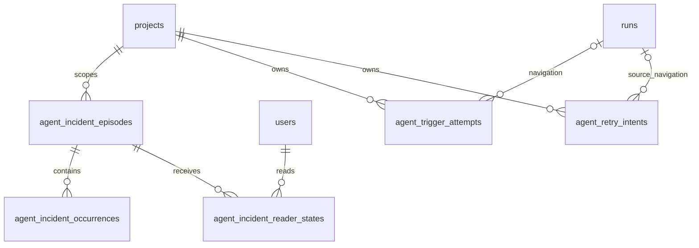

# Agent activity persistence

**Implemented — additive main-lineage migrations 0204–0209; no Brain migration.**

The owning domain defines lifecycle and authority. SQL, Drizzle schema, journal and snapshot must agree; generated consolidated ERD changes only after the corresponding DDL phase.

## Entities and cardinalities

Nullable navigation retains safe immutable identity after history expiry.

## Columns and invariants

| Object                       | Contract                                                                                                                                                                                                                                                          |
| ---------------------------- | ----------------------------------------------------------------------------------------------------------------------------------------------------------------------------------------------------------------------------------------------------------------- |
| runs activity                | source_agent_id has no catalog FK, immutable launched_at/activity_sort_at/provenance/activity snapshot; nullable-first legacy backfill; partial history index by project/source/sort/id.                                                                          |
| episodes                     | Immutable project/agent/scope/fingerprint; unique open cause; attention revision is independent of repeat count.                                                                                                                                                  |
| occurrences                  | Unique source fact key plus fingerprint; run FK SET NULL and immutable original ID; exact cleanup source resolution.                                                                                                                                              |
| reader states                | User/episode/attention revision key, explicit ack timestamp and independent durable notification receipt; valid null/mode CHECKs.                                                                                                                                 |
| trigger attempts             | Unique binding-snapshot/fence or event-delivery key; claimed/settled timestamps, nullable run navigation, immutable source identity and safe outcome; no detach cascade.                                                                                          |
| cutover checkpoints          | `agent_activity_cutovers`, version 1: phase, separate run/schedule/episode cursors, cumulative processed/unresolved counts and start/completion times. One bounded transaction commits each page. Conflict rolls back its page and leaves the last cursor intact. |
| exact legacy reader receipts | `agent_incident_occurrence_readers`, occurrence/user primary key and acknowledgement time; user deletion cascades, run deletion does not erase the receipt. These do not acknowledge the whole episode or future occurrences.                                     |
| retry intents                | Request key plus actor and canonical payload guard; accepted/launched source claim; reserved child ID; immutable recipe, fence/due/attempt/progress and pre-run disposal. Source/run/actor deletion retains safe ownership evidence.                              |
| retry lineage                | Unique nonnull runs.retry_of_run_id; retained launched intent permanently prevents a second child after history pruning.                                                                                                                                          |
| upgrade progress             | Existing upgrade infrastructure stores bounded page cursor and source/version; commit progress with page, refuse poison/unknown rows explicitly.                                                                                                                  |

## Transactions and indexes

Index all hot project/agent/task/due/status and keyset paths; bounded scans use dueAt/id or timestamp/id. All current pointers, receipt uniqueness, payload comparison, state CHECKs and same-project relationships are database/service invariants with direct-write negative tests. Source run precedes task and agent-advisory/episode locks; task-only human writes do not lock a run later. No Git/host/network effect inside PostgreSQL transactions.

## Migration and recovery

Supported fresh/master0198/current0203 upgrades append new SQL. Old pre-rebase operational0194–0198 ledgers are unsupported and must refuse before mutation. Stop old writers, set maintenance, apply additive schema, resume bounded backfill, verify counts/schema, start compatible readers/writers, then reopen admission. Never forge historical success or launch time. Rollback retains additive evidence and fences incompatible admissions; no destructive down migration. Unknown/deleted ownership preserves diagnosis. A pre-run retry allocation is owned by its intent until atomic transfer to the created run.

## Linked artifacts

- [Owning contract](../system-analytics/agent-incidents.md)
- [Traceability](../system-analytics/agent-activity-traceability.md)
- [Current generated ERD](erd.dbml)
- [Database reference](../database-schema.md)

## Attention publication baseline (0208)

`attention_publication_states` has one `owner_user_id` primary key referencing
`users` with cascade deletion, `projection_version=1`, nonnegative `decisions` and
`ordinary_decisions` with `ordinary_decisions <= decisions`, creation/update
timestamps and an optional opaque last `notification_event_id` without an outbox
FK. It is private publication bookkeeping, not a second canonical queue count.
The existing per-user advisory publication lock serializes its writes. Baseline
and episode notification receipts are independent of human seen state and survive
webhook-event retention. Cutover seeding is bounded, maintenance-fenced and
insert-only on replay; normal publication updates the observed baseline even
when no external notification is warranted. See the notification owner contract
in [agent incidents](../system-analytics/agent-incidents.md).
