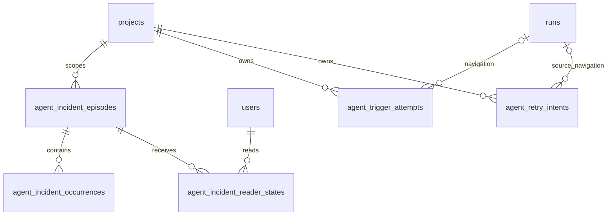
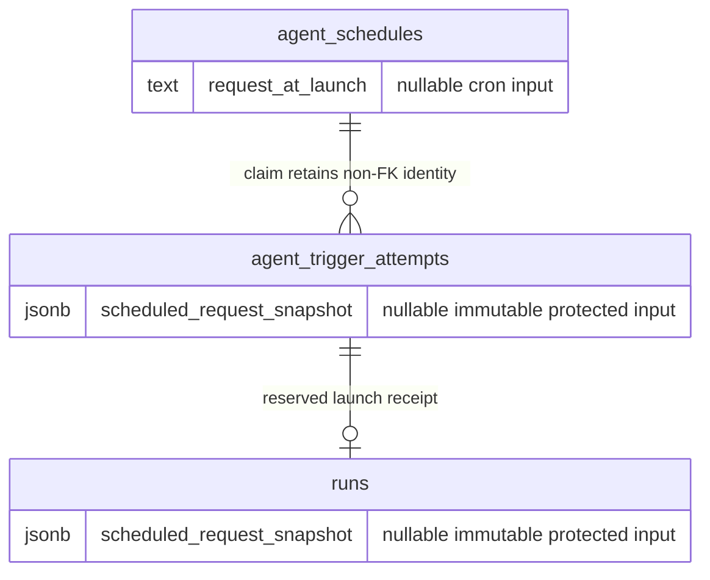

# Agent activity persistence

**Implemented — additive main-lineage migrations 0204–0210; no Brain migration.**

The owning domain defines lifecycle and authority. SQL, Drizzle schema, journal and snapshot must agree; generated consolidated ERD changes only after the corresponding DDL phase.

## Entities and cardinalities

Nullable navigation retains safe immutable identity after history expiry.

## Columns and invariants

| Object                       | Contract                                                                                                                                                                                                                                                          |
| ---------------------------- | ----------------------------------------------------------------------------------------------------------------------------------------------------------------------------------------------------------------------------------------------------------------- |
| runs activity                | source_agent_id has no catalog FK, immutable launched_at/activity_sort_at/provenance/activity snapshot; nullable-first legacy backfill; partial history index by project/source/sort/id.                                                                          |
| episodes                     | Immutable project/agent/scope/fingerprint; unique open cause; attention revision is independent of repeat count.                                                                                                                                                  |
| occurrences                  | Unique source fact key plus fingerprint; run FK SET NULL and immutable original ID; exact cleanup source resolution.                                                                                                                                              |
| reader states                | User/episode/attention revision key, explicit ack timestamp and independent durable notification receipt; valid null/mode CHECKs.                                                                                                                                 |
| trigger attempts             | Unique binding-snapshot/fence or event-delivery key; claimed/settled timestamps, nullable run navigation, immutable source identity and safe outcome; no detach cascade.                                                                                          |
| cutover checkpoints          | `agent_activity_cutovers`, version 1: phase, separate run/schedule/episode cursors, cumulative processed/unresolved counts and start/completion times. One bounded transaction commits each page. Conflict rolls back its page and leaves the last cursor intact. |
| exact legacy reader receipts | `agent_incident_occurrence_readers`, occurrence/user primary key and acknowledgement time; user deletion cascades, run deletion does not erase the receipt. These do not acknowledge the whole episode or future occurrences.                                     |
| retry intents                | Request key plus actor and canonical payload guard; accepted/launched source claim; reserved child ID; immutable recipe, fence/due/attempt/progress and pre-run disposal. Source/run/actor deletion retains safe ownership evidence.                              |
| retry lineage                | Unique nonnull runs.retry_of_run_id; retained launched intent permanently prevents a second child after history pruning.                                                                                                                                          |
| upgrade progress             | Existing upgrade infrastructure stores bounded page cursor and source/version; commit progress with page, refuse poison/unknown rows explicitly.                                                                                                                  |

## Transactions and indexes

Retry recipe v1 remains readable as pre-work replay. Migration 0210 adds v2 with
an explicit `pre_work_retry | fresh_qualification` strategy; the generated CHECK
refuses a missing/unknown v2 strategy and preserves all v1 rows. The v2 fresh
recipe freezes its qualification repository SHA. No table or status is added.
Task row locks serialize fresh assessment intents and the final qualifier run
insertion across different old source runs. The source-only unique index still
protects permanent successor lineage independently of task-level contention.

Index all hot project/agent/task/due/status and keyset paths; bounded scans use dueAt/id or timestamp/id. All current pointers, receipt uniqueness, payload comparison, state CHECKs and same-project relationships are database/service invariants with direct-write negative tests. Source run precedes task and agent-advisory/episode locks; task-only human writes do not lock a run later. No Git/host/network effect inside PostgreSQL transactions.

## Migration and recovery

For 0210, pause admission and stop older web/scheduler writers before migrating,
then start v2-aware code before reopening retries. Schema expansion preserves v1
recipes, but older code must not consume a v2 fresh-assessment intent as generic
replay. Rollback keeps 0210 and all receipts; fence retry admission/dispatch until
a compatible version is restored rather than rewriting or deleting v2 recipes.

Supported fresh/master0198/current0203 upgrades append new SQL. Old pre-rebase operational0194–0198 ledgers are unsupported and must refuse before mutation. Stop old writers, set maintenance, apply additive schema, resume bounded backfill, verify counts/schema, start compatible readers/writers, then reopen admission. Never forge historical success or launch time. Rollback retains additive evidence and fences incompatible admissions; no destructive down migration. Unknown/deleted ownership preserves diagnosis. A pre-run retry allocation is owned by its intent until atomic transfer to the created run.

## Linked artifacts

- [Owning contract](../system-analytics/agent-incidents.md)
- [Traceability](../system-analytics/agent-activity-traceability.md)
- [Current generated ERD](erd.dbml)
- [Database reference](../database-schema.md)

## Attention publication baseline (0208)

`attention_publication_states` has one `owner_user_id` primary key referencing
`users` with cascade deletion, `projection_version=1`, nonnegative `decisions` and
`ordinary_decisions` with `ordinary_decisions <= decisions`, creation/update
timestamps and an optional opaque last `notification_event_id` without an outbox
FK. It is private publication bookkeeping, not a second canonical queue count.
The existing per-user advisory publication lock serializes its writes. Baseline
and episode notification receipts are independent of human seen state and survive
webhook-event retention. Cutover seeding is bounded, maintenance-fenced and
insert-only on replay; normal publication updates the observed baseline even
when no external notification is warranted. See the notification owner contract
in [agent incidents](../system-analytics/agent-incidents.md).

## Scheduled agent request input (Implemented)

The [owning input contract](../system-analytics/scheduled-agent-requests.md) defines normalization, claim serialization, authorized successor inheritance and release/rollback constraints.

| Column | Additive contract |
| --- | --- |
| agent_schedules.request_at_launch | Nullable text; null default; cron-only nonempty strings of at most 8000 code points. Desired input for future claims. |
| agent_trigger_attempts.scheduled_request_snapshot | Nullable jsonb; null default; strict version-1 envelope; IDs match the claim; immutable under the existing identity guard. Protected separately from safe binding metadata. |
| runs.scheduled_request_snapshot | Nullable jsonb; null default; exact immutable copy, including authorized successors with a different current trigger source. |

No historical input is inferred. Snapshot origin IDs are non-FK retained audit values. Existing schedule navigation FK remains SET NULL; key-share existence resolution makes deletion after claim harmless to launch. Guards permit unrelated settlement/lifecycle updates. CHECKs distinguish SQL NULL, JSON null and missing keys; schema, generated SQL, journal and matching snapshot must agree. No new table/index is introduced.

The additive input fields have no independent lifecycle or cascade.

