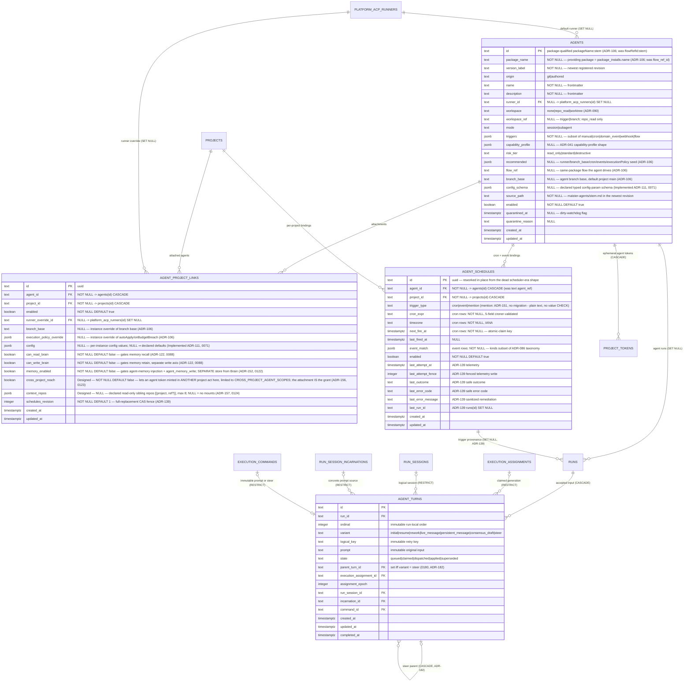
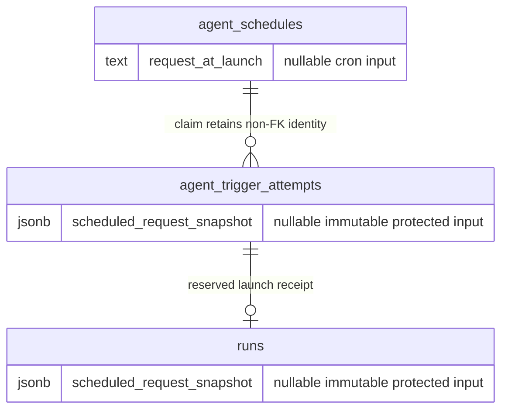
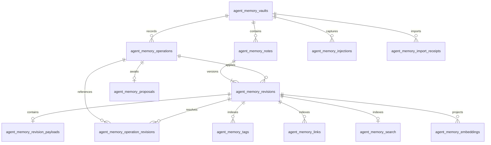

# Platform agents ERD

Tables for the platform-agent substrate (ADR-089/ADR-090): the agent
catalog index, project attachments, trigger bindings, plus the agent-shaped
columns added to `runs`, `tasks`, and `project_tokens`. See
[`../system-analytics/agents.md`](../system-analytics/agents.md) for process
flows and [`../database-schema.md`](../database-schema.md) for the
column-level narrative.

> **Status: Implemented.** Migration `0049_platform_agents.sql` adds `agents` +
> `agent_project_links`, reworks the dead scheduler-clock-era `agent_schedules`
> shape (ADR-060) in
> place, and alters `runs` / `tasks` / `project_tokens`;
> `0051_agents_package_source.sql` reshapes `agents` to package provenance
> (drops `scope`/`project_id`, adds `flow_ref_id`/`version_label`/`origin`/
> `recommended`/`workspace_ref` — ADR-089 rework).
>
> **(Implemented — ADR-106, migration `0068`)** the catalog is re-keyed per-package:
> `agents.flow_ref_id` → `package_name` (NOT NULL, = `package_installs.name`),
> reindex `agents_flow_ref_idx` → `agents_package_name_idx`, add `agents.flow_ref`
> + `agents.branch_base`, extend `recommended` with `executionPolicy`, and add
> `agent_project_links.branch_base` + `agent_project_links.execution_policy_override`.
> The ERD/tables below show the post-0068 shape; the pre-0068 columns they
> replace are noted inline.
>
> **(Implemented — ADR-139, migration `0104`)** stable agent schedule IDs are
> reconciled under `agent_project_links.schedules_revision`; bindings retain
> fenced latest-attempt telemetry and `runs.agent_schedule_id` records the
> binding that launched an agent run.
>
> **(Implemented — ADR-156, migration `0123`; ADR-157, migration `0124`)** the
> attachment gains two per-project axes — `cross_project_reach` (boolean NOT NULL
> DEFAULT false) and `context_repos` (jsonb NULL). Both are additive with
> pre-migration-honest seeds (no reach / no mounts), so neither needs a backfill.
> The matching Run-side launch snapshots `runs.agent_chain_depth` and
> `runs.context_mounts` are drawn in [`runs-domain.md`](runs-domain.md).
>
> Main `0254` adds nullable `agent_schedules.project_source_review` for a
> server-recorded native cron/event review. Legacy rows remain unknown, and no
> Brain/user FK is added. The [review contract](../system-analytics/specialist-assignments.md#project-automation-review)
> defines authority and digest semantics; native dispatch qualification is defined in that contract.
> Main `0255` adds reviewed project binding snapshot v3 to the existing claim
> contract. Its reference guard refuses v1 capture from a currently reviewed
> source, keeping old workers from bypassing native review. Existing v1/v2
> history stays unchanged; the separate scheduled input remains v1.



Dropped from the prior scheduler-era shape (zero readers/writers existed): `agent_ref`
(text), `scheduler_job_id` (per-schedule job bridge — replaced by the seeded
singleton `agent_tick.dispatcher`), `desired_state` (`continuous` is the
future Mγ stage).

The `agent_turns` storage and production message admission are implemented.
Messages retain FIFO order across capacity claims and persistent parks. Initial
turns retain their input before owned creation; rework input commits with its
new assignment and invalidation of the prior public result. Migration `0156`
adds the `consensus_draft` variant so a consensus participant child owns its
draft input, create and completion. Migration `0180` adds the `steer` variant
(ADR-182): a message injected into the running turn, linked to it by
`parent_turn_id` and excluded from the one-active-turn partial index; a host
refusal supersedes it with an ordinary successor message. Resume wiring remains
Designed. Its accepted input,
binding and state constraints are defined in the
[schema reference](../database-schema.md#agent_turns-implemented).

## Sibling-table alters (same migration)

| Table | Change |
| ----- | ------ |
| `runs` | `run_kind` gains `'agent'`; new `agent_id` (FK `agents` SET NULL), `trigger_source` (`manual\|cron\|domain_event\|webhook\|flow\|scheduled`, NULL), `trigger_event_id` (bigint, NULL), `trigger_payload` (jsonb, NULL), `agent_workspace` (`none\|repo_read\|worktree`, NULL; migration `0052`) — snapshot of the run's effective workspace axis at spawn; terminal L3 enforcement gates off this, not the mutable catalog index. ADR-139 adds nullable `agent_schedule_id` (FK SET NULL) as binding provenance. |
| `tasks` | `flow_id` → NULLABLE; new `triage_status` (`'triaged'` \| NULL), `runner_id` (FK SET NULL), `target_branch` (text NULL), `promotion_mode` (`local_merge\|pull_request`, NULL). |
| `project_tokens` | `token_kind` gains `'agent'`; new `agent_id` (FK `agents` CASCADE, NULL; CHECK `token_kind='agent'` ⇔ `agent_id IS NOT NULL`). |

### Human-ask provenance (Implemented — ADR-136)

`task_clarifications.origin_agent_id` is an immutable source snapshot rather
than a cascading FK. It identifies the requesting platform agent even if the
agent, source run, or original HITL row is later removed. Re-trigger dispatch
uses the stored agent identity and the target-only domain-event payload; it does
not trust a request body for an agent identifier.

## Keys and constraints

| Table | Constraint | Columns | Purpose |
| ----- | ---------- | ------- | ------- |
| `agent_project_links` | `UNIQUE` | `(agent_id, project_id)` | One attachment per pair. |
| `agent_schedules` | `CHECK` | cron rows: `cron_expr/timezone/next_fire_at NOT NULL`; event rows: `event_match NOT NULL` | Row shape per `trigger_type`. Both CHECKs are `<>`-guarded, so **(ADR-151 — Implemented)** `trigger_type='mention'` rows (all-null cron/event columns) pass unchanged and need NO migration; `trigger_type` itself carries no value CHECK. At most one ENABLED mention row per `(agent_id, project_id)` is enforced in `updateAgentLink`, not by a constraint. |
| `runs` | partial `UNIQUE` | `(agent_id, trigger_event_id) WHERE trigger_event_id IS NOT NULL AND company_id IS NULL` | Existing project outbox→spawn claim. Company event claims use company/professional/subscription/event under [native source guards](specialist-assignments-domain.md#canonical-intake-receipts). |
| `project_tokens` | `CHECK` | `(token_kind='agent') = (agent_id IS NOT NULL)` | Agent tokens always carry the agent identity. |

## Indexes

| Table | Index | Columns | Purpose |
| ----- | ----- | ------- | ------- |
| `agents` | `agents_package_name_idx` (ADR-106; was `agents_flow_ref_idx`) | `(package_name)` | Providing-package lookups (registration/resync, available-list filter). |
| `agent_project_links` | `agent_project_links_project_idx` | `(project_id)` | Attached-agents-per-project reads. |
| `agent_schedules` | `agent_schedules_project_agent_idx` | `(project_id, agent_id)` | Binding lookups. |
| `agent_schedules` | `agent_schedules_due_cron_idx` | `(trigger_type, enabled, next_fire_at)` | Due-cron scan on the `agent_tick.dispatcher` tick. |

## Cascade chain

```
agents
  ├── agent_project_links  (FK agent_id,  ON DELETE CASCADE)
  ├── agent_schedules      (FK agent_id,  ON DELETE CASCADE)
  ├── project_tokens       (FK agent_id,  ON DELETE CASCADE — ephemeral agent tokens)
  └── runs.agent_id        (ON DELETE SET NULL — run history survives catalog deletes)

projects
  ├── agent_project_links  (FK project_id, ON DELETE CASCADE)
  └── agent_schedules      (FK project_id, ON DELETE CASCADE)
```

There is no admin delete endpoint for package-sourced agents; definitions
leave through their providing package, and `resync` disables missing catalog
rows instead of deleting them. The `ON DELETE` actions remain FK backstops for
future/admin maintenance paths and preserve terminal run history.

**Migration 0068 data policy (Implemented — ADR-106).** The per-flow → per-package
re-key is destructive to the catalog only: migration 0068 runs `DELETE FROM
agents` (which CASCADE-deletes `agent_project_links` + `agent_schedules`, and
SET-NULLs `runs.agent_id` so run history survives) before/while reshaping the
columns, then a post-migration resync (startup reconcile + admin
`POST /api/admin/agents/resync`) re-projects the catalog from installed packages
under the new `package_name` key.

## Linked artifacts

- Process flows: [`../system-analytics/agents.md`](../system-analytics/agents.md).
- Global ERD: [`erd.md`](erd.md); run columns also in [`runs-domain.md`](runs-domain.md).
- Narrative: [`../database-schema.md`](../database-schema.md).
- Decision records: ADR-089, ADR-090, ADR-106 (per-package re-key) in
  [`../decisions.md`](../decisions.md).
- Source (Implemented): `web/lib/db/schema.ts` (migration `0049_platform_agents.sql`);
  per-package reshape `web/lib/db/migrations/0068_m39_package_agents.sql` (Implemented — ADR-106).

## Operational agents

The `kind` and `completion_contract` definition columns default to code delivery and no operational contract. Registry SET/CLEAR/re-SET follows package bytes. Runs snapshot launch semantics; catalog resync never reclassifies historical attempts. See [operational persistence](operational-agents-domain.md).

## Designed activity extension

New activity/incident/attempt/retry fields are owned by [agent activity persistence](agent-activity-domain.md); qualification by [task qualification persistence](task-qualification-domain.md). Existing schema above remains authoritative until the additive migration lands.

## Scheduled agent request input (Implemented)

The [owning input contract](../system-analytics/scheduled-agent-requests.md) defines normalization, claim serialization, authorized successor inheritance and release/rollback constraints.

| Column | Additive contract |
| --- | --- |
| agent_schedules.request_at_launch | Nullable text; null default; cron-only nonempty strings of at most 8000 code points. Desired input for future claims. |
| agent_trigger_attempts.scheduled_request_snapshot | Nullable jsonb; null default; strict version-1 envelope; IDs match the claim; immutable under the existing identity guard. Protected separately from safe binding metadata. |
| runs.scheduled_request_snapshot | Nullable jsonb; null default; exact immutable copy, including authorized successors with a different current trigger source. |

No historical input is inferred. Snapshot origin IDs are non-FK retained audit values. Existing schedule navigation FK remains SET NULL; key-share existence resolution preserves legacy cron launch after source deletion. Native reviewed admission additionally validates its current source appointment. Guards permit unrelated settlement/lifecycle updates. CHECKs distinguish SQL NULL, JSON null and missing keys; schema, generated SQL, journal and matching snapshot must agree. No new table/index is introduced.

The additive input fields have no independent lifecycle or cascade.



## Agent memory vault (Designed)

The main lineage owns vault data and the lexical index. This relational model
uses database-generated text UUIDs and UTC timestamps. Owner project and
agent IDs are retained identity values. Live attachment matching is performed
on the access path, so detaching cannot cascade to history. An installation
vault uses the existing singleton company ID and the qualified catalog agent ID.



| Relation | Identity, fields and constraints | Retention and invalidation |
| --- | --- | --- |
| `agent_memory_vaults` | `id` PK, `agent_id` text, mutually exclusive `project_id` and `company_id` text, `generation` bigint default 0, nonnegative `note_count`, `content_chars`, `content_bytes` default 0, `created_at`. Partial unique keys over `(project_id, agent_id)` and `(company_id, agent_id)`. Company FK to `companies.id` restricts delete. | Project and catalog identities survive detach and retirement. The current reviewed attachment supplies enablement and policy. |
| `agent_memory_notes` | `id` PK, `vault_id` FK, `path`, `head_revision_id`, `deleted_at` nullable. Unique `(vault_id,id)`. Active `(vault_id,path)` partial unique with deterministic byte order. The head FK to `revisions(vault_id,note_id,id)` is deferred to transaction commit. | Keep tombstones. New creation after a delete uses a new note ID. Reject active file and directory-prefix collisions under the vault row lock. |
| `agent_memory_revisions` | `id` PK, `vault_id,note_id` composite FK, `parent_revision_id` nullable same-note FK, optional `operation_id` same-vault FK, `path`, `kind`, `content_sha256` nullable only for tombstones, `size_chars`, `size_bytes`, typed immutable `author` and `source_restrictions` JSON, sorted unique `source_project_ids` text array and `created_at`. Unique `(vault_id,note_id,id)`. At most one first revision and one child per predecessor. Index history by `(vault_id,note_id,created_at,id)`. | Immutable metadata. Both authoring Run/session and node-attempt identifiers are retained identity values so operational cleanup cannot erase provenance. Author JSON distinguishes human, librarian via human, agent session and operator import. |
| `agent_memory_revision_payloads` | PK/FK `(vault_id,note_id,revision_id)`. `content` text holds the exact UTF-8 text. Tombstones carry no payload. | Immutable while present. Only the redaction transaction removes it, with the exact revision redaction record. |
| `agent_memory_redactions` | PK/FK `(vault_id,note_id,revision_id)`. Current global admin ID, bounded reason, `created_at`. | Original metadata remains. The row denies derivative reads and future effects before projection cleanup. |
| `agent_memory_operations`, `agent_memory_operation_revisions` | Operation PK `id`, unique `(vault_id,id)` and `(vault_id,principal_key,request_key)`, `command_kind`, canonical `command_digest`, `outcome`, and `created_at`. Reference row key `(vault_id,operation_id,role,ordinal)` and same-vault composite FKs to operation and `(vault_id,note_id,revision_id)`. Roles separate base and result. | Outcome receipt and revision pointers commit with the write. Diffs resolve from currently authorized payload references. |
| `agent_memory_injections` | PK `id`, `vault_id`, retained `run_id`, nullable `node_attempt_id`, `session_key`, protocol version and hash, canonical ordered tree descriptor, optional same-vault index revision FK, descriptor digest, rendered size, `application_state`, application receipt ID, `created_at`. Unique `(run_id,session_key)`. | Immutable staged descriptor. Settlement changes only application fields. Only acknowledged application receipts enter the Run aggregate. |
| `agent_memory_cutover`, `agent_memory_import_receipts` | Singleton `agent_memory_cutover` with positive generation on activation and activation timestamp, absent means before activation. Import receipt PK `id`, generation, source kind, canonical root-relative legacy identity, source digest and byte length, state, timestamps, optional `vault_id,note_id,revision_id` composite FK and optional retained `run_id`. Unique `(generation,source_kind,source_identity)`. Run snapshot text is stored in a guarded import payload keyed by the receipt. | No SQL reads host files. Verified identity and digest authorize cleanup. Unmatched historical snapshots retain their outcome without being deleted. |
| Tags, aliases, links, lexical search | `agent_memory_tags` and `agent_memory_aliases` key by exact source revision and canonical term. `agent_memory_links` keys by exact source revision and occurrence ordinal and stores the parsed target. `agent_memory_search` uses an exact revision composite key and generated `tsvector`, with a GIN index. All have a same-vault revision FK. | Rebuildable projections. Recheck current visible heads. Resolve aliases and backlinks against currently visible candidates. |
| `agent_memory_proposals`, `agent_memory_proposal_payloads` | Same-vault operation FK, exact base refs, content-free change summaries, immutable source and author, and separately stored typed command. Index pending by `(vault_id,created_at,id)`. | Proposal quota is independent of live quota. Settlement retains the effect receipt. Exact-source redaction removes affected payloads and withdraws pending rows. |
| `agent_memory_promotions` | Exact same-vault revision FK and operation FK, with the resulting governed proposal ID. | The witness resolves the vault payload under current source authority. |
| `inbox_review_receipts` | Actor-scoped request key, digest and receipt ID. | A batch item commits this receipt with its domain decision. |
| Brain `agent_memory_embeddings` | Rebuildable exact revision FK. Primary key `(vault_id,note_id,revision_id,model,dimensions,generation)`. Leases fence retryable work. | Optional Brain migration `0012` follows main. Search joins only the visible current head and configured generation. |

Unless noted otherwise, FKs within retained vault history restrict deletes.
Only rebuildable projections may cascade from their exact owners. Vault
services acquire the vault row before changing the head, quota or generation.
Positive and missing numbers use bounded integers at the command boundary.

| Migration | Designed delta | Upgrade fixture and postcondition |
| --- | --- | --- |
| Main 0343 | Vaults, notes, revisions, payloads, redaction metadata, operations, injections and import/cutover tables. Add nullable `runs.agent_memory_hash_format` with accepted values `legacy-file-v1` and `vault-manifest-v1`. | Seed 0342 with enabled and disabled attachments, detached legacy inventory and a Run with raw hash. New history starts empty. Backfill the format only where the old hash is non-null. Preserve its bytes. |
| Main 0344 | Deferred exact head FK, immutable revision and payload guards, and append-only/redaction transition guards. | A cross-vault or cross-note pointer, changed history or an unauthorized payload delete fails. Same-transaction real redaction succeeds. |
| Main 0345 | Native source capture v2 permits exact vault revision references. | Existing v1 receipt bytes stay unchanged. A v1 receipt cannot include a vault revision reference. |
| Main 0346 | Main tag/alias/link and lexical projections. | Existing heads are indexed by the resumable builder. Installing this migration needs no vector extension. |
| Brain 0012 | Optional vault embedding projection keyed by the exact main revision. | Upgrading 0011 keeps existing Brain data and embeddings. The main-only database remains usable. |
| Main 0347 | Project write policy default `auto`, immutable capture of external input and vault proposal/decision receipts. | Unknown historical execution provenance cannot authorize automatic writes. Existing settings retain their meaning. |
| Main 0348–0349 | Reviewed installation reach, versioned execution principal and exact disclosure provenance. See the [company domain](company-brain-domain.md). | Legacy grant or historical execution gains no new scope. Provenance that cannot resolve remains unavailable. |
