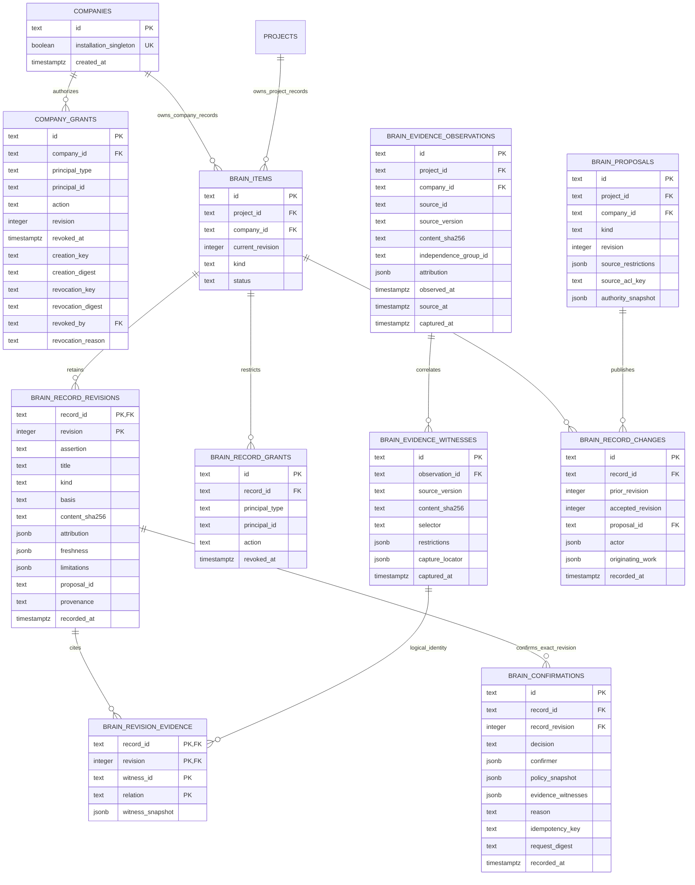

# Company Brain persistence

**Partially implemented — ADR-202.** Main migration `0230_company_ownership` supplies singleton identity and explicit company grants. Brain migration `0007_company_records` adds owners, restricted-record grants, immutable revisions/change history, honest legacy baselines and repository-free text-source storage. Brain migration `0008_company_evidence` adds immutable captures, revision evidence snapshots and exact-version potential-conflict edges. Brain `0009_knowledge_review` and `0011_proposal_source_access` retain native review decisions and inherited source access; main `0232_company_grant_requests` retains administrator grant delivery/revocation receipts. Native review and grant-management HTTP routes are implemented locally; UI and live-package qualification remain pending. This is the additive native Brain record/evidence model; the [existing Project Brain ERD](brain-domain.md) remains the implemented baseline. [Records](../system-analytics/company-brain.md) and [evidence](../system-analytics/company-brain-evidence.md) own behavior.

## Lineages and reservations

Reserved from the inspected `master` journals on 2026-11-02: main `0230_company_ownership` and `0231_company_knowledge_events`; Brain `0007_company_records`, `0008_company_evidence`, `0009_knowledge_review`. The two main migrations and three Brain migrations are implemented in the local lineage; their presence does not establish API or pilot qualification. Brain `0010_source_access` implements current/exact-revision source restrictions and native capture delivery receipts in the local lineage; recheck collisions before merge. Main always precedes Brain; no main migration references a newly created Brain table. The existing Brain ledger remains `drizzle.__drizzle_brain_migrations`.

Company identity/grants live in main. `brain_items` keeps its ID and current search fields, gains nullable company ownership/current revision, and permits null project only with company owner. All Brain children use owner columns or an unambiguous FK-derived owner; access never depends on a null-as-platform convention.

The proposed relationships retain historical revisions and witnesses when projections/sources are retired.

## Column, key and constraint contract

All IDs are server-generated text IDs, timestamps UTC. JSON structures are closed versioned native types, not arbitrary model objects. Character/byte bounds follow the owning [record](../system-analytics/company-brain.md) and [witness](../system-analytics/company-brain-evidence.md) contracts.

| Table/extension | Keys, defaults and checks | Index/delete contract |
| --- | --- | --- |
| `companies` | UUID-text PK; `installation_singleton=true` NOT NULL CHECK and UNIQUE; created_at server now | One explicit company, never synthetic project; delete RESTRICT |
| `company_grants` | UUID-text PK; company FK; principal user/agent/system; domain-qualified action (`knowledge:read/propose/review/confirm/manage` and the closed specialist vocabulary below); positive revision default 1; server creator/time, optional bounded confirmation_classes policy; nullable revoked_at | UNIQUE live `(company_id,principal_type,principal_id,action)`; company FK RESTRICT; current principal validated by service |
| `brain_items` additions | company_id nullable FK; project_id nullable existing FK; exactly one nonnull; current_revision positive; supported kind/lifecycle extension | Separate partial owner/content/current-state indexes, no nullable composite uniqueness loophole; direct record removal is guarded; project deletion cascades local Brain state without obstruction |
| `brain_record_revisions` | PK `(record_id,revision)`; title/kind/assertion/basis/hash immutable; recorded_at capture time; attribution/freshness/limitations closed JSON; provenance submitted/legacy_migration; nullable proposal_id for imported baseline | record FK CASCADE; normal UPDATE/DELETE refuses, while deletion of the owning project cascades its record history; exact revision links remain guarded during ordinary operation |
| `brain_record_grants` | Record FK, explicit principal/action, revoked_at; presence restricts record within owner grants, never broadens owner access | UNIQUE live `(record_id,principal_type,principal_id,action)`; parent record CASCADE |
| `brain_evidence_observations` | Company/project exclusivity; source/version captured; independence_group_id nullable means unknown, never independent-by-default; original actor/run/attempt nullable only when provenance genuinely unavailable | Owner/source/version lookup indexes; project owner CASCADE; source deletion alone leaves an unavailable historical witness |
| `brain_evidence_witnesses` | observation FK CASCADE; at least source_version or lowercase 64-hex digest for new captures; selector and restrictions immutable; locator is bounded inline or existing opaque artifact reference | UNIQUE observation/version/digest/selector using NULL-safe expressions; no source-reanchor rewrite; normal witness deletion guarded; owning-project deletion cascades without blocking other owners |
| `brain_revision_evidence` | Composite revision FK CASCADE; bounded witness_snapshot and immutable witness ID/version/digest snapshot validated by the service, with no restrictive cross-owner witness FK; relation supports/contradicts/derived_from/refines/references; PK includes relation | Reverse `(witness_id,record_id,revision)` index; deleted witness resolves explicitly unavailable; no cross-owner visibility bypass |
| `brain_knowledge_submissions` | Immutable owner/principal/delivery receipt with request digest, original proposal, server attribution and received_at; project FK CASCADE | Live owner-scoped delivery uniqueness; new keys for identical input retain one proposal, changed key content conflicts |
| `brain_confirmations` | Exact composite revision FK; server-generated monotonic decision_sequence; confirm/revoke decision; server confirmer/policy/evidence/reason; content-guarded idempotency | UNIQUE `(record_id,idempotency_key)`; immutable decision rows; latest decision computed over decision_sequence, not wall-clock or agent timestamp |
| `brain_record_changes` | Exact prior/new revision references, reviewer and proposal/origin pointers; new revision positive, prior nullable only addition | UNIQUE `(record_id,accepted_revision)`; immutable; only newly accepted publication emits an event |
| `brain_proposals` extension | knowledge_add/knowledge_correct kinds, record target nullable only new assertion; expected revision required for correction; typed proposed content/witnesses; explicit owner | Pending-decision CAS and owner/authority-scoped submission digest; existing improvement kinds/outcomes unchanged |

Claim edges retain `claim_state` (potential_conflict/declared_conflict), exact `from_revision`/`to_revision` and server `claim_actor`; their JSON references do not block a referenced project deletion. Similarity cannot create a declared contradiction.

Source/chunk/edge/snapshot/proposal ownership migration is explicit: company source snapshots can be text/artifact captures without a repo; repository indexing jobs remain project-scoped. Shared child reads derive owner through their parent and validate it before disclosure. Existing capture/proposal/record IDs are never remapped.

Company grant actions are domain-qualified; a knowledge read cannot authorize a target restart or an assignment read. [Runtime authority](../system-analytics/specialist-runtime.md) lists the specialist/assignment/target vocabulary. Record restrictions use only the knowledge action subset and never broaden owner permission.

## Backfill and startup

1. Apply main company identity/grants before Brain company FKs. Do not grant content read to every global member.
2. Populate genuine project owner on existing records and supporting entities. Create revision 1 from current stored content with `provenance=legacy_migration`, unknown submitting actor/basis/timestamps/witnesses where unsupported, and no fabricated confirmation or historical accept event.
3. Preserve IDs, pending improvement proposals and immutable run/request/result snapshots. Re-anchor only navigational pointers; unknown original versions remain unknown.
4. Add/validate ownership and revision guards only after backfill. Invalid existing rows abort with counted diagnostic identities; never delete live rows to satisfy a CHECK.
5. Both main and Brain startup pending-migration guards must pass before new feature routes or workers activate. Main/Brain interrupted upgrade resumes forward from their separate ledgers.

A deferred foreign key and constraint trigger enforce head/revision identity and content equality at commit. Trusted native review services declare transaction-local `maister.knowledge_writer=native_v1`, then write parent/revision/change together. Legacy writers receive unknown baseline revisions; they cannot change a submitted assertion or advance its head. Numeric confidence updates never change the assertion basis or confirmation. Ordinary revision/change UPDATE/DELETE refuses. Project deletion is an explicit lifetime boundary: its record/grant/revision/change rows cascade, and the history guards recognize that cascade without blocking it. Direct record/history deletion remains guarded. The foundation, indexed-schema and native proposal integration journeys verify successful project deletion, including accepted corrections, submission receipts, confirmations, captured evidence, local accepted-change and restricted-grant rows. A record-grant insert atomically restricts its parent projection. Revocation keeps that restriction; a deferred guard refuses broader visibility while live narrow grants exist. Legacy project recall/panel/cluster/edge readers exclude records with narrower grants; current authorized native projections are supplied by the later knowledge service.

Main generated migrations retain SQL/journal/snapshot/schema agreement. Brain is hand-authored SQL/journal plus `brain/schema.ts` mirror. Brain must never block project deletion. Project-owned Brain rows follow the owning project cascade; company-owned records remain independently owned. Evidence cited across owners uses immutable logical identity/version snapshots rather than a restrictive FK to project-owned evidence. A deleted project/source becomes an explicit unavailable reference, with current access still enforced. Record/source soft retirement during ordinary operation retains accepted evidence.

## Native review storage

Implemented internally in `knowledge-proposals.ts`: add/correct proposal submission, current authority checks, exact-base acceptance, rejection, separately authorized evidence-bound confirm/revoke and immutable delivery receipts. Same-principal identical input under a new delivery key aliases the original proposal; every alias remains content-guarded. Publication of identical accessible content and metadata reuses the accepted record without changing attribution or adding corroboration. A different evidence set or metadata requires a correction. Narrower records are outside the owner-visible deduplication index. Missing-evidence declarations remain on each immutable revision. Local proposal/history and submission/proposal owner constraints prevent a cross-owner cascade. Ordinary proposal and confirmation deletion is guarded; explicit project deletion cascades all project-owned review data. HTTP/MCP proposal and witness inspection, native decision/confirmation endpoints and inherited source restrictions are implemented locally. Non-witness result/operation reference resolvers and complete launch/output inheritance remain in the following runtime tasks.

## Owned outbox and run source capture

Implemented by main migration `0231_company_knowledge_events`. `domain_events.project_id` becomes nullable, `company_id` references the installation company, and an exclusive-owner CHECK preserves every legacy project row. Company events currently permit only `knowledge.record_changed` without project task/run FKs. A company/kind/identity index supports owned invalidation. Publication appends its accepted change and outbox fact in the same transaction; confirmation/revocation appends its independent decision and invalidation likewise. Payloads contain owner, record ID, exact revision, change/decision ID and cause, with no assertion or source bytes. Replayed publication does not emit a second accepted-change event. All registered project consumers skip company-owned events before resolving project services, but dispatch advances their existing cursors. General project pulse/attention and agent trigger subscriptions exclude knowledge invalidation; native knowledge readers apply their own access policy.

`runs.knowledge_access` has no synthetic backfill or empty default. A non-NULL value requires schemaVersion 1, a capturing/complete/unknown state, positive capture generation and a restrictions array. Later launch/read/derivation services own writing that server metadata. A migration cannot declare historical prompts source-free. The populated upgrade preserves all old run/event fields byte for byte and adds only explicit NULL metadata/ownership columns.

## Native source access extension

Implemented by Brain `0010_source_access`, after immutable committed migration `0009_knowledge_review`: nullable server-derived source_restrictions on current records, exact revisions and submitted sources. NULL records historical classification uncertainty; it is never a source-free assertion. Known sets contain company/project owners or logical restricted-record identities and are canonically sorted and deduplicated. These logical dependencies never FK a project or record, so revocation/deletion changes resolution without obstructing project deletion. Current head and immutable revision must agree on restrictions. T11 retains inherited restrictions on native proposals and corrections; T14 still owns launch-wide input and outward-result coverage; model citation omission must not remove them. Active deduplication includes a server-generated source-access digest, preventing a hidden record from causing an existence-revealing unique conflict. Legacy project projections exclude records with additional known restrictions; native projections authorize their current intersection.

Source capture delivery receipts bind exclusive owner, stable server principal, bounded delivery key and canonical input digest to one immutable source/witness capture. Same key with changed bytes/metadata conflicts; same content can reuse the captured source without inventing independent observation. Receipt immutability allows only the owning project deletion cascade. Unknown legacy run capture metadata refuses native agent disclosure until a compatible server-owned launch profile establishes capture coverage. Captured excerpts are bounded to 8192 UTF-8 bytes with an explicit truncation marker and the digest of full captured bytes; unavailable capture content is never reconstructed from a digest.

### Proposal source access and company grant receipts

Brain `0011_proposal_source_access` adds nullable `brain_proposals.source_restrictions` with at most 256 references and 65536 stored bytes, and a server-triggered source-access digest. Historical proposals retain NULL classification; migration does not invent a source-free footprint. Canonical submission deduplication includes the source-access digest in addition to owner/principal/input digest. Delivery keys remain content guarded. Native proposal input, submit authority snapshot and settled decision authority snapshot are immutable. The existing originating-run FK remains nullable on run/project deletion; logical server attribution is not rewritten.

Main `0232_company_grant_requests` adds nullable creation/revocation key and canonical digest, revoked-by user and bounded reason to existing `company_grants`. Existing rows preserve their complete policy, creator and timestamps with NULL new historical metadata. No receipt ledger or scheduler is introduced. A partial company/creator/key/action unique index retains original creation deliveries. Native input and settled revocation cannot change or be deleted. Native revocation increments exactly one revision and requires its complete receipt; old rows remain compatible with existing raw revocation writers and do not acquire invented decision authority. Main migration and schema have no dependency on a Brain table. Apply main before Brain as usual; committed earlier migrations remain unchanged.
