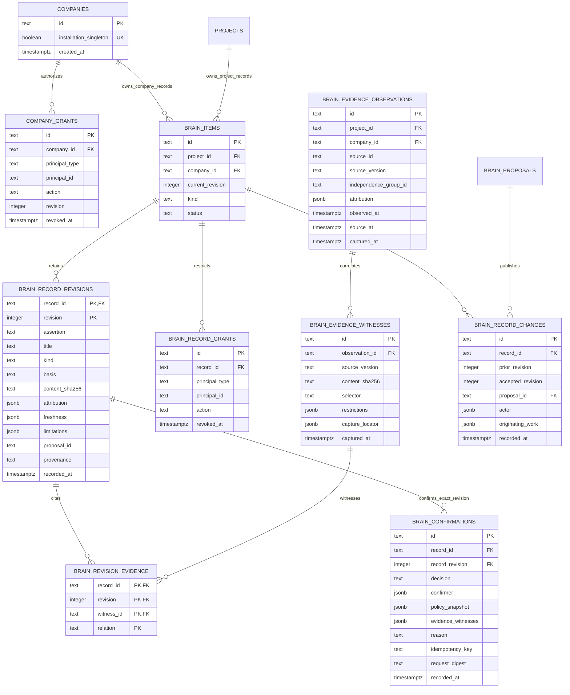

# Company Brain persistence

**Designed — ADR-202.** This is the additive native Brain record/evidence model; the [existing Project Brain ERD](brain-domain.md) remains the implemented baseline. [Records](../system-analytics/company-brain.md) and [evidence](../system-analytics/company-brain-evidence.md) own behavior.

## Lineages and reservations

Reserved from the inspected `master` journals on 2026-11-02: main `0230_company_ownership` and `0231_company_knowledge_events`; Brain `0007_company_records`, `0008_company_evidence`, `0009_knowledge_review`. Reservations are design allocations, not applied SQL or journal entries. Recheck collisions before generation/merge. Main always precedes Brain; no main migration references a newly created Brain table. The existing Brain ledger remains `drizzle.__drizzle_brain_migrations`.

Company identity/grants live in main. `brain_items` keeps its ID and current search fields, gains nullable company ownership/current revision, and permits null project only with company owner. All Brain children use owner columns or an unambiguous FK-derived owner; access never depends on a null-as-platform convention.

The proposed relationships retain historical revisions and witnesses when projections/sources are retired.

## Column, key and constraint contract

All IDs are server-generated text IDs, timestamps UTC. JSON structures are closed versioned native types, not arbitrary model objects. Character/byte bounds follow the owning [record](../system-analytics/company-brain.md) and [witness](../system-analytics/company-brain-evidence.md) contracts.

| Table/extension | Keys, defaults and checks | Index/delete contract |
| --- | --- | --- |
| `companies` | UUID-text PK; `installation_singleton=true` NOT NULL CHECK and UNIQUE; created_at server now | One explicit company, never synthetic project; delete RESTRICT |
| `company_grants` | UUID-text PK; company FK; principal user/agent/system; domain-qualified action (`knowledge:read/propose/review/confirm/manage` and the closed specialist vocabulary below); positive revision default 1; server creator/time, optional bounded confirmation_classes policy; nullable revoked_at | UNIQUE live `(company_id,principal_type,principal_id,action)`; company FK RESTRICT; current principal validated by service |
| `brain_items` additions | company_id nullable FK; project_id nullable existing FK; exactly one nonnull; current_revision positive; supported kind/lifecycle extension | Separate partial owner/content/current-state indexes, no nullable composite uniqueness loophole; accepted revision references RESTRICT destructive item removal |
| `brain_record_revisions` | PK `(record_id,revision)`; title/kind/assertion/basis/hash immutable; recorded_at capture time; attribution/freshness/limitations closed JSON; provenance submitted/legacy_migration; nullable proposal_id for imported baseline | record FK RESTRICT; owner comes from record, `(record_id,revision)` exact FK for links; no UPDATE/DELETE except explicit bounded maintenance that cannot erase referenced evidence |
| `brain_record_grants` | Record FK, explicit principal/action, revoked_at; presence restricts record within owner grants, never broadens owner access | UNIQUE live `(record_id,principal_type,principal_id,action)`; RESTRICT |
| `brain_evidence_observations` | Company/project exclusivity; source/version captured; independence_group_id nullable means unknown, never independent-by-default; original actor/run/attempt nullable only when provenance genuinely unavailable | Owner/source/version lookup indexes; source locator is preserved audit identity, not cascading deletion |
| `brain_evidence_witnesses` | observation FK RESTRICT; at least source_version or lowercase 64-hex digest for new captures; selector and restrictions immutable; locator is bounded inline or existing opaque artifact reference | UNIQUE observation/version/digest/selector using NULL-safe expressions; no source-reanchor rewrite; witness delete RESTRICT if cited |
| `brain_revision_evidence` | Composite revision FK RESTRICT, witness FK RESTRICT; relation supports/contradicts/derived_from/refines/references; PK includes relation | Reverse `(witness_id,record_id,revision)` index; no cross-owner visibility bypass |
| `brain_confirmations` | Exact composite revision FK; confirm/revoke decision; server confirmer/policy/evidence/reason; content-guarded idempotency | UNIQUE `(record_id,idempotency_key)`; immutable decision rows; latest decision computed over server creation order, not agent timestamp |
| `brain_record_changes` | Exact prior/new revision references, reviewer and proposal/origin pointers; new revision positive, prior nullable only addition | UNIQUE `(record_id,accepted_revision)`; immutable; only newly accepted publication emits an event |
| `brain_proposals` extension | knowledge_add/knowledge_correct kinds, record target nullable only new assertion; expected revision required for correction; typed proposed content/witnesses; explicit owner | Pending-decision CAS and owner/authority-scoped submission digest; existing improvement kinds/outcomes unchanged |

Source/chunk/edge/snapshot/proposal ownership migration is explicit: company source snapshots can be text/artifact captures without a repo; repository indexing jobs remain project-scoped. Shared child reads derive owner through their parent and validate it before disclosure. Existing capture/proposal/record IDs are never remapped.

Company grant actions are domain-qualified; a knowledge read cannot authorize a target restart or an assignment read. [Runtime authority](../system-analytics/specialist-runtime.md) lists the specialist/assignment/target vocabulary. Record restrictions use only the knowledge action subset and never broaden owner permission.

## Backfill and startup

1. Apply main company identity/grants before Brain company FKs. Do not grant content read to every global member.
2. Populate genuine project owner on existing records and supporting entities. Create revision 1 from current stored content with `provenance=legacy_migration`, unknown submitting actor/basis/timestamps/witnesses where unsupported, and no fabricated confirmation or historical accept event.
3. Preserve IDs, pending improvement proposals and immutable run/request/result snapshots. Re-anchor only navigational pointers; unknown original versions remain unknown.
4. Add/validate ownership and revision guards only after backfill. Invalid existing rows abort with counted diagnostic identities; never delete live rows to satisfy a CHECK.
5. Both main and Brain startup pending-migration guards must pass before new feature routes or workers activate. Main/Brain interrupted upgrade resumes forward from their separate ledgers.

Main generated migrations retain SQL/journal/snapshot/schema agreement. Brain is hand-authored SQL/journal plus `brain/schema.ts` mirror. Project hard deletion is already unsupported; the new RESTRICT history relationships must be considered before any future hard-delete feature. Record/source soft retirement changes current projections without erasing accepted evidence.
