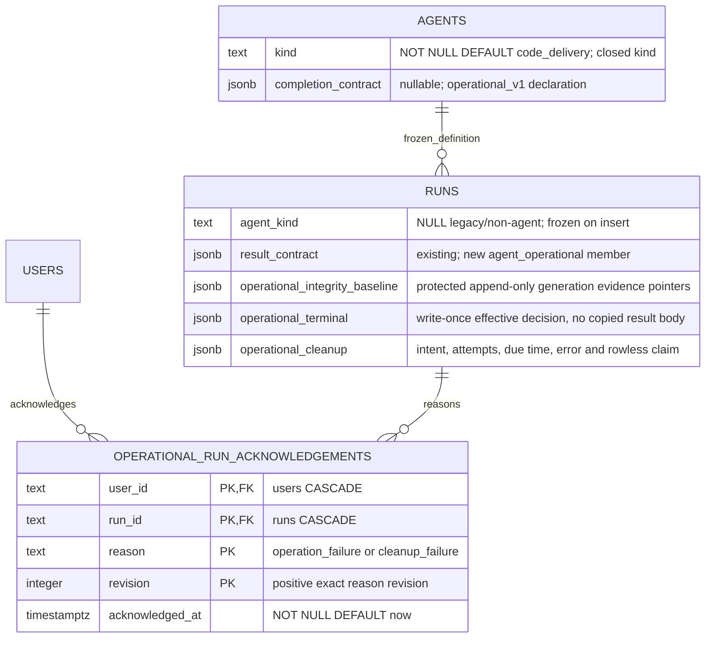

# Operational agent persistence

**Status: Designed — [ADR-194](../decisions/adr-194.md).** Main-lineage migrations
0194 (additive fields/table) and 0195 (cross-cutting immutable/terminal guards)
are reserved at this branch's integration baseline. They have not been applied.

This view owns the operational additions; [agents](agents-domain.md),
[runs](runs-domain.md) and [attention](attention-domain.md) own existing fields.
The generated consolidated ERD changes with the implementation schema.

Catalog kind/completion SET and CLEAR are one update. Operational iff the supported
completion declaration exists. A new operational run inserts matching kind and
required built-in contract; historical rows remain null/default without backfill
by agent identity. Enforce admitted kind/contract immutability with a trigger.

Baseline metadata version 1 references immutable opaque evidence for source
HEAD/branch, exact path/type/content/previous ownership and generation ordinal.
Initial capture precedes prompt dispatch; generation additions are append-only
under the run fence. No source bytes enter the DB metadata.

Terminal version 1 contains status, cause, effectiveOutcome, successful,
resultRevision (nullable), integrity verdict/baseline ordinal, reason codes and
opaque evidence IDs. It commits with status/result/turn/outboxes, is write-once,
and permits successful=true only for Done/valid success/clean integrity.
Operational Review or delivery SHA fields refuse. Nonterminal rows have no terminal
receipt; cancellation/crash/launch failure receipts explicitly record unchecked
validation. Keep cross-row result linkage in the locked transaction/deferred
validation, never a cross-table CHECK.

Cleanup version 1 stores resource kind/reference, state, armed revision/time,
attempts 0..5, dueAt, safe error and latest re-arm receipt. Rowless claim fields
are all-null or a complete attempt ID/owner/expiry tuple. Worktree claim remains
solely in existing workspaces lifecycle columns; their due time follows intent.
Every due query selects only operational terminal candidates and uses a due-time
partial index/keyset, reasserting kind/status/revision under claim.

Acknowledgement PK is (user_id, run_id, reason, revision), with positive revision
and closed reason CHECKs. The leading user key supports reader exclusions; add a
run_id index for cascade/reason lookup. No diagnostic body is duplicated here.
Users/runs deletion cascades acknowledgements but does not bypass execution-command
protected-evidence deletion guards.

Fresh and seeded incremental upgrade, re-entrant migrator, named constraint
refusals, mutation guards, rollback and journal/hash/snapshot/schema/ERD parity
are mandatory. Never rewrite already applied migration bytes.

See [lifecycle](../system-analytics/operational-agent-lifecycle.md),
[results](../system-analytics/operational-agent-results.md), and
[database schema](../database-schema.md).
