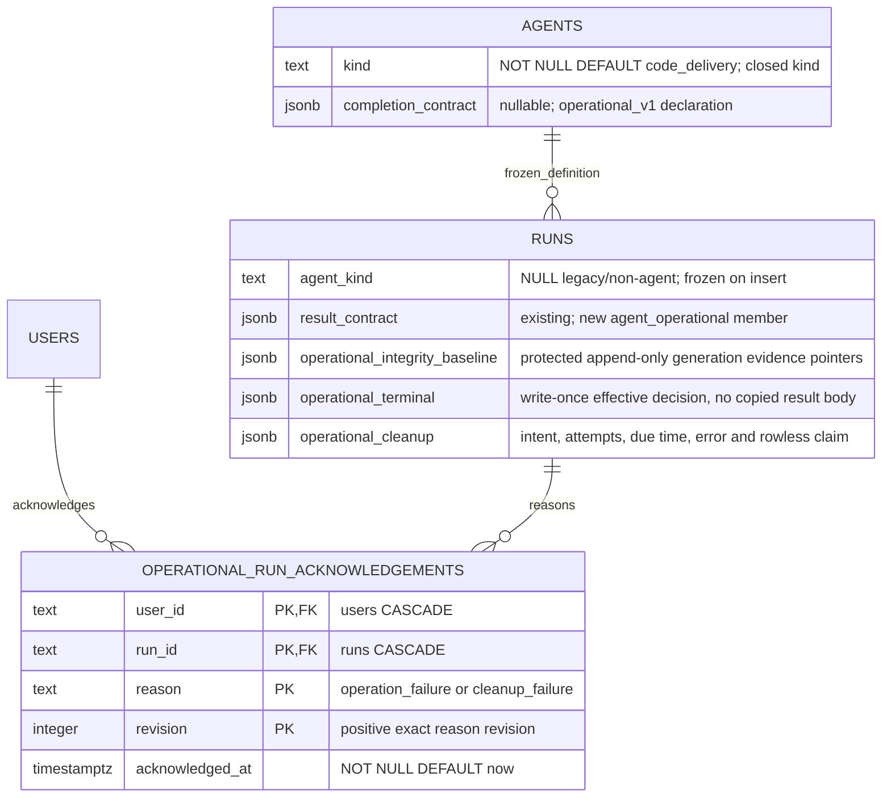

# Operational agent persistence

**Status: Implemented — [ADR-195](../decisions/adr-195.md).** Main-lineage migrations
0199–0203 are qualified on fresh and seeded incremental owned test databases.
No owner database has been migrated by this implementation.

This view owns the operational additions; [agents](agents-domain.md),
[runs](runs-domain.md) and [attention](attention-domain.md) own existing fields.
The generated consolidated ERD changes with the implementation schema.

Catalog kind/completion SET and CLEAR are one update. Operational iff the supported
completion declaration exists. A new operational run inserts matching kind and
required built-in contract; historical rows remain null/default without backfill
by agent identity. Enforce admitted kind/contract immutability with a trigger.

Baseline metadata version 1 stores source HEAD, branch/ref and Git identity/index/
reflog/configuration digests, exact path/type/content hashes, ordered platform
generations and the server-owned workspace location. Its optional `contextMounts`
array freezes each `{mount, baseline}` descriptor/witness before the initial
primary baseline is written. Context witnesses have generation 1 without
materialization allowances and contain no nested mounts. The existing immutable
source trigger protects the entire array; this extension requires no migration.
A legacy baseline with mounted contexts but no witnesses fails closed, while
a run with no context mounts retains its existing semantics. It stores
no source bytes; diagnostic bytes use opaque runtime evidence objects.
Initial capture precedes prompt dispatch; generation additions are append-only
under the run fence. No source bytes enter the DB metadata.

Terminal version 1 contains status, cause, effectiveOutcome, successful,
resultRevision (nullable), integrity verdict/baseline ordinal, reason codes and
opaque evidence IDs. It commits with status/result/turn/outboxes, is write-once,
and permits successful=true only for Done/valid success/clean integrity.
Operational Review or delivery SHA fields refuse. Nonterminal rows have no terminal
receipt; cancellation/crash/launch failure receipts explicitly record unchecked
validation. Keep cross-row result linkage in the locked transaction/deferred
validation, never a cross-table CHECK.

Cleanup version 1 stores resource kind/reference, state, armed revision/time,
attempts 0..5, dueAt, safe error and latest re-arm receipt. Rowless claim fields
are all-null or a complete attempt ID/owner/expiry tuple. Worktree claim remains
solely in existing workspaces lifecycle columns; their due time follows intent.
Due queries filter operational terminal candidates by intent state and deadline,
then advance a durable run-ID keyset cursor. Claims reassert kind/status/revision.

Acknowledgement PK is (user_id, run_id, reason, revision), with positive revision
and closed reason CHECKs. The leading user key supports reader exclusions; add a
run_id index for cascade/reason lookup. No diagnostic body is duplicated here.
Users/runs deletion cascades acknowledgements but does not bypass execution-command
protected-evidence deletion guards.

Fresh and seeded incremental upgrade, re-entrant migrator, named constraint
refusals, mutation guards, rollback and journal/hash/snapshot/schema/ERD parity
are mandatory. Never rewrite already applied migration bytes.

See [lifecycle](../system-analytics/operational-agent-lifecycle.md),
[results](../system-analytics/operational-agent-results.md), and
[database schema](../database-schema.md).

### Cleanup progress and forward migrations

`operational_cleanup_progress` stores the sweep's server-owned rotating run-ID
cursor and update time. It grants no deletion authority: workspace or rowless
leases still fence every effect. Migration 0201 adds this table and aligns the
shared-read combination check with launch validation; 0202 protects exact
ordered platform-generation prefixes and corrects the JSON operator grouping.
Migration 0203 extends the closed domain-event kind CHECK for the two operational
attention/cleanup facts. Migrations 0199/0200 remain unchanged. These new migrations have only been
applied to owned ephemeral integration databases during implementation.
