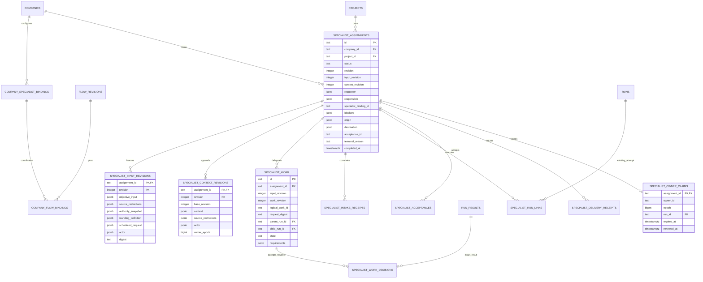

# Specialist assignment and company runtime persistence

**Implemented: assignment/input/run-link base and reviewed specialist/Flow configuration; Designed: company execution and cooperation — ADR-203.** [Runtime](../system-analytics/specialist-runtime.md), [assignments](../system-analytics/specialist-assignments.md) and [cooperation](../system-analytics/specialist-cooperation.md) own behavior. Existing human `assignments` and host `execution_assignments` are not repurposed.

## Migration reservations

Main `0232_company_grant_requests` and `0233_native_knowledge_execution` are implemented. Implemented base unit `0234_specialist_assignments` contains assignment heads, immutable inputs, existing-run links and state facts. Specialist bindings use `0236_company_specialist_bindings`; reviewed company Flow bindings use `0237_company_flow_bindings`. Trigger scope uses `0238_company_trigger_scope` on existing scheduler tables. Retry scope uses `0239_company_retry_scope` on the existing retry ledger. Context/questions/delivery, cooperation/acceptance/ownership and stand operations follow as generated logical units in their owning tasks. Allocate each numeric prefix from the then-current journal; later tables are not precreated as a prerequisite for the base store. Existing head/input/run-link rows survive each additive migration. The main migration units never FK a new Brain table; knowledge pointers store typed record/revision/witness/digest values and the owning service validates them after both lineages are ready. `runs.flow_revision_id` and existing immutable installed revision schema remain runtime truth.

The base business structures link existing execution records rather than duplicating attempts. Context, work, acceptance, delivery and claim entities in this diagram remain designed until their owning slices land; specialist and Flow binding configuration is implemented.

## Exact persistence contract

All new entity IDs are server-generated; timestamps UTC. Versioned closed JSON contains typed fields specified in the owning API/native schemas. Absence/null/legacy variants are explicit, not generic empty objects.

| Entity | Required fields, uniqueness and defaults | Deletion/index/transaction contract |
| --- | --- | --- |
| `company_specialist_bindings` (Implemented, 0221) | Stable company/role identity, current installed pin, enabled=false default, positive configuration revision, server creation identity/key/digest and retirement time | Live `(company_id,agent_id)` unique; current pin RESTRICT until explicit detach; retained heads cannot be deleted or reactivated; no project FK |
| `company_specialist_binding_revisions` (Implemented, 0221) | Binding/revision PK, self-contained versioned package/definition/raw/effective configuration/policy/action limits, server actor/authority witness, request key/digest, content witness and retirement reason | Immutable accepted configuration/replay receipt; exact owned head and positive sequential revisions; per-binding/actor/key unique; deferred head/history coherence; logical historical provider reference survives retirement |
| `company_flow_bindings` (Implemented, 0222) | Stable company/Flow identity, exact current Flow/package/specialist pins, enabled=false, positive revision, server creation receipt and retirement time | Live `(company_id,flow_ref_id)` unique; current foreign keys RESTRICT until explicit retirement; sequential immutable identity and deferred head/history coherence; no project `flows` row |
| `company_flow_binding_revisions` (Implemented, 0222) | Version-1 frozen manifest/package witness, exact responsible specialist configuration, reviewed result-only intent, human role mappings and original answer-grant witnesses, server reviewer/request receipt and content digest | Immutable accepted configuration/replay history; 4 MiB configuration and 32 KiB reviewer-authority bounds; historical provider identities remain logical after retirement |
| Existing schedule/trigger attempt (Implemented storage, 0223; company dispatch Designed) | Exclusive company/project ownership, server-created company source receipt/configuration revision, exact v2 configuration references and unchanged v1 request snapshots; existing claim/fence/reserved-run identities | Preserve project ownership, unknown authorship and v1 bytes; null-safe company creation keys and partial owner due/history indexes; existing delivery/fence/run uniqueness unchanged; company source catalog retention and old project cascades; project consumers refuse/exclude company rows until actual company dispatch is wired |
| Existing run additions | company_id/company binding reference, immutable owner snapshot and specialist assignment link; company result-only flow has project/task/project-flow null and exact flow_revision_id/result_contract | Dedicated CHECK for company run shape, not a new run kind; owner indexes for history/pool/recovery |
| Existing actor/human assignments | Company/project owner union and server principal binding; company role labels resolve reviewed explicit current users | Preserve existing human assignment IDs/claims/events; no fabricated project roles; same current answer authorization |
| `specialist_assignments` (Implemented) | Exclusive owner, binding, requester/responsible, origin/destination, blockers and state; business revision 1, input revision 1/context 0, terminal fields and timestamps | Immutable identity; next business revision and coherent heads; deferred retained-input-head check; failed/cancelled require reason. Completion is refused until the acceptance-owning migration. Owner/status/activity indexes |
| `specialist_input_revisions` (Implemented) | PK assignment/revision; objective/input/targets/refs/constraints/exact result/verification in objective_input; separate authority, standing, recurring request and source restrictions; digest, actor/time | Assignment FK RESTRICT; creation or input append and parent CAS commit together. UPDATE/DELETE refused; current access governs historical reads |
| `specialist_context_revisions` | PK assignment/revision; base revision, structured context and server restrictions, actor/epoch/time | Parent row lock + exact base/epoch CAS; immutable rows, no last-writer merge |
| `specialist_owner_claims` | Assignment PK, owner/run, positive epoch, renewed_at and expires_at, explicit claim state | Owner+epoch+fresh-expiry in every write predicate; lease 120s/renew 40s, not an in-memory mutex; no slot from lease alone |
| `specialist_intake_receipts` | id/owner/source/delivery key, canonical digest, closed disposition, assignment/input/receipt time | UNIQUE explicit owner/source/delivery key, same digest exact replay; key+assignment/input in one transaction |
| `specialist_run_links` (Implemented) | assignment/run PK, input/work revision and role; existing run pointer | Unique run, exact input composite FK, immutable links; owning admission validates scope. No independent attempt counter/ledger |
| `specialist_work` | Stable work identity, assignment/input/work revision, digest, parent/child run, constraints/result requirements/state | UNIQUE assignment/input/logical-work/revision; existing parent/root lock admits one child; terminal work keeps old result |
| `specialist_work_decisions` | id/work revision/actor/input/result revision, decision/reason/evidence, owner epoch, digest/key/time | Unique work/idempotency key; exact result references RESTRICT; append-only decision history |
| `specialist_acceptances` | id/assignment/input/context/exact result revision, policy/actor/evidence/verification decision, key/digest/time | Unique content-guarded key, acceptance/terminal state/outbox one transaction; cross-row obligations checked transactionally |
| `specialist_delivery_receipts` | id/assignment/acceptance/frozen typed destination/digest, pending/delivered/unknown/failed, bounded attempts/next_attempt, ACK witness | Unique acceptance/destination/delivery key; delivered marker only after actual acknowledged destination write |

## Backfill, guards and lifetime

`agent_retry_intents` uses nullable `project_id` / `company_id` with an exclusive-owner CHECK, project cascade and company restrict semantics. Its original actor/request-key, source-claim and successor uniqueness remain effective when `project_id` is NULL. The company history index is partial on company ownership. Project v1/v2 recipes remain unchanged; company v3 recipes retain exact owned binding/coordinator and assignment/input witnesses. The insert trigger validates the available main-store history identities/digests and frozen role/configuration/input without calling Brain. Owner/recipe mutation is forbidden by the existing immutable-receipt trigger. Current project admission/cleanup selects only project-owned intents before its bounded limit; native company retry execution remains Designed. See the [versioned runtime contract](../system-analytics/specialist-runtime.md#retained-retry-scope).

Company identity migration precedes these tables; existing project schedules/actors/human assignments retain their real project owner. Old trigger/request/retry/result snapshots remain version-dispatched and unchanged; new company snapshots explicitly capture company binding. Do not rekey/drop live attachments or seed a guessed assignment for unrelated old runs.

Accepted context/input/work/decision rows are immutable by guarded database writes. Assignment parent/head, claim epoch and existing run/attempt/result updates share one DB transaction where their transition is atomic. Network/filesystem/target effects stay outside DB locks; durable intents precede them and success markers follow acknowledged evidence.

New FK/cascade policy is RESTRICT for referenced assignment inputs/results/effects. Existing run/task/project cleanup cannot silently cascade accepted or unresolved specialist evidence. Authorized soft retirement removes current launchability while preserving historical snapshots. A future retention purge needs explicit reference checks and target receipt retirement, not age-only DELETE.

Startup requires all main then Brain migrations; the runtime refuses new features while either ledger is pending. Fresh/populated/interrupted/second-boot integration and generated SQL/journal/snapshot/schema checks qualify rollout. Invalid existing state aborts loudly with actionable safe context rather than deleting rows.
