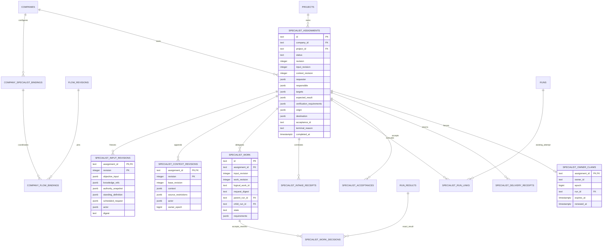

# Specialist assignment and company runtime persistence

**Designed — ADR-203.** [Runtime](../system-analytics/specialist-runtime.md), [assignments](../system-analytics/specialist-assignments.md) and [cooperation](../system-analytics/specialist-cooperation.md) own behavior. Existing human `assignments` and host `execution_assignments` are not repurposed.

## Migration reservations

Main `0232_company_grant_requests` implements administrator grant receipts. T14 reserves `0233_native_knowledge_execution` for the existing attempt ledger’s role attestation before the remaining unapplied units. Main design reservations: `0234_specialist_assignments`, `0220_company_specialist_bindings`, `0221_company_trigger_scope`, `0222_stand_operations`, `0223_company_brain_constraints`, following `0230_company_ownership`. No SQL/journal entries are claimed applied. The main migration units never FK a new Brain table; knowledge pointers store typed record/revision/witness/digest values and the owning service validates them after both lineages are ready. `runs.flow_revision_id` and existing immutable installed revision schema remain runtime truth.

The proposed business structures link existing execution records rather than duplicating attempts.

## Exact persistence contract

All new entity IDs are server-generated; timestamps UTC. Versioned closed JSON contains typed fields specified in the owning API/native schemas. Absence/null/legacy variants are explicit, not generic empty objects.

| Entity | Required fields, uniqueness and defaults | Deletion/index/transaction contract |
| --- | --- | --- |
| `company_specialist_bindings` | id/company FK/agent ID, exact package install/revision/definition digest, enabled=false default, config/grants/runner/policy snapshots, positive config revision | Live `(company_id,agent_id)` unique; referenced pins RESTRICT; disabled does not erase run snapshots |
| `company_flow_bindings` | id/company FK, exact installed flow_revision_id/package pin, enabled=false, reviewed result-only declaration, role mappings and config revision | `(company_id,flow_ref_id)` unique live; no project `flows` row; current declaration validated at action |
| Existing schedule/trigger attempt | Nullable company/project owner pair with exactly one owner; explicit binding/scope snapshot version, existing request/receipt/fence/reserved-run identities | Preserve old project rows and request bytes; partial owner-aware unique/index keys avoid NULL loopholes; all selectors/writers updated together |
| Existing run additions | company_id/company binding reference, immutable owner snapshot and specialist assignment link; company result-only flow has project/task/project-flow null and exact flow_revision_id/result_contract | Dedicated CHECK for company run shape, not a new run kind; owner indexes for history/pool/recovery |
| Existing actor/human assignments | Company/project owner union and server principal binding; company role labels resolve reviewed explicit current users | Preserve existing human assignment IDs/claims/events; no fabricated project roles; same current answer authorization |
| `specialist_assignments` | Exclusive owner, all assignment fields above, status queued default, business revision 1, input revision 1/context 0, created/updated times | CHECK positive revisions/known state; completed requires acceptance/timestamp, failed/cancelled require reason; terminal fields coherent; owner/status/activity and responsible-principal indexes |
| `specialist_input_revisions` | PK assignment/revision; immutable objective/input/ref/authority/standing/scheduled planes, digest, actor/time | Assignment FK RESTRICT; creation or accepted input update and parent revision CAS commit together |
| `specialist_context_revisions` | PK assignment/revision; base revision, structured context and server restrictions, actor/epoch/time | Parent row lock + exact base/epoch CAS; immutable rows, no last-writer merge |
| `specialist_owner_claims` | Assignment PK, owner/run, positive epoch, renewed_at and expires_at, explicit claim state | Owner+epoch+fresh-expiry in every write predicate; lease 120s/renew 40s, not an in-memory mutex; no slot from lease alone |
| `specialist_intake_receipts` | id/owner/source/delivery key, canonical digest, closed disposition, assignment/input/receipt time | UNIQUE explicit owner/source/delivery key, same digest exact replay; key+assignment/input in one transaction |
| `specialist_run_links` | assignment/run PK, input/work revision and role; existing run pointer | Unique link, preserve run-result provenance; no independent attempt counter/ledger |
| `specialist_work` | Stable work identity, assignment/input/work revision, digest, parent/child run, constraints/result requirements/state | UNIQUE assignment/input/logical-work/revision; existing parent/root lock admits one child; terminal work keeps old result |
| `specialist_work_decisions` | id/work revision/actor/input/result revision, decision/reason/evidence, owner epoch, digest/key/time | Unique work/idempotency key; exact result references RESTRICT; append-only decision history |
| `specialist_acceptances` | id/assignment/input/context/exact result revision, policy/actor/evidence/verification decision, key/digest/time | Unique content-guarded key, acceptance/terminal state/outbox one transaction; cross-row obligations checked transactionally |
| `specialist_delivery_receipts` | id/assignment/acceptance/frozen typed destination/digest, pending/delivered/unknown/failed, bounded attempts/next_attempt, ACK witness | Unique acceptance/destination/delivery key; delivered marker only after actual acknowledged destination write |

## Backfill, guards and lifetime

Company identity migration precedes these tables; existing project schedules/actors/human assignments retain their real project owner. Old trigger/request/retry/result snapshots remain version-dispatched and unchanged; new company snapshots explicitly capture company binding. Do not rekey/drop live attachments or seed a guessed assignment for unrelated old runs.

Accepted context/input/work/decision rows are immutable by guarded database writes. Assignment parent/head, claim epoch and existing run/attempt/result updates share one DB transaction where their transition is atomic. Network/filesystem/target effects stay outside DB locks; durable intents precede them and success markers follow acknowledged evidence.

New FK/cascade policy is RESTRICT for referenced assignment inputs/results/effects. Existing run/task/project cleanup cannot silently cascade accepted or unresolved specialist evidence. Authorized soft retirement removes current launchability while preserving historical snapshots. A future retention purge needs explicit reference checks and target receipt retirement, not age-only DELETE.

Startup requires all main then Brain migrations; the runtime refuses new features while either ledger is pending. Fresh/populated/interrupted/second-boot integration and generated SQL/journal/snapshot/schema checks qualify rollout. Invalid existing state aborts loudly with actionable safe context rather than deleting rows.
