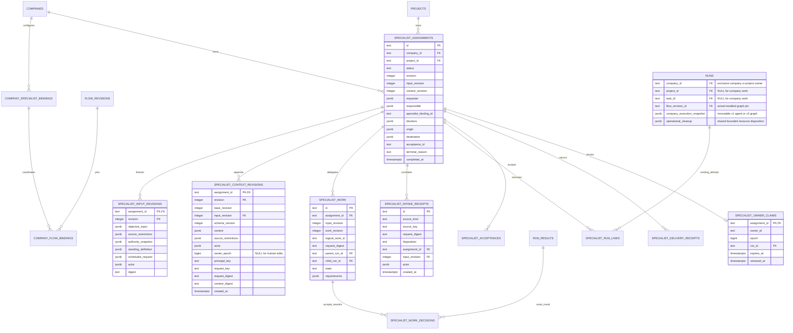

# Specialist assignment and company runtime persistence

**Implemented: assignment/input/run-link base, reviewed configuration, company standalone/graph execution, canonical intake and human context history; Designed: governed cooperation — ADR-203.** [Runtime](../system-analytics/specialist-runtime.md), [assignments](../system-analytics/specialist-assignments.md) and [cooperation](../system-analytics/specialist-cooperation.md) own behavior. Existing human `assignments` and host `execution_assignments` are not repurposed.

## Migration reservations

Main `0232_company_grant_requests` and `0233_native_knowledge_execution` are implemented. Implemented base unit `0234_specialist_assignments` contains assignment heads, immutable inputs, existing-run links and state facts. Specialist bindings use `0236_company_specialist_bindings`; reviewed company Flow bindings use `0237_company_flow_bindings`. Trigger scope uses `0238_company_trigger_scope` on existing scheduler tables. Retry scope uses `0239_company_retry_scope` on the existing retry ledger. Native run ownership and internal credentials use `0240_company_agent_execution` and `0241_company_agent_credentials`. Context history uses `0259_specialist_context_revisions`. Questions/delivery, cooperation/acceptance/ownership and stand operations follow as generated logical units in their owning tasks. Allocate each numeric prefix from the then-current journal; later tables are not precreated as a prerequisite for the base store. Existing head/input/run-link rows survive each additive migration. The main migration units never FK a new Brain table; knowledge pointers store typed record/revision/witness/digest values and the owning service validates them after both lineages are ready. `runs.flow_revision_id` and existing immutable installed revision schema remain runtime truth.

The base business structures link existing execution records rather than duplicating attempts. Work, acceptance, delivery and claim entities in this diagram remain designed until their owning slices land; context history and specialist/Flow binding configuration are implemented.

## Canonical intake receipts

Generated main `0253_specialist_intake_receipts` adds one immutable source-delivery receipt per canonical owner/source key. It references the exact existing assignment input, retains the server actor and original request digest, and indexes assignment history. Source keys include the owner and canonical origin, manual requester identity, and the addressed specialist binding for task comments. A unique `(source_kind,source_key)` plus a bounded transaction advisory lock serializes concurrent deliveries; content conflicts do not repeat dependent writes. Insert validation binds source kind and actor to the retained assignment/input. UPDATE and DELETE refuse. No Brain table is referenced; existing rows are not rewritten. Source dispatch and continuation remain their owning slices.

Generated main `0254_specialist_project_flow_input` permits an explicit standing snapshot v2 only for newly retained project coordinator inputs. Its closed Flow witness names the project provider/ref, exact installed revision and resolved revision, plus the manifest SHA-256; v1 input bytes and existing assignment fields remain unchanged. A nullable `specialist_assignments.project_task_id` references the initial existing project task, with an owner CHECK, same-project reference guard, immutable non-null link and partial index. Its first CAS write and ordinary task creation commit together. No legacy task identity is invented; company assignments retain NULL. Existing input/history guards and the existing Run/node-attempt ledgers remain authoritative. No Brain FK or new execution ledger is introduced.

Generated main `0255_company_event_admission` leaves project event claims unique on agent/event and scopes company claims to company/professional/subscription/event. A source insertion/reference guard requires its exact existing reserved invocation, owned event and immutable assignment origin. Historical null/unknown triggers, original Run/input bytes and cron v1 snapshots remain unchanged; existing owner CHECKs remain in force. Event source references and inherited restrictions use existing assignment inputs; no Brain FK, clock or execution ledger is added.

## Immutable context history

Generated main `0259_specialist_context_revisions` adds retained version-one context snapshots with exact input references and content-guarded request receipts. The parent lock serializes revision allocation; a deferred invariant requires the context head to equal retained history. Existing heads/inputs remain byte-for-byte unchanged, and revision zero creates no synthetic history or attribution. An inconsistent pre-existing positive head aborts the migration instead of inventing rows. Main-only upgrade and ordinary company context edits work without Brain tables; there is no Brain FK.

New entries are bound to the server actor and introduced revision; unchanged entries retain their exact original attribution. Removed entries require an explicit replacement, and inherited source restrictions cannot shrink. Public human edits record NULL ownership epoch and cannot manufacture accepted work. Each snapshot is bounded to 256 entries/128 KiB of PostgreSQL JSONB text. Executing-agent appointment/fencing and exact child-result acceptance remain their owning runtime slices.

## Exact persistence contract

All new entity IDs are server-generated; timestamps UTC. Versioned closed JSON contains typed fields specified in the owning API/native schemas. Absence/null/legacy variants are explicit, not generic empty objects.

| Entity | Required fields, uniqueness and defaults | Deletion/index/transaction contract |
| --- | --- | --- |
| `company_specialist_bindings` (Implemented, 0221) | Stable company/role identity, current installed pin, enabled=false default, positive configuration revision, server creation identity/key/digest and retirement time | Live `(company_id,agent_id)` unique; current pin RESTRICT until explicit detach; retained heads cannot be deleted or reactivated; no project FK |
| `company_specialist_binding_revisions` (Implemented, 0221) | Binding/revision PK, self-contained versioned package/definition/raw/effective configuration/policy/action limits, server actor/authority witness, request key/digest, content witness and retirement reason | Immutable accepted configuration/replay receipt; exact owned head and positive sequential revisions; per-binding/actor/key unique; deferred head/history coherence; logical historical provider reference survives retirement |
| `company_flow_bindings` (Implemented, 0222) | Stable company/Flow identity, exact current Flow/package/specialist pins, enabled=false, positive revision, server creation receipt and retirement time | Live `(company_id,flow_ref_id)` unique; current foreign keys RESTRICT until explicit retirement; sequential immutable identity and deferred head/history coherence; no project `flows` row |
| `company_flow_binding_revisions` (Implemented, 0222) | Version-1 frozen manifest/package witness, exact responsible specialist configuration, reviewed result-only intent, human role mappings and original answer-grant witnesses, server reviewer/request receipt and content digest | Immutable accepted configuration/replay history; 4 MiB configuration and 32 KiB reviewer-authority bounds; historical provider identities remain logical after retirement |
| Existing schedule/trigger attempt (Implemented storage, 0223; company dispatch Designed) | Exclusive company/project ownership, server-created company source receipt/configuration revision, exact v2 configuration references and unchanged v1 request snapshots; existing claim/fence/reserved-run identities | Preserve project ownership, unknown authorship and v1 bytes; null-safe company creation keys and partial owner due/history indexes; existing delivery/fence/run uniqueness unchanged; company source catalog retention and old project cascades; project consumers refuse/exclude company rows until actual company dispatch is wired |
| Existing run additions (Implemented storage, 0225; dispatch Designed) | company_id/company binding reference, immutable owner snapshot and specialist assignment link; company result-only flow has project/task/project-flow null and exact flow_revision_id/result_contract | Dedicated CHECK for company run shape, not a new run kind; owner indexes for history/pool/recovery |
| Existing actor/human assignments | Company/project owner union and server principal binding; company role labels resolve reviewed explicit current users | Preserve existing human assignment IDs/claims/events; no fabricated project roles; same current answer authorization |
| `specialist_assignments` (Implemented) | Exclusive owner, binding, requester/responsible, origin/destination, blockers and state; business revision 1, input revision 1/context 0, terminal fields and timestamps | Immutable identity; next business revision and coherent heads; deferred retained-input-head check; failed/cancelled require reason. Completion is refused until the acceptance-owning migration. Owner/status/activity indexes |
| `specialist_input_revisions` (Implemented) | PK assignment/revision; objective/input/targets/refs/constraints/exact result/verification in objective_input; separate authority, standing, recurring request and source restrictions; digest, actor/time | Assignment FK RESTRICT; creation or input append and parent CAS commit together. UPDATE/DELETE refused; current access governs historical reads |
| `specialist_context_revisions` (Implemented human boundary, 0244) | PK assignment/revision; exact base/input revision, versioned structured context, inherited restrictions, server actor/time, nullable owner epoch, principal/key/request/content digests | Unique assignment/principal/key; exact input composite FK RESTRICT; parent row lock and context/input CAS; immutable history and deferred head/history coherence; retained entries preserve original attribution, supersession is explicit; human epoch NULL; no last-writer merge |
| `specialist_owner_claims` | Assignment PK, owner/run, positive epoch, renewed_at and expires_at, explicit claim state | Owner+epoch+fresh-expiry in every write predicate; lease 120s/renew 40s, not an in-memory mutex; no slot from lease alone |
| `specialist_intake_receipts` (Implemented internal core, 0238; source adapters pending) | Server ID, source kind and owner/origin-scoped key hash, original request digest, closed created disposition, exact assignment/input, server actor/time | UNIQUE source kind/key; owner derives from immutable assignment and is included in the key; exact input FK RESTRICT; source/actor binding guard and immutable receipt; same-key lock, creation and state event commit together |
| `specialist_run_links` (Implemented) | assignment/run PK, input/work revision and role; existing run pointer | Unique run, exact input composite FK, immutable links; owning admission validates scope. No independent attempt counter/ledger |
| `specialist_work` | Stable work identity, assignment/input/work revision, digest, parent/child run, constraints/result requirements/state | UNIQUE assignment/input/logical-work/revision; existing parent/root lock admits one child; terminal work keeps old result |
| `specialist_work_decisions` | id/work revision/actor/input/result revision, decision/reason/evidence, owner epoch, digest/key/time | Unique work/idempotency key; exact result references RESTRICT; append-only decision history |
| `specialist_acceptances` | id/assignment/input/context/exact result revision, policy/actor/evidence/verification decision, key/digest/time | Unique content-guarded key, acceptance/terminal state/outbox one transaction; cross-row obligations checked transactionally |
| `specialist_delivery_receipts` | id/assignment/acceptance/frozen typed destination/digest, pending/delivered/unknown/failed, bounded attempts/next_attempt, ACK witness | Unique acceptance/destination/delivery key; delivered marker only after actual acknowledged destination write |

## Backfill, guards and lifetime

**Implemented storage (T20, 0225):** `runs.company_id` and `runs.company_execution_snapshot` are nullable on legacy rows. New company standalone runs retain a closed version-1 server capture with company owner, business revision at reservation, exact assignment/input ID/revision/digest, specialist configuration ID/revision/digest and initiating user's current `assignments:update` grant witness. Company ownership requires a workspace-none finite operational agent, null project/task/Flow/local-package ownership and exact result contract. The snapshot is immutable, at most 32 KiB, validated against available owned main-store configuration/input history and linked through `specialist_run_links` atomically. Linking advances the assignment business revision separately from its immutable launch receipt. No new run kind or execution ledger is added. Company graph and delegated native-result shapes extend this CHECK only in their owning runtime slices. Old project/private/librarian rows are not assigned guessed company metadata.

**Company graph storage (T20.1, 0233; runtime dispatch remains Designed):** the existing Run owner CHECK has a separate closed v2 Flow-capture branch. It requires null project/task/project-Flow/local-package ownership, a finite workspace-none graph, null `agent_kind`, responsible source role, pinned installed `flow_revision_id` and a required `flow_export` contract for that revision. The shared insert guard preserves its v1 branch and validates v2 against current queued assignment/input, owned specialist/configuration/authority and exact enabled coordinator history/provider/Flow manifest witnesses. The result producer list and optional native-validation marker must exactly match the pinned manifest. Source version labels come from the actual installed Flow revision and cannot be retargeted. The deferred link obligation requires the same assignment/input and `coordinator` role; the application link service uses the same version union. No table, new execution ledger, backfill or Brain FK is introduced. The main-only populated upgrade preserves v1 company, project and private Run bytes; project deletion remains possible with the Brain lineage absent. Allocation, credentials, graph execution and lifecycle qualification remain separate owning runtime gates.

**Implemented storage and internal service (T20, 0226):** company ephemeral credentials extend `project_tokens` with exclusive company/run references; project/user/librarian rows retain NULL company metadata. Company credentials remain `token_kind=agent`, project-less, expiring and source-role-bound. The existing terminal/GC revokers match their deterministic run name. A partial unique live-run index, exact run/assignment/provider/initial actor checks and immutable credential binding protect rotation. Deleting the initiating user may clear its optional owner FK; verification refuses the now-unavailable account rather than inventing a successor principal. No new credential or attempt ledger is introduced.

`agent_retry_intents` uses nullable `project_id` / `company_id` with an exclusive-owner CHECK, project cascade and company restrict semantics. Its original actor/request-key, source-claim and successor uniqueness remain effective when `project_id` is NULL. The company history index is partial on company ownership. Project v1/v2 recipes remain unchanged; company v3 recipes retain exact owned binding/coordinator and assignment/input witnesses. The insert trigger validates the available main-store history identities/digests and frozen role/configuration/input without calling Brain. Owner/recipe mutation is forbidden by the existing immutable-receipt trigger. Current project admission/cleanup selects only project-owned intents before its bounded limit; native company retry execution remains Designed. See the [versioned runtime contract](../system-analytics/specialist-runtime.md#retained-retry-scope).

Company identity migration precedes these tables; existing project schedules/actors/human assignments retain their real project owner. Old trigger/request/retry/result snapshots remain version-dispatched and unchanged; new company snapshots explicitly capture company binding. Do not rekey/drop live attachments or seed a guessed assignment for unrelated old runs.

Accepted context/input/work/decision rows are immutable by guarded database writes. Assignment parent/head, claim epoch and existing run/attempt/result updates share one DB transaction where their transition is atomic. Network/filesystem/target effects stay outside DB locks; durable intents precede them and success markers follow acknowledged evidence.

New FK/cascade policy is RESTRICT for referenced assignment inputs/results/effects. Existing run/task/project cleanup cannot silently cascade accepted or unresolved specialist evidence. Authorized soft retirement removes current launchability while preserving historical snapshots. A future retention purge needs explicit reference checks and target receipt retirement, not age-only DELETE.

Startup requires all main then Brain migrations; the runtime refuses new features while either ledger is pending. Fresh/populated/interrupted/second-boot integration and generated SQL/journal/snapshot/schema checks qualify rollout. Invalid existing state aborts loudly with actionable safe context rather than deleting rows.

### Existing human-work ownership extension

Company HITL uses the existing `actor_identities`, human `assignments` and
`assignment_events` ledgers with exclusive nullable project/company ownership.
Existing project rows retain their IDs, claims, events and real project cascade;
new company rows require a real company and owned Run, never a fabricated project.
Company actors are current users or server system identities. A scoped actor row
is an attribution identity and supplies no action authority. Human claim/answer
requires current explicit `assignments:read` and `assignments:answer` plus the Run's
retained source access. Server lifecycle cancellation uses an owned system actor.
Company human work has no repository task, branch or ref. It cannot complete
without a retained responding actor; source-unavailable or revoked human action
authority leaves work pending. Its event owner/Run and
all actor references must match the assignment owner; accepted owner identity is
immutable. User deletion may leave an orphan historical actor, which cannot act
or be rebound to another user. Migration adds NULL company metadata to old rows;
it invents no actors, historical authority or specialist assignment linkage.

This ownership foundation belongs to native company lifecycle (T20/T21), before
company Flow human/form waits. T24 later adds business question/input-revision
semantics and reuses these identities/claims rather than introducing a second
human-work ledger.

**Company graph credentials (T20.1, 0234; graph dispatch remains Designed):** the existing company/native-node token CHECKs accept an explicitly company-owned `agent-run` credential bound to `knowledge_node_attempt_id`. The insert reference guard requires v2 owner/input/coordinator witnesses, trusted pinned Flow/provider, initiating current read/update authority, current immutable node attestation, that professional's own enabled exact binding and scopes within both binding action sets. Newer node attempts fence old references. The standalone branch still requires a null node. Existing token identity/node immutable guards, one-live-company-token-per-Run index, hashes, expiry, rotation and terminal/GC revocation are reused. No table, token kind, parallel credential store, execution ledger or Brain FK is introduced. Populated upgrades must retain all preexisting token bytes and project cascade cleanup.

**Company graph resource witness (T20.1, 0235; graph driver/terminal cleanup remain Designed):** the existing `runs.operational_integrity_baseline` CHECK admits an explicit company-owned v2 workspace-none graph with required Flow export, retaining its existing operational-agent branch. No field/table/backfill is added. The same company/run opaque paths, baseline version/generation and integrity inspection are used; current resource-owner validation checks retained company, Run and managed paths. Internal workspace adoption carries an explicit agent/Flow discriminator derived from the validated Run; the host wire remains the existing company-owned directory contract. Populated v1 baseline and Run/token values remain unchanged, and project deletion stays independent of Brain. This is a resource witness, not an operational completion contract or proof of an external effect.

**Native company graph lifecycle (T20.1, 0236; controlled ACP qualification):** the existing graph loader retains an explicit company context and null Task/project-Flow/workspace records. Actual dispatch, node attempts, prompts, results, sessions, driver claims and host commands use the existing ledgers. The resource cleanup CHECK and due index include the exact finite workspace-none v2 Flow branch. The company event reference guard admits that retained owner for terminal, wait, escalation and cleanup facts while retaining the v1 operational-agent branch. Company graph results remain `flow_export`; `operational_terminal` remains NULL. No table, project, Brain FK, scheduler or attempt ledger is added. Main-only populated upgrade preserves prior Run/token values and permits project deletion without Brain tables. Native graph form/human response delivery now reuses the exact company input/actor owner and existing node-attempt vars; captures do not advance during graph input. Engine 3.12.0 supports this native lifecycle, including controlled-ACP permission/idle/restart and retained-result recovery. Full phase compatibility and actual companion/stand qualification remain separate gates.
