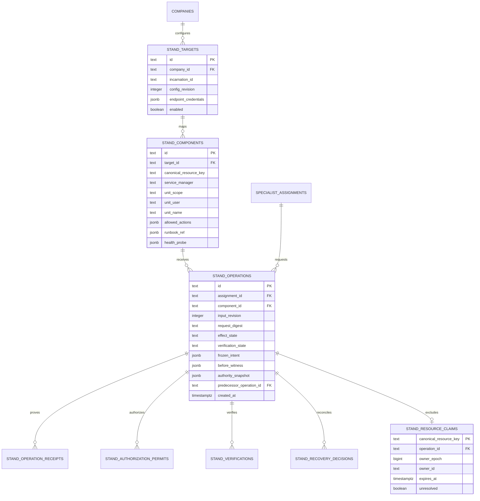

# Stand operation persistence

**Designed — ADR-205.** [Stand maintenance](../system-analytics/stand-maintenance.md) owns exact authority/effect/health/recovery semantics. Main migration reservation `0222_stand_operations` creates the entities; `0223_company_brain_constraints` adds separately reviewed cross-cutting constraints. These are allocations, not applied schema.

The resource claim links uncertainty across all assignment attempts, while verification stays independent.

| Entity | Keys/checks/limits | Persistence and lifetime |
| --- | --- | --- |
| `stand_targets` | Server ID, company FK, stable incarnation, positive config revision, explicit HTTPS/TLS/credential-ref config, enabled=false default | Company/id/config index; endpoint/cert identity versioned and administrative-only; secrets stay env/host config references |
| `stand_components` | Target FK, exact systemd scope/user/unit, canonical resource key, actions/runbook/probe closed config | Alias rows may resolve same canonical key; actual resource claim uniqueness is on canonical identity, not component ID |
| `stand_operations` | Server ID; exact assignment/work/input/target/config/policy/runbook/digest; closed effect and verification axes; optional predecessor; before witness | UNIQUE assignment/logical-action/idempotency key and digest compare; history/effects RESTRICT cascade; no mutation of frozen intent |
| `stand_resource_claims` | Canonical key PK, operation FK, positive epoch/owner/expiry and unresolved marker | Unknown remains exclusive after lease expiry; successor transfer is one transaction with risk decision/new intent; index reclaim candidates by unresolved/expiry |
| `stand_operation_receipts` | Operation+target receipt revision unique; target incarnation, permit, sequence and attributable before/after witnesses; received/capture times distinct | Immutable accepted target receipt digest; exact ID/digest/version checked before adoption; result cleanup cannot delete it |
| `stand_authorization_permits` | Server permit ID, operation/digest/resource/incarnation/epoch/nonce, initiating current principal/policy, issued/expiry/consumed times | Nonce unique per exact target/operation; single-use and <=5-second expiry, no model-supplied actor; current decision committed before response |
| `stand_verifications` | Server probe ID/nonce unique, exact operation/incarnation/config/probe, issue and target sequence, healthy/unhealthy/inconclusive evidence | Independent after-effect ordering; no stale healthy observation adoption; immutable results |
| `stand_recovery_decisions` | Exact operation/inspection/current actor/policy/reason/decision/key/digest and optional successor | Same decision replay inert; changed body conflicts; original unknown effect not rewritten by authorized successor |

Main migrations reference existing main assignment/run/result identities but no newly created Brain table. Runbook/witness references are typed record/revision/hash values validated by the service once both lineages are ready. Required accepted effect/probe references use actual main receipt rows and are checked transactionally at assignment acceptance. Generated CHECKs cover local owner/lease/digest/state shape; they do not pretend to verify cross-row health or target truth.

The target helper uses its own durable configured journal directory with exclusive process/resource ownership, per-operation intent/receipt/tombstone records and atomic fsynced publication. A target receipt journal is external-effect evidence, not a run-attempt or scheduler ledger. Capacity/corruption refuses new effects before invocation; unresolved records cannot be garbage-collected by age. Pruning retained payloads leaves identity/digest replay protection or an explicit expired-request refusal. Recovery reads stay possible after original run/host placement termination under a separate current operation-recovery fence.

Fresh/populated migration tests cover unknown operations, two aliases/controllers, owner expiry, permit replay, result/target/run retirement, exact successor transfer and interrupted receipt adoption. No migration clears unknown resource claims or deletes receipts to satisfy constraints.
