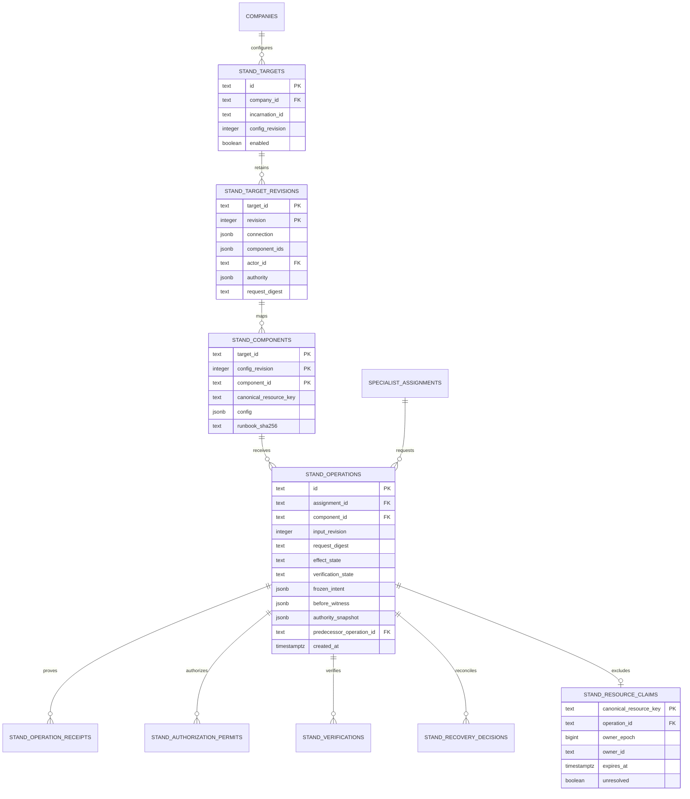

# Stand operation persistence

**Registry and intent persistence implemented — ADR-205.** [Stand maintenance](../system-analytics/stand-maintenance.md) owns exact authority, effect, health and recovery semantics. Main migrations `0299_stand_target_registry` and `0300_stand_target_registry_guards` add the company registry, reviewed revisions and component mappings. Migrations `0301_stand_operation_intents` and `0302_stand_operation_intent_guards` retain the exact assignment input, target configuration, action, authority and restart exclusion. Permit, receipt, verification and recovery tables below describe subsequent persistence work.

The resource claim links uncertainty across all assignment attempts, while verification stays independent.

| Entity | Keys/checks/limits | Persistence and lifetime |
| --- | --- | --- |
| `stand_targets` | Server ID, company FK, unique stable incarnation, positive current config revision, enabled=false database default | Company keyset index and deferred check for a complete current configuration |
| `stand_target_revisions` | Target/revision, exact reviewed HTTPS origin and TLS/environment references, immutable component IDs, actor and authority, actor/delivery key and content digest | Retains each accepted configuration. Endpoint and credential references are administrative configuration. Credential values stay in host configuration. |
| `stand_components` | Target/revision FK, component ID, exact systemd scope/UID/unit, canonical resource key, actions/runbook/probe closed config, runbook witness digest | Aliases share the canonical key of the same target incarnation, service manager, scope, UID and unit. The revision's closed component list prevents later additions. |
| `stand_operations` | Server ID, exact assignment input and component revision, action, authority, delivery and intent digests, closed effect and verification axes | Unique assignment, initiating user and delivery key; foreign keys retain historical input and configuration; intent fields are immutable |
| `stand_resource_claims` | Canonical key PK, exact restart operation FK, positive epoch, owner, expiry and unresolved marker | Expiry leaves exclusion held. A successor requires an explicit linked recovery disposition and higher epoch. A new independent restart can take a resolved claim at the next epoch while the prior operation remains inspectable. |
| `stand_restart_approvals` | Operation PK, exact operation digest/revision, human actor, grant witness, decision digest, delivery key and reason | Immutable exact human decision. Migrations `0301` and `0302` retain it and check the current intent and grant at insertion. |
| `stand_operation_observations` | Exact operation/incarnation/resource/digest FK, target sequence, invocation, observed state and separate capture/receipt timestamps | Migrations `0308` and `0309` retain immutable before-effect observations while the restart is pending. The command retains the selected observation ID, and a dispatch permit requires the matching known-state observation. |
| `stand_read_claims` | Exact operation and read purpose, current actor and grant witness, owner epoch and expiry | Migrations `0312` and `0313` fence helper reads independently of the original Run and mutation claim. A read claim expires after 30 seconds; replacing it advances the epoch and invalidates further permit requests by the previous owner. |
| `stand_operation_receipts` | Operation/target receipt revision and sequence, exact retained permit and before/after witnesses, separate capture and receipt timestamps | Migrations `0314` and `0315` retain immutable authenticated target receipts. Adoption checks the exact dispatch and its prior observation, settles the original operation and only releases the claim when the effect is proved. Exact replay is inert. |
| `stand_authorization_permits` | Server permit ID, immutable operation FK, owner epoch, purpose, nonce and issued/expiry times | Migrations `0304` and `0305` bound expiry to five seconds, reject nonce replay and retain at most one dispatch permit per operation. Dispatch admission requires the current operation, resource owner, command placement, assignment input and approving grant. The operation FK retains the digest, resource and incarnation. Migrations `0306` and `0307` add and bind the existing ledger's `stand.dispatch` command. It holds one attempt, no ACP session and no automatic mutation replay. Read permits require the matching current read claim and grant. |
| `stand_verifications` | Server probe ID/nonce unique, exact operation/incarnation/config/probe, issue and target sequence, healthy/unhealthy/inconclusive evidence | Independent after-effect ordering; no stale healthy observation adoption; immutable results |
| `stand_recovery_decisions` | Operation and resulting revision, actor and grant witness, decision, inspection references, reason, delivery key and digest | Migrations `0310` and `0311` retain immutable holds on unknown restarts with an unresolved claim. Exact replay is inert and changed input conflicts. Authenticated inspection references and successor decisions remain gated. |

Main migrations reference existing main assignment/run/result identities but no newly created Brain table. Runbook/witness references are typed record/revision/hash values validated by the service once both lineages are ready. Required accepted effect/probe references use actual main receipt rows and are checked transactionally at assignment acceptance. Generated CHECKs cover local owner/lease/digest/state shape; they do not pretend to verify cross-row health or target truth.

Migration `0305_stand_effect_transition_guards` protects the effect state and
disposition on updates. It leaves existing rows intact. A recorded dispatch
precedes any confirmed effect. A confirmed outcome is immutable, and an
unknown outcome may retain a hold or record an authorized successor. Receipt
adoption remains responsible for proving each authorized transition.

The target helper uses its own durable configured journal directory with exclusive process/resource ownership, per-operation intent/receipt/tombstone records and atomic fsynced publication. A target receipt journal is external-effect evidence, not a run-attempt or scheduler ledger. Capacity/corruption refuses new effects before invocation; unresolved records cannot be garbage-collected by age. Pruning retained payloads leaves identity/digest replay protection or an explicit expired-request refusal. Recovery reads stay possible after original run/host placement termination under a separate current operation-recovery fence.

Fresh/populated migration tests cover unknown operations, two aliases/controllers, owner expiry, permit replay, result/target/run retirement, exact successor transfer and interrupted receipt adoption. No migration clears unknown resource claims or deletes receipts to satisfy constraints.
