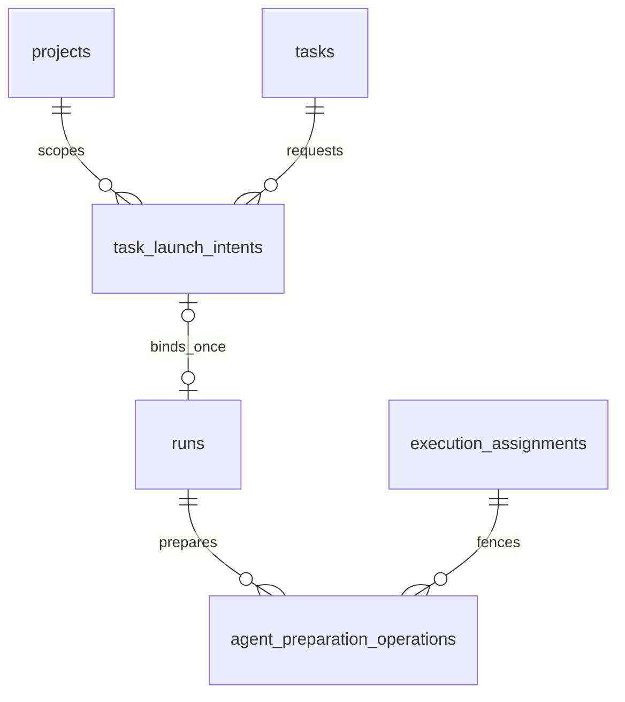

# Task launch and preparation persistence

**Preparation implemented; admission designed — ADR-200/201.** Main-lineage migration `0215_agent_preparation` adds preparation ownership with its schema/journal/snapshot and fenced progress/invalidation/writer guards. Admission remains planned for 0216 and a separate shared guard migration if needed. No Brain migration or historical assessment/run snapshot rewrite. Test databases apply 0215; this task performs no production migration.

## Entities and cardinalities

Intents and preparation operations have independent durable lifecycles. Optional navigation never changes immutable original identity.

## Columns and invariants

| Object                 | Required shape and enforcement                                                                                                                                                                                                                                                                                                                                                                                          |
| ---------------------- | ----------------------------------------------------------------------------------------------------------------------------------------------------------------------------------------------------------------------------------------------------------------------------------------------------------------------------------------------------------------------------------------------------------------------- |
| task_launch_intents    | Server UUID; project/task; immutable principal identity/kind, operation, request key/payload digest, acceptedAt, versioned semantic input/settings snapshot and basis; mutable state/stateVersion, due time, attempts, exact lease token/expiry, typed reason and outcome. Unique principal/project/operation/key plus content comparison.                                                                              |
| Ordinary reservation   | Partial unique task index for ordinary intents in queued/preparing/run_bound/held; operational Triager and explicitly authorized concurrent operations have separate lanes. Existing v1 nonterminal run exclusion is additionally checked under task/run locks. Held state retains task reservation but no capacity.                                                                                                    |
| Run binding            | Nullable new intent navigation on untouched v1; required for new v2 task-delivery roots. Unique intent binding, same project/task/basis/input/settings, write-once immutable original run identity. Link/run/task/slot handoff commit together. Active references restrict pruning; permitted nullable navigation deletion cannot mint authority.                                                                       |
| Frozen request         | Versioned bounded input/settings JSON, canonical SHA-256 digest and positive task/input revisions. Preserve title/prompt/statement/source/clarifications and resolved immutable Flow/session runner/model/base/delivery/execution/promotion. No secret values. NULL historical snapshot is unknown.                                                                                                                     |
| Preparation operations | Operation token primary identity; run/assignment/positive epoch; resource ID/incarnation/commit; state claimed/checkout_ready/baseline_ready/materialized/handed_off/fenced/failed/cancelled; coherent lease and phase timestamps. One active owner per physical resource. Exact token/epoch/lease/status CAS renews/advances; closed states release lease. Handoff references existing session/command/turn authority. |
| v2 admission           | Discriminated manual/automatic/execution_child basis tied to its intent; automatic requires same current accepted assessment/evidence; manual references trusted stored user decision, never changes qualification mode. Existing v1 decoder/immutable guard retained.                                                                                                                                                  |
| Writer capability      | Raise compatible binary floor for v2 and intent-owned legacy rows. GUC is compatibility evidence, not user authentication. New migrations replace affected guards; historic SQL remains unchanged.                                                                                                                                                                                                                      |
| Event                  | task.launch_changed has project/task/intent/stateVersion and no content; fact plus mutation/audit commit together. Complete domain-kind CHECK/taxonomy preserves all existing kinds.                                                                                                                                                                                                                                    |

## Transactions and indexes

### Bounds and lease arithmetic

Identifiers/principal identity/request keys are nonempty strings of at most 256 characters; principal kind and operation are closed discriminants. Task revision is nonnegative, input/state revisions and assignment epochs are positive integers, and digests are 64 lowercase hex characters. The serialized frozen semantic input is at most 256 KiB, resolved settings at most 128 KiB; exceeding an envelope refuses admission as `CONFIG` with `launch_input_limit` before effects, without altering the task. Selection HTTP bodies are at most 64 KiB. Collection bounds are 64 runner slots and 32 safe changed-field categories; existing seven-check assessment bounds remain unchanged.

Preparation and intent-worker leases are 60 seconds, renewed every 20 seconds with exact token/epoch and database time. Probe source/time/byte/entry bounds remain the existing 30 seconds/256 MiB/100,000 entries. Physical lock acquisition uses the existing bounded 2-second contention window; contention records a retryable wait, not failed source evidence. A slow stage renews ownership; an expired owner cannot publish even if its filesystem operation later completes.

Intent processing permits three genuine retryable failures per accepted intent with 1/2/4-second backoff; capacity, host pressure and another valid owner consume no failure attempt. Exhaustion holds the request with the retained last cause and explicit retry remediation, never infers a negative assessment. Existing automatic run-attempt and operational cleanup budgets remain their own counters. A new human successor earns a new scoped budget; worker redrive does not.

Use request-key, active task reservation, active preparation resource, `(state,due_at,id)` recovery and project/task history indexes; populated-plan checks validate actual predicates rather than timing. StateVersion increments exactly on a committed transition. Every key replay rechecks access and exact payload. Constraint/trigger direct-write negative cases accompany valid writer controls.

When capacity is counted, scheduler advisory lock precedes row locking. Existing run/parent/root locks precede assignment, intent and task locks in deterministic order; task-only acceptance never locks a run later. No SQL transaction waits for filesystem exclusion or Git/network effects. Short post-exclusion DB transactions recheck exact owner. Terminal commit precedes physical cleanup and after-commit slot wake.

## Migration and recovery

Generate SQL, journal, snapshot and schema together. Validate fresh and populated supported upgrades through production runner, unchanged historical digests, journal reapply no-op, transactional failure, new/old writer floors, current v1 readers and v2 writers, ordered cross-track migrations and no generation drift. Unsupported/ambiguous lineage refuses before mutation. Never backfill manual authorization, pristine baseline or old input from today's mutable task.

Already checkedAt does not establish actual dispatch or frozen input. Hold incomplete pre-dispatch v1 work; protect existing live sessions and refuse unrecoverable later prompts. Preserve active source references and all immutable assessment publication/content. Forward fix or separately authorized matched restore is the rollback policy; no down migration deletes live evidence.

## Linked artifacts

- [Launch contract](../system-analytics/task-launch-admission.md), [preparation contract](../system-analytics/agent-preparation.md).
- [Qualification persistence](task-qualification-domain.md), [runs](runs-domain.md), [operational agents](operational-agents-domain.md).
- [Database reference](../database-schema.md), [generated implemented ERD](erd.dbml).
