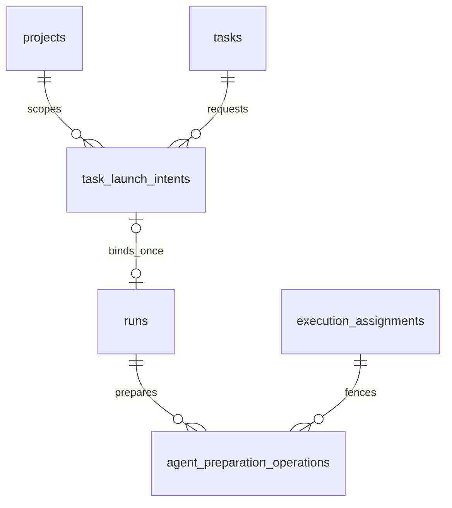

# Task launch and preparation persistence

**Implemented locally — ADR-200/201; final combined acceptance pending.** Main-lineage migrations `0215`–`0225` establish preparation ownership, immutable admission, shared reservations, frozen execution inputs, first-dispatch evidence and standalone-agent/derived-child guards. The migration ledger below identifies each additive change. Generated schema, journal and snapshots travel with SQL. Historical assessments, run snapshots and accepted input digests are not rewritten. Fresh/populated test databases exercise upgrades; this work does not migrate production.

| Migration                              | Persistence change                                                                                                                         |
| -------------------------------------- | ------------------------------------------------------------------------------------------------------------------------------------------ |
| `0215_agent_preparation`               | Durable run/assignment/epoch preparation operations and ownership constraints.                                                             |
| `0216_task_launch_admission`           | Immutable launch intents, v2 run admission/binding and compatibility writer guards.                                                        |
| `0217_task_launch_events`              | Complete event-kind constraint including launch-state facts.                                                                               |
| `0218_task_launch_commit_shape`        | Canonical commit-ID shapes.                                                                                                                |
| `0219_task_launch_execution_snapshots` | Complete execution input v2 and resolved capability identities.                                                                            |
| `0220_task_launch_token_origin`        | Credential-free bearer origin validated on new intent writes.                                                                              |
| `0221_task_launch_shared_reservation`  | Shared ordinary reservation, cancellation/replacement and historical occupancy guards.                                                     |
| `0222_task_launch_preparation`         | Immutable pre-run identity, preparation phases, capacity ownership and materialization guards.                                             |
| `0223_task_triage_flag_origin`         | Distinct qualification findings and explicit/dispatch/unknown holds.                                                                       |
| `0224_task_launch_dispatch_receipt`    | Write-once first-dispatch witness bound to run, assignment/epoch and accepted digests.                                                     |
| `0225_task_launch_agent_preparation`   | Standalone-agent preparation, exact agent/Flow binding, derived consensus/carrier admission and compatible historical continuation guards. |

## Entities and cardinalities

Intents and preparation operations have independent durable lifecycles. Optional navigation never changes immutable original identity.

## Columns and invariants

| Object                 | Required shape and enforcement                                                                                                                                                                                                                                                                                                                                                                                          |
| ---------------------- | ----------------------------------------------------------------------------------------------------------------------------------------------------------------------------------------------------------------------------------------------------------------------------------------------------------------------------------------------------------------------------------------------------------------------- |
| task_launch_intents    | Server UUID; project/task; immutable principal identity/kind, operation, request key/payload digest, acceptedAt, versioned semantic input/settings snapshot and basis; mutable state/stateVersion, due time, attempts, exact lease token/expiry, typed reason and outcome. Unique principal/project/operation/key plus content comparison.                                                                              |
| Ordinary reservation   | Partial unique task index for ordinary intents in queued/preparing/run_bound/held; operational Triager and explicitly authorized concurrent operations have separate lanes. Existing v1 nonterminal run exclusion is additionally checked under task/run locks. Held state retains task reservation but no capacity.                                                                                                    |
| Run binding            | Nullable new intent navigation on untouched v1; required for new v2 task-delivery roots. Unique intent binding, same project/task/basis/input/settings, write-once immutable original run identity. Link/run/task/slot handoff commit together. Active references restrict pruning; permitted nullable navigation deletion cannot mint authority.                                                                       |
| Frozen request         | Versioned bounded input/settings JSON, canonical SHA-256 digest and positive task/input revisions. Preserve title/prompt/statement/source/clarifications and resolved immutable Flow/session runner/model/base/delivery/execution/promotion. No secret values. NULL historical snapshot is unknown.                                                                                                                     |
| Preparation operations | Operation token primary identity; run/assignment/positive epoch; resource ID/incarnation/commit; state claimed/checkout_ready/baseline_ready/materialized/handed_off/fenced/failed/cancelled; coherent lease and phase timestamps. One active owner per physical resource. Exact token/epoch/lease/status CAS renews/advances; closed states release lease. Handoff references existing session/command/turn authority. |
| v2 admission           | Discriminated manual/automatic/execution_child basis tied to its intent; automatic requires same current accepted assessment/evidence; manual references trusted stored user decision, never changes qualification mode. Existing v1 decoder/immutable guard retained.                                                                                                                                                  |
| Writer capability      | Raise compatible binary floor for v2 and intent-owned legacy rows. GUC is compatibility evidence, not user authentication. New migrations replace affected guards; historic SQL remains unchanged.                                                                                                                                                                                                                      |
| Event                  | task.launch_changed has project/task/intent/stateVersion and no content; fact plus mutation/audit commit together. Complete domain-kind CHECK/taxonomy preserves all existing kinds.                                                                                                                                                                                                                                    |

## Transactions and indexes

Frozen settings distinguish Flow and task-bound code-delivery-agent targets. Flow settings carry real Flow/ref/revision IDs and null agent identity; agent settings carry real agent ID and definition SHA-256 with null Flow IDs. Shared runner metadata excludes `env` and credential-bearing `provider` objects, retaining a server profile digest for exact dispatch revalidation. Run binding must match the target kind/identity and execution policy; no synthetic Flow IDs or human-decision backfill are permitted.

An intent has at most one immutable cancellation receipt: cancelling principal/actor, key/payload digest, expected state version and DB acceptance time. An expression unique index scopes cancellation keys by principal/project/operation independently of the original launch key. This permits an authorized different actor to cancel, supports exact replay after response loss, and rejects reuse of one cancellation key for another intent. Replacement keys belong to the uniquely linked successor intent. Neither cancellation nor replacement rewrites the original execution authority.

The intent input digest covers its semantic input snapshot, excluding mutable qualification counters/pointers and task status/priority. Automatic basis separately freezes the assessment's qualification input digest and revision; these use the existing qualification algorithm. This separation prevents requalification or evidence-head invalidation from changing an accepted manual request whose frozen content/settings remain identical. Automatic dispatch still revalidates all assessment/evidence freshness rules.

### Bounds and lease arithmetic

Identifiers/principal identity/request keys are nonempty strings of at most 256 characters; principal kind and operation are closed discriminants. Task revision is nonnegative, input/state revisions and assignment epochs are positive integers, and digests are 64 lowercase hex characters. The serialized frozen semantic input is at most 256 KiB, resolved settings at most 128 KiB; exceeding an envelope refuses admission as `CONFIG` with `launch_input_limit` before effects, without altering the task. Selection HTTP bodies are at most 64 KiB. Collection bounds are 64 runner slots and 32 safe changed-field categories; existing seven-check assessment bounds remain unchanged.

Preparation and intent-worker leases are 60 seconds, renewed every 20 seconds with exact token/epoch and database time. Probe source/time/byte/entry bounds remain the existing 30 seconds/256 MiB/100,000 entries. Physical lock acquisition uses the existing bounded 2-second contention window; contention records a retryable wait, not failed source evidence. A slow stage renews ownership; an expired owner cannot publish even if its filesystem operation later completes.

Intent processing permits three genuine retryable failures per accepted intent with 1/2/4-second backoff; capacity, host pressure and another valid owner consume no failure attempt. Exhaustion holds the request with the retained last cause and explicit retry remediation, never infers a negative assessment. Existing automatic run-attempt and operational cleanup budgets remain their own counters. A new human successor earns a new scoped budget; worker redrive does not.

Use request-key, active task reservation, active preparation resource, `(state,due_at,id)` recovery and project/task history indexes; populated-plan checks validate actual predicates rather than timing. StateVersion increments exactly on a committed transition. Every key replay rechecks access and exact payload. Constraint/trigger direct-write negative cases accompany valid writer controls.

When capacity is counted, the scheduler advisory lock comes first. Acceptance takes its scoped request-key advisory lock, then the shared task-reservation advisory lock; queued edits and dispatch take that same task-reservation lock before row locks. No path takes a request-key lock after the task-reservation lock. Existing run/parent/root locks precede assignment, intent and task locks in deterministic order; task-only acceptance never locks a run later. No SQL transaction waits for filesystem exclusion or Git/network effects. Short post-exclusion DB transactions recheck exact owner. Terminal commit precedes physical cleanup and after-commit slot wake.

## Migration and recovery

Generate SQL, journal, snapshot and schema together. Validate fresh and populated supported upgrades through production runner, unchanged historical digests, journal reapply no-op, transactional failure, new/old writer floors, current v1 readers and v2 writers, ordered cross-track migrations and no generation drift. Unsupported/ambiguous lineage refuses before mutation. Never backfill manual authorization, pristine baseline or old input from today's mutable task.

Already checkedAt does not establish actual dispatch or frozen input. Hold incomplete pre-dispatch v1 work; protect existing live sessions and refuse unrecoverable later prompts. Preserve active source references and all immutable assessment publication/content. Forward fix or separately authorized matched restore is the rollback policy; no down migration deletes live evidence.

## Linked artifacts

- [Launch contract](../system-analytics/task-launch-admission.md), [preparation contract](../system-analytics/agent-preparation.md).
- [Qualification persistence](task-qualification-domain.md), [runs](runs-domain.md), [operational agents](operational-agents-domain.md).
- [Database reference](../database-schema.md), [generated implemented ERD](erd.dbml).

## Frozen execution format v2

Input v2 captures the ordered answered clarification projection actually used by
execution, including nonblocking answers and sequence numbers, under its existing
20-answer/question bounds. Qualification retains its existing blocking-input hash
algorithm and invalidation counters; these are different projections. A reader
must never reconstruct missing execution context from today's task. Existing
input-v1 intent rows remain immutable and readable as history; undispatched v1
requests require a compatibility hold and explicit replacement.

Settings v2 adds the existing resolved capability-set reference snapshot plus a
canonical digest of the relevant catalog/binding configuration, including records
with no published revision. It contains no capability material or credentials.
The settings token also covers the enabled revision's runner default. Current
Flow gates and runner resolution remain authoritative; changing one of these
inputs before acceptance/dispatch cannot silently select a different executor.

An additive migration accepts historical snapshot formats without rewriting them,
requires input/settings v2 for new intent/run bindings. Migration `0219` raised
the launch writer floor to v2; current preparation/binding uses the later v3
compatibility floor. The public receipt remains schemaVersion 1 and exposes only
its existing metadata fields. This change does not version the seven-check result
or alter existing qualification digests.

## Bearer-origin identity

An automatic bearer basis additionally retains a bounded version-1 origin object:
`kind=token`, token ID/kind, original nullable project scope, owner user, agent,
bound run and Librarian turn. These are identifiers only; no token secret, hash,
prefix, label or credential enters an intent. Its token ID matches the intent's
principal ID; owner attribution matches actorUserId. SQL validates identity shape
and current durable token binding on insert; the domain also checks current
scope, grants, expiry, owner and turn/parent availability. Dispatch repeats those
checks. Existing system automatic bases and all historical receipts remain
unchanged; no absent historical bearer identity is reconstructed from mutable
token rows.

## Intent-owned preparation journal

Migration `0222_task_launch_preparation` adds nullable `preparationIdentity`,
`preparationPhase` and `cleanupState` to the existing intent. Historical rows keep
NULL; no Run or workspace is invented to record preparation. Before the first
Git mutation, the scheduler transaction allocates a fixed run UUID, monotonically
allocated task attempt, branch, managed worktree path, canonical parent repository,
resource/incarnation IDs, exact base commit and input/settings digests. The identity
is immutable once written and is not part of the public source-free receipt.

Preparation phases are `reserved`, `checkout_ready`, `materializing`, `materialized`
and `run_bound`. Advancement requires the current unexpired intent lease; an expired
owner cannot publish a phase. A successor retains the same identity. A completed
materialization may be reused only after checking its owned receipt; interrupted
materialization is preserved and held for reconciliation, never silently deleted
or accepted as complete. `cleanupState` records `pending`, `removed` or `retained`
after cancellation/failure/hold. Removing the worktree requires the same physical
repository fence, positive identity/provenance, no bound/in-use run and proven
quiescence. Lease expiry alone never proves quiescence.

An intent in preparation reserves one capacity slot; run binding transfers that
slot exactly once under the scheduler lock. A bound Pending run retains that
reservation until the atomic first-dispatch decision or an explicit hold/cancel.
If live capacity or automatic reserve/project share no longer permits dispatch,
`run_bound -> queued` records `launch_capacity_wait` and releases that slot before
any model command. The same immutable Run, workspace and preparation identity
remain linked. A later claim verifies and reuses that workspace without allocating
another attempt or replaying materialization. Terminalization also settles a bound
Run while its intent is queued or being reclaimed.
The first-dispatch transaction commits the immutable request receipt and Running
transition together. Every later driver executes the frozen request and retains
normal host/assignment/workspace fences. Git and filesystem work remain outside
SQL transactions.

Migration `0224_task_launch_dispatch_receipt` freezes the first commitment's
Run, current assignment ID/epoch, input/settings digests and a database timestamp
at millisecond precision. A timestamp alone cannot mint or replace this receipt.
Continuation on a later assignment keeps the original first-dispatch receipt and
must acquire its own current execution reservation and effect fences. Existing
historical NULL receipts remain NULL.

The `v3` writer compatibility floor covers new Run creation and acquisition of
slot-holding status. A historical active run can continue within its existing
slot under an older writer; a new Run or reactivation must use the counter-aware
writer. This database GUC identifies compatible binaries and provides no user
authorization.
