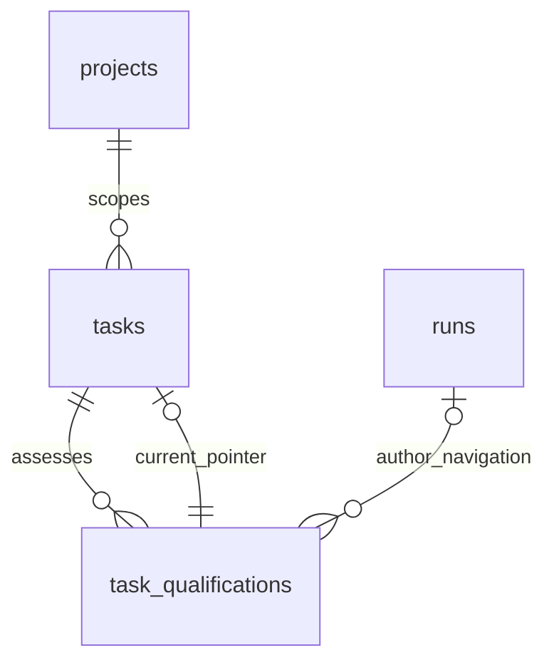

# Task qualification persistence

**Implemented — additive main-lineage migrations 0204–0209; no Brain migration.**

The owning domain defines lifecycle and authority. SQL, Drizzle schema, journal and snapshot must agree; generated consolidated ERD changes only after the corresponding DDL phase.

## Entities and cardinalities

Nullable navigation retains safe immutable identity after history expiry.

## Columns and invariants

| Object              | Contract                                                                                                                                                                                                                            |
| ------------------- | ----------------------------------------------------------------------------------------------------------------------------------------------------------------------------------------------------------------------------------- |
| projects            | Versioned taskQualificationPolicy: immutable creation baseline legacy/required and nullable override; old projects legacy, new required. Changes use existing reviewed project config semantics, never agent writes.                |
| tasks               | Server-owned required/admission mode, qualification_input_revision, qualification_revision_counter, current_qualification_id/revision (accepted only); inherited execution-child proof only from admitted bound-parent transaction. |
| task_qualifications | Immutable assessment ID/task/project/input revision/digest/author identity/run/evidence SHA/checks/decision/next actions, publication receipt candidate/accepted/rejected with typed reason; bounded JSON and content.              |
| uniqueness          | Unique task/input revision/request key; payload conflict rejected; one candidate per task/run/input revision. Task current pointer targets same project/task; input and pointer CAS both required.                                  |
| runs                | Immutable task_admission_snapshot records exact policy/input/assessment/evidence/parent proof. Existing running work keeps its original admission.                                                                                  |
| evidence            | Active pointers cannot be pruned; run/actor navigation may become unavailable without losing immutable provenance or granting acceptance.                                                                                           |
| invalidation        | Every semantic writer increments input revision and clears current acceptance/old enqueue in its transaction. Priority/pause and ordinary discussion do not silently change requirements.                                           |

## Transactions and indexes

Index all hot project/agent/task/due/status and keyset paths; bounded scans use dueAt/id or timestamp/id. All current pointers, receipt uniqueness, payload comparison, state CHECKs and same-project relationships are database/service invariants with direct-write negative tests. Source run precedes task and agent-advisory/episode locks; task-only human writes do not lock a run later. No Git/host/network effect inside PostgreSQL transactions.

## Migration and recovery

Supported fresh/master0198/current0203 upgrades append new SQL. Old pre-rebase operational0194–0198 ledgers are unsupported and must refuse before mutation. Stop old writers, set maintenance, apply additive schema, resume bounded backfill, verify counts/schema, start compatible readers/writers, then reopen admission. Never forge historical success or launch time. Rollback retains additive evidence and fences incompatible admissions; no destructive down migration. Unknown/deleted ownership preserves diagnosis. A pre-run retry allocation is owned by its intent until atomic transfer to the created run.

## Linked artifacts

- [Owning contract](../system-analytics/task-qualification.md)
- [Traceability](../system-analytics/agent-activity-traceability.md)
- [Current generated ERD](erd.dbml)
- [Database reference](../database-schema.md)

`evidence_sha` is nullable only for held assessments; ready requires a verified
SHA. New projects receive their required baseline from the sole registration
owner; the additive SQL legacy default preserves upgraded rows and trusted legacy
fixtures. Task creation derives required mode from the locked project's effective
policy. The database invalidates semantic inputs across all task-row writers,
blocking clarification mutations and default-target updates, with transactional
content-free outbox facts. Source-run → task remains the write lock order.

0209 declares the task-qualification writer capability on production and owned test
connections. Undeclared old writers cannot mutate governed task or admission rows.
It also persists the agent declaration and write-once first-dispatch check receipt.
Default legacy DB values preserve upgraded data; registration assigns new-project
required policy. Independent request admission and execution-child proof are checked
by their existing service owners and database constraints, never inferred from text.
