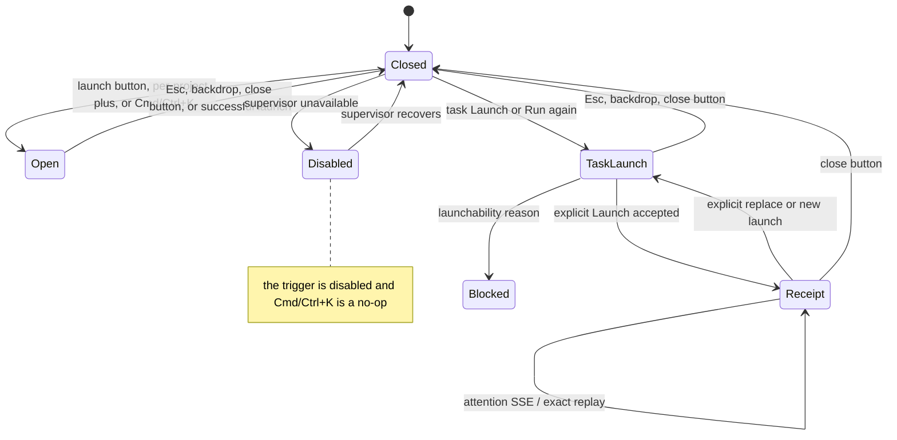

# Launch dialog

## Cut-over incompatible revision state (ADR-131 — Implemented)

An incompatible stored revision remains visible with its exact compatibility
reason: the locked graph-only remediation for legacy `steps[]`, or the declared
engine-range reason for a graph revision. `launchable` is false. Runner
overrides and the submit control are absent, so no selection can bypass
compatibility.

- **Type:** chrome (launch surface reachable from the rail and a global
  shortcut).
- **Status:** Implemented (WI-4 restyle, WI-5 Cmd/Ctrl+K shortcut); `try_once`
  package-version option (ADR-132).
- **Source:** `web/components/chrome/scratch-launch-popover.tsx`,
  `web/components/scratch/scratch-launcher.tsx`,
  `web/components/chrome/launch-hotkey-hint.tsx`,
  `web/components/board/launch-popover.tsx`.

## JTBD

When I want to start a scratch session, I want to open a focused launcher from
anywhere with one keystroke and pick the project, runner, and mode — so starting
exploratory work never requires hunting for a button. When I am on a task card
or task detail page, I want a task-scoped launch dialog that initially shows
the resolved Flow, runner/model, and execution preset, with less-frequent
branch, delivery, budget, and advanced controls available by disclosure before
a run is created.

## Roles & capabilities

An accepted execution-child request can remain queued without a Run. If its
parent is unavailable or its scope changed, the retained launch status explains
that parent decision in EN/RU and directs the user to review, cancel or replan
the request. It is not presented as a negative task assessment. Choosing new
settings does not restore the old parent authority.

Any authenticated user can open the dialog. Whether a launch can proceed is
gated downstream (project selection + supervisor availability); the trigger
button is disabled while the supervisor is unavailable, and the Cmd/Ctrl+K
shortcut respects that same disabled state.

## Navigation

- **Open:** the rail's primary **Launch run** button, a per-project **+** icon,
  or **Cmd/Ctrl+K** (primary launcher only). Task cards and task detail pages
  open the task-scoped run launch popover from their **Launch** / **Run again**
  action.
- **Close:** Esc, a backdrop click, or the top-right **✕** — the shared
  bare-crossmark close ([popup conventions](../README.md#shared-popup--density-conventions),
  no text label).
- **Submit:** scratch launch retains its existing detail-page routing. Task
  Launch keeps the dialog open with the accepted request receipt and an explicit
  Run link once bound. Acceptance is not immediate execution or success; the
  Flow may later ask for its initial form on the Run page. Scheduling a future
  run keeps the current page open.

## Layout & regions

The global scratch launcher uses a trigger button (the primary one carries the
OS-aware
[`LaunchHotkeyHint`](launch-dialog.md) `⌘K` / `Ctrl K` label), then a modal:
a dimmed `bg-paper-warm` backdrop and a panel with a header (title, hint, close)
over the `ScratchLauncher` composer. After WI-4 the composer's field card is
`bg-paper-warm` (flush with the backdrop, no `shadow-inner`) and the control-bar
controls (runner / mode / priority / icon buttons) read as subtly raised
(`border-line` + `bg-ivory` + a top inset highlight + a hover step). Tokens are
theme-aware, so the treatment holds in light and dark.

The task-scoped run launch popover is portal-rendered above the board and left
rail. It preloads launch options from the selected task and shows:

- a visible qualification explanation: missing, stale, negative or source-failed
  assessments block automatic launch but do not require a manual assessment
  before an authorized manual Launch;
- a human-readable launchability banner for states such as active run,
  relation blocker, missing Flow revision, or installed-but-not-enabled Flow;
- Flow, runner/model, and execution preset controls are initially visible;
- logical sessions and consensus runner roles show their resolved runner or a
  localized binding requirement. Selecting a ready runner saves its binding
  automatically for project administrators, including when no binding row
  exists yet. Each row shows saving, saved, or a localized error with a neutral
  retry action. A failed save keeps the choice visible and blocks launch until
  it is saved or replaced. The choice persists for this project and Flow revision;
  selecting automatic resolution clears the binding. Other project members see the role
  status and an administrator-remediation hint. Unresolved roles disable normal
  and force launch; saving a binding or changing Flow or the main runner
  refreshes this preview before submission;
- base/target branch, delivery policy, budget, and advanced execution controls
  are behind explicit disclosures that preserve their selected values;
- non-blocking runner-resolution warnings when a Flow slot launches on a
  same-capability runner whose model and/or provider kind differs from the
  package intent;
- delivery-policy controls for strategy, push, and trigger;
- advanced checks, human-gate, and promotion selectors remain unchanged after
  their disclosure opens;
- budget inputs for run/task/tree token, failure, warning-percent, and
  wall-clock ceilings. Empty budget fields mean unlimited; these controls are
  collapsed by default with the rest of the non-primary controls;
- a **package version choice** per backing package when launch detection
  reports newer state: `keep | adopt | cut_and_adopt | try_once` (ADR-132).
  `try_once` is offered exactly when `adopt` is offered (a newer cut exists)
  and carries a hint — "run this launch on the newer cut without changing the
  project's pin". Picking an option the server did not offer refuses with a
  409 rendered through the existing localized error surface; the next launch
  re-detects and re-offers.

The package-version disclosure starts open exactly when `hasNewerCut ||
hasUncutEdits`; otherwise it follows existing availability behavior. Opening or
collapsing a disclosure is visual-only and cannot mutate a version pin or alter
the existing launch request body.

## States

The shortcut never fires while focus is in an `input` / `textarea` /
`contenteditable`, nor when another `aria-modal` dialog is already open.

## Data & APIs

The `ScratchLauncher` composer owns scratch submission and routing; task-scoped
run launch uses `GET /api/runs/launch-options?taskId=...` followed by
`POST /api/task-launch-intents` with a stable `Idempotency-Key`, displayed task
revision/settings token and server-validated selections. A lost response retains
the identical key/body across close or remount. Accepted requests use scoped
status/cancel/replace operations and existing attention SSE; no client poller is
introduced. Normal Launch has no extra confirmation dialog. Intentional concurrent
launch is a separate explicit session operation, not a bypass flag.

Task-bound agent controls use `GET /api/task-launch-intents/options` and the
same POST contract with their actual `agentId`; a genuine Flow facade is resolved
by the server. See [admission](../../system-analytics/task-launch-admission.md).

`launch-options` returns
`runnerSlots` (logical sessions and consensus roles), `selectedFlowRevisionId`, and
`canConfigureRunnerBindings`, and accepts optional `flowId`/`runnerId` selections
for read-only preview. `consensusRunnerSlots` retains the consensus-only subset
for existing clients. Slot assignments use the existing project-scoped
`PATCH /api/projects/{slug}/flow-runner-remaps`, guarded by `editSettings`.
The consensus admission contract is described in
[`../../system-analytics/consensus.md`](../../system-analytics/consensus.md).
It also returns
`selectedRunnerWarning` and per-session `warning` objects for soft
model/provider fallback previews; those warnings do not disable submit, while
capability absence and exact-match ambiguity keep the existing blocked or
unresolved preview behavior. Behavior and the run substrate live in
[`../../system-analytics/scratch-runs.md`](../../system-analytics/scratch-runs.md).
Task run behavior lives in
[`../../system-analytics/runs.md`](../../system-analytics/runs.md).

## i18n

`scratch` (composer + dialog labels), `portfolio` (`launchRun`, `launchHint`,
`launchUnavailableHint`, `esTip1`), and `launch` (task-scoped run launch
dialog, incl. `launch.packageVersionOption.try_once` + its hint key,
ADR-132). The shortcut glyph is OS-derived, not translated.

## Linked artifacts

- Behavior: [`../../system-analytics/scratch-runs.md`](../../system-analytics/scratch-runs.md).
- Task run behavior: [`../../system-analytics/runs.md`](../../system-analytics/runs.md).
- Package version choice (`keep | adopt | cut_and_adopt | try_once`):
  [`../../system-analytics/local-packages.md`](../../system-analytics/local-packages.md)
  §Version-adopt launch.
- Source: `web/components/chrome/scratch-launch-popover.tsx`,
  `web/components/scratch/scratch-launcher.tsx`,
  `web/components/chrome/launch-hotkey-hint.tsx`,
  `web/components/board/launch-popover.tsx`.
