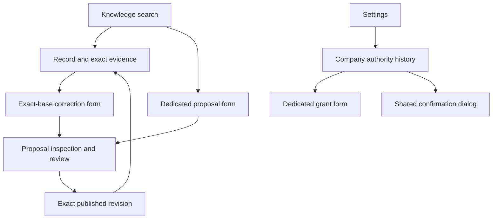
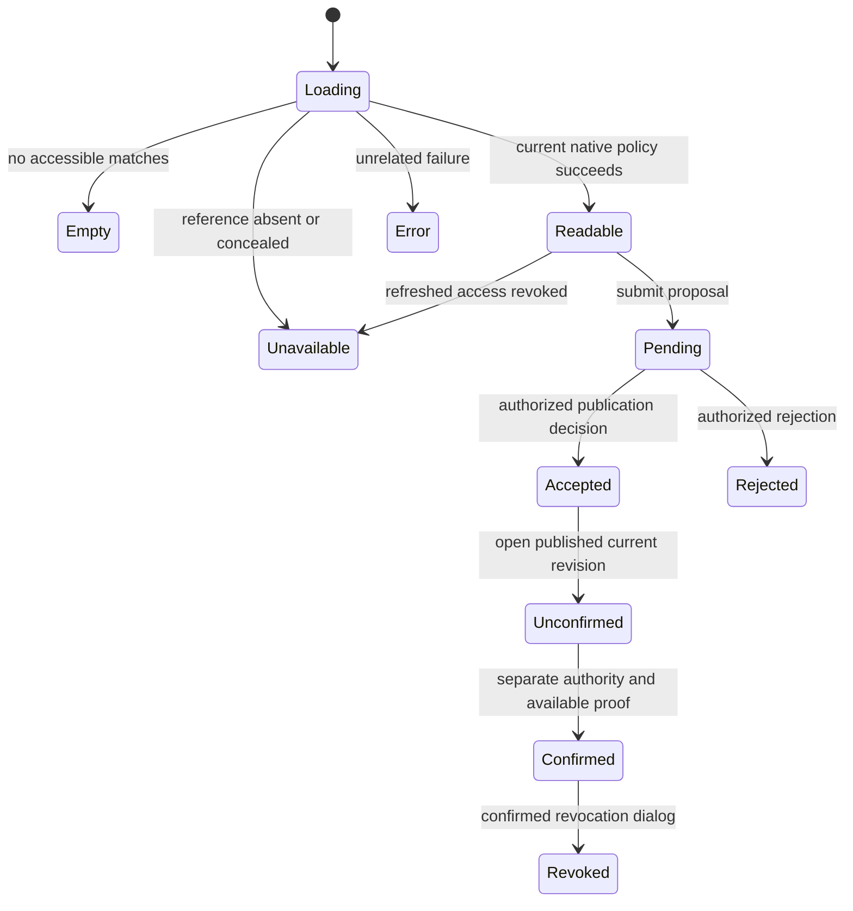

# Company Brain and explicit access

Routes: `/knowledge`, `/knowledge/{recordId}`, `/knowledge/proposals`,
`/knowledge/proposals/new`, `/knowledge/proposals/{proposalId}`,
`/knowledge/{recordId}/correct`, `/knowledge/witnesses/{witnessId}`,
`/settings/company-grants`, `/settings/company-grants/new`,
`/knowledge/results/{runId}/{revision}`.
Status: Implemented locally; cross-surface and full runtime qualification remains separate.
Source: `web/app/(app)/knowledge/`, `web/components/brain/knowledge-*`,
`web/components/brain/company-grant-*`.

## Knowledge workspace designs (Designed)

[Linked mockups](../../.ai-factory/designs/knowledge-management.html) cover Records, the selected review, decision outcomes, the owner-aware vault catalog, note comparison and promotion. Use the scope and example-state controls to exercise accessible and unavailable selections. The production screen uses the existing HeroUI controls and i18n catalogs.

| Screen | Wide layout | Narrow layout and focus |
| --- | --- | --- |
| Records and proposals | Owner scope and filters above a paged list; selected record or proposal beside the list | A selected detail occupies the screen. Back restores the filter, scroll position and row focus. Keyboard activation moves focus to the detail heading. |
| Decision | Show owner, author, source, observed version, reason and verb for the actual effect | Place actions after evidence in reading order. Announce the current outcome. On conflict retain the reason and offer to load the new version. |
| Vault and comparison | Owner and path navigation, safe preview/source, exact revision metadata and comparison | Navigate owner → folder → note → history as nested views. Historical detail offers comparison and restore as a new revision. Return to the current note before editing. |
| Note promotion | Show destination, exact source version, excerpt and intended outcome before submitting | The receipt links to the pending decision. The decision links to its authorized outcome. |

Use readable text labels for states in both themes. A successful empty response, protected content, insufficient evidence and retryable failure each have distinct copy. See the [review lifecycle](../system-analytics/company-brain.md#shared-human-review-designed) and [vault contract](../system-analytics/agent-memory.md#human-catalog-historical-identity-and-review-rationale-designed).

## JTBD

When I need a supported company or project assertion, I want to inspect its
original evidence, author and independent review states, so I can distinguish a
finding from a confirmed fact. When I administer company access, I want explicit
recipient/action grants without creating a repository.

## Roles & capabilities

| Authority                                      | Visible surface and actions                                                                                                     |
| ---------------------------------------------- | ------------------------------------------------------------------------------------------------------------------------------- |
| Active user with current native read authority | Accessible search, records, exact revisions and witnesses; source restrictions still apply                                      |
| Current propose authority                      | Dedicated addition/correction form; own submitted proposal inspection                                                           |
| Current review authority                       | Authorized proposal queue and accept/reject controls                                                                            |
| Current confirm authority                      | Separate evidence selection and confirmation/revocation controls on the current record                                          |
| Current global administrator                   | Company grant list, recipient search, dedicated create form and exact-revision revoke dialog; no implicit company content grant |

Native services remain authoritative. `knowledgeOwnerChoices` uses the shared
SQL owner policy; `knowledgeRecordActions` applies narrower record grants.
Grant administration reuses `authorizeCompanyAdministrator`. A stale client
control cannot authorize a mutation. Reference denial and absence share the
same localized unavailable view.

## Navigation

The Knowledge rail entry opens the search surface. The existing
[Project Brain](projects/project-brain.md) links to a project-filtered structured
list; its indexing and improvement controls remain separate. Administrator
[Settings](settings-brain.md) links to company access. Proposal publication links
to the exact accepted revision; **Open current record** resolves the current
head before a new decision.

## Layout & regions

Search uses URL-backed owner, kind, confirmation, freshness and conflict filters
and signed next-page links. Its table separates basis, confirmation and
freshness. Record details show the assertion, owner/visibility, attribution and
originating execution, source timestamps or unknowns, evidence, limitations and
accessible conflicting revision links. A shortened legacy assertion cannot be
silently submitted as a complete correction.

Proposal detail keeps publication state and its evidence together. The separate
confirmation panel selects available supporting witnesses and requires a
reason. Source inspection shows exact identity/version/digest, original source
group, availability and a bounded excerpt. The correction form retains original
witness references and allows explicit retention/removal of recorded limitations
and missing-evidence declarations.

Company authority history is view-only. New grants use a dedicated form with
searchable current recipients and explicit actions/classes. Revocation opens the
shared portaled confirmation, preserves its reason on failure and disables
closure/repeated confirmation while busy. Mutation feedback uses the shared
provider and localized errors. Uncertain retries retain their delivery identity
while input remains unchanged.

## States

## Data & APIs

RSC readers call the same native services as the session/bearer API. Client
mutations use `/api/knowledge/sources`, `/api/knowledge/proposals`, proposal
`/decision`, record `/confirmations` and session-only `/api/company/grants`.
Owning behavior: [Company Brain](../system-analytics/company-brain.md),
[evidence](../system-analytics/company-brain-evidence.md). The interface does not
create an execution engine or mix private/librarian memory with company records.

## Native findings and exact result history

The existing run inspector renders structured findings only for the frozen native findings contract. Evidence links open exact record/witness/result identities. The retained result page shows current validity separately from its original schema digest, publication and collection timestamps. Superseded history stays inspectable under current project/source authority or explicit company assignment read authority with an exact retained input binding. Company result inspection includes a separate read-only original-assignment section: identity, revision and digest, followed by separately expandable requested work/verification, standing instructions, recurring request and captured authority. Historical authority describes the input; current grants still govern access. The result API omits private assignment input. Inspection does not collect or accept child work or confirm a Brain fact. The session-only API is documented in the [HTTP contract](../api/web.openapi.yaml); it does not widen MCP collection. Native execution capability remains behind the separate complete-disclosure and installed-package qualification gates.

## i18n

`findings` provides EN/RU native evidence/history labels. `knowledge` provides EN/RU labels and mutation feedback; `nav.knowledge`,
`brain.structuredKnowledge` and `settings.companyAccess*` provide entry points.
System-generated legacy/source-availability warnings use localized diagnostic copy, separately from authored limitations. Corrections retain selected missing-evidence declarations without copying generated diagnostics into authored knowledge. Captured source bytes and submitted assertions retain their original language.
Dates use the active locale and explicit UTC. Loading and error states reuse the
shared route skeleton and error boundary.

## Linked artifacts

- [ADR-202](../decisions.md#adr-202)
- [HTTP contract](../api/web.openapi.yaml)
- [Public guide](../../site-docs/guides/company-brain.md)
- `web/e2e/company-brain.spec.ts` — native browser/session qualification;
  installed-package/live ACP qualification remains in its own lane.

## Proposal review (Implemented)

Read authorized proposal and decision history here. Pending items link to the filtered Inbox review group.
