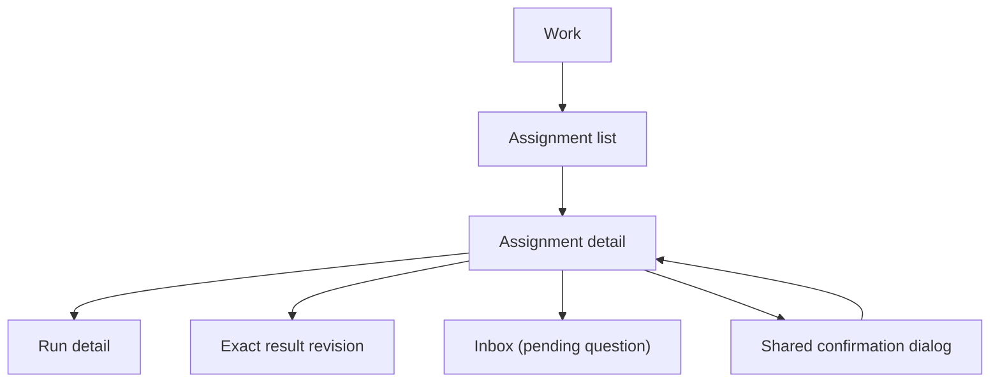
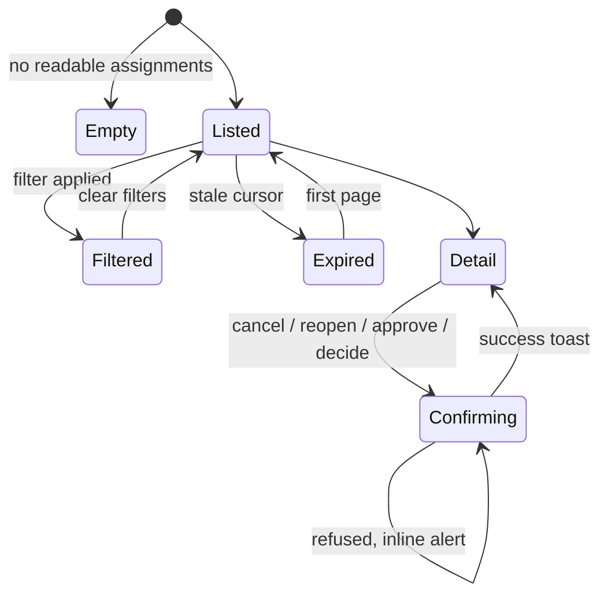

# Specialist assignments

Routes: `/specialist-assignments`, `/specialist-assignments/{assignmentId}`.
Status: Implemented.
Source: `web/app/(app)/specialist-assignments/`,
`web/components/specialist-assignments/`.

## JTBD

When I hand durable work to a company or project specialist, I want to find it
again by status and owner, see who is responsible, what it is waiting for and what
it produced, so I can answer, accept, stop or reopen it without reading run logs.
When a stand restart is involved, I want to approve, inspect and recover the exact
operation with an explicit confirmation, so an external effect never happens by a
stray click.

## Roles & capabilities

| Authority (current, per assignment owner) | Visible surface and actions |
| --- | --- |
| `assignments:read` | List row, detail, working context, delegated work, delivery state |
| `assignments:submit` + an enabled specialist | **New assignment** form |
| `assignments:accept` | Accept the final result; accept or reject a ready delegated result |
| `assignments:cancel` | **Cancel assignment** (stops running work first) |
| `assignments:recover` | **Reopen assignment**; replay a delivered or dead result delivery |
| `targets:read` | Stand operations, receipts and **Verify** health |
| `targets:restart` | **Approve this restart** and successor authorization |
| `targets:recover` | **Check the original receipt**, **Inspect**, **Hold** |

Every control is a convenience; the route re-authorizes. An assignment the user
cannot read is absent from the list and its detail URL returns the same not-found
view as a missing ID.

## Navigation

Entry is the **Specialist assignments** link on [Work](work.md) and the
`?project=<slug>` filter from a project. Rows open the detail page; runs link to
[run detail](runs/flow-run.md); accepted findings link to the
[Company Brain](company-brain.md) result view.

## Layout & regions

**List.** Full-width page. A collapsed **New assignment** section holds the
narrow submission form. A GET filter form (status, owner, requested by me) keeps
every filter in the URL. A view-only table shows objective, coloured status,
owner and last update. **Next page** carries an opaque cursor; a cursor from other
filters or older authority shows **First page** instead of an error.

**Detail.** Header with objective, coloured status pill and live refresh;
identity grid (specialist, owner, revisions); a collapsed **Configuration**
block with package revision, definition digest and a readable authority summary
(submitter, execution policy, grant witnesses). Then, when present:

- pending-input notice linking to the Inbox, and blockers;
- working context with named authors;
- stand incidents and **operations**: each operation shows effect, verification
  and disposition, receipts, and the [stand operation controls](#stand-operation-controls);
- **Delegated work**: a table of child work with derived state, child run and
  result links, and **Accept** / **Reject** for a ready result;
- **Result delivery**: transport state, attempts, last response, **Replay delivery**;
- final acceptance form, knowledge write-back, coordinator recovery;
- **Cancel assignment** or **Reopen assignment**; while work is running a note says
  cancelling stops it first;
- runs with kind, start time and status.

### Stand operation controls

Icon + label buttons. **Approve this restart** opens a confirmation showing the
exact request digest and requires a reason. **Hold** and successor authorization
also confirm with a reason. A successor is chosen from open assignments the user can
read that cite the same target, never typed as an ID. **Verify** appears only with
read authority on a confirmed effect. Completion shows a green-check toast.

## States

## Data & APIs

Server reads use `listAccessibleSpecialistAssignments`,
`listSpecialistAssignmentWork` and `getSpecialistAssignmentDelivery`. Client
controls call `POST /api/specialist-assignments/{id}/cancel|continue`,
`POST …/work/{workId}/decisions`, `POST …/delivery/{deliveryId}/replay` and
`POST /api/stand-operations/{id}/approval|reconcile|recovery-inspections|recovery-decisions|verification`
([web OpenAPI](../api/web.openapi.yaml)). Behaviour is owned by
[specialist assignments](../system-analytics/specialist-assignments.md) and
[stand maintenance](../system-analytics/stand-maintenance.md).

## i18n

`specialistAssignments` (and `knowledge` for shared error copy).

## Linked artifacts

[#adr-203](../decisions.md#adr-203-durable-specialist-assignments-and-company-coordinator-flows),
[#adr-205](../decisions.md#adr-205-stand-operation-intents-and-independent-verification),
[specialist assignments](../system-analytics/specialist-assignments.md),
[specialist cooperation](../system-analytics/specialist-cooperation.md),
[stand maintenance](../system-analytics/stand-maintenance.md).
