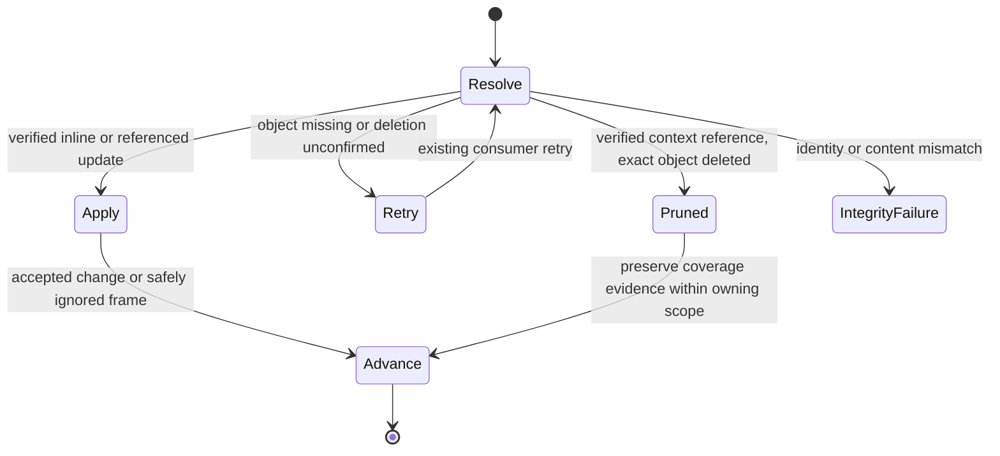
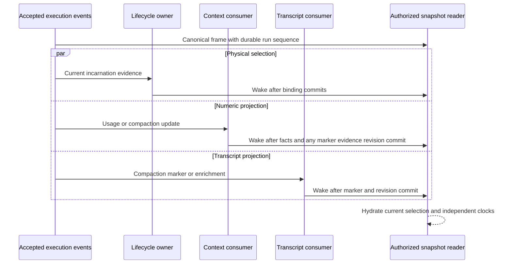

# ACP context observations

**Status:** Implemented in the platform. Provider-backed and browser qualification are tracked in the [acceptance evidence](../../.ai-factory/plans/feature-acp-context-usage-compaction.md). See [ADR-215](../decisions/adr-215.md).

## Purpose

Expose the agent’s reported context occupancy and compaction activity in scratch, Studio, Run detail and the workbench inspector. Preserve typed prompt limit outcomes through settlement and recovery.

## Domain entities

- **[Context reading](../db/runs-domain.md#acp-context-observations-implemented--adr-215)** contains the latest valid used/size pair, canonical event time and source sequence in a physical session or exact node attempt. The same numeric projection holds observed compaction counts and coverage.
- **[Compaction](../db/runs-domain.md#acp-context-observations-implemented--adr-215)** is identified by its fenced physical session and ACP compaction ID. The transcript owns its private summary, bounded error detail and an independent revision for each exact attempt and the whole run.
- **Failure reason** is `context_exhausted` for an input window limit or `max_output_tokens` for a response output cap. The associated error code remains `ACP_PROTOCOL`.

## State machine

| Observation in accepted sequence order | Reading | Lifecycle and transcript |
| --- | --- | --- |
| Fresh or resumed process becomes current | Unknown on the new scope until a fresh valid measurement | Start with zero observed live compactions. History replay remains historical. |
| Valid usage with a nonnegative safe integer and positive safe size | Replace the pair, even when usage decreases or exceeds size | Use it as before/after evidence only when its ownership and relationship to the compaction are unambiguous. |
| Live `in_progress` | Keep the current reading | Start one marker and highlight while any in-scope live ID remains active. |
| Summary chunk | Keep the current reading | Enrich its marker. An orphan chunk cannot establish activity. |
| Live `completed` | Clear any pre-compaction reading until a later valid sample | Set the terminal and add one completed operation. Completion-only is valid and has unknown start. |
| `failed` or `cancelled` | Keep the current reading | Set the terminal with zero additional completed operations. |
| Enrichment for the same terminal | Keep the current reading | Update the existing marker, preserving creation order and count. A full terminal summary replaces streamed text. |
| Physical exit with open compaction | Remove live activity | Mark the observation interrupted. The adapter’s terminal status and error remain unknown. |
| Invalid measurement, unknown status or conflicting terminal | Keep the valid reading | Warn with safe metadata and advance the projection cursor. |

Each projector resolves a canonical reference independently. Ledger coverage
describes available evidence for the selected physical scope.



A confirmed deletion of a referenced usage or lifecycle update clears the
affected reading as the consumer crosses that sequence. The physical session
and its attempts report partial coverage, and the projection retains the
incomplete flag on the exact attempt when attributed. Counts describe observed
operations. A later valid sample can restore the reading while coverage remains
partial. A deleted summary chunk
limits available transcript detail and leaves numeric coverage unchanged.
Consumers advance past malformed optional updates without changing the
reading or marker and emit content-free diagnostics.

During the 0358 → 0359 upgrade, the first accepted inline host frame
identifies compactions whose adapter IDs were stored in JSONB-escaped form.
The migration restores their keys so a summary chunk or completion updates
the original marker and lifecycle record. This preserves the marker's ID,
position and summary, even when two distinct adapter IDs differ only by an
escape suffix. See the [database upgrade contract](../database-schema.md#acp-context-observations-implemented-adr-215).

## Process flows

The supervisor advertises the optional capability for qualified adapters. It commits the ordinary ACP update to its outbox. The context consumer owns numeric facts. The ordered transcript consumer owns marker content and ordering. Both use the same interpretation of ACP status and identity.



Each branch can commit first. An accepted update can populate a fenced
physical scope before the lifecycle owner binds it. Binding exposes those
facts and switches away from the preceding incarnation. Resume-handshake
history cannot restore its predecessor’s live reading or counts. Compare
snapshots across bindings using the database observation time of the
selection. When the newer physical process ends, the current selection can
return to an older live named session. Compare numeric state within an
incarnation using its context sequence.

An opt-in run stream can attach `contextUsageOnly: true` to a canonical frame.
It still advances the durable cursor. The client can skip unrelated
transcript and detail refreshes from that frame. Id-less snapshots share the
same connection. They independently carry the committed transcript revision
so a later marker or before/after usage enrichment invalidates the
corresponding transcript, even when the canonical frame already passed or
the highest marker sequence stays fixed. Reconnect and REST hydration read
the same projections and enforce current scope and source access.

The horizontal meter shows a visible percent and band (green below 60%, amber below 85%, red from 85%). Unknown renders a neutral track and “Not reported”. While a compaction is in progress, an outline, glyph and localized text identify activity independently of color and usage validity. The details expose time, measured token counts, window provenance and observed completed count. Treat a Claude gateway with no usable configured window as advisory and preserve the agent-reported pair.

Prompt settlement first classifies terminal adapter facts and keeps the original receipt and partial output. See [prompt lifecycle](execution-prompt-lifecycle.md) for owner reconciliation, [error taxonomy](../error-taxonomy.md) for reasons and [Flow DSL](../flow-dsl.md) for retry and rework.

Scratch retains its typed failure after the turn settles. On input overflow the conversation pauses sends to the exhausted handle and preserves queued messages. The user starts a fresh session through the normal launch path. An output limit preserves the partial response and allows a smaller follow-up prompt. Agent and Flow terminal outcomes use the safe reason on the existing event. Gates and consensus verifier cells retain technical failure evidence alongside their own outcome records.

## Expectations

- CTX-01: A gauge MUST read the validated pair, source sequence and time for its selected physical scope. A late snapshot from an older binding MUST leave the newer incarnation’s reading or reset intact.
- CTX-02: A compaction ID MUST produce at most one marker and count at most once as a completed operation in that incarnation.
- CTX-03: A projected snapshot MUST converge after reconnect without changing the canonical replay cursor. A change to a marker or its displayed evidence MUST advance transcript invalidation independently of the active incarnation and numeric context sequence.
- CTX-04: An active compaction MUST remain identifiable with color disabled and absent usage.
- CTX-05: Only a current authorized transcript reader may receive a summary or adapter diagnostics. An oversized summary MUST expose the existing authorized full-record action when a preview is returned.
- CTX-06: Runner window guidance MUST preserve the readiness and launch verdict.
- CTX-07: Each supported terminal limit MUST preserve its reason across prompt owner recovery.
- CTX-08: An overflow retry with `workspace: keep` MUST retain its workspace and use a fresh ACP session.
- CTX-09: Compaction MUST leave the existing guardrail evidence and duration deadline in force.
- CTX-10: Migration MUST preserve prior receipts and transcript positions while allowing bounded replay to reconstruct available measurements. A confirmed context tombstone MUST allow later events to project and preserve partial coverage for its numeric scope.

## Edge cases

- A stale assignment cannot update the current scope. A valid late update from the previous process can update retained evidence for that process. A missing creation sequence does not establish that the previous process is newer.
- Two compactions may overlap. Ending one keeps the other highlighted. Compaction during a long-lived named session does not change the owning attempt.
- The event-plane skip ledger handles permanently uningestable envelopes. An unavailable referenced object can still become readable and remains on the existing retry path. A confirmed tombstone is an accepted event with unavailable content and is handled by its projectors.
- Summary and error bounds are in UTF-16 code units and preserve complete surrogate pairs when clipping. Transcript storage uses the existing reversible JSONB-safe codec. A compaction ID must fit its identifier bound in storage. Private text stays out of browser run notifications, logs and metrics.
- The pinned Claude rejection combines a generic error kind with a specific terminal diagnostic. The pinned Codex overflow must be verified on the wire. A retry warning or prose in a transcript cannot establish a failure.

## Provider qualification

The credentialed fixture uses synthetic repositories and prompts. It verifies
usage in scratch and Flow, scratch compaction count and one transcript marker
through each pinned executable, the Supervisor outbox, PostgreSQL and the
shared reader. Run it explicitly with local Claude and Codex authentication.

```sh
MAISTER_CONTEXT_PROVIDER_FIXTURE=1 pnpm --dir web exec vitest run --project integration lib/scratch-runs/__tests__/context-provider.integration.test.ts --maxWorkers=1 --reporter=verbose
```

| Adapter and configured model | Scratch before compaction | Scratch after compaction | Flow reading |
| --- | --- | --- | --- |
| Claude ACP 0.95.0, `claude-sonnet-4-6` | 25,755 / 200,000 | 10,093 / 200,000 | 25,778 / 200,000 |
| Codex ACP 2.2.2, `gpt-6.1-terra` | 23,810 / 475,000 | No new usage in the immediate snapshot | 32,677 / 475,000 |

Both pinned adapters emitted one native completion marker. For Codex, the
immediate reset remains unknown until the adapter reports a new sample. The
initial Codex probe using the workstation’s default model was refused by the
provider. The qualifying test used an advertised model without editing the
workstation’s global config. Gemini, OpenCode and MiMo keep their existing advertisements. A one-turn
provider probe saw `12,100 / 200,000` from OpenCode 2.3.0 and an explicit
`0 / 1,048,576` from MiMo 0.1.0. Gemini 0.68.0 refused session creation
before it reported usage. A silent or unavailable adapter has no reading.

## Linked artifacts

- [ADR-215](../decisions/adr-215.md), [sessions](sessions.md), [event plane](execution-event-plane.md), [scratch](scratch-runs.md), [guardrails](guardrail-hooks.md), [runners](acp-runners.md)
- [Run SSE](../api/async/web-runs.asyncapi.yaml), [ACP wire](../api/external/acp.asyncapi.yaml), [REST](../api/web.openapi.yaml), [database schema](../database-schema.md)
