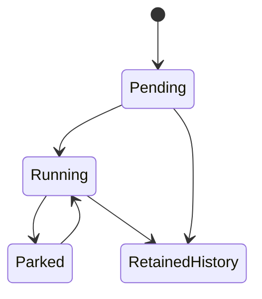
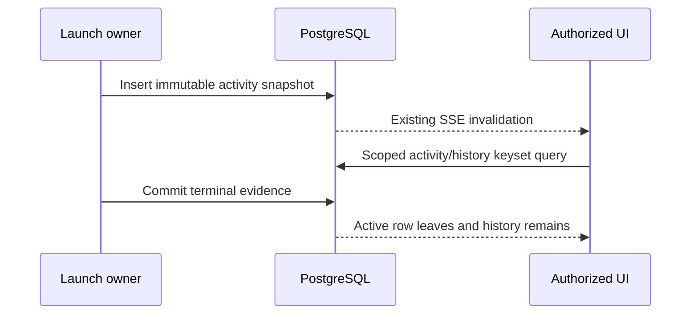

# Agent activity and retained history

**Designed — ADR-196–198.**

## Purpose

Present all active agent executions and retained run/trigger-attempt history without treating rowless sessions as physical workspaces.

## Domain entities

- Agent identity and frozen activity/admission snapshots.
- Run and trigger attempt; [persistence](../db/agent-activity-domain.md).
- Retained physical workspace and scoped reader.

## State machine

The state boundary distinguishes current execution from retained evidence.

## Process flows

The owning transaction commits durable state before its wake-up signal.

### Contract 1

Add `runs.sourceAgentId` (nullable text, immutable, **no FK to catalog agents**)
and immutable `runs.launchedAt` (database-owned insert timestamp for new launches)
for every agent-origin launch, including `runKind=flow` launches. Identity is the
existing package-qualified ID, scoped by `projectId`. Detach/reattach and package
updates retain this identity; an explicit rename creates a distinct history.
Deleting/recreating the same qualified ID resumes its identity, with historical
name/version retained per run. Never group unrelated null agents by display name.

Freeze a small versioned `agentActivitySnapshot` at launch: qualified ID, display
name, definition digest, package install/version/revision, and the versioned
operational comparison scope where applicable. Reuse existing frozen definition,
config, trigger and result payloads rather than copying complete prompts/results
into new tables. Historical code-delivery rows without a full prompt snapshot
must say “Launch prompt unavailable”; current prompt is never substituted.

Backfill source identity from `runs.agentId`, then verified operational definition
snapshot, then an existing explicit delegation snapshot. Reconstruct a qualified
ID only with proven package identity and stem; a bare stem is not globally unique.
Conflicting candidates fail the backfill with a typed diagnostic. Rows with no
proof remain historical run records, individually addressable, under a visible
“Agent identity unavailable” diagnostic; no fabricated association. New launches
must always provide identity, enforced at the launch seam and by a constrained
schema relation for the new snapshot version. Existing runs keep frozen completion
semantics when new metadata is backfilled.

History includes manual, cron, event, webhook, delegated and flow-driving launches
identified by this key. A Flow node merely using an agent persona is not another
launch. Project/agent pages remain available in read-only historical mode after
detach or catalog deletion when authorized retained history exists; current
settings, effective definition and memory mutations require a current attachment.

### Contract 2

Use a dedicated run query, with no workspace prerequisite. Agent-origin executions
in `Pending | Running | NeedsInput | NeedsInputIdle | HumanWorking |
WaitingOnChildren` appear individually in the **Agents / Агенты** section. Derive
one exhaustive status classification from the canonical RunStatus union; new
statuses must not enter implicitly. Include agent-driven flow launches, with a
Flow badge and their actual pool classification. Two concurrent runs of one agent
are two accessible rows. “Waiting for input” rows retain each request's own control.

All working-copy queries require an actual retained workspace; project and
portfolio gain a distinct active-executions section too (UX-D08). Rail workspace
query additionally excludes runs currently represented in the agent section. At code-delivery Review/Failed/Crashed, existing review/recovery/retention
workspace rows remain available. Terminal operational runs never appear in either
rail population, regardless of success, retained diagnostic bytes or cleanup
failure. Change project/portfolio population deliberately at its domain boundary, while
retaining real code-delivery workspaces and ordinary promotion semantics.

Rows show agent and project, status, launch time, run link and pending-input count;
reuse authorized Stop/run navigation, not Git actions. Use semantic icon/text in
addition to color. Expanded rail, collapsed flyout and mobile drawer share this
population; long active lists scroll without hiding concurrent executions.

Show visible active and queued counts, explicitly scoped to accessible projects.
Do not introduce a global occupancy fraction for ordinary members: it would leak
inaccessible activity and the agent-driven Flow entries use another pool. The
existing scheduler/admin surface remains the capacity authority. No new capacity
widget is required; the section label must not imply a new operational-only pool.

### Contract 3

Project Agents rows link to `/projects/[slug]/agents/[agentId]` and show retained
run count, active count, and the last launched run's status/time/outcome. In the
page header also show last completed run, so a new Pending run does not conceal
last failure. Label counts **Runs in retained history / Запуски в истории**;
these are not lifetime counters independent of retention. Zero runs means “Not
run yet / Ещё не запускался”. Use one batched aggregate/latest query, not N+1.

The full-width page has URL-addressable tabs: History, Attempts, Memory, Definition and
Settings. Attempts has its own bounded cursor and explicit pre-run outcome labels. History is default and uses keyset pagination, default 25/max 100,
newest `(activitySortAt,id)` first; for new/verified rows activitySortAt equals
immutable launchedAt. Preserve mutable startedAt
as execution/admission time, never use it for causal recovery. Backfill launch time
only from verified creation evidence; otherwise retain a stable legacy sort time
with explicit estimated provenance and disallow it as a recovery witness.
Persist activitySortAt once at cutover from known launch evidence or the then-current
legacy timestamp; never recompute it from mutable startedAt. If no timestamp exists,
use the recorded migration instant with `migration_estimate` provenance. The latest
summary row uses this same total ordering and labels estimated history explicitly;
it must not claim an exact last-launch time for such a row. Filters
are URL-synchronized allow-listed status, trigger source and operational outcome;
reset cursor on filter change. Cursor binds project, agent, filters and upper
launch boundary. Cursors preserve PostgreSQL microsecond ordering, use a 2,048-character
bound and a domain-separated HMAC with the existing required `AUTH_SECRET`; no
new secret or server-side pagination store is introduced. Rotation invalidates
old cursors and the client returns to page one. Tampered/mismatched cursors return 400; all queries still enforce
authorization independently. New launches do not displace rows between existing
pages; live updates display “New runs available” with an explicit first-page
refresh. Dynamic status/outcome filters reflect current canonical state, not a
historical database snapshot; do not promise frozen membership across transitions.

Each history row uses `loadOperationalOutcomes` and normal run details for evidence,
counts, diagnostics, cancellation/crash, cleanup and confirmed task links. Only
links belonging to this authorized project are exposed. No diff/promotion controls
for operational rows. History and summary use the same identity/filter foundation;
summary is unfiltered and labeled accordingly.

Memory reuses current persistence, grants and hash CAS. Definition shows the pinned
current prompt and safe resolved configuration/provenance, not token-expanded
runtime text. Apply `readRepoFiles` to prompt/memory/config values; membership may
see safe metadata and history statuses without protected text. Missing/untrusted/
incompatible package yields a localized section error while history remains usable.
Never fall back to the newest catalog definition. Studio “View package” link is
shown only when the resolver selects exactly this authorized pinned install.
Project settings reuse the existing editSettings-protected modal/endpoint. No new
prompt write endpoint; installed files remain immutable.

### Contract 8

The reported screenshot is consistent with a verified read-model defect, not proof
that 20 physical worktrees exist. `project.ts:332-375` and
`portfolio.ts:410-455` left-join workspace-less agents into `activeWorkspaces`;
`project.ts:477-488` substitutes agentId for branch; `portfolio.ts:230-243` maps
Failed/Crashed to generic `done`. The project renderer at
`web/app/(app)/projects/[slug]/page.tsx:928-1007` shows that as a green dot and
passes workspace availability unconditionally. Actual statuses, installed pin and
runner health in the user's live installation have not been inspected.

Fix the domain boundary in **all three surfaces**: rail, project and portfolio.
“Working copies / Рабочие копии” contains actual retained workspace rows only.
An independently named “Agent executions / Запуски агентов” section contains the
same active agent-run population as the rail, including Pending and parked runs.
Each DTO carries exact run status, explicit workspace availability and separate
counts. No-workspace session rows cannot receive Git actions or inflate working
copy totals. Failed is danger/error, Crashed has its own localized state; neither
is rendered as successful Done. Review has its own label and retains real review
controls. Preserve real code-delivery failed/crashed/review workspaces and their
cleanup/recovery evidence; never infer a new kind from an empty diff or an agent ID.

Extend grouped incident eligibility beyond newly operational runs to
`runKind=agent` terminal Failed/Crashed executions whose **frozen** workspace mode
is none/repo_read and which have no retained delivery workspace. This includes
legacy `core:triager` without changing its historical `agentKind` or completion
contract. Operational runs remain eligible in every supported workspace mode.
Agent-driven Flow/code-delivery worktree failures retain their existing recovery/
review queue rather than producing a duplicate grouped incident. Unknown legacy
workspace/identity evidence is shown explicitly and never silently classified.
No `agentId === 'core:triager'` branch in generic lifecycle or visibility code.

Use a shared `AgentExecutionFailure` projection for both kinds: stage
`admission | materialization | session_create | prompt_dispatch | execution |
finalization | unknown`, typed reason/code, safe message/remediation, failed runner
ID and immutable runner snapshot label, occurrence time, source evidence locator,
retry eligibility and refusal reasons. Prefer canonical terminal event
`web/lib/runs/terminal-cause.ts:60-102`, owned execution command `lastError`, and
verified prompt evidence; do not parse prose or guess runner failure from status.
Missing evidence is `unknown`, not a fabricated HTTP/auth diagnosis. Operational
results add business detail but are not required to represent legacy execution
failure. Runner ID/config digest belongs in infrastructure cause identity;
business causes keep their original scope rules.

Correct actual stranded state as well as its projection. A known failure after
run INSERT but before dispatch must settle through a specific Pending-admission
failure finalizer. Under the run lock require Pending, matching launch ownership,
and proof of no dispatched prompt or live/unknown create. Use the same atomic
terminal/result/token/event/cleanup owner and release queue capacity exactly once.
Do not widen the general Failed status allow-list. If scheduler wins Running,
hand off to the current generation's ordinary finalizer/reconcile owner.

Unknown create/prompt outcome is not “failed safely”: reconcile the durable command,
assignment and supervisor evidence before concluding no live work remains. Review
all post-insert mkdir, `tryStartRun`, dispatch microtask and pre-spawn exception
paths (`launch.ts:1617-1623`, scheduler dispatch and create-failure paths). No
log-only stranded Pending/Running run. Startup/reconcile must recover a process
crash between durable launch and worker dispatch, with bounded existing-owner
retry; no new polling service and no forced status flip while a session may live.
Admission refusal before a run exists stays on its existing scheduler attempt/
launch HTTP diagnostic and agent summary; do not fabricate successful executions
or count rejected HTTP requests as runs. Repeated scheduler refusals use the same
agent attention card when they have durable attempt evidence, with a distinct
source fact key and **attempt count**, not a fake failed-run count. Current `agent_schedules.lastAttemptFence/lastOutcome` is overwritten telemetry
(`triggers.ts:48-95`, schema:1098-1114), not a durable attempt ledger; a global
scheduler job run cannot identify each binding attempt. Add a narrow
`agent_trigger_attempts` ledger: immutable id/project/sourceAgent/binding snapshot,
trigger source and delivery identity, claimedAt, nullable settledAt/outcome/runId,
safe reason and comparison scope. Unique schedule-snapshot/fence or event-delivery
claim prevents replay duplicates; a deleted binding/run leaves the safe snapshot.
Claim a scheduled fire and insert its attempt atomically (including nextFireAt),
then settle attempt + latest telemetry + incident occurrence + outbox in one owner
transaction. No full prompts or secret trigger bodies copied into the ledger.
No new business retry policy: a process death after claim is reconciled by the
existing system_sweep using the recorded launch intent/run evidence. Adopt a proven
run receipt; if outcome cannot be proven, settle `unknown` with remediation and do
not blindly re-fire the external operation. Late receipts refine evidence under
CAS without double-counting incidents. Manual preflight refusal stays HTTP feedback;
accepted explicit retries use their own intent ledger. Expose scheduled attempts
in agent history as a distinct Attempts view, page size 25/max100, with separate
attempt/run counts; do not mix two sorts into one unbounded union. Include manual
refusal feedback without manufacturing a run. Backfill only the latest proven
legacy attempt with `legacy_latest` provenance; prior counts remain unavailable,
not fabricated from lastAttemptFence.

## Expectations

- **UX-01:** a package update, schedule deletion, detach/reattach or catalog deletion does not reclassify or lose provably associated retained runs. An unresolved legacy identity is explicit and never merged into another agent's history. Enforced by the owning services/constraints below and primary acceptance in [traceability](agent-activity-traceability.md).
- **UX-02:** all listed active states are individually accessible for none, repo_read and worktree modes; no duplicate rail row. 1,000 completed operational successes or failures leave zero terminal rail rows. Code-delivery Review still opens normal review and promotion. Visibility count is not scheduler occupancy. Enforced by the owning services/constraints below and primary acceptance in [traceability](agent-activity-traceability.md).
- **UX-03:** summary → page → next history page → run works for EN/RU, keyboard and mobile; counts/latest are deterministic, safe and scoped. Memory conflicts are visible; unauthorized users cannot retrieve protected data by calling the API. Enforced by the owning services/constraints below and primary acceptance in [traceability](agent-activity-traceability.md).
- **UX-08:** twenty failed workspace-less triagers yield zero working copies, one agent failure card, and twenty retained run records with accurate failure labels. Queued/running agents remain accessible. Known pre-dispatch failures terminalize; unknown host outcomes remain actionable and recoverable until reconciled. Real code-delivery workspaces and individually actionable HITL are preserved. Enforced by the owning services/constraints below and primary acceptance in [traceability](agent-activity-traceability.md).

## Edge cases

- **EDGE-UX-01:** AC01/06: both launch seams snapshot ID; update/detach/delete/reattach; legacy proven/unknown/conflicting identity; nullable/estimated legacy sort, frozen paging after Pending admission, fresh/incremental index/constraint parity The owner returns typed `MaisterError` CONFIG/PRECONDITION/CONFLICT/UNAUTHORIZED or records a canonical operational failure; no silent fallback. Primary `IT-UX-01` (plan alias `UX-IT01`).
- **EDGE-UX-06:** AC03: batched summary, retained total/active/last-launched/last-completed, flow-driving/manual/scheduled/delegated population, equal timestamps, bounded keyset/filter cursor, no N+1 The owner returns typed `MaisterError` CONFIG/PRECONDITION/CONFLICT/UNAUTHORIZED or records a canonical operational failure; no silent fallback. Primary `IT-UX-06` (plan alias `UX-IT06`).
- **EDGE-UX-07:** AC03/07: real GET/grants contract, cross-project/cursor forgery, readRepoFiles vs membership, deleted/untrusted pinned definition, no latest-pin fallback, memory CAS regression The owner returns typed `MaisterError` CONFIG/PRECONDITION/CONFLICT/UNAUTHORIZED or records a canonical operational failure; no silent fallback. Primary `IT-UX-07` (plan alias `UX-IT07`).
- **EDGE-UX-10:** AC02: all active statuses/modes and flow-driving pool distinction, simultaneous runs, terminal exclusion, workspace dedup and code Review/retained-workspace parity The owner returns typed `MaisterError` CONFIG/PRECONDITION/CONFLICT/UNAUTHORIZED or records a canonical operational failure; no silent fallback. Primary `IT-UX-10` (plan alias `UX-IT10`).
- **EDGE-UX-13:** AC08: no-run admission refusal, post-INSERT Pending failure, scheduler race, dispatch exception, unknown create ACK, restart/reconcile, provider failure stage and immutable launchedAt The owner returns typed `MaisterError` CONFIG/PRECONDITION/CONFLICT/UNAUTHORIZED or records a canonical operational failure; no silent fallback. Primary `IT-UX-13` (plan alias `UX-IT13`).
- **EDGE-UX-21:** AC08/06: claim+fire atomicity, concurrent binding attempts, overwritten latest telemetry, crash before/after launch receipt, unknown outcome not re-fired, detach and partial legacy backfill; history attempts vs run counts The owner returns typed `MaisterError` CONFIG/PRECONDITION/CONFLICT/UNAUTHORIZED or records a canonical operational failure; no silent fallback. Primary `IT-UX-21` (plan alias `UX-IT21`).
- **EDGE-UX-23:** AC02/04/07: EN/RU active rail in expanded/collapsed/mobile, Pending and no-worktree row, SSE disappearance, one live failure card, ack then quiet repeat/new cause, separate HITL controls The owner returns typed `MaisterError` CONFIG/PRECONDITION/CONFLICT/UNAUTHORIZED or records a canonical operational failure; no silent fallback. Primary `E2E-UX-01` (plan alias `UX-E2E01`).
- **EDGE-UX-24:** AC01/03: summary→page→second page→run, URL tabs/back/forward, new-run refresh, role gates, memory CAS error/success, unavailable definition and detached read-only state The owner returns typed `MaisterError` CONFIG/PRECONDITION/CONFLICT/UNAUTHORIZED or records a canonical operational failure; no silent fallback. Primary `E2E-UX-02` (plan alias `UX-E2E02`).
- **EDGE-UX-25:** AC08–10: 20 failed rowless triagers vs zero working copies; safe bad-runner attempt→failure details→choose B→one linked successor; defaults/member/admin separation; unknown/partial refusal; EN/RU The owner returns typed `MaisterError` CONFIG/PRECONDITION/CONFLICT/UNAUTHORIZED or records a canonical operational failure; no silent fallback. Primary `E2E-UX-03` (plan alias `UX-E2E03`).

## Linked artifacts

- [Traceability](agent-activity-traceability.md)
- [Web API](../api/web.openapi.yaml) and [external API](../api/external/operations.openapi.yaml)
- [Persistence](../db/agent-activity-domain.md) and [qualification persistence](../db/task-qualification-domain.md)
- [Implementation plan](../../.ai-factory/plans/feature-operational-agent-kind.md)

History exposes the stored trigger vocabulary, including `flow` and `scheduled`.
An unknown legacy trigger stays null; it is never fabricated as a manual launch.

Retry previews include a nullable `existingIntentId` so a reload can follow an
already accepted or launched receipt. Retry receipts expose only the nullable
cleanup state, revision and safe reason; they never expose allocation paths,
recipe, runner credentials or ACP handles. Explicit cleanup rearm uses that
revision and its own request key. A launched receipt retains its identity after
child retention and continues to prohibit a second successor from the source.
