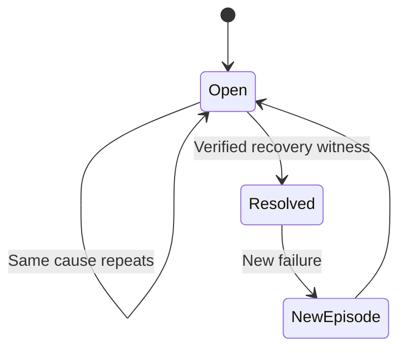
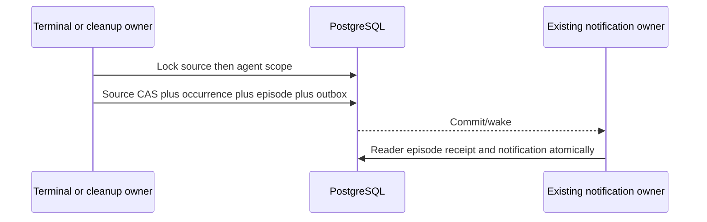

# Grouped agent incidents

**Designed — ADR-196–198.**

## Purpose

Represent repeated operational and eligible legacy execution failures as one scoped reader-actionable agent group, preserving every occurrence and normal HITL.

## Domain entities

- Episode, immutable occurrence and per-reader acknowledgement/publication receipt.
- Terminal/cleanup/trigger-attempt source fact.
- Existing decision queue, notification outbox and HITL requests.

## State machine

The state boundary distinguishes current execution from retained evidence.

## Process flows

The owning transaction commits durable state before its wake-up signal.

### Contract 4

For operational terminal problems and eligible workspace-less legacy execution
failures defined in UX-D08, group **before** the canonical decision queue
by `(projectId,sourceAgentId)`. ID is stable for this pair and independent of a
representative run. One card summarizes all unresolved, unacknowledged cause
**episodes**; no automatic Task, no terminal rail card and no per-run notification
storm. Individual HITL decisions retain original request IDs and are never grouped.

A cause fingerprint is versioned canonical structured data: platform reason,
normalized diagnostic code/operation/service/httpStatus where applicable, and
comparison scope. Never hash prose, remediation text, raw response bodies, dynamic
URLs, run IDs or timestamps. Platform validation/integrity/crash/missing-result
reasons take precedence over agent-authored diagnosis. A run with several distinct
causes contributes one occurrence to each cause but only one distinct failed-run
count to the card. Cap displayed causes at 10 with a paginated detail expansion;
the summary reports total causes and never silently drops the remainder.

Scope is a frozen hash of definition digest, effective declared instance config,
completion-contract version and semantic trigger input for business causes. Implement explicit trigger
normalizers: cron/manual scan with identical declared scope can match; event,
webhook or delegated inputs retain target identifiers/payload semantics while
excluding delivery IDs/timestamps only where the existing trigger contract proves
them nonsemantic. Unknown/legacy scope is **not comparable for automatic recovery**.
These semantic-input scopes apply to business/validation causes. Infrastructure
causes use a separate versioned allow-listed scope: project/agent, runner configuration
digest, provider/service identity, failed stage/operation and relevant execution-host
or repository boundary when that stage depends on it. Task ID, issue number and
request prose do not split a provider-auth/session-create failure into new episodes.
Unknown reason/stage is not automatically collapsed into a known infrastructure
cause. The normalizer table is closed and tested, not arbitrary field omission.
No secret-bearing scope inputs/hash preimages are exposed or logged. Changed scope
starts a distinct cause episode inside the same agent/project card.

Repeated observations in an open episode increment exact occurrence counts and
first/last timestamps, update latest-run evidence and content revision, but do not
raise actionable revision or undo a user's episode acknowledgement. A new cause,
escalation to a different fingerprint, or a recurrence after confirmed recovery
creates a new episode and re-arms attention. Acknowledgement is per user and means
“seen”, not “fixed”; acknowledged ongoing problems remain on the agent page.
No wall-clock cooldown and no automatic repeat reminder in this scope.

New episode acknowledgement accepts the exact observed episode IDs and immutable
attention revisions. An unknown/cross-agent ID fails atomically; a concurrently
created different episode remains unacknowledged. Repeated occurrences within the
same episode need not cause a 409 or force the user to chase a minute-by-minute
moving revision. A closed observed episode is an idempotent no-op. Another user's
attention does not change.

### Contract 5

Normal business/API episodes, including authorization failures, can close only on a canonical validated,
source-clean **complete successful** result in the **same comparable scope**, whose
launch timestamp is strictly later than every occurrence's terminal timestamp.
A success launched before or during a failing run cannot establish recovery.
Use the new immutable database-owned launchedAt and terminal evidence; estimated
legacy times cannot prove recovery. UUID tie-breaks order pages, not causal proof. A
zero-new-work complete scan is eligible. Recovery eligibility is a platform cause
classification, independent of the diagnostic retryable flag: a 403 may be
non-retryable until access is repaired yet recover after an eligible successful scan.
Partial, missing, malformed, cancelled or
prose-only outcomes are not. A changed definition/config is a different business scope and
does not falsely resolve the old problem; the UI permits acknowledging it as seen.

Infrastructure recovery compares its infrastructure scope, not task-specific
business input. A later clean complete operational success on runner A may close a
matching provider failure across different tasks, but success on runner B may not.
A legacy run lacking canonical validated success is not a business recovery witness;
retain acknowledgement/manual remediation rather than infer success from prose.
The same strict non-overlap timestamp rule applies to both scope families.

Integrity violations, unresolved external effects and unavailable evidence are
safety episodes: a later clean scan never closes them. Keep their diagnostic links
and existing remediation; acknowledgement can quiet the reader without asserting
repair. Cleanup episodes close only when their original resource's canonical
cleanup state proves removal/release; a different run's success cannot close them.
Rearming cleanup is not successful cleanup. Another exhaustion of the same open
cause updates occurrence evidence without revoking acknowledgement; exhaustion
after verified recovery creates a new episode. A cleanup episode shared by several
runs resolves only after every unresolved source occurrence has verified disposal.
Partial removal,
lease recovery and source evidence preservation keep their existing owners.

Serialize episode changes per project/agent with transaction-scoped advisory lock,
then episode/occurrence row locks and uniqueness constraints. Integrate with
existing terminal CAS and cleanup transactions. Inventory actual run-row locking
first and use one consistent lock order across finalization, failure, reconciliation,
cleanup and acknowledgement; never add a reverse acquisition order. No Git,
filesystem inspection, supervisor call or await on an external service inside this
transaction. Persist terminal/cleanup fact + incident projection + invalidation
fact atomically. On rollback, none becomes visible; on replay, unique source keys
prevent double counting. Applying a delayed/backfilled failure first checks for a
canonical success satisfying the same strict recovery witness; already-recovered
failures remain historical instead of reopening attention due to processing order.
Stop/cancellation without another failure creates no
operation episode; exhausted cleanup after cancellation still requires attention.
Recovery/resume of a crashed run preserves the original occurrence. A later status
change cannot erase it or pretend the failed attempt never happened; terminal
revision/source identity, not mutable run status alone, keys the incident fact.
Use the stable terminal-transition event/generation identity minted in the source
transaction; multiple terminal attempts of a recovered run must not share a boolean
“already applied” marker. Scheduler writers are verified to change startedAt; the new immutable launchedAt
is mandatory and must remain unchanged through Pending admission and resume.
Acquire the source run lock first, then the project/agent advisory lock and episode
rows; acknowledgements lock only episode rows and never acquire source-run locks.

Hard deletion of run history must not cascade away an unresolved episode. Retain a
small safe occurrence tombstone with timestamps and source fact key (`run_id` FK
SET NULL) and show “Execution evidence expired” when normal retention removes the
link. Aggregate counts are exact for ingested occurrences, distinct from the
retained-history summary. This first release performs no automatic episode/occurrence pruning: these small
ledger records persist with the project. Any later pruning policy needs an explicit
contract and owner. Evidence expiry alone creates no new incident. Project hard delete
may cascade its own groups after existing authorization; catalog detach/delete may
not. User delete cascades only that user's acknowledgement rows.

### Contract 6

Proposed additive schema, finalized in Phase 0:

| Object                               | Fields/invariants and access path                                                                                                                                                                                                                                                                                                                                                                                                                                                                            |
| ------------------------------------ | ------------------------------------------------------------------------------------------------------------------------------------------------------------------------------------------------------------------------------------------------------------------------------------------------------------------------------------------------------------------------------------------------------------------------------------------------------------------------------------------------------------ |
| `runs`                               | Immutable `source_agent_id`, nullable `launched_at`, nonnull activitySortAt for classified agent history with timestamp provenance, versioned `agent_activity_snapshot`, retry lineage and versioned taskAdmissionSnapshot where applicable; history index `(project_id,source_agent_id,activity_sort_at DESC,id DESC)` with source-agent predicate. No persisted mutable run-count columns.                                                                                                                 |
| `agent_incident_episodes` (new)      | UUID ID, project FK, immutable agent key, scope digest/version or explicitly unknown, reason/fingerprint, state open/resolved, attention revision, first/last terminal timestamps, resolvedAt/recovery evidence. Unique open episode per `(project,agent,scope,fingerprint)`; unknown scope uses an explicit key, not SQL NULL uniqueness. Index open episodes by authorized project/agent.                                                                                                                  |
| `agent_incident_occurrences` (new)   | Episode FK, immutable source fact key, nullable run FK SET NULL, original run ID for dedup/distinct count, fact channel (operational terminal, execution failure, admission refusal, cleanup), result/terminal/attempt or cleanup revision, observed terminal timestamp, per-occurrence verified cleanup resolution and minimal safe reason. Unique `(source fact key,cause fingerprint)`; no copied result bodies or prompts. Source key survives run deletion. Index episode/time and run/revision lookup. |
| `agent_incident_reader_states` (new) | User/episode/attention-revision PK; nullable acknowledgedAt; independent notificationRecordedAt, notificationMode (published/baseline), nullable notificationEventId. A notification receipt never implies acknowledgement. CHECKs enforce valid null/mode combinations. User FK cascade; publication receipt survives outbox retention. Old per-run acknowledgement table remains for compatibility.                                                                                                        |
| `agent_trigger_attempts` (new)       | Source-agent/project and binding snapshot, unique delivery claim/fence, nullable run pointer, immutable claim time and CAS settlement, bounded safe diagnostics. No cascade on detach; index agent/claimedAt/id and unsettled claims. Independent pre-run lifecycle, not another run or scheduler queue.                                                                                                                                                                                                     |

The separate `agent_retry_intents` ledger and unique retry-child relation in UX-D09
are required for explicit rerun idempotency, not incident aggregation.
Do not add a group table, general notification engine, lifetime counter or new
consumer clock. Content revisions can be hashes over bounded canonical summary
fields; actionable revisions depend on episode identity, not occurrence counts.
Use a bounded keyset backfill under the existing maintenance/upgrade fence before
opening new readers. Persist progress through the existing upgrade mechanism if
available; otherwise add one explicit upgrade progress record, not process-memory
state. Each page is committed with its cursor; retries are idempotent. Backfill
identity before episodes; process terminal facts deterministically and use the
same transition function as live writers. Surface corrupt/unclassifiable rows,
with exact counts and a deploy refusal, instead of silently skipping them.

Legacy per-run acknowledgements suppress only their corresponding existing
occurrences. Backfill creates **no explicit episode acknowledgement** from legacy
rows. Visibility derives from all current historical tuples being acknowledged;
only the new explicit action writes reader-state acknowledgedAt. Legacy acknowledgement
endpoints continue their exact run/reason/revision behavior; they must never grant
an episode-wide acknowledgement of future repeats. Define effective visibility as
explicit episode ack OR all current occurrence tuples individually acknowledged;
a later new tuple becomes visible without an explicit episode ack. New UI uses
explicit episode acknowledgement. The legacy read projection also honors an
explicit episode acknowledgement for its covered tuples, while retaining the old
per-run response shape. This preserves old clients without silently widening a
legacy write decision.

**Rebase reconciliation completed:** master retains ADR-194 and migrations
0194–0198 for project configuration. The unpublished operational branch now uses
ADR-195 and migrations 0199–0203. SQL bodies were renamed without business edits;
master snapshots remain unchanged and new operational snapshots include both
schemas. The operational incremental test now starts at canonical master 0198.
`db:generate` reports no schema changes; fresh and incremental local PostgreSQL
qualification passed. No deployment database was touched. Previous conflict-free
receipts in the historical section do not describe this new base.

Provisionally reserve follow-up migration 0204 for activity/incidents and 0205 for
retry persistence, 0206 for trigger-attempt evidence, and 0207 for qualification; reserve ADR-196 for activity/attention,
ADR-197 for explicit retry/effect boundaries and ADR-198 for task qualification. Recompute against authoritative master at implementation.
UX-T01 still owns deployment-ledger inventory: a durable DB using the pre-rebase
operational 0194–0198 sequence must refuse ordinary upgrade until an explicit
ledger reconciliation path is specified/qualified; never rewrite that DB's applied
checksums or pretend canonical-master upgrade proof covers it.

Migration deliverables are SQL + journal + snapshot + Drizzle schema, generated
DBML, domain Mermaid ERD and column/cascade narrative. Qualify fresh install and
incremental upgrade from canonical master, as well as an already-operational
branch database if one is supported. `db:generate` must report no residual schema
change. A single quiet maintenance cutover drains old writers, migrates/backfills,
deploys all new writers/readers, validates projection, then reopens admission.
Do not support mixed old/new incident writers during the cutover. Rollback fences
admission, retains additive data, rolls back compatible binaries/readers together;
old per-run attention may be noisier, but history/results are not removed.

The migration entrypoint rejects unknown ledger hashes before any DDL. After the
additive migrations, it runs bounded `agent_activity_cutovers` pages. Existing
agent history requires the existing `MAISTER_UPGRADE_MAINTENANCE` fence; no new
maintenance switch is introduced. Identity, facts, latest legacy schedule attempts
and per-reader notification baselines commit independently with durable cursors.
A poisoned page reports `agent_activity_identity_conflict` and preserves its prior
cursor. Unknown identities retain their run and are counted explicitly; never
assign a bare stem without proven package identity. Legacy acknowledgements are
copied to occurrence-reader receipts and mirrored by the existing endpoint, so
hard-deleting a run does not erase their exact meaning.

### Contract 7

All responses use explicit typed/Zod DTOs and shared projections. API specs and
examples are written before handlers. Typed 400/401/403/404/409/503 errors use the
project taxonomy and localized UI mapping; never string-match server messages.
GETs are side-effect-free. New acknowledgement is DB-only (no downstream delivery
acknowledgement gap). Existing memory/settings/cleanup actions retain their own
transaction, CAS and external-effect protocols; no new hidden side effect.

| Surface                                                                                           | Planned contract and identifiers                                                                                                                                                                                                                                                                                                                                                                                                                                                                                                                                          | Specification owner                                                                                                   |
| ------------------------------------------------------------------------------------------------- | ------------------------------------------------------------------------------------------------------------------------------------------------------------------------------------------------------------------------------------------------------------------------------------------------------------------------------------------------------------------------------------------------------------------------------------------------------------------------------------------------------------------------------------------------------------------------- | --------------------------------------------------------------------------------------------------------------------- |
| `GET /api/projects/{slug}/agents`                                                                 | Add safe batched `activity` summary to attached agent DTO; slug=url-param, reader=auth-context, project/agent rows=server-state. Existing grants remain.                                                                                                                                                                                                                                                                                                                                                                                                                  | `docs/api/web.openapi.yaml`, agents analytics                                                                         |
| `GET /api/projects/{slug}/agents/{agentId}` (new method)                                          | Safe metadata/activity + attachment/historical state; definition capability flags, not protected prompt by default. slug/agentId=url-param; resolved project/source key=server-state; reader=auth-context. 404 only when neither visible attachment nor proven history exists.                                                                                                                                                                                                                                                                                            | Same                                                                                                                  |
| `GET .../{agentId}/runs` (new)                                                                    | `{items,nextCursor,asOf}`; cursor/limit/filter=query-controlled and validated, with server-derived project scope. Invalid cursor 400; inaccessible project follows existing 403/404 policy.                                                                                                                                                                                                                                                                                                                                                                               | Same                                                                                                                  |
| `GET .../{agentId}/definition` (new)                                                              | readRepoFiles gate; current pinned safe prompt/config/provenance or typed unavailable state. Missing current attachment is 404; valid historical page still works. No runtime secrets/private paths.                                                                                                                                                                                                                                                                                                                                                                      | Same                                                                                                                  |
| `GET .../{agentId}/incidents` (new)                                                               | Bounded episode/cause details and acknowledgement state, separate cursor; member gets safe metadata, protected evidence/diagnostics use existing run-data grants. Derive group via project/source key, not an arbitrary representative run.                                                                                                                                                                                                                                                                                                                               | Same, attention analytics                                                                                             |
| `POST .../{agentId}/incidents/acknowledge` (new)                                                  | body-controlled nonempty bounded array of `{episodeId,attentionRevision}`; compare every ID to server-state project/agent, derive user from auth and require the existing `answerHitl` project action. 200 accepted/replayed/closed no-op; 409 stale invalid revision; 400 malformed; 403/404 unauthorized. All-or-none, no run/source IDs supplied in body.                                                                                                                                                                                                              | Same, operational lifecycle AsyncAPI                                                                                  |
| Existing `POST /api/runs/{runId}/operational/acknowledge`, cleanup retry, project memory/settings | Preserve existing body/status/grants. Run/project/path locators=url-param; scope/user/cleanup owner=server-state/auth-context. Old per-run acknowledgement never means new episode acknowledgement. Document cutover compatibility.                                                                                                                                                                                                                                                                                                                                       | Existing web OpenAPI paths                                                                                            |
| `GET /api/v1/ext/decisions` and MCP decisions tool                                                | Opt-in query `operationalGrouping=agent` selects the grouped DTO with `aggregation: agent`, stable group/agent identity, episode/reason summary and counts; representative run is nullable navigation only. Omitted query preserves legacy per-run wire semantics; bundled MCP explicitly opts in. Validate the query allow-list, retain old safe fields and forbid representative-run group mutation. Read grants still govern nested fields. No new external mutation tool or prompt/history API required; grouped DTO exposes safe retry availability/navigation only. | `docs/api/external/operations.openapi.yaml`, `mcp/src/tools.ts`/contract tests                                        |
| Attention SSE                                                                                     | Reuse `attention.tick` invalidation regions; add durable launch/queue/start/park/resume/terminal/incident-ack changes to scanned sources. Include content fingerprint in change signature. One subscription, reconnect/catch-up via existing cursor.                                                                                                                                                                                                                                                                                                                      | `docs/api/async/attention-stream.asyncapi.yaml`, domain taxonomy and attention analytics                              |
| Internal domain facts                                                                             | Versioned activity/incident changed payloads contain IDs/revisions only, no prompt/diagnostic bodies. Emit in the owning transaction; notify-after-commit is only a wake optimization. Terminal and cleanup facts stay canonical.                                                                                                                                                                                                                                                                                                                                         | `docs/api/async/operational-lifecycle.asyncapi.yaml`; outbound webhook spec only if a public webhook actually changes |

A grouped read response cannot expose secrets merely because a user can see
counts. Restrict prompt/memory/config and evidence payloads independently; redact
nested diagnostic/reference data before serialization. Project visibility applies
before SQL aggregation, cursor construction and notification generation. Tokens
must never acknowledge as a human by taking a userId from the request. Existing
HITL routes, permission IDs and resume behavior remain unchanged.

The Inbox badge counts groups plus independent existing decisions. Activity and
cause content changes refresh UI even when count/ID stays constant. Notification
creation uses newly actionable episode IDs, not count increase alone: a second
cause in one existing card must notify once; another identical occurrence must
not. Under the existing per-user notification lock, atomically insert the existing
outbox event and record each `(reader,episode,attentionRevision)` publication in
reader state. A failure before commit leaves both retryable; committed publication
uses the existing delivery retries. Outbox retention must not erase the receipt.
Both the event consumer and existing system_sweep backstop (`notifications/digest-trigger.ts`)
call this same publisher, including unchanged-count cases; preserve count-delta
semantics for other decision kinds. Bound each page of new episodes and make the
receipt the durable progress marker; do not advance past failed publication. New
activity facts must not feed an unintended agent-trigger/self-trigger loop.
On initial/backfill activation, mark the consumer baseline without generating
one historical notification per old failure. Bound summary queries and avoid
loading all historical operational runs on every badge render. The agent page
uses the same attention refresh mechanism; no timer/poll-based data fetching.

## Expectations

- **UX-04:** 1,000 identical failures produce one card with correct distinct-run count; after acknowledgement they produce no new unread/actionable item until a new cause/episode. Two independent causes remain distinguishable inside one card; other agents/projects and both readers remain isolated. No Task rows are inserted. Enforced by the owning services/constraints below and primary acceptance in [traceability](agent-activity-traceability.md).
- **UX-05:** reversed completion order, duplicate finalization, crash/restart, acknowledgement races and cleanup retries neither double-count nor lose attention. Old/overlapping successes do not resolve new failures. Cleanup/evidence loss cannot silently erase an open problem or create review/promotion affordances. Enforced by the owning services/constraints below and primary acceptance in [traceability](agent-activity-traceability.md).
- **UX-06:** migration resumes after interrupted pages without duplicates; old acknowledgements retain meaning; source identity survives FK deletion; constraints and generated schema match. New code is not enabled on partial backfill. Add nullable launch columns first, backfill verified/estimated fields, then set defaults for future INSERTs; adding DEFAULT now() must not silently turn old launches into today's factual timestamps. CHECK/immutable guards explicitly distinguish legacy from versioned new records. Enforced by the owning services/constraints below and primary acceptance in [traceability](agent-activity-traceability.md).
- **UX-07:** browser and opt-in REST/bundled MCP agree on grouped cardinality; stale representative runs do not control mutations. Same-count changes update live UI, repeated failures do not create notifications, a new cause does, inaccessible-project activity leaks neither counts nor events, and reconnect converges without a reload/poll loop. Enforced by the owning services/constraints below and primary acceptance in [traceability](agent-activity-traceability.md).

## Edge cases

- **EDGE-UX-02:** AC04/08: 1,000 repeats across different task IDs on the same failed runner remain one infrastructure cause; different runner/business scopes stay distinct, partial/403/missing/malformed result, distinct-run vs cause counts, no Task creation The owner returns typed `MaisterError` CONFIG/PRECONDITION/CONFLICT/UNAUTHORIZED or records a canonical operational failure; no silent fallback. Primary `IT-UX-02` (plan alias `UX-IT02`).
- **EDGE-UX-03:** AC05: simultaneous finalizers, replay, transaction rollback/process restart, overlapping/late success, zero-work recovery, reopened episode, safety reasons never auto-clear The owner returns typed `MaisterError` CONFIG/PRECONDITION/CONFLICT/UNAUTHORIZED or records a canonical operational failure; no silent fallback. Primary `IT-UX-03` (plan alias `UX-IT03`).
- **EDGE-UX-04:** AC05: exhausted/rearmed/re-exhausted/released cleanup with two resources sharing one cause (one release cannot close both), partial disposal, cancellation and crash retained evidence; terminal/resource state and occurrence commit atomically The owner returns typed `MaisterError` CONFIG/PRECONDITION/CONFLICT/UNAUTHORIZED or records a canonical operational failure; no silent fallback. Primary `IT-UX-04` (plan alias `UX-IT04`).
- **EDGE-UX-05:** AC01/06: interrupted/backfilled pages, no duplicate occurrence, existing per-run acks, unknown scope, catalog/run/user deletion, archived project, no historical notification storm The owner returns typed `MaisterError` CONFIG/PRECONDITION/CONFLICT/UNAUTHORIZED or records a canonical operational failure; no silent fallback. Primary `IT-UX-05` (plan alias `UX-IT05`).
- **EDGE-UX-08:** AC04/07: group/badge/opt-in REST/MCP parity plus legacy default DTO; per-user ack repeat/replay; new cause racing ack; old per-run ack does not suppress future repeat; scoped cleanup action The owner returns typed `MaisterError` CONFIG/PRECONDITION/CONFLICT/UNAUTHORIZED or records a canonical operational failure; no silent fallback. Primary `IT-UX-08` (plan alias `UX-IT08`).
- **EDGE-UX-09:** AC07: taskless Pending→Running→park/resume→terminal, equal-count updated group, reconnect/cursor replay, access loss, new-cause one notification vs repeat zero, publication rollback and backstop replay at count 1→1 The owner returns typed `MaisterError` CONFIG/PRECONDITION/CONFLICT/UNAUTHORIZED or records a canonical operational failure; no silent fallback. Primary `IT-UX-09` (plan alias `UX-IT09`).
- **EDGE-UX-11:** AC02/05: two real independent permission requests, parked checkpoint/resume, stop/crash recovery free slots and update visibility; no autoapproval, no grouped HITL The owner returns typed `MaisterError` CONFIG/PRECONDITION/CONFLICT/UNAUTHORIZED or records a canonical operational failure; no silent fallback. Primary `IT-UX-11` (plan alias `UX-IT11`).
- **EDGE-UX-12:** AC01/02/05: run snapshot stable through pin update; original source materialization/integrity and cleanup guards stay green; code-delivery Review/promotion unaffected The owner returns typed `MaisterError` CONFIG/PRECONDITION/CONFLICT/UNAUTHORIZED or records a canonical operational failure; no silent fallback. Primary `IT-UX-12` (plan alias `UX-IT12`).

## Linked artifacts

- [Traceability](agent-activity-traceability.md)
- [Web API](../api/web.openapi.yaml) and [external API](../api/external/operations.openapi.yaml)
- [Persistence](../db/agent-activity-domain.md) and [qualification persistence](../db/task-qualification-domain.md)
- [Implementation plan](../../.ai-factory/plans/feature-operational-agent-kind.md)
