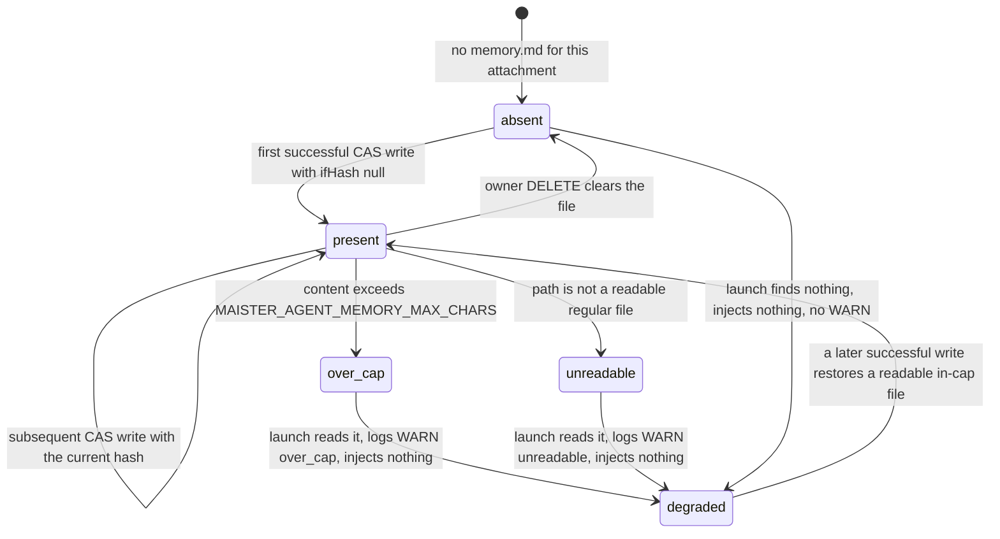
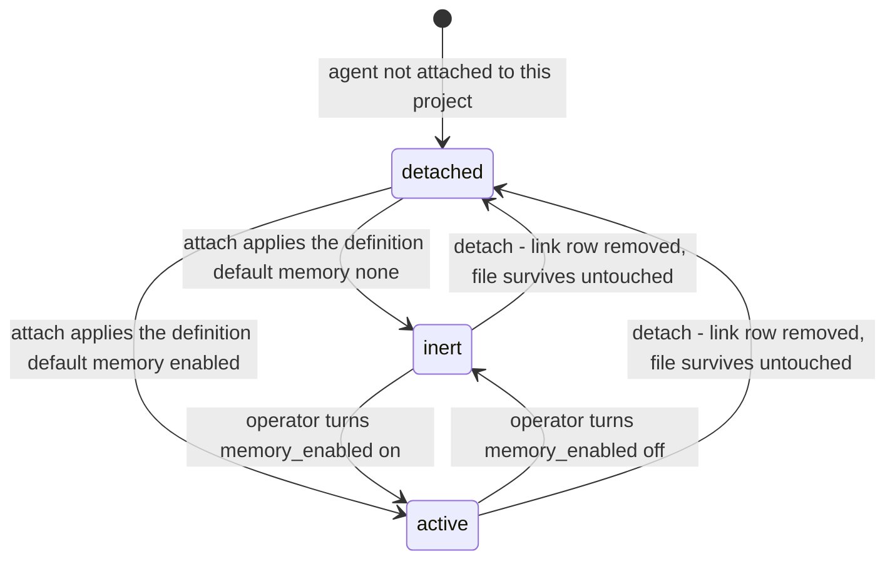
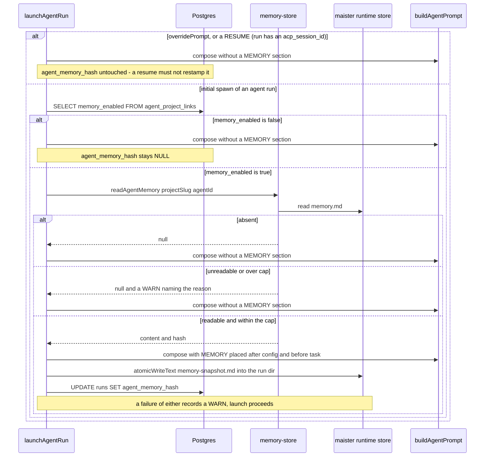
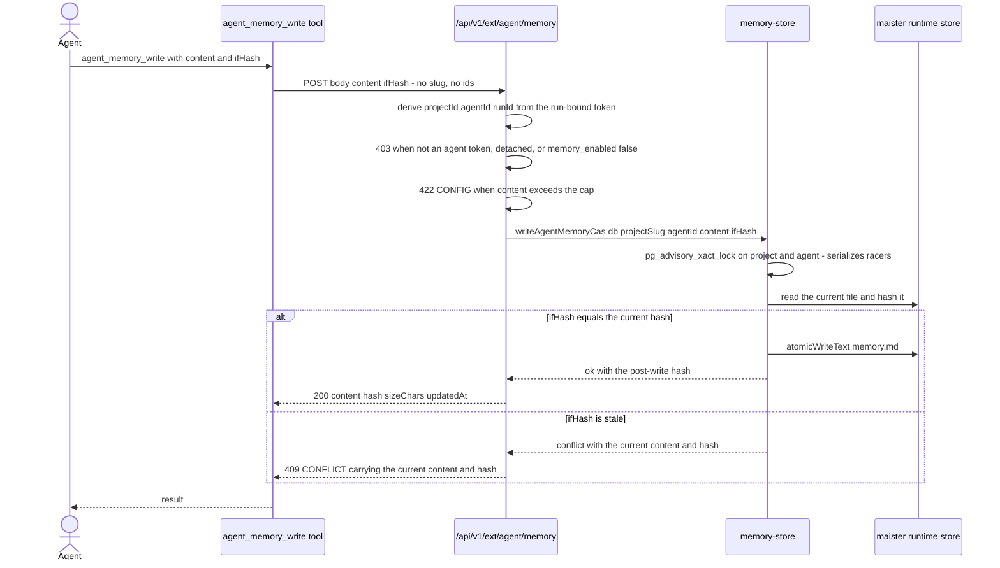
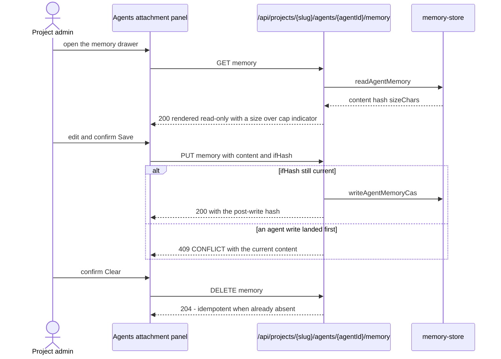

# Agent memory domain

## Purpose

The PostgreSQL vault stores current Markdown notes and immutable
revisions. The Memory tab and session-bound MCP command use it after
activation. Existing installations use the file behavior below until their
operator completes the explicit cutover. [ADR-210](../decisions/adr-210.md)

**Legacy agent memory** is a single Markdown file per `(agent, project)`
attachment that a platform agent may read at launch and rewrite during a run.
It is the agent's own durable cross-run scratch note — "what I learned about
this project last time" — and it exists so a summoned agent
([`agent-mentions.md`](agent-mentions.md)) does not start cold on every run.
This file owns the memory axis on the attachment, the on-disk store and its
path derivation, launch-time injection and its provenance record, the
content-hash CAS write path, and the owner's view/edit/clear surface. It does
NOT own agent launch mechanics ([`agents.md`](agents.md)) or Project Brain
([`project-brain.md`](project-brain.md)) — those are a different store with a
different owner, and the two axes never imply each other. (Implemented — ADR-152)

## Domain entities

- **Memory axis** — `agent_project_links.memory_enabled boolean NOT NULL
  DEFAULT false`. The per-attachment operator switch. Independent of
  `can_read_brain` / `can_write_brain`. See
  [`../db/agents-domain.md`](../db/agents-domain.md). (Implemented)
- **Definition memory field** — `memory: none | enabled` in the agent
  definition frontmatter (`agentDefinitionFrontmatterSchema`), default `none`.
  It is the package author's *recommendation*; `attachAgent` applies it once as
  the server-side default for a new attachment. The stored link value is
  effective thereafter — a package upgrade never re-enables memory an operator
  turned off. (Implemented)
- **Memory file** — `memory.md` at
  `.maister/<project-slug>/agents/<enc(packageName)>/<enc(stem)>/memory.md`
  under `runtimeRoot()`. Keyed by the qualified agent id
  (`<packageName>:<stem>`), never by package revision. (Implemented)
- **Component encoder `enc`** — keeps `[A-Za-z0-9._-]` verbatim and rewrites
  every other byte as `%XX` (uppercase hex). A component that encodes to `.` or
  `..` is refused. Because an encoded component can never contain `/`, the
  `(packageName, stem)` → path map is injective. (Implemented)
- **Content hash** — `hashAgentMemory(content)`, sha256 hex over the exact
  content bytes. An absent file hashes to `null`. It is both the CAS token and
  the provenance stamp. (Implemented)
- **CAS lock** — a per-`(project, agent)` `pg_advisory_xact_lock` held across the
  whole read-compare-write in `writeAgentMemoryCas`. The filesystem offers no
  compare-and-swap, so without it two callers observing the same hash would both
  pass the comparison and both write, and the loser would be discarded with a
  `200`. (Implemented)
- **Memory snapshot** — `memory-snapshot.md`, written into the run dir
  (`runDirPath(runtimeRoot(), projectSlug, runId)`) on every launch that
  actually injected memory. Human-readable evidence, GC'd with the run dir
  after 7 days. (Implemented)
- **Provenance stamp** — `runs.agent_memory_hash text` (nullable). The durable
  half of the provenance pair: it survives the run-dir GC and is queryable.
  `NULL` means "this run injected no memory". (Implemented)
- **Cap** — `MAISTER_AGENT_MEMORY_MAX_CHARS`, default `32768` characters, read
  through `agentMemoryMaxChars()`. Host/service env only per ADR-023; see
  [`../configuration.md`](../configuration.md). (Implemented)

## State machine

The memory **file** as seen by a launch. `degraded` is a read-time verdict,
not a stored state: the file on disk is unchanged, the launch simply carries no
MEMORY section. (Implemented)

The **attachment** axis, which gates every read and write regardless of the
file's own state. Detach never touches the file. (Implemented)

In `inert` and `detached` the file may exist and is simply not used: no
injection at launch, and `POST /api/v1/ext/agent/memory` refuses with 403.

## Process flows

### Launch injection and provenance (Implemented)

Resolution happens at the **launch site**, not inside `buildAgentPrompt`,
because the launch site's `opts.overridePrompt ?? …` discards the composed
base prompt wholesale — resolving inside the builder would stamp provenance for
a prompt that carried no memory. The whole path is gated on
`runs.run_kind = 'agent'` and on the run having **no** `acp_session_id`:
`startAgentSession` is also the resume entry point, and a resumed session
already carries the original prompt in restored context.

### Agent write through the content-hash CAS (Implemented)

The losing branch is the interesting one: it returns the current content so the
agent can merge and retry rather than blindly clobber.

### Owner view, edit, and clear (Implemented)

CAS applies to the human too — a blind Save must not clobber a concurrent
agent write.

### Vault ownership, writes and cutover (Implemented — ADR-210)

A vault resolves from a current memory-enabled attachment and a stable owner
key. For a project, the key is the project ID plus qualified agent ID. For
an installation, it is the company ID plus qualified agent ID. History
survives detach and catalog retirement. The [vault data
contract](../db/agents-domain.md#agent-memory-vault-implemented) owns its storage
constraints. The [external API](../api/external/operations.openapi.yaml) and
[browser API](../api/web.openapi.yaml) own the command and response schemas.

| State or operation | Guard | Result and owner |
| --- | --- | --- |
| Missing path → create | Both expected hash and revision are null. Destination is free, policy admits the writer, and quotas allow the new head. | Commit a note, first revision and receipt. A name reused after deletion gets a new note identity. |
| Active → edit, insert or replace | Match the current revision and hash. Replace requires one literal match. Insert addresses the position after the 1-based line number, with zero for the start. | Append a revision and change only its head. Match and split lines on LF, preserve other bytes, and use the supplied insert text verbatim. |
| Active → rename | Match the current revision and hash and verify the destination is unused. | Keep the note ID and append a path-change revision. |
| Active → delete or clear | Match every current head in the bounded selection. For a virtual directory or vault clear, also match the vault generation. | Append tombstone revisions in one transaction. Directory paths and root are virtual. Root cannot be renamed or deleted through the MCP command. |
| Retained revision → revert | Match the current head, require a readable payload on the exact selected revision, and validate the resulting path, content and quotas. | Append a new revision with its own author and inherited source restrictions. |
| Mutation requires review | Policy forces review after authority and content validation. | Commit the proposed operation and its receipt, with no head or live quota change. Review completion uses the same CAS service. |
| Active or historical → redacted | Current global administrator selects an exact revision and supplies a reason. | Record redaction and remove payload in one transaction with index and dependent access invalidation. If the revision is current, append a tombstone. The revision identity and hash remain. |
| Inventoried → imported → verified | Operator quiesces all legacy writers and revokes or drains their credentials. Resolve owners using immutable IDs or an unambiguous current slug/catalog match. | Persist checksummed exact bytes and receipts. Files remain as rollback input until activation. Repeated import of the same inventory is a replay. |
| Verified → active | All live notes resolve, every staged payload matches its receipt, and the maintenance process confirms writer quiescence. | Advance the durable cutover generation. New writes and token admission use the active generation. |
| Active → cleaned | Explicit operator action checks the live generation, exact file identity and SHA-256 from its import receipt. | Remove the verified original and settle cleanup. An already absent file is a replay only for an imported and verified identity. |

Before activation, take matched backups of the main database and legacy
runtime data. Set `MAISTER_UPGRADE_MAINTENANCE` on the web processes, retire
pre-vault binaries and drain legacy sessions before running `activate`.
Keep the verified originals through activation and the first database write
and read. After activation, vault revisions exist in PostgreSQL. Returning to
a pre-vault binary requires restoring both parts of the pre-activation backup
as one recovery point. That recovery point excludes subsequent vault edits.

The vault namespace is NFC, case sensitive and rooted at `/memories`.
Commands accept canonical virtual paths only. Relative paths, empty and dot
segments, backslashes, percent escapes, URL/query/fragment syntax, control
characters and non-scalar UTF-16 are invalid. File leaves end in `.md`.
Directories are implicit parents. A file cannot also be a parent prefix.
The limit is 512 UTF-8 bytes and 16 segments below the root. A directory page
sorts by canonical UTF-8 path, and a note page binds to its exact revision.
An immediate folder entry records one visible descendant as evidence for that
folder. The generation still fences the visible subtree. Child note paths,
hashes and bodies are disclosed through subsequent reads.
Every cursor binds the vault, selection, kind and sort key. Offset into a
long note is measured in UTF-16 code units and a page cannot split a
surrogate pair.

A command locks the current principal and provenance consumer first, then the
cross-domain knowledge lock where applicable, the vault quota/generation row,
and the affected note heads in ID order. Governed Librarian card preparation
and confirmation hold a shared redaction fence before locking the card,
vault, or source payload. Redaction takes the exclusive fence before its vault
and dependent card changes. It invalidates dependent projections in the same
transaction, and later reads recheck exact source access. No external provider or
filesystem action runs under a vault write transaction. The service validates
every CAS, authorization and resulting quota before modifying any head.

An operation receipt is unique for the vault, author principal and request key.
Its digest uses the UTF-8 encoding of the normalized command with recursively
sorted object keys, preserving list order. Same digest replays the original
permitted receipt. Distinct digest conflicts. A replay that would disclose
content reapplies current read and source checks. A single-note CAS conflict
carries the authorized current state. A multi-note conflict identifies only
the authorized mismatched heads and includes a reload instruction.

For launch, an attested Flow node persona takes precedence over the Run
persona. An enabled attachment authorizes bounded protocol, visible
`/memories/index.md` and a sorted path page delimited as untrusted data.
Current source authorization applies to the index and path metadata, including
ordinary project Runs. A fresh prompt omits an unreadable index and any
unreadable paths. Project sessions without the governed source capture profile
can read local project memory and legacy private imports. Governed revisions
require a current source consumer for prompt delivery and on-demand access.
The path page fits both the character limit and the
remaining source capture budget. Omitted paths can be read through authorized,
bounded vault views.
Escape reserved markers in note bytes and path names for rendering only.
Use the existing prompt application owner to stage the exact manifest before
dispatch and settle applied or retired. An uncertain delivery keeps its staged
manifest. Record a Run-level digest over applied descriptors in session-key
order under the Run lock. Preserve prior receipts on a resumed context and
reauthorize their sources before restore. A fresh context uses a new
descriptor. A shared-session subagent definition has no independent vault
credential.

Legacy imports use the current ADR-152 encoder only for resolving original
files. Reject symlinks, nonregular files, invalid UTF-8 and ambiguous owners.
Move exact note bytes into the index only if they fit its cap. Otherwise use
`/memories/notes/legacy.md` and create a small bounded index pointer. Preserve
the original SHA-256, project ID and qualified agent ID in the import receipt.
Import retries, activation and cleanup revalidate the path's current owner
against the retained identity. A reused slug cannot adopt another vault's
verified receipt. Snapshot evidence is separately
classified as retained, missing or mismatched, using the Run ID and the
historical hash. Cleanup of mismatched evidence is forbidden. Before
activation the operator can restart the legacy writer with intact files.
After activation, recover with a vault-compatible build or restore a
consistent backup. Reimport cannot overwrite an activated head.

### Current-head index and search

Main migration `0346` adds exact-head tag, alias, heading, link and lexical
projections. Updates share the revision transaction. The existing system
sweep rebuilds missing heads in bounded batches without creating revisions.
Unsafe reserved frontmatter in legacy content has a repair state. New invalid
frontmatter is refused before a head change.

English and Russian lexical search runs in the main database. Brain migration
`0012` adds the optional vector projection. It uses the configured provider
and only considers entries for the current head and provider generation.
A worker checks the same witnesses when writing its leased result. Visibility
checks precede candidate ranking and determine what contributes to tag counts,
alias resolution and backlinks.

### Project review and redaction

The attachment's `memoryWritePolicy` defaults to `auto`. Changing it to
`review` holds subsequent agent mutations. The launch witness can also force
review after a policy change. Run lineage and retained input markers preserve
external provenance from webhook delivery and task source links. Human saves
remain governed by `editSettings`.

A pending result returns HTTP `202` with an operation ID and proposal ID.
Retries preserve the original receipt. Current reviewers see the exact
selection and its proposed diff in Inbox. Acceptance repeats CAS, source and
quota checks in the revision transaction. Admin redaction tombstones an
active head, removes the payload and cancels dependent vault previews. Governed
evidence points to an exact revision and refuses reads after redaction.

**Vault expectations (Design and implementation):**

- **AV-01, AV-12.** A mutation MUST compare revision and hash in the locked
  head transaction before creating any revision.
- **AV-02.** The prompt application receipt MUST bind the exact rendered
  manifest and its attested session, including on parallel Flow sessions.
- **AV-03.** The authorization service MUST enforce `readRepoFiles` on
  project memory bodies and metadata, `editSettings` on human mutations, and
  a current global admin for redaction.
- **AV-09.** Index publication MUST compare the current head revision under
  the vault lock before serving tags, links, terms or embeddings.
- **AV-10.** The cutover generation MUST fence API writes until the operator
  verifies import receipts and quiesces legacy writers.
- **AV-14.** The disclosure service MUST record exact memory revision sources
  before governed bytes leave a read, conflict, replay or prompt path. A
  session that cannot retain those restrictions must conceal the governed
  revision and refuse restore of a prior disclosure.
- **AV-15.** The wire adapters MUST distinguish applied, pending, disabled,
  stale and hidden outcomes using the canonical schemas.
- **AV-16.** An exact redaction MUST deny derivatives and future effects
  that depend on the redacted payload.
- **AV-17.** A history revert MUST write a new revision through the same
  command service used for normal edits.

**Vault refusals (Implemented):**

- Invalid path, command, insertion line, or configured cap uses
  `CONFIG`. A stale head, conflicting destination or replay digest uses
  `CONFLICT`. A disabled vault or absent verified cutover uses
  `PRECONDITION` after target authorization.
- An unauthorized source, foreign note, or hidden target follows the missing
  resource response. An overflow in the disclosure receipt refuses the read
  before bytes leave and retains the previous capture.
- A storage or provider error leaves the last committed history intact.
  Index-provider retries are bounded and keyed by exact revision and model.
  The lexical index remains locally available. A configured vector error is
  visible to the caller.

### Installation vault (Implemented)

The vault owner is the qualified agent and the installation company. Admins
can edit and review. A non-admin needs current `specialists:read` plus
access to every source project and any finer source restrictions. Each
installation session proposal retains the union of projects disclosed up to
the write, guarded links and base revision sources. The Memory tab and Inbox
resolve the same company and agent identifiers from their URL filters.
Directory generations describe the visible subtree selected by the request.
A recursive mutation submits the original selected subtree generation and
the exact complete set of member revisions for atomic revalidation.

## Human catalog, historical identity and review rationale

| Object or state | Required behavior |
| --- | --- |
| Project attachment or reviewed installation binding | Catalog selects an authorized owner and qualified agent without creating a vault. The same agent in two projects and one installation has three independent identities. An authorized binding selector resolves independently of pagination. |
| Vault unreadable or unavailable | After access checks distinguish empty, disabled attachment, disabled memory, and pre-cutover legacy read. A temporary failure permits retry. Conceal missing and unauthorized owner/note resources through the same refusal. |
| Disabled attachment or memory | Live vault reads and writes require an enabled attachment and enabled memory. This includes the installation binding head and its reviewed memory grant. Authorized reviewers may inspect and reject pending changes, and authorized readers may inspect settled review history under current source access. Accepting a pending change while disabled yields `CONFLICT` and preserves the proposal and note heads. |
| Historical note revision | Bind history to the vault, stable note ID and revision ID. Rename, deletion and path reuse leave the original URL attached to its original identity. Restore creates a new revision with the ordinary current-head CAS. |
| Edit under review policy | Submission leaves heads unchanged. Acceptance applies the frozen command only if its reviewed base and authorization still hold. Rejection records the reviewer, time and any validated reason and preserves all heads. |
| Settled review or outcome continuation | Authorize the complete base and result set before returning any page or count. Check distinct source projects and inherited restrictions together. Shared locks retain the proposal and protected payloads for the read. Settlement continues to take the vault write lock. |
| Redacted revision | Recheck operation bases, applied revisions and inherited restrictions at every read. Erase stored dependent free-text reason alongside dependent proposal content while retaining authorized decision identity. |

Vault review detail and settlement take the shared source-redaction fence
before reading source metadata or locking a proposal, vault, or payload row.
Redaction takes the exclusive fence before its first vault lock. A review that
waits for redaction rechecks authority after the redaction commits and
conceals the withdrawn source and its dependent review content.

The catalog, historical identity and decision-rationale contracts are implemented. K04, K05 and K08–K10 define their acceptance checks. A conflict on a version, generation or selected head leaves the change atomic and the browser draft recoverable. The [vault review owner](../../web/lib/agent-memory-vault/review.ts) checks current source authority. The [redaction owner](../../web/lib/agent-memory-vault/redaction.ts) invalidates dependent content. For pending promotion see [Project Brain disposition](project-brain.md#human-review-and-disposition) or the [knowledge publication lifecycle](company-brain.md).

## Expectations

The ADR-152 expectations in this section apply to the pre-cutover file store.
The vault section above governs writes, permissions, storage and prompt
composition after activation.

- `agent_project_links.memory_enabled` MUST be the only switch for the memory
  axis; no code path MUST let `can_read_brain` / `can_write_brain` imply it or
  be implied by it, and a write MUST require BOTH the `agent_memory:write`
  token scope and `memory_enabled = true`. (REQ-C1, Implemented)
- `agentDefinitionFrontmatterSchema` MUST accept `memory: none | enabled`
  defaulting to `none`, `renderAgentDefinition()` MUST round-trip it
  byte-identically, and `attachAgent` MUST apply the effective definition's
  value server-side so a bare attach with no follow-up `PATCH` lands the right
  value; a definition-resolution failure MUST fail the attach, never land
  `false` silently. (REQ-C2, Implemented)
- The memory path MUST be
  `.maister/<project-slug>/agents/<enc(packageName)>/<enc(stem)>/memory.md`,
  split on the qualified id's first `:`; no two distinct qualified ids MUST
  ever map to the same path, every derived path MUST stay inside the project's
  `agents/` subtree, a component encoding to `.` or `..` MUST be refused, an id
  with no `:` MUST raise `MaisterError("CONFIG")` rather than fall back to a
  single level, and the path MUST NEVER include a package revision.
  (REQ-C3, Implemented)
- Memory MUST be injected only for `runs.run_kind = 'agent'`, only at initial
  spawn, and only into the composed base prompt — positioned after the config
  block and before the task block, carrying the maintenance instruction, and
  framed as untrusted self-authored DATA between `BEGIN/END AGENT MEMORY`
  markers. The stored bytes MUST be injected verbatim (no trimming), so the
  provenance hash describes exactly what the agent saw. (REQ-C4, Implemented)
- A disabled axis, an absent file, an unreadable file, or an over-cap file MUST
  each produce no MEMORY section and MUST NOT block or fail the launch;
  unreadable and over-cap MUST each emit a `log.warn` naming which failure
  occurred. (REQ-C5, Implemented)
- Every launch that injects memory MUST write `memory-snapshot.md` into the run
  dir via `atomicWriteText` AND stamp `runs.agent_memory_hash`; a launch taking
  the `overridePrompt` branch MUST write neither, a RESUME MUST write neither
  (it injects nothing), and a failure to record either one MUST degrade to a
  `log.warn` rather than fail the launch. (REQ-C6, Implemented)
- A write MUST be a content-hash CAS: `ifHash === null` is the first-writer
  form, ordering MUST be read-current → compare → atomic write → return the
  post-write hash, a stale `ifHash` MUST return `MaisterError("CONFLICT")` with
  the current `{content, hash}`, and the read-compare-write MUST be serialized
  per `(project, agent)` by a `pg_advisory_xact_lock` so that of two concurrent
  writers holding the same `ifHash` exactly ONE wins and the other is refused —
  never both admitted with one silently discarded. (REQ-C7, Implemented)
- `POST /api/v1/ext/agent/memory` MUST take no body-controlled identifier —
  `projectId`, `agentId` and the audit `runId` come from the token binding and
  `projectSlug` from a `projects` lookup — MUST map its scope to a named
  `ProjectAction` (`writeAgentMemory`, minimum `member`) rather than falling into
  `resolveProjectAction`'s `readBoard` default, and MUST target
  `.maister/<slug>/agents/…` rather than the worktree so it works in every
  workspace mode including `none`. (The mapping is a guard for the slug-bearing
  user-token path; this route's own authorization is agent-token kind + link row
  + `memory_enabled` + scope.) (REQ-C8, Implemented)
- The owner MUST be able to read, replace and clear the file through
  `GET | PUT | DELETE /api/projects/{slug}/agents/{agentId}/memory`; `GET` MUST
  require `readRepoFiles` (member) rather than `readBoard`, because the file can
  hold repo-derived content ADR-053 keeps from viewers; `PUT` and `DELETE` MUST
  require `editSettings` and BOTH MUST carry `ifHash` (a clear is a
  compare-and-delete, idempotent when `ifHash: null` matches an absent file);
  and `memoryEnabled` MUST flow through the existing aggregating
  `PATCH /api/projects/{slug}/agents/{agentId}` rather than a new per-field
  route. (REQ-C9, Implemented)
- Detach MUST make memory inert — no injection, write refused — while leaving
  the file untouched; re-attach MUST revive the file and re-apply the
  definition default; a package re-pin or upgrade MUST preserve the file.
  (REQ-C10, Implemented)
- `MAISTER_AGENT_MEMORY_MAX_CHARS` MUST be character-denominated with default
  `32768`, MUST fall back to the default with one WARN on an invalid or
  non-positive value, MUST refuse an over-cap **write** with
  `MaisterError("CONFIG")`, and MUST remain host/service env only — never a
  compose variable. (REQ-C11, Implemented)
- No assistant pulse block MUST carry memory content, size, or hash.
  (REQ-C12, Implemented)

## Edge cases

These cases describe the legacy file store before activation.

| Edge case | Behavior |
|---|---|
| File larger than the cap at launch | No MEMORY section, `log.warn` with `reason: "over_cap"`, launch proceeds. The file is NOT truncated or rewritten — only a write refuses. |
| Path exists but is not a readable regular file (a directory, a bad mode) | No MEMORY section, `log.warn` with `reason: "unreadable"`, launch proceeds. Nothing throws. |
| CAS loss | 409 `MaisterError("CONFLICT")` whose body carries the current `{content, hash}` so the agent can merge and retry. The agent's bytes are discarded, never partially merged. |
| Two genuinely concurrent writers | The advisory lock serializes them: the second observes the first's committed bytes, loses the hash comparison, and gets the 409 with the winner's content. The atomic tmp+rename additionally guarantees the file is never a partial or interleaved write. Both halves are required — without the lock the compare-then-write is a check-then-act and BOTH writers succeed. |
| Owner `DELETE` racing an agent write | Refused. `DELETE` is a compare-and-delete under the same lock as the write CAS, so a clear holding a stale `ifHash` answers `409` with the content it would have destroyed. Exactly one of a racing clear and write wins; the loser always learns why. |
| A memory file that tells the agent to do something | The injected block is bracketed by `BEGIN/END AGENT MEMORY` markers and explicitly framed as reference data, so a line that reads like a command is a note about a command. This narrows, but does not eliminate, the fact that an agent authors its own later prompt context — see ADR-152 D29 for the accepted residual risk. |
| A directory (or any non-file) at the memory path on `DELETE` | Surfaces as an error rather than a `204`. Only `ENOENT`/`ENOTDIR` mean "already absent"; answering "cleared" while the path survives would be the same lie the read path already reports as `unreadable`. |
| Workspace mode `none` | Memory works normally — the store lives under `.maister/<slug>/agents/…`, never in a worktree, so the L1–L3 read-only enforcement contour is untouched. |
| Detach | Memory becomes inert immediately (no injection, write 403) and the file survives untouched on disk. |
| Re-attach of an agent whose definition says `memory: none` | The surviving file is revived but the attachment lands `memory_enabled = false`, so it stays inert. Correct by construction and deliberately surprising — the definition default is re-applied, not the previous operator choice. |
| Package re-pin or upgrade | The file is preserved: the path is keyed by qualified agent id, never by revision. |
| Launch using `opts.overridePrompt` | Injects nothing and records nothing — no MEMORY section, no `memory-snapshot.md`, no `runs.agent_memory_hash`. The override discards the composed base prompt, so claiming provenance would be a lie. |
| Session resume | Memory is injected at initial spawn only. `startAgentSession` is ALSO the resume entry point (hook_trip and idle-permission resumes call it), so the gate is explicit: a run with an `acp_session_id` resolves no memory, re-injects nothing, and — crucially — does NOT re-write `memory-snapshot.md` or re-stamp `runs.agent_memory_hash`, which would otherwise describe the last resume instead of what the agent started from. |
| Provenance write fails (full disk, unwritable run dir, DB error) | The launch PROCEEDS with memory injected; the failure degrades to a `log.warn` carrying `reason: "provenance_write_failed"`. Memory must never block a launch, and the snapshot/stamp are evidence, not a precondition. |
| Flow-bound agent before vault activation | The legacy file is not injected into a Flow prompt. After activation, the attested persona can use the vault. |
| Agent id with no `:` reaching the store | `MaisterError("CONFIG")` — never a silent single-level path, which would let two different agents share a file. |
| Run dir GC'd after 7 days | `memory-snapshot.md` is gone but `runs.agent_memory_hash` remains, so "what did this agent remember when it acted" stays answerable. |
| Agent token revoked (link disabled or detached) | The write fails at the token layer as well as the memory gate — `revokeAgentProjectTokens` fires on both disable and detach. |

## Non-goals

Personal scratch-run memory, graph visualization, scheduled consolidation,
package-shipped seed notes, and memory content in the assistant pulse are outside
ADR-210. Project Brain owns its separate `memory_recall` and `memory_propose`
semantics. Vault vector search uses optional Brain infrastructure and promotes
notes through governed proposals that reference the exact source revision.

## Linked artifacts

- ADR: [ADR-152](../decisions.md#adr-152-assistant-pulse-promotion-readiness--summonable-agent-metadata-and-per-attachment-agent-memory-files),
  building on [ADR-089](../decisions.md#adr-089-platform-agent-catalog-with-per-agent-runner-and-a-five-source-trigger-model)
  (platform agents), [ADR-106](../decisions.md#adr-106-package-based-platform-agents--package-identity-attachment-gating-optional-flow-enrichment-and-per-agent-runner-policy)
  (package-based agents) and [ADR-151](../decisions.md#adr-151-agent-mentions-in-task-comments-as-directed-summons)
  (directed summons).
- Sibling domains: [`agents.md`](agents.md) (catalog, launch gates, workspace
  axis), [`agent-mentions.md`](agent-mentions.md) (the summon path this memory
  serves), [`project-brain.md`](project-brain.md) (the *other* memory store —
  project-owned, shared, indexed), [`assistant-activity.md`](assistant-activity.md)
  (the pulse that must never carry memory content),
  [`external-operations.md`](external-operations.md) (ext surface + MCP facade).
- API: [`../api/external/operations.openapi.yaml`](../api/external/operations.openapi.yaml)
  (`extAgentMemoryGet`, `extAgentMemoryWrite`),
  [`../api/web.openapi.yaml`](../api/web.openapi.yaml)
  (`patchProjectAgentLink`, the three `/memory` owner routes).
- ERD: [`../db/agents-domain.md`](../db/agents-domain.md)
  (`agent_project_links.memory_enabled`, `runs.agent_memory_hash`).
- Narrative schema: [`../database-schema.md`](../database-schema.md).
- Configuration: [`../configuration.md`](../configuration.md)
  (`MAISTER_AGENT_MEMORY_MAX_CHARS`).
- Screens: [`../screens/projects/project-settings-agents.md`](../screens/projects/project-settings-agents.md)
  (`mem` chip, memory drawer, Memory toggle).
- Source (Implemented): `web/lib/agents/memory-store.ts`,
  `web/lib/agents/launch.ts`, `web/lib/agents/project-links.ts`,
  `web/lib/agents/definition.ts`, `web/lib/instance-config.ts`,
  `web/app/api/v1/ext/agent/memory/route.ts`,
  `web/app/api/projects/[slug]/agents/[agentId]/memory/route.ts`,
  `mcp/src/tools.ts`.
