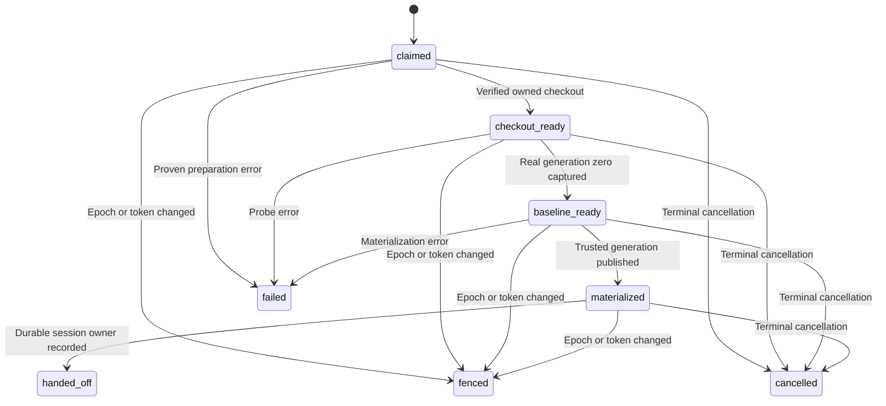
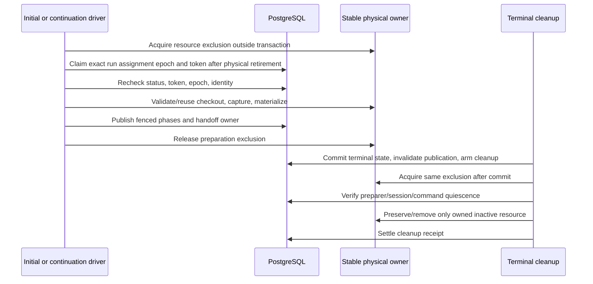

# Agent workspace preparation

## Purpose

**Implemented — ADR-201.** Own the interval from preparation claim through physical checkout/baseline/materialization to durable session handoff, including terminal cancellation and disposal. Existing session/create/prompt ownership governs model execution after handoff. Integrity validation and operational result publication remain mandatory. Local regression evidence and outstanding combined qualification belong to the active implementation plan; no production upgrade is implied.

## Domain entities

- Run, execution assignment/epoch and immutable resolved commit.
- Durable preparation operation token, phase, lease and resource incarnation.
- Stable physical-resource exclusion, common-Git-directory mutation fence and context locks.
- Real integrity baseline/generation and existing session/create/prompt owner.
- Terminal cleanup receipt, host quiescence and sanitized primary diagnosis.

## State machine

Operation phases record confirmed progress. Fenced or expired publication authority does not prove physical quiescence.



## Process flows

Both driver entries claim the same durable/physical resource before any destructive effect.



### Ownership and locking

Claim is scoped to run, exact assignment ID/epoch, canonical physical resource ID/incarnation and operation token. Claim/renew/publish/release use current DB time and short run/assignment-fenced transactions. Terminal/released runs cannot claim preparation. Completed same-owner receipts and identity are validated and reused; absent baseline is not permission to remove/add a checkout.

Several admitted agent Runs may borrow one shared writable root. The physical
resource incarnation stays stable, but a different Run captures its own current
operational commit and baseline under that resource fence. Only same-Run re-entry
inherits its previously resolved commit. The accepted root seed remains part of
the launch witness; borrower cleanup never removes the root workspace. These
rules are enforced by preparation ownership and the accepted shared-root resolver.

The implementation acquires the physical fence before the short claim transaction. This permits retiring an abandoned durable publisher only after its filesystem/Git activity is proven quiescent. No checkout mutation precedes the claim, and no SQL transaction waits for physical ownership. Repository resources reuse the existing common-Git-directory mutation fence (including durable process-group registration and gated Git start). This intentionally serializes preparation and cleanup within one repository; its key remains stable across assignment epochs and disposable checkout paths. Plain directories use the existing SQLite mutex under the persistent manager runtime root because that branch starts no Git children. Context-mount locks follow the main resource fence.

Resource mutex key is stable for the canonical host/path across all epochs. Incarnation is receipt data, not a changing lock key for one path. It lives outside removable trees. Separate physical paths can use separate locks, with shared parent-Git mutations still fenced. Context locks are sorted and acquired after resource ownership; common-Git mutation exclusion follows the documented acquisition graph. Never wait for physical exclusion/Git inside a SQL transaction. Recheck DB ownership after acquiring physical exclusion and after awaits before publishing/adopting/dispatching.

`preparation-resource.ts` resolves ancestor aliases through the nearest existing
directory before hashing, without creating a missing workspace suffix. Creation
does not change that identity. Existing leaf symlinks, non-directories, dangling
ancestor links and non-ENOENT filesystem failures refuse. Plain mutexes and durable
preparation operations use this shared canonical path. Actual preparation uses
its frozen workspace descriptor, including after a worktree-root alias changes.
Task-agent first dispatch derives that physical operation identity outside its
transaction from the frozen descriptor; the immutable allocation hash remains a
separate witness. Flow V1 allocation/cleanup hashes retain their original contract.

No historical identity is rewritten. A same-Run journal with a different physical
resource hash is an explicit `operational_preparation_identity_changed` hold;
the old hash alone cannot reconstruct an aliased path or authorize adoption.
Preserve that workspace for diagnosis and use a fresh attempt after remediation.
The existing maintenance cutover must stop and quiesce every old manager before
starting canonical-lock writers. Maintenance mode alone does not retire an
in-flight physical owner; mixed old/new lexical-lock writers are unsupported.

Lease expiry fences writes but never authorizes a competing actor over still-active filesystem work. Renew slow capture. A new owner waits for physical exclusion/quiescence or allocates a truly distinct physical incarnation. Manager death can release SQLite while a Git child survives: takeover is disabled until a lock-owning helper/host lifetime or proven cancellation/reaping protects the full child-operation interval. Real-process SIGKILL/restart qualification is required; neither a local mutex nor pre-operation DB check establishes this guarantee.

The reused Git gate registers its detached process group durably before acknowledging permission to start Git. A manager killed before acknowledgement cannot start Git; after acknowledgement, recovery refuses the recorded live group until completion or bounded group termination. Checkout add/remove, integrity probes and cleanup preservation use this executor. Unknown/corrupt ownership evidence remains an actionable refusal, never a lease-based steal. The existing `IT-CPC-10` real-process tests own this invariant; preparation/cleanup integration verifies these paths actually enter that fence.

### Crash and cleanup matrix

| Durable state / interruption                      | Recovery and refusal                                                                                                                          |
| ------------------------------------------------- | --------------------------------------------------------------------------------------------------------------------------------------------- |
| Claimed; no checkout                              | Current fenced owner constructs exact frozen commit.                                                                                          |
| Checkout exists; no baseline                      | Reconcile journal/identity under physical exclusion; recapture only proven pristine pre-materialization tree. Ambiguity is preserved/refused. |
| Baseline generation zero; materialization partial | Continue owned manifest/journal; never accept partial generated bytes as pristine source.                                                     |
| Materialized; create outcome unknown              | Join existing durable create/host receipt and generation-turn owner; no checkout reset/session duplicate.                                     |
| Lease/epoch superseded                            | Old owner cannot publish/terminalize successor; new owner still requires physical exclusion/quiescence.                                       |
| Terminal committed while capture waits            | Invalidate publication atomically, defer physical cleanup until old owner releases; late callback cannot recreate/adopt/prompt.               |
| Manager death with surviving child                | Keep physical exclusion or prove child stopped before same-path reuse. Lease age alone is insufficient.                                       |
| Removed but release receipt missing               | Replay removed-phase settlement; never recreate resource.                                                                                     |
| Existing baseline/claim missing from older binary | Explicit identity/quiescence inventory and hold; no invented successful baseline or unowned deletion.                                         |

Terminalization atomically closes run/assignment/turn/publication authority and arms cleanup; filesystem effects follow commit. Disposition quiescence includes preparation, commands, canonical bound sessions, HITL and fresh host evidence. Missing session, successful prompt or old DELETE success alone is insufficient. Cleanup failure is a separate retained incident and does not revert terminal state. Deferred contention/readiness is not a negative assessment or proof of irrecoverability from age alone.

Flow traversal also retains its [terminal-safe database scope](execution-prompt-lifecycle.md#creation-before-prompt-admission)
when a graph only collects human/form input and needs no host preparation. The
implemented Run lock and traversal token/lease prevent late node/HITL/event
writes after abandonment without inventing an execution assignment. This is a
separate traversal boundary, not permission to skip preparation or integrity for
graphs that require host/CLI work. Local database/API terminal-race qualification
is recorded with the owning traversal contract; deployed acceptance remains
separate.

Failure settlement by the current preparer retains physical exclusion through
the terminal DB commit. Apply requires the held owner, exact preparation and
resource incarnation, current assignment/epoch, and an eligible phase and DB
lease; a closed failed receipt remains valid only while that owner is held.
Release follows commit and precedes after-commit cleanup. A proofless
pre-dispatch failure cannot settle an assignment that already has a preparation
journal. Continuation after real historical dispatch uses the existing
canonical/scoped quiescence checks with the same held-preparation guard.

A rejected session create without a manager incarnation needs positive physical
retirement evidence. [Supervisor receipt ownership](../supervisor.md#command-envelope-fences-and-receipts-implemented--adr-166)
defines the versioned host witness and same-command late-exit recovery. Finalization,
cleanup and pre-work retry validate that witness and exact private owner binding;
empty inventory or a legacy unstamped rejection alone remains insufficient.
Accepted v1/v2 creates and legacy restart-generated `turn_lost` rejections do
not prove adapter retirement and cannot authorize a new session generation.
No historical receipt is backfilled.

### Diagnostics

Preserve earliest safe cause plus run, assignment/epoch, driver source, preparation token/resource incarnation, stage, probe operation, safe errno/syscall, Git category/exit/signal and bounded cause chain. Retain capture/verify phase and numeric limit counters. Correlate worktree operation start/end/outcome by operation ID. Log no source bytes, credentials, environment values, raw provider stderr or default absolute host paths. Error sanitization must retain typed FENCED yield semantics.

If failure publication or cleanup also fails, retain the primary diagnosis and
its pending/fenced classification. Log the secondary `probe.close`,
`preparation.publish_failure`, `preparation.release` or `agent_package.release`
operation separately with the same owner context and bounded safe cause chain.
A cleanup failure without a primary failure still fails explicitly. Preserving
a diagnosis grants no terminalization authority: publication fencing and a newer
preparation owner remain authoritative even within the same assignment epoch.

UI distinguishes workspace-preparation infrastructure failure from a successful
negative assessment. The Run result uses neutral preparation wording because a
continuation can fail after earlier model execution. Task qualification status
may say the model did not start only when its source projection explicitly
proves that condition; missing evidence is not that proof. Missing-baseline,
qualification-source rejection and cleanup failures remain separate subsequent
data. Retry is explicit after remediation; no historical diagnosis is invented.

## Expectations

### Operational preparation recovery (Designed, [ADR-214](../decisions/adr-214.md))

- **APR-02:** The frozen source witness admits historical v1 and new v2 ephemeral witnesses. Generation zero is a non-dispatchable source witness. Positive generations attest trusted materialization without replacing the original source. A legacy operational ephemeral continuation is refused with operational_legacy_baseline_unverifiable. Historical inspection and cancellation remain available.
- **APR-05:** Record definitive refusal with its exact assignment, operation and cause before releasing preparation ownership. The post-create integrity check also records a definitive refusal, bound to the exact claimed turn and incarnation. A retained refusal blocks create and prompt admission. The settlement owner retires that session and finalizes the failure. Stop remains available under its own authority. Storage and cleanup errors retain distinct causes. Settlement and restart recovery do not reacquire the preparation fence.
- **APR-11:** On upgrade, a populated two-epoch Run converges through restart and either worker ordering. The repaired production Run remains terminal. Reconcile and report historical application and checkout evidence independently.


- TB01: real Postgres/Git driver-plus-continuation tests establish operation owners and actual interference; log ordering alone never establishes historical causation.
- TB02: durable one-active-resource-owner constraints and token/epoch publication CAS make re-entry idempotent and prevent stale owners writing successor state.
- TB03: stable cross-process physical exclusion plus verified child lifetime prevents destructive overlap across leases, epochs and restart; real-process regression covers manager SIGKILL during Git.
- TB03a: the preparation integration suite holds a plain directory across an ancestor alias before creation and after assignment replacement; SIGKILL/restart retains its canonical resource/incarnation. Actual terminal cleanup through that alias defers until owner release. Unsafe leaves refuse and unprovable historical identities remain unchanged.
- TB04: terminal transaction, shared disposal fence and fresh quiescence prevent deletion of an active tree and recreation after release; disposition/finalization integration covers both race orderings.
- TB05: integrity/launch diagnostic boundaries preserve original safe operation/cause and block all create/prompt commands on real probe failure; secrets and typed-fence controls are executable.
- TB06: baseline and trusted generation validation retain source/index/ref/symlink checks and existing bounds; missing or indeterminate integrity never becomes clean.
- TB07: real preparation and existing terminal publication accept a complete assessment only after valid clean completion; Triager wire and diagnostic browser tests prove success and infrastructure failure separately.
- DB01: additive schema/writer floor and populated upgrade tests preserve old evidence, reject malformed phases/leases and inventory unknown resources without fabricating preparation success.

## Edge cases

- Busy resource/temporary host read pressure: bounded retryable defer with structured owner context; no arbitrary delay masking a race.
- Epoch/token loss: `CONFLICT` with `assignment_fenced`; yield without successor mutation.
- Genuine Git/filesystem error: `PRECONDITION`, model dispatch blocked and primary cause retained.
- Symlink, foreign identity, partial journal or missing baseline: preserve/refuse explicitly; do not repair by deleting another owner's tree.
- Historical MAI-27 inner exception is lost; a later successful probe does not reconstruct original state.

## Linked artifacts

- [ADR-201](../decisions/adr-201.md), [launch admission](task-launch-admission.md), [persistence](../db/task-launch-domain.md).
- [Operational lifecycle](operational-agent-lifecycle.md), [execution prompt lifecycle](execution-prompt-lifecycle.md), [execution hosts](execution-hosts.md).
- Implementation owners: `web/lib/agents/launch.ts`, `web/lib/agents/finalization.ts`, `web/lib/gc/operational-disposition.ts`, existing context/materialization lock and command/session owners.

## Preparation recovery traceability

| ID | Contract | Tasks | Primary test | Status |
| --- | --- | --- | --- | --- |
| APR-01 | `operational-agents.md` | T7,T8 | IT-APR-01 | Implemented |
| APR-02 | `agent-preparation.md` | T3,T7,T8 | IT-APR-02 | Implemented |
| APR-03 | `execution-hosts.md` | T4,T6 | IT-APR-03 | Implemented |
| APR-04 | `execution-hosts.md` | T5 | IT-APR-04 | Implemented |
| APR-05 | `agent-preparation.md` | T2,T9 | IT-APR-05 | Implemented |
| APR-06 | `agent-retry.md` | T3,T10 | IT-APR-06 | Implemented |
| APR-07 | `operational-agent-lifecycle.md` | T11 | IT-APR-07 | Implemented |
| APR-08 | `agent-incidents.md` | T11,T12 | IT-APR-08 | Implemented |
| APR-09 | `operational-agent-lifecycle.md` | T2,T6,T11 | IT-APR-09 | Implemented |
| APR-10 | `workbench-git.md` | T13 | E2E-APR-10 | Implemented |
| APR-11 | `agent-preparation.md` | T9,T12,T14,T15 | IT-APR-11 | Implemented |
| APR-12 | `operational-agent-lifecycle.md` | T5,T6,T14,T15 | IT-APR-12 | Implemented |


## Operator recovery ([ADR-214](../decisions/adr-214.md))

Preparation, task-launch dispatch and cleanup, Pull and promotion, and project
configuration publication and recovery share the common Git-directory fence.
The preparation owner holds the physical fence until the turn’s session-create command is durable. A competing driver rechecks the retained create under the fence and leaves that turn to command replay. If the owner dies before the create commits, recovery can prepare the turn again.
Retained child-process and orphan checks determine when a dead owner can be
recovered. A continuation in settlement or attention has no preparation claim.

Search from an authorized read-only database session. The failure count below
reflects committed preparation rows. A failed secondary publication can leave
only a log record.

```sql
SELECT r.id AS run_id, r.execution_assignment_id AS current_assignment,
       r.operational_integrity_baseline->>'version' AS baseline_version,
       p.failures, p.last_failure, c.id AS deferred_command,
       c.execution_assignment_id AS command_assignment, c.application_attempts,
       c.application_error->>'reason' AS application_reason,
       c.application_error->>'deferredSince' AS deferred_since,
       c.application_next_retry_at, e.assignment_epoch AS attention_epoch,
       e.failure->>'reason' AS continuation_reason,
       e.failure->>'blockedReason' AS settlement_blocker
FROM runs AS r
CROSS JOIN LATERAL (
  SELECT count(*) AS failures, max(p.updated_at) AS last_failure
  FROM agent_preparation_operations AS p
  WHERE p.run_id = r.id AND p.phase = 'failed'
) AS p
LEFT JOIN LATERAL (
  SELECT c.id, c.execution_assignment_id, c.application_attempts,
         c.application_error, c.application_next_retry_at
  FROM execution_commands AS c
  WHERE c.run_id = r.id AND c.kind = 'session.prompt'
    AND c.owner_kind = 'agent_turn' AND c.completion_applied_at IS NULL
    AND c.application_state = 'pending' AND c.application_error IS NOT NULL
  ORDER BY c.updated_at, c.id LIMIT 1
) AS c ON true
LEFT JOIN agent_continuation_episodes AS e
  ON e.run_id = r.id AND e.state = 'attention'
WHERE r.run_kind = 'agent' AND r.agent_kind = 'operational'
  AND r.status = 'Running'
  AND (p.failures >= 2 OR c.id IS NOT NULL OR e.run_id IS NOT NULL)
ORDER BY p.failures DESC, r.id;
```

Open the flagged Run's Operation result. An attention record shows the
original refusal, the latest settlement blocker and the assignment epoch.
After restoring the host or obtaining the missing evidence, use Recheck
execution with current project recovery authority. A stale observation
conflicts. Each accepted recheck schedules one settlement attempt. The Run
returns to attention if proof is still unavailable. The action records the
operator and assignment epoch in a structured log. It cannot reopen preparation.

Stop is available independently. For a proven undispatched resume, Abandoned
releases the scheduler slot even if host inventory is unavailable. Inspect the
historical prompt owner and any retained checkout disposition separately.
A blocked checkout shows its typed reason. Confirm retained canonical exit or
checkpoint facts and the scoped supervisor process-retirement observation
before authorizing cleanup. Use the existing prompt application observation-token
rearm for a poisoned application whose original receipt is still eligible.

If the Run failed due to the legacy baseline policy, inspect its retained
evidence and use the existing retry or relaunch action when admission permits
a fresh Run. Check the cleanup receipt, Git worktree registration, exact path,
and adopted workspace handle before reporting release. For an already-terminal
Run, look up its exact ID because the discovery query selects Running rows.


A preparation limit refusal retains the bounded integrity measurements. **Implemented.** The current preparation or continuation owner records the evidence, including a failure after session creation and before prompt admission. Continuation attention and terminal settlement project that original measurement even if a subsequent verification succeeds under a higher threshold. An authorized run reader sees the failed stage, workspace category, axis, threshold and corrective action. Existing run access rules apply to this metadata.

When reuse of a bound task workspace is refused by a limit, the held launch revision retains the bounded diagnostic in its transaction event. The authorized Run view reads that exact revision. Browser invalidation remains content-free.
