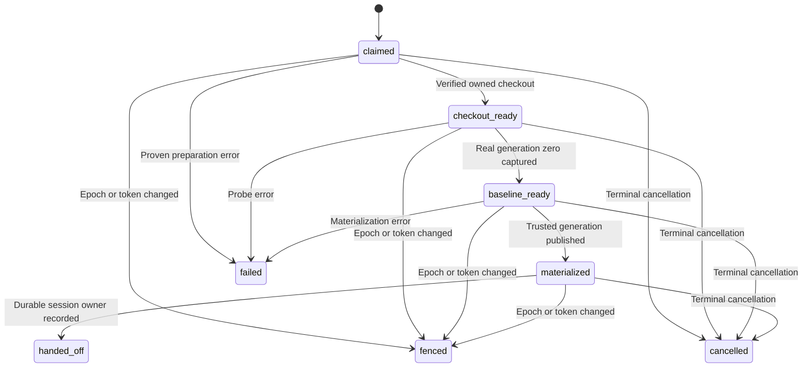
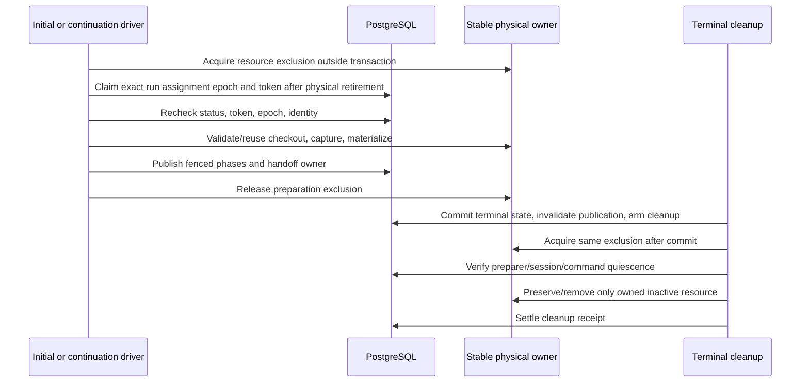

# Agent workspace preparation

## Purpose

**Designed — ADR-201.** Own the interval from preparation claim through physical checkout/baseline/materialization to durable session handoff, including terminal cancellation and disposal. Existing session/create/prompt ownership governs model execution after handoff. Integrity validation and operational result publication remain mandatory.

## Domain entities

- Run, execution assignment/epoch and immutable resolved commit.
- Durable preparation operation token, phase, lease and resource incarnation.
- Stable physical-resource exclusion, common-Git-directory mutation fence and context locks.
- Real integrity baseline/generation and existing session/create/prompt owner.
- Terminal cleanup receipt, host quiescence and sanitized primary diagnosis.

## State machine

Operation phases record confirmed progress. Fenced or expired publication authority does not prove physical quiescence.

## Process flows

Both driver entries claim the same durable/physical resource before any destructive effect.

### Ownership and locking

Claim is scoped to run, exact assignment ID/epoch, canonical physical resource ID/incarnation and operation token. Claim/renew/publish/release use current DB time and short run/assignment-fenced transactions. Terminal/released runs cannot claim preparation. Completed same-owner receipts and identity are validated and reused; absent baseline is not permission to remove/add a checkout.

The implementation acquires the physical fence before the short claim transaction. This permits retiring an abandoned durable publisher only after its filesystem/Git activity is proven quiescent. No checkout mutation precedes the claim, and no SQL transaction waits for physical ownership. Repository resources reuse the existing common-Git-directory mutation fence (including durable process-group registration and gated Git start). This intentionally serializes preparation and cleanup within one repository; its key remains stable across assignment epochs and disposable checkout paths. Plain directories use the existing SQLite mutex under the persistent manager runtime root because that branch starts no Git children. Context-mount locks follow the main resource fence.

Resource mutex key is stable for the canonical host/path across all epochs. Incarnation is receipt data, not a changing lock key for one path. It lives outside removable trees. Separate physical paths can use separate locks, with shared parent-Git mutations still fenced. Context locks are sorted and acquired after resource ownership; common-Git mutation exclusion follows the documented acquisition graph. Never wait for physical exclusion/Git inside a SQL transaction. Recheck DB ownership after acquiring physical exclusion and after awaits before publishing/adopting/dispatching.

Lease expiry fences writes but never authorizes a competing actor over still-active filesystem work. Renew slow capture. A new owner waits for physical exclusion/quiescence or allocates a truly distinct physical incarnation. Manager death can release SQLite while a Git child survives: takeover is disabled until a lock-owning helper/host lifetime or proven cancellation/reaping protects the full child-operation interval. Real-process SIGKILL/restart qualification is required; neither a local mutex nor pre-operation DB check establishes this guarantee.

The reused Git gate registers its detached process group durably before acknowledging permission to start Git. A manager killed before acknowledgement cannot start Git; after acknowledgement, recovery refuses the recorded live group until completion or bounded group termination. Checkout add/remove, integrity probes and cleanup preservation use this executor. Unknown/corrupt ownership evidence remains an actionable refusal, never a lease-based steal. The existing `IT-CPC-10` real-process tests own this invariant; preparation/cleanup integration verifies these paths actually enter that fence.

### Crash and cleanup matrix

| Durable state / interruption                      | Recovery and refusal                                                                                                                          |
| ------------------------------------------------- | --------------------------------------------------------------------------------------------------------------------------------------------- |
| Claimed; no checkout                              | Current fenced owner constructs exact frozen commit.                                                                                          |
| Checkout exists; no baseline                      | Reconcile journal/identity under physical exclusion; recapture only proven pristine pre-materialization tree. Ambiguity is preserved/refused. |
| Baseline generation zero; materialization partial | Continue owned manifest/journal; never accept partial generated bytes as pristine source.                                                     |
| Materialized; create outcome unknown              | Join existing durable create/host receipt and generation-turn owner; no checkout reset/session duplicate.                                     |
| Lease/epoch superseded                            | Old owner cannot publish/terminalize successor; new owner still requires physical exclusion/quiescence.                                       |
| Terminal committed while capture waits            | Invalidate publication atomically, defer physical cleanup until old owner releases; late callback cannot recreate/adopt/prompt.               |
| Manager death with surviving child                | Keep physical exclusion or prove child stopped before same-path reuse. Lease age alone is insufficient.                                       |
| Removed but release receipt missing               | Replay removed-phase settlement; never recreate resource.                                                                                     |
| Existing baseline/claim missing from older binary | Explicit identity/quiescence inventory and hold; no invented successful baseline or unowned deletion.                                         |

Terminalization atomically closes run/assignment/turn/publication authority and arms cleanup; filesystem effects follow commit. Disposition quiescence includes preparation, commands, canonical bound sessions, HITL and fresh host evidence. Missing session, successful prompt or old DELETE success alone is insufficient. Cleanup failure is a separate retained incident and does not revert terminal state. Deferred contention/readiness is not a negative assessment or proof of irrecoverability from age alone.

### Diagnostics

Preserve earliest safe cause plus run, assignment/epoch, driver source, preparation token/resource incarnation, stage, probe operation, safe errno/syscall, Git category/exit/signal and bounded cause chain. Retain capture/verify phase and numeric limit counters. Correlate worktree operation start/end/outcome by operation ID. Log no source bytes, credentials, environment values, raw provider stderr or default absolute host paths. Error sanitization must retain typed FENCED yield semantics.

UI distinguishes pre-model infrastructure failure (“could not prepare workspace; model did not start; no assessment produced”) from a successful negative assessment. Missing-baseline, qualification-source rejection and cleanup failures remain separate subsequent data. Retry is explicit after remediation; no historical diagnosis is invented.

## Expectations

- TB01: real Postgres/Git driver-plus-continuation tests establish operation owners and actual interference; log ordering alone never establishes historical causation.
- TB02: durable one-active-resource-owner constraints and token/epoch publication CAS make re-entry idempotent and prevent stale owners writing successor state.
- TB03: stable cross-process physical exclusion plus verified child lifetime prevents destructive overlap across leases, epochs and restart; real-process regression covers manager SIGKILL during Git.
- TB04: terminal transaction, shared disposal fence and fresh quiescence prevent deletion of an active tree and recreation after release; disposition/finalization integration covers both race orderings.
- TB05: integrity/launch diagnostic boundaries preserve original safe operation/cause and block all create/prompt commands on real probe failure; secrets and typed-fence controls are executable.
- TB06: baseline and trusted generation validation retain source/index/ref/symlink checks and existing bounds; missing or indeterminate integrity never becomes clean.
- TB07: real preparation and existing terminal publication accept a complete assessment only after valid clean completion; Triager wire and diagnostic browser tests prove success and infrastructure failure separately.
- DB01: additive schema/writer floor and populated upgrade tests preserve old evidence, reject malformed phases/leases and inventory unknown resources without fabricating preparation success.

## Edge cases

- Busy resource/temporary host read pressure: bounded retryable defer with structured owner context; no arbitrary delay masking a race.
- Epoch/token loss: `CONFLICT` with `assignment_fenced`; yield without successor mutation.
- Genuine Git/filesystem error: `PRECONDITION`, model dispatch blocked and primary cause retained.
- Symlink, foreign identity, partial journal or missing baseline: preserve/refuse explicitly; do not repair by deleting another owner's tree.
- Historical MAI-27 inner exception is lost; a later successful probe does not reconstruct original state.

## Linked artifacts

- [ADR-201](../decisions/adr-201.md), [launch admission](task-launch-admission.md), [persistence](../db/task-launch-domain.md).
- [Operational lifecycle](operational-agent-lifecycle.md), [execution prompt lifecycle](execution-prompt-lifecycle.md), [execution hosts](execution-hosts.md).
- Implementation owners: `web/lib/agents/launch.ts`, `web/lib/agents/finalization.ts`, `web/lib/gc/operational-disposition.ts`, existing context/materialization lock and command/session owners.
