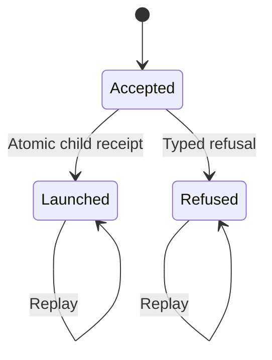
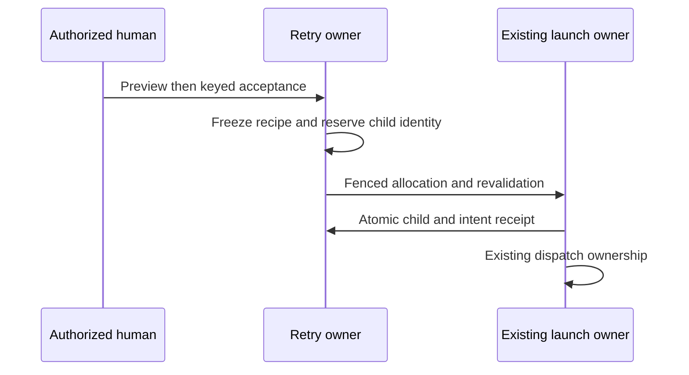

# Explicit agent retries

**Designed — ADR-196–198.**

## Purpose

Create one explicitly authorized new attempt on a selected runner after proven pre-work failure, with durable admission and safe resource ownership.

## Domain entities

- Source run and immutable retry intent/recipe.
- Fenced pre-run allocation/disposition and successor receipt.
- Existing run/session create command ownership.

## State machine

The state boundary distinguishes current execution from retained evidence.

## Process flows

The owning transaction commits durable state before its wake-up signal.

### Contract 9

Provide **“Run again…” / “Запустить повторно…”** on eligible failed-run details,
agent history and the incident's representative-run action. A picker shows the
source runner, compatible ready alternatives and precise refusal reasons. Preview
states that this is a new session/attempt using the **current effective pinned
agent definition/configuration**, preserving the source task and semantic trigger
input. Show differences from source snapshots, including kind/contract changes;
never pretend this resumes the old ACP session or reproduces an unavailable prompt.

One-off runner override and **“Runner for future runs / Раннер для будущих запусков”**
are separate controls. New attempt requires existing `launchRun`; permanent
attachment override uses existing PATCH plus `editSettings`. A member can retry
without changing defaults. Do not alter `triage_set.runnerId` when choosing the
triager runner: that field controls the downstream task Flow, a different choice.
No automatic failover, automatic retry storm, schedule re-enable or default change.

Reuse `launchAgentRun` resolution, admission, permissions, isolation, trust,
maintenance and queue machinery, but introduce a server-owned retry intent rather
than calling the current manual launch endpoint blindly. The existing launch route
accepts runnerId/taskId but discards event context; reusing original triggerEventId
would hit `(agentId,triggerEventId)` dedup and return the old failed run. Generic
`POST /api/runs/{id}/recover` is not a runner-switch API and remains unchanged.

Retry safety is an explicit preview/action contract:

| Source / state | Decision |
| --- | --- |
| Settled nonpersistent standalone agent Failed/Crashed; owned durable evidence proves prompt/work never dispatched and no source session/create can still execute | Allow a new attempt, including verified legacy workspace-less triager failures; retain original task and trigger context. |
| Running, Pending, NeedsInput, NeedsInputIdle, HumanWorking, WaitingOnChildren, or any unresolved create/prompt delivery | Refuse; link to the source Stop/reconcile/HITL action. Never run two live attempts through this control. |
| Post-dispatch failure, partial business work, unknown writes or incomplete audit evidence | `reconciliation_required`; preserve confirmed effects/references and refuse blind replay. Existing explicit task/business remediation may be used, but is not falsely presented as idempotent retry. |
| Clean complete successful source or already-answered/claimed task, stale task revision, archived project, detached/disabled agent, unavailable/untrusted package, unsupported trigger, persistent/shared/delegated agent or driven Flow | Typed refusal with current-state remedy; use existing appropriate launch/Flow recovery paths. No implicit task reset/requeue or authority inherited from an expired parent. |
| Same retry request delivered twice / concurrent callers for one source | Same-key replay returns the same receipt; a different request key conflicts with an existing accepted/launched intent. At most one retry child per source; retry a failed child from that child. |

The first release deliberately guarantees safe runner substitution for proven
pre-work failures. It does not promise exactly-once replay of arbitrary MCP writes.
The eligibility predicate uses command/assignment evidence, not “no result file”,
empty diff, exit code, mere audit-log absence or an agent's statement. If legacy
records cannot prove safety, show that reason and retain ordinary manual launch/
task remediation as distinctly named existing actions. Keep task state unchanged
until the new attempt performs an authorized operation.

Add `agent_retry_intents` with immutable ID, sourceRunId/project/agent/actor,
request key and canonical request digest, selected runner, frozen current-definition/
config/input/task-revision preview fingerprint and its protected server-owned recipe
(exact package/definition digest, resolved configuration, semantic trigger payload,
task revision, selected-runner snapshot and policy inputs), preallocated successorRunId,
state `accepted | launched | refused`, typed refusal, timestamps, mandatory admission
lease owner/fence/expiry, attempt count, due time and allocation progress/provenance. Partial unique sourceRunId while state is accepted/launched serializes an active
claim; unique nonnull runs.retryOfRunId permanently enforces one created successor.
Retain immutable source/successor identity text and nullable navigation FKs; never
cascade-delete an active/refused-with-resources intent or its cleanup evidence.
The launched receipt survives child history deletion and still blocks a second
successor from that source. While it owns resources, deletion is refused by the
existing evidence/ownership pattern. Actor deletion revokes execution authority but
does not orphan cleanup; a system cleanup owner retains the narrow disposal duty.
Unique `(actor,requestKey)` and payload comparison reject key reuse
with different contents. `runs.retryOfRunId`/retry-origin snapshot persist lineage
and original trigger/event/schedule semantics. Derive every locator from source
state; the new run's `triggerEventId` does not reuse the original delivery key.
Keep the original trigger source/payload as semantic input with an explicit manual
retry-origin envelope; no new trigger enum is necessary. The prompt builder must
read this server-derived retry context rather than replacing an event with an
empty manual prompt. Do not count a retry as another scheduled delivery or reset
cron `nextFireAt`; history labels it as an explicit retry.

Validate cheap preconditions first; then lock source run/task and revalidate source
quiescence, current permissions, task revision and preview fingerprint before
committing retry intent. No network/Git/filesystem work in the transaction. The
accepted recipe is immutable, not just a hash of mutable rows. The launch seam
consumes that recipe; it must not re-resolve a newer pin/kind/config silently.

After commit, the launch owner claims the intent with a database lease and fencing
generation. Immediate post-commit dispatch and a bounded `runAgentRetryAdmissionSweep`
called by existing `runSystemSweep` (`web/lib/scheduler/system-sweeps.ts:343`) share
this owner. Run this recovery pass before workspace-orphan reconciliation; add no
new timer/job kind. Before allocation, revalidate current actor grants, attachment,
package trust/availability, runner readiness/policy, source quiescence and task
revision against the accepted recipe. Preview-relevant drift yields a typed
`retry_context_changed` refusal requiring a fresh preview; revoked authority never
inherits the earlier grant. No workspace/session is allocated on this refusal.

Use the **preallocated run identity** and durable per-resource allocation receipt,
not a fresh random ID/path on retry. Protect allocation and adoption with the
existing materialization/context filesystem mutex pattern plus the DB fence;
a live filesystem owner is not stolen merely because a lease expired. Persist
intent-owned allocation provenance before the crash window; ordinary orphan GC
must recognize accepted-intent resources. On crash after worktree allocation but
before run insertion, adopt only the exact matching owned branch/path/provenance
under the renewed fence. Unknown/conflicting bytes are preserved and refused for
diagnosis, never overwritten, deleted or silently recreated. A stale worker cannot
insert a child or clean resources after another generation takes ownership.

Before successor INSERT, recheck the fence, source quiescence, task revision,
current authority and accepted recipe under the owning transaction locks. Insert
successor run, immutable snapshots and intent→run receipt atomically; then dispatch
via existing recoverable command ownership. A final-check refusal after allocation
records durable allocation disposition on the retry intent (`armed | released |
exhausted`, due/attempt/error/ownership fields). The retry-admission sweep owns this
**pre-run** disposal, reusing preservation/removal primitives under its fence;
`operational-disposition.ts:100-105` needs an existing run and cannot own this row.
After atomic child insertion, ownership transfers exactly once to the run's normal
lifecycle owner and the intent is forbidden to delete its resources. Pre-run cleanup
exhaustion uses the agent incident, safe evidence and explicit rearm via a scoped
retry-intent action, not a fake run cleanup endpoint. Bound and specify that action
in the retry API contract as `POST /api/runs/{runId}/retry/{intentId}/cleanup` with body
`{expectedDispositionRevision,requestKey}`, existing launchRun grant, 202/replay
receipt and 409 stale ownership; it rearms cleanup only, never launches work;
never mark resources disposed merely because the intent is refused. Recovery after
receipt adopts that same child, never creates another. Transient pre-insert admission failures
use at most three attempts with existing scheduler due-time/backoff utilities and
structured warnings (no sleep-held worker); exhaustion becomes a typed
refusal and grouped attention, while retained resources keep a separate cleanup
obligation. Process at most 100 due intents per sweep, ordered by dueAt/id, with fenced
lease ownership; a poison intent cannot starve the sweep. Reuse the existing
worktree operation lock/wait deadlines, recording expired-but-still-locked as
retryable ownership contention rather than stealing the filesystem owner. Unknown session-create outcome
stays under existing command reconciliation, not this pre-insert retry mechanism.

An accepted intent is 202, not a claim that the new runner has started or succeeded.
A launched child remains visible Pending when capacity is full. A terminally refused
intent can be explicitly re-prepared with a new request key after fixing the
precondition, only if it never minted a successor and its allocation ownership has
been safely settled; preserve earlier attempts in audit, never overwrite receipts.
The refused intent releases only its active-intent claim; a created successor can
never be replaced by refusing or deleting its receipt.

New routes:

- `GET /api/runs/{runId}/retry-options`: source run=url-param, actor=auth-context;
  project/agent/task/original trigger/current pin/readiness=server-state. Require
  project `launchRun` before disclosing compatible runners; protected original
  input remains behind its existing data grant. Return eligibility/refusal,
  compatible runner metadata, safe differences and expiring preview fingerprint.
- `POST /api/runs/{runId}/retry`: body-controlled `{runnerId,requestKey,previewFingerprint}`
  only. runnerId must resolve in the authorized compatible set; request key UUID;
  no taskId/projectId/cwd/package path/eventId supplied by client. Server derives
  input. 202 `{retryIntentId,sourceRunId,runId,intentState,runStatus,queueReason}`
  for accepted intent or its pending replay. intentState is exactly
  `accepted | launched | refused`; runStatus is null before child creation and then
  the canonical RunStatus. queueReason is nullable; queued/started are UI derivations,
  not extra intent states. The receipt never claims completion. Before creation, runId is null; the reserved identity is
  server-only. Read the intent through `GET /api/runs/{runId}/retry/{intentId}`
  (both IDs=url-param, verify source/intent match and project grant) with SSE
  invalidation. It returns 200 with current state and nullable created runId/runStatus; a terminal child does not change the intent
  from launched back to refused.
  Same-key replay of an asynchronously refused intent returns 200 with intentState refused
  and typed reason; it never restarts that receipt. 400 malformed, 403 denied, 404 unavailable source,
  409 stale/unsafe/conflicting request or successor already owned by another
  intent, 503 maintenance/admission infrastructure unavailable before acceptance.
  Post-acceptance delivery failure is recorded on intent/run; it is not a blind
  HTTP retry that creates another child. Exact same-key replay returns same receipt.

Specify these in web OpenAPI, agent/run analytics, error taxonomy and attention
AsyncAPI. Reuse existing SSE for intent/new-run/terminal changes. No new MCP retry
tool or external write scope in this release; grouped external decisions expose
safe action availability and navigation without pretending a review action starts
work. Add migration SQL/journal/snapshot/schema/ERD and payload-hash checks in the
same Phase-0 design. Reserve a separate follow-up migration for retry persistence
and ADR for its effect/replay boundary. No data-dependent unreviewed auto migration.

A successful retry links the work-item recovery in history but does not rewrite the
old failure or certify the old runner healthy. Infrastructure episodes for runner A
are not automatically closed by success on runner B; a matching healthy witness or
explicit per-user acknowledgement is required. A one-off override does not repair
an attachment that will still choose A tomorrow. The UI offers the separately
authorized future-run setting with this distinction visible.

## Expectations

- **UX-09:** a proven failed runner launch can create exactly one new attempt with selected runner B, same intended task/input and a new frozen current contract, while runner A's original record remains unchanged. Double click, timeout/replay, concurrent readers and process death cannot duplicate work. Unsafe/unknown effects and unauthorized/unready runners refuse with actionable reasons. Neither task Flow runner nor project defaults changes implicitly. Enforced by the owning services/constraints below and primary acceptance in [traceability](agent-activity-traceability.md).

## Edge cases

- **EDGE-UX-14:** AC09: retry preconditions, source/context scope, selected runner readiness/grants, current-config fingerprint, old snapshot unchanged, stale task/partial effects refuse The owner returns typed `MaisterError` CONFIG/PRECONDITION/CONFLICT/UNAUTHORIZED or records a canonical operational failure; no silent fallback. Primary `IT-UX-14` (plan alias `UX-IT14`).
- **EDGE-UX-15:** AC09: same/different-key concurrency, payload conflict, one successor, original event dedup intact, crash before allocation/after allocation/before receipt/after receipt, expired lease/stale worker/concurrent sweep, owned allocation adoption vs foreign bytes and orphan GC, post-acceptance pin/kind/config/task/grant drift before and after allocation, cleanup exhaustion, refused-intent reprepare and queue admission The owner returns typed `MaisterError` CONFIG/PRECONDITION/CONFLICT/UNAUTHORIZED or records a canonical operational failure; no silent fallback. Primary `IT-UX-15` (plan alias `UX-IT15`).

## Linked artifacts

- [Traceability](agent-activity-traceability.md)
- [Web API](../api/web.openapi.yaml) and [external API](../api/external/operations.openapi.yaml)
- [Persistence](../db/agent-activity-domain.md) and [qualification persistence](../db/task-qualification-domain.md)
- [Implementation plan](../../.ai-factory/plans/feature-operational-agent-kind.md)
