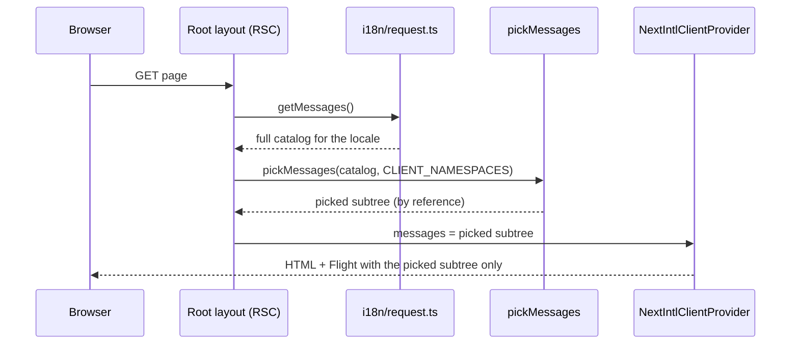
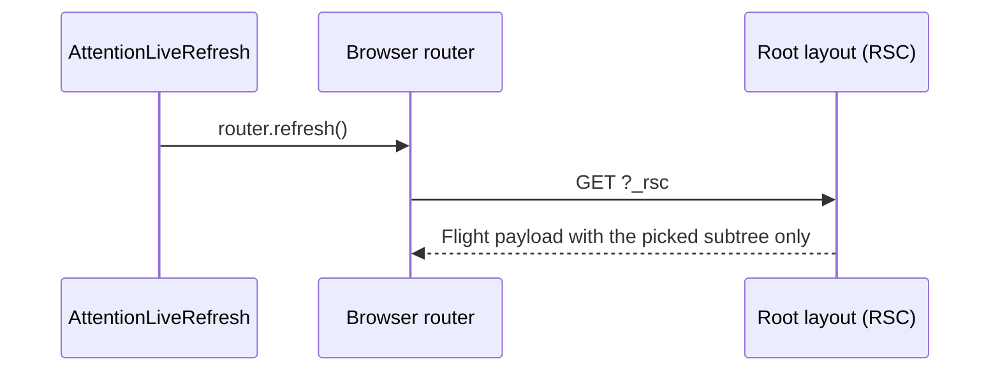
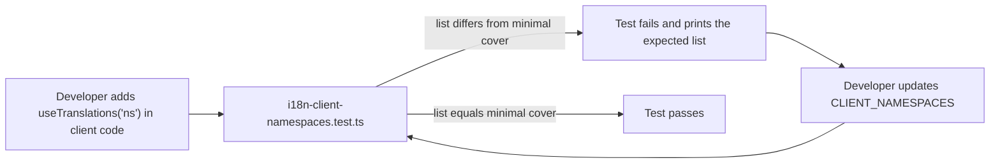

# Client messages

> **Status: Designed** — ADR-225
> ([record](../decisions/adr-225.md)). Per-route scoping is (Phase 2: revisit
> with the UI regrouping; see ADR-225).

## Purpose

This domain owns the delivery of i18n messages to client components: which
part of the request catalog the root `NextIntlClientProvider` serializes into
every document and every `router.refresh()` Flight payload, and how the
repository keeps that part complete and minimal. Server components are outside
it: `getTranslations()` reads the full request catalog from
`web/i18n/request.ts`, not from the provider.

## Domain entities

- **Catalog** — `web/messages/en.json` and `web/messages/ru.json`, loaded per
  request by `web/i18n/request.ts`; key parity is enforced by
  `web/lib/__tests__/i18n-parity.test.ts`.
- **Message path** — a top-level namespace (`librarian`) or a dotted subtree
  (`run.runStatus`).
- **Client namespace list** — `CLIENT_NAMESPACES` in
  `web/i18n/client-namespaces.ts`, the minimal covering set of message paths
  read by client-reachable code.
- **Client-reachable module** — a module reachable through static imports,
  `import()` or `next/dynamic` from a `"use client"` file, stopping at
  `"use server"` files; `import type` edges do not count. JavaScript and
  TypeScript sources are scanned alike.

## State machine

Not applicable: the picked message set is computed per request from static
inputs and has no lifecycle.

## Process flows

### Document render (Designed)

The root layout picks the client paths out of the request catalog once per
render.

### Router refresh (Designed)

An attention tick re-renders the server tree; the root provider props are sent
again, so the pruning applies to every refresh.

### Adding a client namespace (Designed)

The repository test turns an incomplete or stale list into a failing test.

## Expectations

- **CMSG-01:** The root `NextIntlClientProvider` MUST receive exactly `pickMessages(messages, CLIENT_NAMESPACES)` as its `messages` prop.
- **CMSG-02:** `CLIENT_NAMESPACES` MUST equal the minimal cover of the literal namespaces passed to `useTranslations` by client-reachable modules: every literal is covered and no listed path is unused or nested under another listed path.
- **CMSG-03:** Client-reachable code MUST NEVER call `useMessages()` or call `useTranslations` with no argument or a non-literal argument, and MUST import both hooks from `next-intl` directly, never through a re-export.
- **CMSG-04:** Every `CLIENT_NAMESPACES` path MUST resolve in `web/messages/en.json`.
- **CMSG-05:** No production file other than `web/app/layout.tsx` may render `NextIntlClientProvider`, and every file MUST import it from `next-intl` directly.
- **CMSG-06:** `pickMessages` MUST return namespace values by reference, and a dotted path MUST yield only the requested subtree under its parents.
- **CMSG-07:** An unknown path MUST throw outside production and MUST be omitted with a WARN in production.
- **CMSG-08:** No covered route MUST emit `MISSING_MESSAGE` in EN or RU.

## Edge cases

- **`t.has` on a missing namespace** — returns `false` silently
  (`web/components/runs/run-peek-navigation.tsx`), so a missing path can hide
  UI without an error; CMSG-02 is the guard.
- **`next/dynamic` import** — the scanner follows `import()` edges, so a
  dynamically loaded client module counts as reachable.
- **Module without a directive** — reached from a client file, it is client
  code for scanning purposes.
- **Server component `getTranslations`** — unaffected; it reads the request
  configuration, not the provider.
- **Hook re-exported under another name** — the scanner recognizes the hooks
  and the provider by their `next-intl` names, so
  `export { useTranslations as useT } from "next-intl"` would hide every `useT`
  call from it. The scanner therefore flags any re-export of the hooks or the
  provider (`intl_reexport`) and any import of them from a module other than
  `next-intl` (`indirect_intl_import`), in every scanned file.
- **Unknown path in production** — omitted with a WARN instead of throwing a
  `MaisterError`: a misconfigured list must degrade one surface, not every
  page; outside production it is a programming error and throws.

## Linked artifacts

- Decision: [ADR-225](../decisions/adr-225.md).
- Source: `web/app/layout.tsx`, `web/i18n/client-namespaces.ts`,
  `web/i18n/pick-messages.ts`, `web/i18n/request.ts`.
- Tests: `web/lib/__tests__/pick-messages.test.ts`,
  `web/test-support/__tests__/client-namespace-scanner.test.ts`,
  `web/lib/__tests__/i18n-client-namespaces.test.ts`,
  `web/e2e/i18n-client-messages.spec.ts`.
