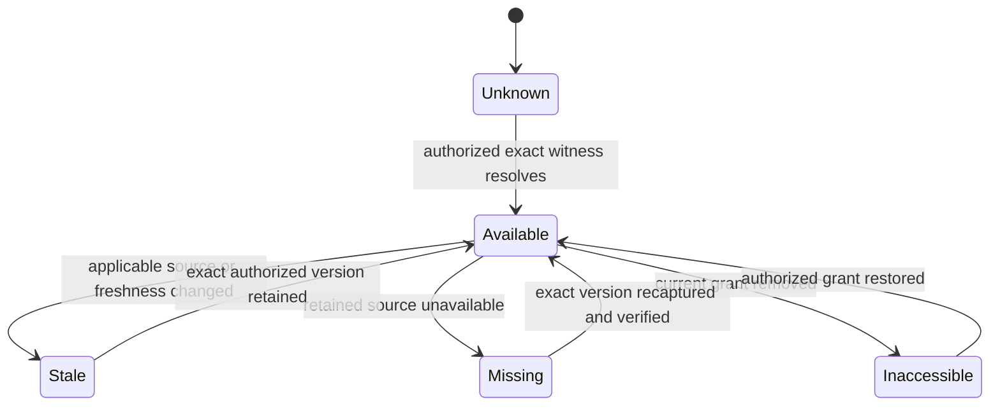
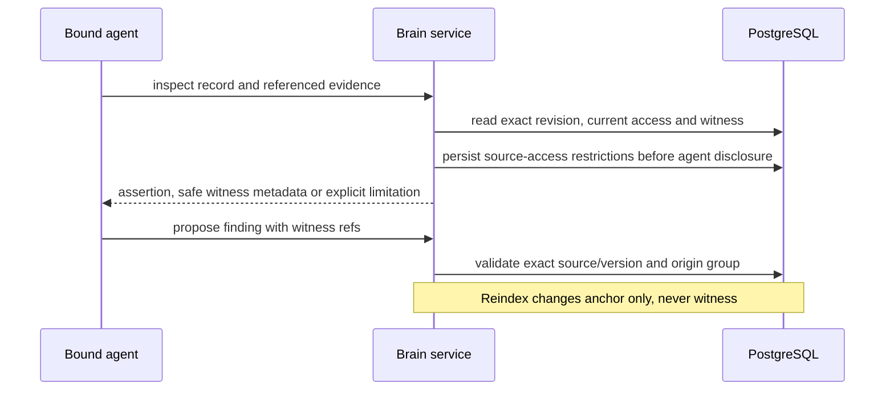

# Company Brain evidence and source independence

## Purpose

**Partially implemented — ADR-202.** Indexed-source captures, immutable witnesses, correlated reuse and potential-conflict edges are implemented in storage. Native retrieval, review and external tool surfaces remain Designed. This domain owns immutable source/version witnesses, source-observation independence and conflict-preserving retrieval. [Records](company-brain.md) owns publication/confirmation; current repository search anchors remain navigational projections.

## Domain entities

- Source: stable owner-scoped submitted text, repository source, external capture, runbook or execution evidence.
- Source observation: server-identified capture/version and independence group; distinct selectors are not independent observations.
- Witness: immutable source/version or content digest, selector, timestamps, capture actor and access restrictions.
- Evidence link: supports/contradicts/derived_from/refines/references over an exact record revision.
- Current anchor: replaceable source/chunk pointer used only for navigation.
- Conflict: explicit relationship between distinguishable claims, with optional attributed resolution. See [ERD](../db/company-brain-domain.md).

## State machine

Resolution is recomputed from the current access/source state; it does not rewrite the immutable witness.

## Process flows

Record links keep the original witness even when a current indexed chunk is replaced.

### Witness schema and limits

`schemaVersion=1`, stable server ID, explicit owner, `sourceId`, optional source version and SHA-256 content witness, bounded selector, `observedAt`/`sourceAt`/server `capturedAt`, server principal/run/attempt, independence-group ID or explicit unknown, and access restrictions. At least one identifiable version or content witness is required for newly captured evidence. A legacy ref lacking both remains readable with `unknown`, not invented support. IDs <=128 characters, digest lowercase 64-hex, selector <=512, URL <=2048 without credentials, metadata <=16 KiB. Capture bytes <=256 KiB; larger content requires an existing bounded artifact pointer, not an unbounded inline body.

Source observation identity is separate from selector/witness identity. Two chunks, mirrored locators or two agents quoting one server-identified observation share its independence group. A new version does not establish independent observation. Unknown provenance never increments independent support automatically. Exact digest equality can identify reused bytes but cannot prove causal independence or truth.

### Retrieval, conflicts and validation

| Input/state | Required disposition |
| --- | --- |
| Valid authorized exact witness | `available`; retain source/version/digest and support/contradiction role |
| Existing legacy pointer without version/content witness | `unknown` plus metadata limitation; no implicit confirmation |
| Source changed/current anchor moved | Original witness unchanged; `available` for retained exact content or `stale`/`missing` explicitly |
| Missing referenced identity | New forged/mismatched reference refuses with `CONFIG`/400 (external 422), `PRECONDITION`/409 or existence-safe 404; stored historical missing ref projects missing |
| Inaccessible witness/claim | Safe support limitation, no foreign hidden ID/title/URL/content/count; current grants rechecked before disclosure |
| Known conflicting claim outside top-K | Include accessible contradiction refs and unresolved conflict marker; budget exhaustion returns incomplete support and authorized continuation |
| Same source quoted repeatedly | One correlated observation; do not increase confirmation or independent corroboration |
| Near semantic match | Review candidate only; no automatic overwrite/merge/supersession |

Proposal evidence uses explicit `{relation,reference}` entries; record evidence returns `{relation,witness}`. Supporting, contradicting and provenance roles cannot be silently converted during publication or reduction.

Submissions use owner/authority-bound delivery key and canonical payload digest; keys are generated before external effects and survive retries. Same key/same canonical body returns the original safe receipt without new origin/reinforcement evidence; changed body conflicts. Exact-content dedup cannot reveal hidden records. Parent record revision, witness links and submission receipt commit together; current anchor updates are independently retryable.

Indexed captures record source/version/content and server capture attribution; source-observation independence is explicitly unknown and cannot increase corroboration. Similarity emits only an attributed `potential_conflict` edge with exact record revisions; it never asserts a contradiction or truth.

Witness rows and evidence links are immutable; source deletion retires capture availability without cascading accepted revision/evidence history. Restricted captured content stays restricted after workspace cleanup. Explicit project deletion cascades its observations/witnesses without obstruction. Cross-owner links retain immutable identity/version snapshots and resolve unavailable; they have no restrictive FK to the removed witness. Current rank/confidence is retrieval metadata only. Derived summary output inherits every server-recorded accessed restriction, including sources absent from model citations.

## Expectations

- **CBE-01:** Original witnesses survive source edits/reindex/deletion with explicit availability, enforced by immutable witness rows separate from current anchors (`IT-CBE-01`).
- **CBE-02:** Repeated selectors/agents/derived summaries of one source observation do not become independent support, enforced by observation-group identity and content-guarded receipts (`IT-CBE-02`).
- **CBE-03:** Conflicting claims remain distinguishable and known opposition is not hidden by top-K selection, enforced by conflict-aware recall/get projections (`IT-CBE-03`).

## Edge cases

- **EDGE-CBE-01:** Reanchor after source update cannot replace the historical digest/selector; missing capture remains explicit (`IT-CBE-01`).
- **EDGE-CBE-02:** Different URLs/selectors with known shared provenance remain one correlated observation; unknown provenance is not guessed independent (`IT-CBE-02`).
- **EDGE-CBE-03:** Denied opposing evidence returns only a support limitation, while an authorized reader can inspect its exact revision (`IT-CBE-03`).

## Linked artifacts

- [Records and authority](company-brain.md), [persistence](../db/company-brain-domain.md), [ADR-202](../decisions.md#adr-202-company-ownership-and-evidence-linked-knowledge-revisions).
- [Project Brain](project-brain.md), [web API](../api/web.openapi.yaml), [error taxonomy](../error-taxonomy.md).
- Owning implementation: `web/lib/brain/{sources,edges,retain,recall,indexer,reindex}.ts` and result reference validation.
