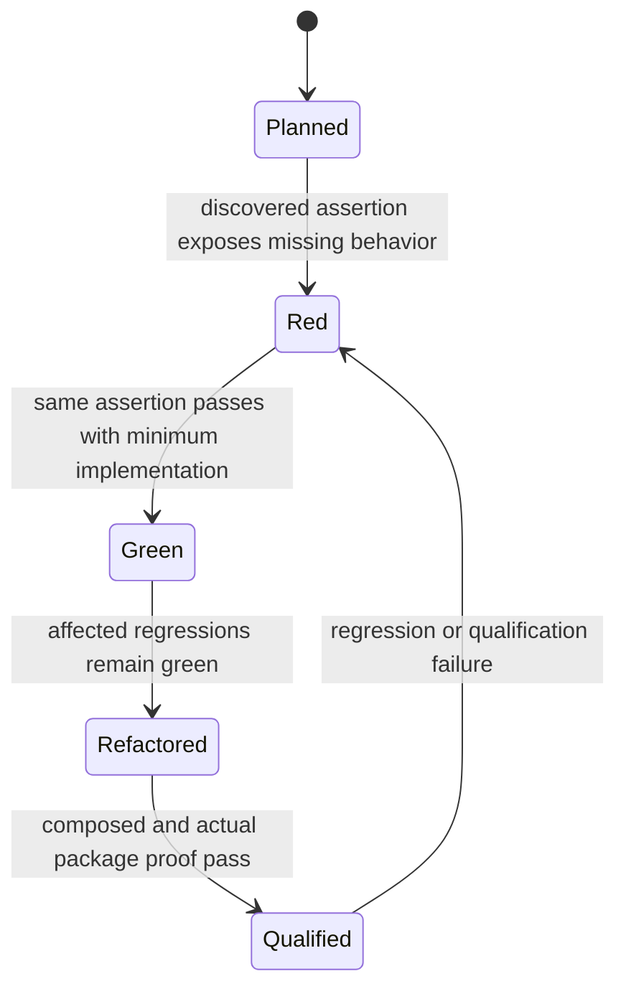
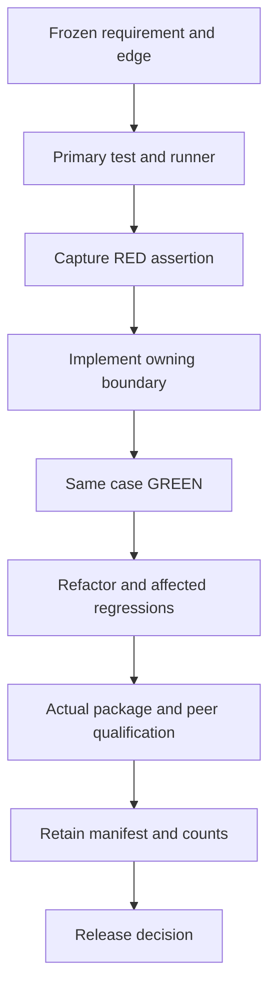

# Company Brain and specialist qualification

## Purpose

**ADR-202–203.** This contract qualifies native Company Brain and durable specialist cooperation, including the actual installable RAH/specialist packages. Passing synthetic schemas or platform fixtures alone is insufficient. Domain behavior belongs to the linked owning specifications; this document owns migration, boundary and release proof.

## Domain entities

- Qualification manifest: platform/build revision, installed immutable package revision/digest, configuration witness and runner identity.
- Primary test: one observable requirement partition, with distinct domain, transport, browser or live responsibility.
- Migration qualification: fresh, populated, interrupted and repeated boot with both main and Brain ledgers.
- Evidence artifact: exact command, discovered/executed/passed/failed/skipped counts, assertion output and RED/GREEN/refactor revisions.
- Release decision: CB0 independently qualified or CB0+CB1 qualified; no inferred readiness from fixtures.

## State machine

An import, unavailable database, missing executable, absent credentials or empty discovery is a harness failure, not RED. Required qualification never silently skips its preflight. A Planned matrix row is not execution proof.

## Process flows

### Migration execution manifest

Assignment storage precedes binding storage (T18→T19). Execution resolves the current binding service; retained binding/pin references alone grant no authority. Main migrations through `0335_company_pending_pool_index` and Brain migrations through `0011_proposal_source_access` are implemented locally. The following units identify the migration boundaries and drill-down contracts. Deployment and installed-package qualification have separate evidence requirements. Exact keys and guards belong to the linked [knowledge](../db/company-brain-domain.md), [assignment](../db/specialist-assignments-domain.md) and [operation](../db/stand-operations-domain.md) persistence contracts. Apply the complete main lineage before Brain; main-side knowledge pointers never FK a new Brain table. Recheck journal collisions before generation or integration.

| Unit | Dependency and responsible slice | Preservation and failure oracle |
| --- | --- | --- |
| Main 0229 company_ownership | Existing users/agents; T05 | One installation company and explicit grants; project membership unchanged and no automatic content grants. |
| Main 0230 company_knowledge_events | 0229; T08.1/T09 | Exclusive-owner metadata facts and nullable native capture; legacy events remain readable and metadata facts cannot trigger agents. |
| Main 0231 company_grant_requests | 0229; T08.1 | Content-guarded grant/revocation receipts retain current principal and authority checks. |
| Main 0232 native_knowledge_execution | 0230; T14 | Immutable executed-role/node-token attestation; legacy NULL remains unknown, without a Brain FK. |
| Main 0233 specialist_assignments | 0229; T18 | Assignment/input/run-link history and owner/revision guards preserve existing execution ledgers; completion remains unavailable until acceptance. |
| Main 0234 specialist_metadata | 0233; T19 | Optional role declarations preserve absent legacy definition bytes and grant no authority. |
| Main 0235 company_specialist_bindings | 0234; T19 | Reviewed pinned configuration and immutable history retain explicit current company authority. |
| Main 0236 company_flow_bindings | 0235; T19.1 | Exact installed result-only Flow pins require no project/Flow carrier; historical v1 snapshots stay unchanged. |
| Main 0237 company_trigger_scope | 0236; T19.1 | Existing schedules/attempts gain exclusive owners and immutable v2 binding snapshots; v1 scheduled input stays unchanged. |
| Main 0238 company_retry_scope | 0237; T19.1 | Company v3 retry references preserve project v1/v2 bytes; storage does not enable company replacement execution. |
| Main 0239 company_agent_execution | 0238; T20 | Company Run ownership and exact assignment/input links require no dummy project. |
| Main 0240 company_agent_credentials | 0239; T20 | Existing internal tokens gain exact company Run binding, current-authority and identity guards. |
| Main 0241 company_run_terminal_events | 0240; T20 | Company terminal/cleanup facts retain same-owner Run references; metadata facts remain content-free. |
| Main 0242 native_source_array_planning | 0241; T21 | A low planner row estimate for the existing source-restriction array function preserves every entry and changes no access policy. |
| Main 0243 company_human_work_ownership | 0242; T20/T21 | Existing human assignment/actor/event tables gain exclusive company ownership without a second work ledger. |
| Main 0244 human_work_owner_guards | 0243; T21 | Same-owner human-work references and current actor gates reject forged cross-owner actions. |
| Main 0245 company_hitl_wait_events | 0244; T21 | Company wait facts require exact retained Run ownership; historical project wait facts remain readable. |
| Main 0246 company_operational_attention | 0245; T21 | Existing attention kinds cover company work without leaking protected prompt/input bytes. |
| Main 0247 company_flow_execution | 0246; T20.1 | Explicit v2 company graph captures retain required exports and no project/task/provider-Flow carrier. |
| Main 0248 company_flow_node_credentials | 0247; T20.1 | Exact current node/professional credentials reuse existing rotation; v1 null-node credentials remain unchanged. |
| Main 0249 company_flow_workspace_witness | 0248; T20.1 | Company graph plain-directory baselines preserve source-integrity and ownership witnesses. |
| Main 0250 company_flow_runtime | 0249; T20.1 | Existing bounded disposition and lifecycle guards cover result-only graphs without synthesizing operational-agent results. |
| Main 0251 company_run_cancellation | 0250; T20.1/T21 | Immutable stop intent fences new commands and competing completion before teardown; uncertainty remains recoverable. |
| Main 0252 specialist_intake_receipts | 0251; T22 | Canonical source keys and exact input/actor receipts prevent duplicate assignments and changed-payload replay. |
| Main 0253 specialist_project_flow_input | 0252; T22 | New project coordinator input v2 and same-project carrier linkage preserve company tasklessness and legacy v1 bytes. |
| Main 0254 company_event_admission | 0253; T22.1 | Company subscription/event identity binds the original reserved invocation; project uniqueness remains unchanged. |
| Main 0255 project_source_review | 0254; T22 | Server-recorded current project source review remains separate from recurring input and invocation authority. |
| Main 0256 project_trigger_review | 0255; T22 | Reviewed project binding v3 refuses old-worker native-review bypass while preserving existing v1/v2 history. |
| Main 0257 project_event_context | 0256; T22 | Explicit current source-sharing review bounds inherited producing-context disclosure. |
| Main 0258 specialist_context_revisions | 0257; T23 | Attributed immutable working context and source closure use assignment revision CAS, separate from long-term Brain. |
| Main 0259 specialist_context_credentials | 0258; T23 | Native context read scopes retain exact current execution/input appointment. |
| Main 0260 specialist_context_mutation_credentials | 0259; T23 | Context mutation additionally requires current update authority; no model-authored author/epoch is accepted. |
| Main 0261 specialist_question_subject | 0260; T24 | Existing HITL rows retain immutable native assignment/input/question correlation and legacy NULL metadata. |
| Main 0262 specialist_question_answer | 0261; T24 | Exact native human-answer receipts gate continuation; answer intent remains distinct from delivered input. |
| Main 0263 specialist_flow_question | 0262; T24 | Existing graph resume grammar retains exact native question/answer lineage. |
| Main 0264 specialist_result_delivery | 0263; T25 | Result-availability capture and origin delivery bind exact retained result/input, without accepting business work. |
| Main 0265 specialist_delivery_targets | 0264; T25 | Existing webhook/Inbox transports retain source-authorized recipients and delivery identity. |
| Main 0266 specialist_source_handoff | 0265; T26 | Once-only source pointers bind original assignment/input and unused execution reservation. |
| Main 0267 project_source_recovery | 0266; T26 | Interrupted unused intakes can recover exact source pointers; used/uncertain execution is never reset. |
| Main 0268 specialist_logical_work | 0267; T27 foundation | Immutable logical work/intake/child witnesses are implemented; native dispatch, decisions and owner recovery remain their owning slices. |
| Main 0269 specialist_work_witness_guards | 0268; T27 guard correction | Requires positive source/context/target matches, preserves immutable company source identity after optional catalog FK removal, and leaves retained rows unchanged. |
| Main 0270–0277 | Logical work and existing results; T27–28 | Child reservations, result-only rework, exact work decisions and assignment acceptance retain existing Run/result witnesses. |
| Main 0278–0297 | Operational evidence v2 and existing placement/retry; T28.1–30 | Immutable evidence contracts, executor fencing/renewal and source-specific replacement keep legacy snapshots and exact current assignments. |
| Main 0298–0333 | Governed cooperation; T31–39 | Versioned target/operation/probe persistence, authenticated permit, resource exclusion, recovery, incident projection and scheduled read-only appointments preserve unknown effects independently of Run retirement. See [stand persistence](../db/stand-operations-domain.md). |
| Main 0334 company_pending_pool_index | Native child reservation; T27/T41 | Lets the existing worker find pending company Runs within its bounded scan. Existing pool admission retains capacity and budget checks. |
| Brain 0007 company_records | Main 0229; T06 | Stable IDs and honest legacy provenance; unknown authorship/basis/time never becomes confirmation or a historical acceptance event. |
| Brain 0008 company_evidence | Brain 0007; T07/T08 | Immutable witnesses/observation groups remain separate from mutable anchors and cannot manufacture independent support. |
| Brain 0009 knowledge_review | Brain 0008; T08/T09 | Existing improvement drafts remain intact; native add/correct/confirm receipts are attributable, idempotent and CAS protected. |
| Brain 0010 source_access | Brain 0009; T10 | Source-restricted capture and access-partitioned dedup preserve project-deletion-safe logical references. |
| Brain 0011 proposal_source_access | Brain 0010; T11 | Inherited proposal restrictions and exact replay/review retain current source access without restrictive source FKs. |

Both migration CLIs acquire one dedicated PostgreSQL client and await session setup (`lock_timeout=5s`, `statement_timeout=120s`) plus writer capability before ledger inspection or DDL. The limits apply to each lock wait and statement, not to the entire transaction or upgrade. Each existing `migrate()` call applies its pending SQL and ledger entries atomically; a failure rolls back that pending batch. Metadata schema/table preparation precedes the batch, and earlier committed stages or backfill pages remain committed. This also bounds upgrades beginning after migrations that carried their own `SET LOCAL`; connection-URL options cannot silently disable the awaited session settings. Large backfills must be measured on the populated test dataset before rollout; if a statement exceeds the bound, design its new owning migration with an explicit resumable strategy before deployment, preserving already applied SQL. No network or service-manager calls occur under migration locks. Generated main SQL/journal/snapshot/reference schema and hand-authored Brain SQL/journal/schema must agree. Runtime serves new routes/workers only after both existing pending-migration guards pass. An interruption between ledgers resumes forward; a second boot changes neither row counts nor identities. Native record read DTOs now expose typed `diagnostics`, and unavailable evidence exposes `reasonCode`; API, UI, built MCP and strict read consumers deploy with their matching contracts. These read projections do not rewrite stored revisions, finding/input schemas or migration bytes. Mixed old/new writers are unsupported: quiesce dispatch, retain snapshots/intents, back up, migrate main then Brain, start matching web/supervisor/MCP builds and re-arm consumers.

### Owner and writer inventory

| Existing ownership assumption | Owning readers/writers that must change together | Constraint and regression owner |
| --- | --- | --- |
| brain_items, brain_sources, brain_chunks, brain_snapshots, brain_edges, brain_proposals | `web/lib/brain/{retain,recall,sources,edges,indexer,reindex,ambient,policy,decay,proposals}.ts`, Brain route/service adapters, source-access/result resolvers | Exclusive company/project owner on roots; children derive one checked owner, never null means platform. Existing retain/recall/edges/proposals integration suites plus new company-records. |
| brain_embeddings | Indexer/embedding retrieval and source/chunk delete paths | Owner derived from exact parent; no separate guessed owner, preserve existing vectors. |
| brain_index_jobs, brain_harvested_events, brain_project_config, brain_proposal_decision_stats | Existing index/harvest/config/stat writers | Repository jobs, project configuration and existing improvement stats stay project-only; company submitted sources use explicit capture, not fake project indexing. Owner-aware proposal branches cannot invoke project-only stats/harvest. |
| agent_schedules, agent_trigger_attempts, immutable scheduled requests | `web/lib/agents/{triggers,trigger-attempts,scheduled-request-store,launch,resume,project-links,summonability}.ts`, scheduler claim/dispatch | Owner/binding union, versioned decoder, reserved-run reuse; company tick and existing scheduled-request migration/invocation suites. |
| runs, agent_tokens, launch/result snapshots | `web/lib/agents/{launch,resume,launch-contract,activity-access,activity-queries}.ts`, `web/lib/tokens/{ext-handler,verify,run-project,personal-actor}.ts`, `web/lib/services/runs.ts` | Current owner-bound action access; historical pins unchanged; existing effective/agent-run-result/delegated-launch suites and new company-runtime. |
| flows.project_id and graph execution | `web/lib/flows/{delegatable-flow,lifecycle,runner-agent}.ts`, graph runner/continuation/prompt owners, orchestrator delegate/collect | Project flows remain project-owned; company binding points to installed revision. Repo-only nodes refuse at admission. Company graph lifecycle and existing recursive-harness suites. |
| actors and human assignments | Existing actor resolver, `web/lib/services/agent-question*.ts`, HITL responder and Inbox projections | Explicit company subjects/current respondents, stored native FormSchema, no invented project roles; existing agent-question integration suite. |
| Capacity and recovery scans | `web/lib/runs/{recover,keepalive-sweeper,run-kind-invariants}.ts`, agent/graph continuation workers, coordinator wake and prompt owners | All 11 existing run states and agent/flow/coordinator forms accounted for; no new run status or separate capacity pool. Distinct owner/recovery tests plus existing prompt-owner regressions. |
| Events and outward projections | Domain-event taxonomy/schema CHECK, Brain source-reindex consumer, agent-trigger consumer, run-result/detail/collect/activity/artifact/transcript/runtime-object/export readers | Content-free invalidations, source-access taint/current grant recheck before every disclosure. Findings-access owns leak oracle; route/MCP owns wire mapping. |
| Cleanup and cascades | Brain source/reanchor/retirement, project/binding detach, operational GC, run-result/runtime-object cleanup | Ordinary cleanup retains accepted evidence and unknown operations. Explicit project deletion cascades project-owned Brain rows and history; Brain references cannot block it. Cross-owner evidence becomes unavailable through logical identity snapshots. Operation journals retain their separately governed lifetime. Migration and operation-recovery cases inspect retained rows. |

The inventory is a change-impact boundary, not permission to globally replace `projectId`. Every actual field/enum addition repeats `rg` over its symbol and raw table/column names, updates affected fixtures, and records any newly found writer before the slice closes. Inbound cascade paths are inspected against generated SQL; no main-to-new-Brain circular dependency is permitted. The precise owner unions, immutable rows and NULL-safe keys live in the owning DB contracts, avoiding a second schema definition here.

### Frozen reads and machine tools

Resume/recovery reads the original run launch contract, scheduled request, installed agent/Flow revision, assignment input revision, accepted child result revision, runbook record revision/witness, operation intent/config and target receipt. It never selects newest definitions or re-resolves an old action against mutable component aliases. Current permission, principal activity and target authorization are still checked at action/disclosure time.

Native additive tools map to the same HTTP/domain services: `knowledge_search/get/evidence/conflicts/capture_source/witness_get/propose/proposals_list/proposal_get/decide/confirm`; `specialists_list`; `specialist_assignment_create/get/update/context_get/context_update/delegate/collect/work_decide/ask_human/respond/accept/cancel/continue`; and `stand_operation_create/get/reconcile/recover`. Names are frozen at the generated MCP facade slice together with tools/list schemas and ext operation IDs; private permit callbacks and administrative credential configuration are never agent tools. Existing project `memory_*`, human `ask_human`, delegate/collect and operational_v1 remain backward compatible. Native findings validation resolves identities and restrictions, not semantic truth or model authority.

### Executable proof and acceptance scenarios

The [traceability matrix](company-brain-specialists-traceability.md) fixes primary file/title/runner and task mappings for every requirement and edge. Existing file allocations were inspected; new paths are explicitly Planned. Web integration uses `web/vitest.workspace.ts` lib/app integration globs, MCP uses its src integration glob, Node contracts use `node --test`; normal browser cases use existing Playwright configuration. Live cases use `web/playwright.live.config.ts` project `live-supervisor` and the `live-*.spec.ts` pattern. Required discovery and nonzero execution counts are retained.

| Original acceptance | Primary requirement proof |
| --- | --- |
| AC1 real pinned knowledge consumer | CBX-03, CBE-04 |
| AC2 depth-2 evidence preservation | CBE-05, CBX-03 |
| AC3 missing/stale/conflicting/unauthorized references | CBE-01/03/04/06, CBX-03 |
| AC4 repeated source cannot confirm | CBE-02, CBK-03/04 |
| AC5 company without dummy repository | CBK-01, CBS-02/03, CBA-01 |
| AC6 coordinated stand diagnosis/restart/verify | CBO-01/02/05, CBC-01/04, CBX-04 |
| AC7 clarification resumes correct work | CBA-02/05 |
| AC8 duplicate/concurrent mutation safety | CBA-02, CBC-01/03, CBO-02/03 |
| AC9 lost restart response reconciles | CBO-04/07, CBX-04 |
| AC10 coordinator/child interruption recovery | CBC-03/05, CBX-04 |
| AC11 result and verification required | CBA-07, CBO-05/08 |
| AC12 attributable governed write-back | CBK-03, CBU-03, CBX-04 |

Store compact JSON and raw assertion output under `.ai-factory/qa/company-brain-specialist-assignments/<task>/<slice>/`. Capture spec hash, base/implementation revision, exact command, test IDs, discovery/results counts, RED failure, GREEN/refactor rerun, safe diagnostic paths and package/runner/target witnesses where applicable. No secrets/raw private logs. No-refactor decisions state the concrete reason and retain the rerun. Platform gates cover actual services/DB/HTTP/MCP; live manifests additionally bind actual installed package digest, loader/ACP session, depth-2 result chain and independently observed target effect/probe. Fixture identities cannot substitute for live witnesses.

CB0 qualification selects QL-CBX-03 without importing or requiring CB1 stand credentials. Full pilot selects QL-CBX-04 with configured helper identity/unit scope/action/runbook, current grants and an independent observer. Missing preflight fails actionably. The qualification requires the retained operation ID before dispatch, dropped restart acknowledgment, independent coordinator and child interruptions, correct ownership on continuation, one verified effect and governed write-back. The main browser journey and fault scenarios require separate exact runtime receipts. A failed qualification returns to its owning behavior slice and reruns; repair does not depend on an already passing qualification gate.

## Expectations

- **CBX-01:** Fresh/populated/interrupted/second-boot real-Postgres migrations preserve IDs, pending work and honest unknown metadata, enforce scoped/terminal constraints, and refuse incomplete startup (`IT-CBX-01`).
- **CBX-02:** Runtime schemas, HTTP and actual built MCP tools/list→call agree, including unsupported-version refusal and current owner authority (`IT-CBX-02`).
- **CBX-03:** An actual immutable installed RAH package retrieves structured knowledge and preserves original evidence through depth 2, with missing/conflict/access cases (`QL-CBX-03`).
- **CBX-04:** An actual installed specialist/company Flow completes the configured stand pilot with duplicate/fault/interruption/reconciliation/independent verification and governed write-back (`QL-CBX-04`).
- **CBX-05:** Nonempty bidirectional traceability, unique IDs, real implemented test titles, nested examples and matching release manifests are mandatory executable gates (`CT-CBX-05`).

## Edge cases

- **EDGE-CBX-01:** Failure between main and Brain refuses new serving; forward resume and second boot retain pending records/requests/questions/unknown effects (`IT-CBX-01`).
- **EDGE-CBX-02:** Source grammar accepted by platform but rejected/stripped by built MCP is a release failure (`IT-CBX-02`).
- **EDGE-CBX-03:** Empty/skipped live selection, unpinned fixture package or missing ACP preflight cannot establish CB0 readiness (`QL-CBX-03`).
- **EDGE-CBX-04:** One healthy probe with lost effect history cannot qualify pilot success; recovery must retain uncertainty and separately verify an authorized successor (`QL-CBX-04`).
- **EDGE-CBX-05:** Empty parser discovery, duplicate declaration/matrix row/task or an Implemented row without a resolvable primary title must fail the gate (`CT-CBX-05`).

## Linked artifacts

- [Traceability](company-brain-specialists-traceability.md), [records](company-brain.md), [evidence](company-brain-evidence.md), [findings](evidence-findings.md).
- [Runtime](specialist-runtime.md), [assignments](specialist-assignments.md), [cooperation](specialist-cooperation.md), [stand pilot](stand-maintenance.md).
- [Knowledge DB](../db/company-brain-domain.md), [assignment DB](../db/specialist-assignments-domain.md), [operation DB](../db/stand-operations-domain.md), [API](../api/web.openapi.yaml).
- Owning gates: `scripts/validate-requirement-coverage.mjs`, `scripts/validate-contracts.mjs`; task execution: `.ai-factory/plans/codex-company-brain-specialist-assignments.md`.
