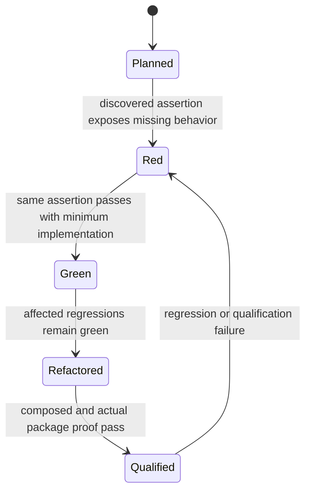
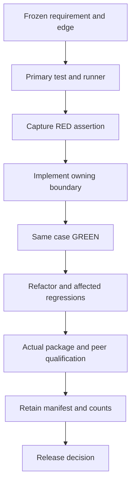

# Company Brain and specialist qualification

## Purpose

**Designed — ADR-202–203.** This contract qualifies native Company Brain and durable specialist cooperation, including the actual installable RAH/specialist packages. Passing synthetic schemas or platform fixtures alone is insufficient. Domain behavior belongs to the linked owning specifications; this document owns migration, boundary and release proof.

## Domain entities

- Qualification manifest: platform/build revision, installed immutable package revision/digest, configuration witness and runner identity.
- Primary test: one observable requirement partition, with distinct domain, transport, browser or live responsibility.
- Migration qualification: fresh, populated, interrupted and repeated boot with both main and Brain ledgers.
- Evidence artifact: exact command, discovered/executed/passed/failed/skipped counts, assertion output and RED/GREEN/refactor revisions.
- Release decision: CB0 independently qualified or CB0+CB1 qualified; no inferred readiness from fixtures.

## State machine

An import, unavailable database, missing executable, absent credentials or empty discovery is a harness failure, not RED. Required qualification never silently skips its preflight. A Planned matrix row is not execution proof.

## Process flows

### Migration execution manifest

Assignment storage is generated before binding storage, matching T18→T19. Its requested binding/pin is a validated typed reference until the binding FK can be added by the later constraint unit; creating an assignment for execution still requires the current binding service. Reservations were checked against main journal index 214 and Brain index 5/tag 0006. They are not applied migrations. Exact table/column/check contracts are in the three [DB documents](../db/company-brain-domain.md); this table fixes deployment order, preservation oracle and owning writer slice. Main completes before Brain; main-side knowledge pointers cannot FK newly created Brain tables. Recheck number collisions before generation and merge.

| Unit | Dependency and responsible slice | Preservation and failure oracle |
| --- | --- | --- |
| Main 0215 company_ownership | Existing users/agents; T05 | One singleton company and explicit grants; existing project membership unchanged; no automatic content grants. Active principal and live grant uniqueness tested. |
| Main 0216 company_knowledge_events | 0215; T08.1/T09 | Extend owner-aware domain-event CHECK/decoder before publication and reserve versioned run knowledge-access capture metadata (NULL is unknown); existing events remain readable, new projection events cannot trigger an agent recursively. |
| Main 0217 specialist_assignments | 0215; T18/T23–25 | Add business assignment/context/work/claim/acceptance/delivery structures; do not rekey human/host assignments or node_attempts. Input/context revision CAS and terminal invariants reject invalid rows. |
| Main 0218 company_specialist_bindings | 0215; T19/T19.1 | Add binding/run/token/actor scope, keep project pins and frozen v1 snapshots byte-stable; company result-only Flow uses existing flow_revision_id, no flows/project carrier. |
| Main 0219 company_trigger_scope | 0218; T19.1/T22.1 | Backfill real project owners on schedules/attempts; NULL-safe company uniqueness and due-row indexes; immutable scheduled requests preserved. |
| Main 0220 stand_operations | 0217; T31 | Target/operation/receipt/permit/probe/recovery and resource exclusion; unknown effects survive run retirement and owner expiry. |
| Main 0221 company_brain_constraints | Main entities above; T31 | Dedicated owner/lease/state/digest constraints; malformed populated data aborts with safe identities, no deletion or invented success. No new Brain FKs. |
| Brain 0007 company_records | All main migrations, especially 0215; T06 | Stable IDs/content/project ownership; revision 1 marked legacy_migration with unknown attribution/basis/time and no confirmation or historical acceptance event. |
| Brain 0008 company_evidence | Brain 0007; T07/T08 | Immutable witnesses and observation groups separate from reanchored edges; no inferred independent sources. Existing source/chunk/edge IDs retained. |
| Brain 0009 knowledge_review | Brain 0008; T08/T09 | Preserve pending improvement proposals; new knowledge add/correct/confirm receipts and exact revisions are attributable, idempotent and CAS protected. |

Each SQL transaction uses bounded lock and statement timeouts (`lock_timeout=5s`, `statement_timeout=120s`); a timeout rolls back its migration and leaves the ledger unapplied. Large backfills must be measured on the populated test dataset before rollout; if the bound is exceeded, amend the migration with an explicit resumable strategy before deployment. No network or service-manager calls occur under migration locks. Generated main SQL/journal/snapshot/reference schema and hand-authored Brain SQL/journal/schema must agree. Runtime serves new routes/workers only after both existing pending-migration guards pass. An interruption between ledgers resumes forward; a second boot changes neither row counts nor identities. Mixed old/new writers are unsupported: quiesce dispatch, retain snapshots/intents, back up, migrate main then Brain, start matching web/supervisor/MCP builds and re-arm consumers.

### Owner and writer inventory

| Existing ownership assumption | Owning readers/writers that must change together | Constraint and regression owner |
| --- | --- | --- |
| brain_items, brain_sources, brain_chunks, brain_snapshots, brain_edges, brain_proposals | `web/lib/brain/{retain,recall,sources,edges,indexer,reindex,ambient,policy,decay,proposals}.ts`, Brain route/service adapters, source-access/result resolvers | Exclusive company/project owner on roots; children derive one checked owner, never null means platform. Existing retain/recall/edges/proposals integration suites plus new company-records. |
| brain_embeddings | Indexer/embedding retrieval and source/chunk delete paths | Owner derived from exact parent; no separate guessed owner, preserve existing vectors. |
| brain_index_jobs, brain_harvested_events, brain_project_config, brain_proposal_decision_stats | Existing index/harvest/config/stat writers | Repository jobs, project configuration and existing improvement stats stay project-only; company submitted sources use explicit capture, not fake project indexing. Owner-aware proposal branches cannot invoke project-only stats/harvest. |
| agent_schedules, agent_trigger_attempts, immutable scheduled requests | `web/lib/agents/{triggers,trigger-attempts,scheduled-request-store,launch,resume,project-links,summonability}.ts`, scheduler claim/dispatch | Owner/binding union, versioned decoder, reserved-run reuse; company tick and existing scheduled-request migration/invocation suites. |
| runs, agent_tokens, launch/result snapshots | `web/lib/agents/{launch,resume,launch-contract,activity-access,activity-queries}.ts`, `web/lib/tokens/{ext-handler,verify,run-project,personal-actor}.ts`, `web/lib/services/runs.ts` | Current owner-bound action access; historical pins unchanged; existing effective/agent-run-result/delegated-launch suites and new company-runtime. |
| flows.project_id and graph execution | `web/lib/flows/{delegatable-flow,lifecycle,runner-agent}.ts`, graph runner/continuation/prompt owners, orchestrator delegate/collect | Project flows remain project-owned; company binding points to installed revision. Repo-only nodes refuse at admission. Company graph lifecycle and existing recursive-harness suites. |
| actors and human assignments | Existing actor resolver, `web/lib/services/agent-question*.ts`, HITL responder and Inbox projections | Explicit company subjects/current respondents, stored native FormSchema, no invented project roles; existing agent-question integration suite. |
| Capacity and recovery scans | `web/lib/runs/{recover,keepalive-sweeper,run-kind-invariants}.ts`, agent/graph continuation workers, coordinator wake and prompt owners | All 11 existing run states and agent/flow/coordinator forms accounted for; no new run status or separate capacity pool. Distinct owner/recovery tests plus existing prompt-owner regressions. |
| Events and outward projections | Domain-event taxonomy/schema CHECK, Brain source-reindex consumer, agent-trigger consumer, run-result/detail/collect/activity/artifact/transcript/runtime-object/export readers | Content-free invalidations, source-access taint/current grant recheck before every disclosure. Findings-access owns leak oracle; route/MCP owns wire mapping. |
| Cleanup and cascades | Brain source/reanchor/retirement, project/binding detach, operational GC, run-result/runtime-object cleanup | Ordinary cleanup retains accepted evidence and unknown operations. Explicit project deletion cascades project-owned Brain rows and history; Brain references cannot block it. Cross-owner evidence becomes unavailable through logical identity snapshots. Operation journals retain their separately governed lifetime. Migration and operation-recovery cases inspect retained rows. |

The inventory is a change-impact boundary, not permission to globally replace `projectId`. Every actual field/enum addition repeats `rg` over its symbol and raw table/column names, updates affected fixtures, and records any newly found writer before the slice closes. Inbound cascade paths are inspected against generated SQL; no main-to-new-Brain circular dependency is permitted. The precise owner unions, immutable rows and NULL-safe keys live in the owning DB contracts, avoiding a second schema definition here.

### Frozen reads and machine tools

Resume/recovery reads the original run launch contract, scheduled request, installed agent/Flow revision, assignment input revision, accepted child result revision, runbook record revision/witness, operation intent/config and target receipt. It never selects newest definitions or re-resolves an old action against mutable component aliases. Current permission, principal activity and target authorization are still checked at action/disclosure time.

Native additive tools map to the same HTTP/domain services: `knowledge_search/get/evidence/conflicts/capture_source/witness_get/propose/proposals_list/proposal_get/decide/confirm`; `specialists_list`; `specialist_assignment_create/get/update/context_get/context_update/delegate/collect/work_decide/ask_human/respond/accept/cancel/continue`; and `stand_operation_create/get/reconcile/recover`. Names are frozen at the generated MCP facade slice together with tools/list schemas and ext operation IDs; private permit callbacks and administrative credential configuration are never agent tools. Existing project `memory_*`, human `ask_human`, delegate/collect and operational_v1 remain backward compatible. Native findings validation resolves identities and restrictions, not semantic truth or model authority.

### Executable proof and acceptance scenarios

The [traceability matrix](company-brain-specialists-traceability.md) fixes primary file/title/runner and task mappings for every requirement and edge. Existing file allocations were inspected; new paths are explicitly Planned. Web integration uses `web/vitest.workspace.ts` lib/app integration globs, MCP uses its src integration glob, Node contracts use `node --test`; normal browser cases use existing Playwright configuration. Live cases use `web/playwright.live.config.ts` project `live-supervisor` and the `live-*.spec.ts` pattern. Required discovery and nonzero execution counts are retained.

| Original acceptance | Primary requirement proof |
| --- | --- |
| AC1 real pinned knowledge consumer | CBX-03, CBE-04 |
| AC2 depth-2 evidence preservation | CBE-05, CBX-03 |
| AC3 missing/stale/conflicting/unauthorized references | CBE-01/03/04/06, CBX-03 |
| AC4 repeated source cannot confirm | CBE-02, CBK-03/04 |
| AC5 company without dummy repository | CBK-01, CBS-02/03, CBA-01 |
| AC6 coordinated stand diagnosis/restart/verify | CBO-01/02/05, CBC-01/04, CBX-04 |
| AC7 clarification resumes correct work | CBA-02/05 |
| AC8 duplicate/concurrent mutation safety | CBA-02, CBC-01/03, CBO-02/03 |
| AC9 lost restart response reconciles | CBO-04/07, CBX-04 |
| AC10 coordinator/child interruption recovery | CBC-03/05, CBX-04 |
| AC11 result and verification required | CBA-07, CBO-05/08 |
| AC12 attributable governed write-back | CBK-03, CBU-03, CBX-04 |

Store compact JSON and raw assertion output under `.ai-factory/qa/company-brain-specialist-assignments/<task>/<slice>/`. Capture spec hash, base/implementation revision, exact command, test IDs, discovery/results counts, RED failure, GREEN/refactor rerun, safe diagnostic paths and package/runner/target witnesses where applicable. No secrets/raw private logs. No-refactor decisions state the concrete reason and retain the rerun. Platform gates cover actual services/DB/HTTP/MCP; live manifests additionally bind actual installed package digest, loader/ACP session, depth-2 result chain and independently observed target effect/probe. Fixture identities cannot substitute for live witnesses.

CB0 qualification selects QL-CBX-03 without importing or requiring CB1 stand credentials. Full pilot selects QL-CBX-04 with configured helper identity/unit scope/action/runbook, current grants and an independent observer. Missing preflight fails actionably. The test retains operation ID before dispatch, drops the restart ACK, interrupts coordinator/child, resumes correct ownership, verifies one effect, and proves governed write-back. A failed qualification returns to its owning behavior slice and reruns; repair does not depend on an already passing qualification gate.

## Expectations

- **CBX-01:** Fresh/populated/interrupted/second-boot real-Postgres migrations preserve IDs, pending work and honest unknown metadata, enforce scoped/terminal constraints, and refuse incomplete startup (`IT-CBX-01`).
- **CBX-02:** Runtime schemas, HTTP and actual built MCP tools/list→call agree, including unsupported-version refusal and current owner authority (`IT-CBX-02`).
- **CBX-03:** An actual immutable installed RAH package retrieves structured knowledge and preserves original evidence through depth 2, with missing/conflict/access cases (`QL-CBX-03`).
- **CBX-04:** An actual installed specialist/company Flow completes the configured stand pilot with duplicate/fault/interruption/reconciliation/independent verification and governed write-back (`QL-CBX-04`).
- **CBX-05:** Nonempty bidirectional traceability, unique IDs, real implemented test titles, nested examples and matching release manifests are mandatory executable gates (`CT-CBX-05`).

## Edge cases

- **EDGE-CBX-01:** Failure between main and Brain refuses new serving; forward resume and second boot retain pending records/requests/questions/unknown effects (`IT-CBX-01`).
- **EDGE-CBX-02:** Source grammar accepted by platform but rejected/stripped by built MCP is a release failure (`IT-CBX-02`).
- **EDGE-CBX-03:** Empty/skipped live selection, unpinned fixture package or missing ACP preflight cannot establish CB0 readiness (`QL-CBX-03`).
- **EDGE-CBX-04:** One healthy probe with lost effect history cannot qualify pilot success; recovery must retain uncertainty and separately verify an authorized successor (`QL-CBX-04`).
- **EDGE-CBX-05:** Empty parser discovery, duplicate declaration/matrix row/task or an Implemented row without a resolvable primary title must fail the gate (`CT-CBX-05`).

## Linked artifacts

- [Traceability](company-brain-specialists-traceability.md), [records](company-brain.md), [evidence](company-brain-evidence.md), [findings](evidence-findings.md).
- [Runtime](specialist-runtime.md), [assignments](specialist-assignments.md), [cooperation](specialist-cooperation.md), [stand pilot](stand-maintenance.md).
- [Knowledge DB](../db/company-brain-domain.md), [assignment DB](../db/specialist-assignments-domain.md), [operation DB](../db/stand-operations-domain.md), [API](../api/web.openapi.yaml).
- Owning gates: `scripts/validate-requirement-coverage.mjs`, `scripts/validate-contracts.mjs`; task execution: `.ai-factory/plans/codex-company-brain-specialist-assignments.md`.
