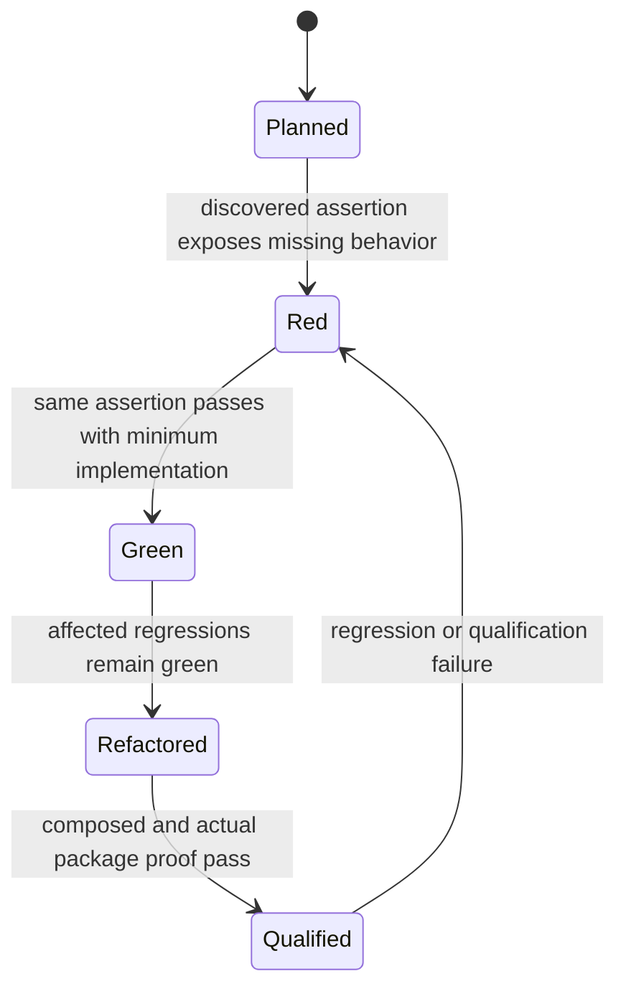
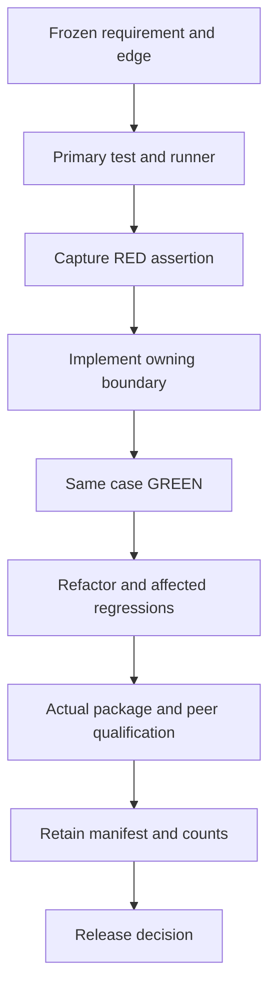

# Company Brain and specialist qualification

## Purpose

**ADR-202–203.** This contract qualifies native Company Brain and durable specialist cooperation, including the actual installable RAH/specialist packages. Passing synthetic schemas or platform fixtures alone is insufficient. Domain behavior belongs to the linked owning specifications; this document owns migration, boundary and release proof.

## Domain entities

- Qualification manifest: platform/build revision, installed immutable package revision/digest, configuration witness and runner identity.
- Primary test: one observable requirement partition, with distinct domain, transport, browser or live responsibility.
- Migration qualification: fresh, populated, interrupted and repeated boot with both main and Brain ledgers.
- Evidence artifact: exact command, discovered/executed/passed/failed/skipped counts, assertion output and RED/GREEN/refactor revisions.
- Release decision: CB0 independently qualified or CB0+CB1 qualified; no inferred readiness from fixtures.

## State machine

An import, unavailable database, missing executable, absent credentials or empty discovery is a harness failure, not RED. Required qualification never silently skips its preflight. A Planned matrix row is not execution proof.

## Process flows

### Migration execution manifest

Assignment storage precedes binding storage (T18→T19). Execution resolves the current binding service; retained binding/pin references alone grant no authority. Main migrations through `0336_specialist_interrupted_work` and Brain migrations through `0011_proposal_source_access` are implemented locally. The following units identify the migration boundaries and drill-down contracts. Deployment and installed-package qualification have separate evidence requirements. Exact keys and guards belong to the linked [knowledge](../db/company-brain-domain.md), [assignment](../db/specialist-assignments-domain.md) and [operation](../db/stand-operations-domain.md) persistence contracts. Apply the complete main lineage before Brain; main-side knowledge pointers never FK a new Brain table. Recheck journal collisions before generation or integration.

| Unit | Dependency and responsible slice | Preservation and failure oracle |
| --- | --- | --- |
| Main 0230 company_ownership | Existing users/agents; T05 | One installation company and explicit grants; project membership unchanged and no automatic content grants. |
| Main 0231 company_knowledge_events | 0230; T08.1/T09 | Exclusive-owner metadata facts and nullable native capture; legacy events remain readable and metadata facts cannot trigger agents. |
| Main 0232 company_grant_requests | 0230; T08.1 | Content-guarded grant/revocation receipts retain current principal and authority checks. |
| Main 0233 native_knowledge_execution | 0231; T14 | Immutable executed-role/node-token attestation; legacy NULL remains unknown, without a Brain FK. |
| Main 0234 specialist_assignments | 0230; T18 | Assignment/input/run-link history and owner/revision guards preserve existing execution ledgers; completion remains unavailable until acceptance. |
| Main 0235 specialist_metadata | 0234; T19 | Optional role declarations preserve absent legacy definition bytes and grant no authority. |
| Main 0236 company_specialist_bindings | 0235; T19 | Reviewed pinned configuration and immutable history retain explicit current company authority. |
| Main 0237 company_flow_bindings | 0236; T19.1 | Exact installed result-only Flow pins require no project/Flow carrier; historical v1 snapshots stay unchanged. |
| Main 0238 company_trigger_scope | 0237; T19.1 | Existing schedules/attempts gain exclusive owners and immutable v2 binding snapshots; v1 scheduled input stays unchanged. |
| Main 0239 company_retry_scope | 0238; T19.1 | Company v3 retry references preserve project v1/v2 bytes; storage does not enable company replacement execution. |
| Main 0240 company_agent_execution | 0239; T20 | Company Run ownership and exact assignment/input links require no dummy project. |
| Main 0241 company_agent_credentials | 0240; T20 | Existing internal tokens gain exact company Run binding, current-authority and identity guards. |
| Main 0242 company_run_terminal_events | 0241; T20 | Company terminal/cleanup facts retain same-owner Run references; metadata facts remain content-free. |
| Main 0243 native_source_array_planning | 0242; T21 | A low planner row estimate for the existing source-restriction array function preserves every entry and changes no access policy. |
| Main 0244 company_human_work_ownership | 0243; T20/T21 | Existing human assignment/actor/event tables gain exclusive company ownership without a second work ledger. |
| Main 0245 human_work_owner_guards | 0244; T21 | Same-owner human-work references and current actor gates reject forged cross-owner actions. |
| Main 0246 company_hitl_wait_events | 0245; T21 | Company wait facts require exact retained Run ownership; historical project wait facts remain readable. |
| Main 0247 company_operational_attention | 0246; T21 | Existing attention kinds cover company work without leaking protected prompt/input bytes. |
| Main 0248 company_flow_execution | 0247; T20.1 | Explicit v2 company graph captures retain required exports and no project/task/provider-Flow carrier. |
| Main 0249 company_flow_node_credentials | 0248; T20.1 | Exact current node/professional credentials reuse existing rotation; v1 null-node credentials remain unchanged. |
| Main 0250 company_flow_workspace_witness | 0249; T20.1 | Company graph plain-directory baselines preserve source-integrity and ownership witnesses. |
| Main 0251 company_flow_runtime | 0250; T20.1 | Existing bounded disposition and lifecycle guards cover result-only graphs without synthesizing operational-agent results. |
| Main 0252 company_run_cancellation | 0251; T20.1/T21 | Immutable stop intent fences new commands and competing completion before teardown; uncertainty remains recoverable. |
| Main 0253 specialist_intake_receipts | 0252; T22 | Canonical source keys and exact input/actor receipts prevent duplicate assignments and changed-payload replay. |
| Main 0254 specialist_project_flow_input | 0253; T22 | New project coordinator input v2 and same-project carrier linkage preserve company tasklessness and legacy v1 bytes. |
| Main 0255 company_event_admission | 0254; T22.1 | Company subscription/event identity binds the original reserved invocation; project uniqueness remains unchanged. |
| Main 0256 project_source_review | 0255; T22 | Server-recorded current project source review remains separate from recurring input and invocation authority. |
| Main 0257 project_trigger_review | 0256; T22 | Reviewed project binding v3 refuses old-worker native-review bypass while preserving existing v1/v2 history. |
| Main 0258 project_event_context | 0257; T22 | Explicit current source-sharing review bounds inherited producing-context disclosure. |
| Main 0259 specialist_context_revisions | 0258; T23 | Attributed immutable working context and source closure use assignment revision CAS, separate from long-term Brain. |
| Main 0260 specialist_context_credentials | 0259; T23 | Native context read scopes retain exact current execution/input appointment. |
| Main 0261 specialist_context_mutation_credentials | 0260; T23 | Context mutation additionally requires current update authority; no model-authored author/epoch is accepted. |
| Main 0262 specialist_question_subject | 0261; T24 | Existing HITL rows retain immutable native assignment/input/question correlation and legacy NULL metadata. |
| Main 0263 specialist_question_answer | 0262; T24 | Exact native human-answer receipts gate continuation; answer intent remains distinct from delivered input. |
| Main 0264 specialist_flow_question | 0263; T24 | Existing graph resume grammar retains exact native question/answer lineage. |
| Main 0265 specialist_result_delivery | 0264; T25 | Result-availability capture and origin delivery bind exact retained result/input, without accepting business work. |
| Main 0266 specialist_delivery_targets | 0265; T25 | Existing webhook/Inbox transports retain source-authorized recipients and delivery identity. |
| Main 0267 specialist_source_handoff | 0266; T26 | Once-only source pointers bind original assignment/input and unused execution reservation. |
| Main 0268 project_source_recovery | 0267; T26 | Interrupted unused intakes can recover exact source pointers; used/uncertain execution is never reset. |
| Main 0269 specialist_logical_work | 0268; T27 foundation | Immutable logical work/intake/child witnesses are implemented; native dispatch, decisions and owner recovery remain their owning slices. |
| Main 0270 specialist_work_witness_guards | 0269; T27 guard correction | Requires positive source/context/target matches, preserves immutable company source identity after optional catalog FK removal, and leaves retained rows unchanged. |
| Main 0271–0278 | Logical work and existing results; T27–28 | Child reservations, result-only rework, exact work decisions and assignment acceptance retain existing Run/result witnesses. |
| Main 0279–0298 | Operational evidence v2 and existing placement/retry; T28.1–30 | Immutable evidence contracts, executor fencing/renewal and source-specific replacement keep legacy snapshots and exact current assignments. |
| Main 0299–0334 | Governed cooperation; T31–39 | Versioned target/operation/probe persistence, authenticated permit, resource exclusion, recovery, incident projection and scheduled read-only appointments preserve unknown effects independently of Run retirement. See [stand persistence](../db/stand-operations-domain.md). |
| Main 0335 company_pending_pool_index | Native child reservation; T27/T41 | Lets the existing worker find pending company Runs within its bounded scan. Existing pool admission retains capacity and budget checks. |
| Main 0336 specialist_interrupted_work | Native rework; T40/T41 | Binds a read-only child continuation to its retired original prompt and retains the same input and objective. Old decisions retain a null interruption pointer. |
| Brain 0007 company_records | Main 0230; T06 | Stable IDs and honest legacy provenance; unknown authorship/basis/time never becomes confirmation or a historical acceptance event. |
