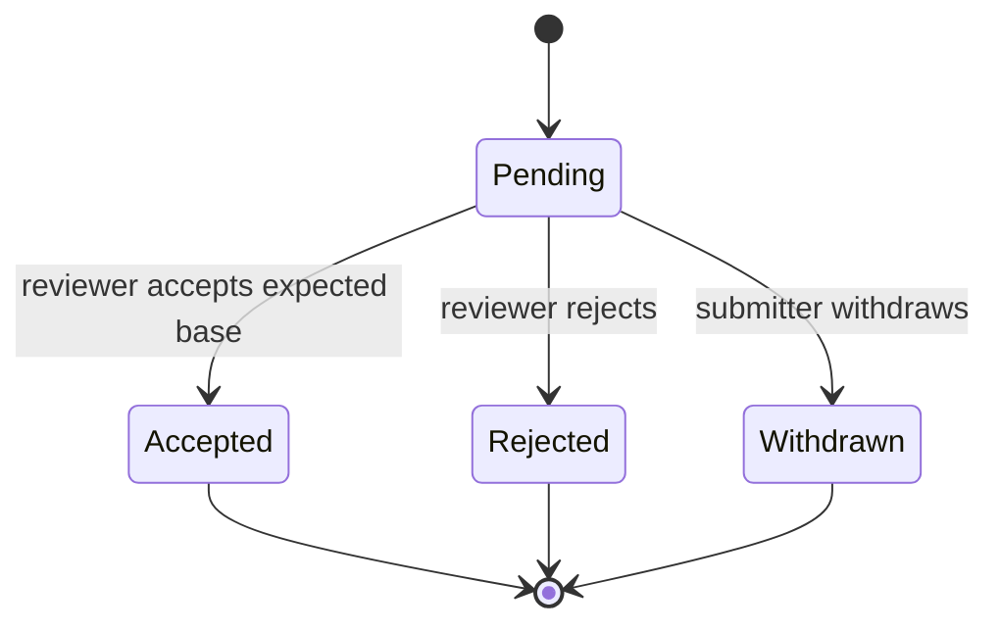
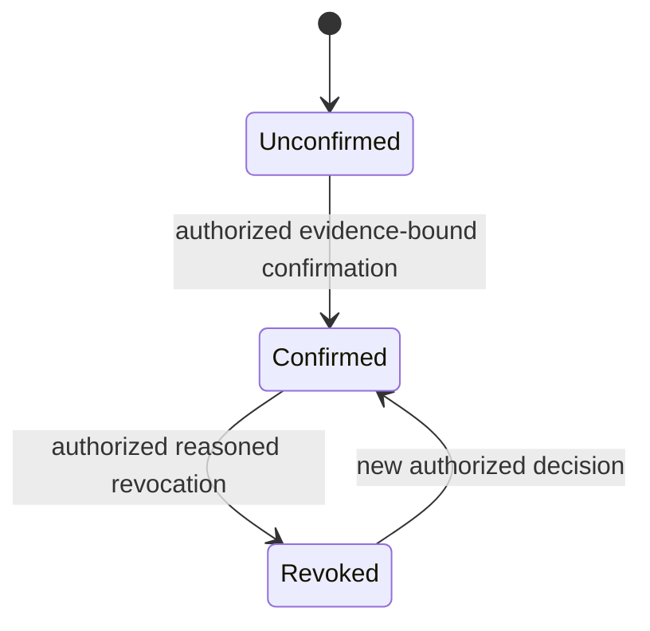
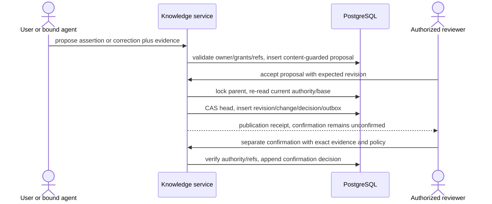
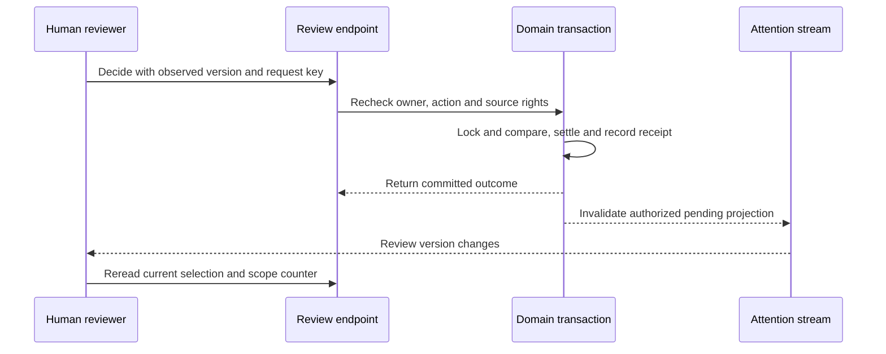

# Company Brain records and review

## Purpose

**Implemented — ADR-202.** Native company and project records extend Project Brain with explicit ownership, evidence, publication and confirmation. Session and bearer APIs, MCP tools and the EN/RU review views have local platform coverage. The [evidence contract](company-brain-evidence.md) defines source witnesses. Personal librarian and private agent memory remain separate stores.

The installed `rah/v1.0.9` package passed depth-one, depth-two and revoked-grant qualification with GLM-5.3 and four configured agent slots. The receipt binds the package, platform patch, adapter and typed results. [Live package qualification receipt](../../.ai-factory/qa/company-brain-specialist-assignments/review-fixes/qualification/installed-package-glm53-duration-owner/evidence.json)

The earlier `rah/v1.0.7` functional run recorded eleven typed results across three trees, evidence through depth two, governed write-back and localized evidence inspection with mixed models. A subsequent exact-model attempt used GLM-5.3 in all ten sessions; one required intermediate coordinator failed during overlapping deletion. [Functional package receipt](../../.ai-factory/qa/company-brain-specialist-assignments/review-fixes/qualification/installed-package-159e462b3/evidence.json) · [Exact-model attempt](../../.ai-factory/qa/company-brain-specialist-assignments/review-fixes/qualification/installed-package-glm53-isolated-failure/evidence.json)

## Domain entities

- Company: one installation-owned identity without a repository.
- Owner: exactly one company or project, separate from access grants.
- Knowledge record: existing `brain_items.id`, current immutable revision and current retrieval projection.
- Record revision: immutable assertion, basis, metadata, evidence links and server attribution.
- Knowledge proposal: addition/correction against an exact base revision, distinct from existing improvement proposals.
- Confirmation decision: actor, policy version, exact record revision/evidence and confirm/revoke reason.
- Accepted-change event: immutable prior/new revision, proposal, originating run/attempt and submitting principal. See [persistence](../db/company-brain-domain.md).

## State machine

Publication and confirmation are independent; accepting a proposal does not confirm its assertion.

Confirmation decisions are append-only and apply only to the exact accepted revision.

## Process flows

The review transaction serializes on the stable record parent before publishing a new revision.

### Record and state contract

| Property | Closed contract |
| --- | --- |
| Owner | `{kind:company,companyId}` or `{kind:project,projectId}`; exactly one existing owner, server-generated company ID |
| Content kind | assertion, observation, decision, procedure; legacy lesson/state_fact/direction readable with their original kind |
| Lifecycle | active, expired, superseded, withdrawn; lifecycle does not express truth |
| Assertion basis | observed, inferred, unknown; pending proposal is publication state, not basis |
| Confirmation | unconfirmed, confirmed, revoked over one exact record revision; never derived from score |
| Attribution | server principal kind/ID, originating run/attempt where present; null with explicit legacy limitation where absent |
| Freshness | source/observation/capture times remain distinct UTC values; freshness current/stale/unknown and applicability known/unknown plus limitations; absent observation is unknown |
| Identity | stable item ID and positive integer revision; old revisions addressable under current access |
| Bounds | title 1–256 characters; content 1–32000; proposal/review reason <=2000; query <=2000; <=10 tags of <=64 characters; <=64 evidence refs per revision |
| Reads | default 20/max 50 records, <=128 KiB summary/evidence pages and <=512 KiB record detail; stable `(createdAt,id)` cursor bound to owner/filter/access-policy digest; changed authorization invalidates cursor, never widens it |

### Authority

All grants are checked from current server state, including account availability and binding/assignment scope. A company owner does not imply visibility to platform members. Global administrators manage explicit grants through `/api/company/grants` (create/list and exact-revision revoke); a grant action is domain-qualified and a management request cannot nominate a privileged actor. Company policy starts restricted; an installation administrator can manage explicit company grants. Administration itself is not an implicit content-read grant. Project records retain current project membership/attachment floors and can add narrower record restrictions. A record/evidence read requires the intersection of owner grant, record/source restrictions and initiating principal/delegation grants.

| Action | Required authority | Actor and refusal |
| --- | --- | --- |
| Search/get/evidence | read knowledge plus source-derived restrictions | User or bound agent; unknown/hidden resource returns same safe 404; lists/counts contain only accessible rows |
| Propose/withdraw own pending | propose knowledge; ownership validated | User or bound agent; cannot nominate actor, run, permission or confirmation authority |
| Accept/reject | review knowledge, exact current pending proposal/base | Authorized reviewer; 409 on stale base/decision or content-changed idempotency key |
| Confirm/revoke | confirm knowledge plus named policy and exact evidence access | Default human authority; a configured verifier may act only within its explicit assertion class; ordinary agent cannot self-confirm |
| Manage access/policy | manage company knowledge or existing project management authority | Server validates policy revision; removal affects subsequent read/write/action, not past authorized disclosure |

Company standalone credentials resolve a server-owned company execution identity rather than a synthetic project attachment. Native company read/propose intersects the configured role action limit, current professional grant and current initiating-user grant; restricted record/source policy applies to both recipients. Its initial authority is confined to the bound company, with project/context/private-memory dependencies unavailable until explicitly admitted through the project/cooperation path. Search applies the same intersection before LIMIT and binds both current grant sets into its cursor. Proposal authority snapshot v2 records the professional grant, current initiating knowledge grant and exact server run/launch capture; old v1 snapshots remain unchanged. This extends native authorization and attributable proposal storage; actual company session/Flow launch remains the CB1 runtime gate. See [company execution knowledge identity](specialist-runtime.md#company-execution-knowledge-identity).

### Mutations and refusal table

| Transition | Preconditions | Atomic effect | Refusal |
| --- | --- | --- | --- |
| Create proposal | Current propose grant, valid accessible refs, unused delivery key or exact replay | Insert proposal and submission receipt; same-key/same-body returns prior safe receipt | Invalid 400, concealed reference 404, changed digest 409, byte limit 413 |
| Accept addition | Pending proposal and review grant under lock | Create stable record/revision and publication decision/change/outbox in one transaction | Changed decision/base 409; removed grant 403 |
| Accept correction | Same plus exact current base revision | CAS head then insert immutable successor/change/decision in same transaction | Loser rolls back all writes, 409 |
| Reject/withdraw | Pending and proper reviewer/submitter authority | Append decision and settle pending proposal | Settled different decision 409; exact replay inert |
| Confirm | Current confirm policy permits actor/class, exact record and available supporting witnesses | Append decision with policy/evidence witnesses | Missing/forged/stale evidence cannot establish confirmation; explicit 400/409, never invented citation |
| Revoke | Current confirm authority and reason | Append revocation; retain original confirmation | Unauthorized 403, stale revision 409 |
| Expire/supersede/withdraw record | Policy expiry or attributed explicit lifecycle decision | Preserve original revision/history and update only projection/lifecycle | Similarity/relevance cannot invoke supersession |

Accepted/corrected revisions never inherit a previous revision's confirmation automatically. Evidence becoming stale/missing changes current support and applicability; historical confirmation remains inspectable as a past decision. Freshness is unknown unless observation/source policy establishes it; row creation or reinforcement time cannot manufacture historical observation.

### Source intake and compatibility

`POST /api/knowledge/sources` captures bounded submitted text through the same source/witness service and current propose grant. The server hashes received bytes and assigns capture identity/time. An optional reported external version stays reported metadata, not a verified external source version or independent corroboration. Source capture supports repository-free runbooks; record publication/confirmation remain separate.

### Compatibility and recovery

Legacy migration creates an imported baseline revision with unknown submitting actor/observation/confirmation and no historical review event. Existing improvement proposals keep their draft/task outcome. Existing retain endpoints enter the same source-aware claim policy; they cannot silently supersede claims. Exact content replay is deduplicated within the accessible owner/authority boundary, without revealing hidden duplicates or adding independent corroboration. No destructive migration deletes records or attachments. Brain does not block explicit project deletion: project-owned records and local history cascade with that project; ordinary record changes retain immutable history. Cross-owner evidence references become explicitly unavailable when their source owner is deleted.

DB changes are one transaction; the existing outbox publishes only after commit. Implemented internal storage emits `knowledge.record_changed` with owner, exact record revision, accepted change/confirmation decision identity and cause. General project pulse/attention, indexing and agent-trigger consumers do not treat this invalidation as project work. Crash before commit leaves the proposal pending; after commit returns the same content-guarded receipt. Failed projection/index refresh retries from the accepted revision; it cannot roll back the accepted fact history or bypass access. List/search failure does not mutate knowledge.

## Shared human review

| Input and current authority | Accepted effect | Rejection or conflict |
| --- | --- | --- |
| Structured add or correction. Current owner review grant, accessible sources and exact proposal revision. A correction also pins its base revision. | Publication writes the exact record revision and the resolution in the same transaction. | Rejection records the reviewer and reason. An outdated proposal or base yields `CONFLICT`. |
| Published revision. Independent confirmation authority and available exact `supports` witness. | Confirmation records the actor, reason and evidence on that revision. | Revocation acts on the active confirmation. A correction starts with its own confirmation state. |

- **K03–K05.** The shared queue and detail must apply current source closure before exposing text, counts, actions or continuations. A successful identical replay must reuse the original receipt under current authority. Changed input on the same key and a fresh key on a settled proposal must conflict.
- **K06.** A legacy assertion with missing evidence must remain correctable. Confirmation must independently require a qualifying exact source and its own authority.
- **K13.** Attention `reviews/reviewVersion` must invalidate the actor's pending queue. Each project count must come from its own authorized selection. History and result links must reauthorize even when the same receipt is replayed.

The native proposal read owner is [knowledge-proposal-read.ts](../../web/lib/brain/knowledge-proposal-read.ts). The shared write boundary is [inbox-review-actions.ts](../../web/lib/queries/inbox-review-actions.ts). See the [session API](../api/web.openapi.yaml) and [attention contract](../api/async/attention-stream.asyncapi.yaml).

## Expectations

- **CBK-01:** Company/project ownership is exclusive and repository-free for company records, while current explicit grants independently gate access, enforced by owner CHECKs and the knowledge access service (`IT-CBK-01`).
- **CBK-02:** Record IDs and exact accepted revisions retain attributable correction/withdrawal history, enforced by immutable revision/change rows and parent-row CAS (`IT-CBK-02`).
- **CBK-03:** Publication and confirmation require separate current authority and evidence-bound receipts with inert exact replay, enforced by review/confirmation transactions (`IT-CBK-03`).
- **CBK-04:** Retrieval confidence/reinforcement never confirms or invents observation time, enforced by independent state projections and freshness evaluation (`IT-CBK-04`).
- **CBK-05:** Legacy records, proposals and project APIs retain usable identities and honest metadata limitations, enforced by preserving backfill and shared retain policy (`IT-CBK-05`).
- **CBK-06:** Search/list/get/evidence/propose/review enforce current grants and bounded authorization-scoped pagination, enforced by the shared service and HTTP contract (`IT-CBK-06`).
- **CBU-01:** Knowledge UI provides EN/RU owner/search/evidence/conflict/confirmation/review interactions with accessible URL-synchronized state, enforced by existing Brain UI extensions (`E2E-CBU-01`).
- **CBU-03:** Work completion creates at most one attributable proposal without implicit factual confirmation, enforced by assignment/result-bound write-back receipts (`IT-CBU-03`).

## Edge cases

- **EDGE-CBK-01:** Two reviewers of the same base produce one successor; the losing transaction returns `CONFLICT` without orphan revisions (`IT-CBK-02`).
- **EDGE-CBK-02:** Revocation after search invalidates subsequent reads/cursors and suppresses hidden counts/URLs, enforced by current access checks (`IT-CBK-06`).
- **EDGE-CBK-03:** Same decision key with changed body returns `CONFLICT`; exact replay cannot create a second confirmation/change event (`IT-CBK-03`).
- **EDGE-CBK-04:** An imported high-confidence legacy item remains unconfirmed with unknown attribution, enforced by migration/projection (`IT-CBK-05`).

## Linked artifacts

- [ADR-202](../decisions.md#adr-202-company-ownership-and-evidence-linked-knowledge-revisions), [Company Brain persistence](../db/company-brain-domain.md).
- [Evidence](company-brain-evidence.md), [Project Brain](project-brain.md), [web API](../api/web.openapi.yaml), [external operations](../api/external/operations.openapi.yaml).
- Owning implementation: `web/lib/brain/`, `web/lib/authz.ts`, `web/lib/tokens/`, `mcp/src/`; separate [private agent memory](agent-memory.md) and [personal librarian memory](librarian-memory.md).

## Native read and capture boundary (Implemented locally)

`/api/knowledge` and `/api/v1/ext/knowledge` share current principal/owner/source-closure gates. Search uses literal text matching and stable creation-time/identity keysets. Signed cursors bind credentials, filters and the current principal authority snapshot; every page also resolves current object/source access. Exact record, evidence and conflict reads revalidate current head policy as well as retained revision restrictions. A project-limited user token cannot widen its resource boundary to company knowledge. Company operations do not require a project; the existing token audit records a nullable project identity.

The MCP `knowledge_search`, `knowledge_get`, `knowledge_evidence`, `knowledge_conflicts` and `knowledge_capture_source` tools publish generated nested schemas from the native input contract, validate them before routing, and retain structured refusal reasons. They are excluded from the personal librarian toolset. Native agent disclosure commits the source-access union under the existing run lock before returning bytes; historical/unknown run capture profiles refuse this path. Native launch-profile creation and derived-output guards are implemented and platform-qualified through the [findings boundary](evidence-findings.md). Actual package release proof remains governed by the [qualification contract](company-brain-specialists-qualification.md).

## Native review and explicit company authority (Implemented locally)

Session and bearer proposal submission, bounded review queues, proposal detail, exact-revision accept/reject and separate confirm/revoke use the same current native authority policy. `knowledge_propose`, `knowledge_proposals_list`, `knowledge_proposal_get`, `knowledge_decide`, `knowledge_confirm` and `knowledge_witness_get` expose the same generated nested inputs through MCP. Ordinary specialist credentials keep only read/propose scopes. A human user token needs both its current token scope and current company/project authority for review or confirmation. Verifier authority never comes from agent prose or successful child completion.

Proposal inspection requires current owner/source read and review authority, or the originating principal's current propose authority. The review queue contains only currently reviewable proposals; source and accepted-publication policy applies before LIMIT. Summaries contain a bounded assertion preview rather than full proposal bodies. Detail retains exact evidence identities, source versions, availability and server attribution. Standalone witness inspection supports review before a record exists. Pages use the existing signed cursor policy and a 128 KiB serialized response bound; proposal detail is bounded to 512 KiB.

Native proposal inputs freeze additional source restrictions from the agent's entire compatible disclosure profile, explicit proof sources and correction base. Omitting citations cannot erase these restrictions. Publication retains the same source restrictions on the current record and exact immutable revision. A deleted source project leaves company-owned proposals and records intact, while reads requiring that source remain unavailable. The optional run FK may become NULL; server-recorded logical originating-run attribution remains unchanged. No dependency FK obstructs project deletion.

An active installation administrator can list, create and revoke explicit company grants without creating a project or manually editing SQL. Administration grants no implicit content access; the administrator must explicitly grant their own required knowledge actions. Model credentials cannot administer grants. Creation accepts existing user/agent identities and distinct actions; agent confirmation requires explicit assertion classes. Company/principal policy publication is serialized across administrators. A competing live grant returns an actionable conflict. Creation replay returns its original rows even after revocation, without restoring authority. Revocation requires the exact revision, nonblank reason and a content-guarded delivery key; revoked authority and its receipts are immutable. Restoring authority requires an intentional new grant and delivery key. Every request rechecks the current administrator account and role. List pages are bounded to 128 KiB; the bounded create receipt contains at most 20 original grant rows.

A new factual confirmation requires an available captured witness with matching retained bytes and current source version. Stale, missing or unknown source support can remain inspectable but cannot establish a new confirmation. Replay of a previously accepted decision remains historical and inert, subject to current authority. A correction creates a new unconfirmed revision. Failure before publication commit leaves the proposal pending and emits no accepted-change event.

## Native human interface (Implemented locally)

The Knowledge rail entry opens `/knowledge`; the existing project Brain tab links
to its owner-filtered native record list. Company access has a dedicated
administrator settings entry. Server rendering uses native read services and the
same current owner-policy predicates for available choices. Lists keep filters
and signed continuation in the URL. A missing/concealed reference has a localized
unavailable view; unrelated failures reach the shared route error boundary.

Record details keep assertion basis, factual confirmation, freshness, applicability,
visibility and lifecycle as separate labeled fields. Proposal publication links
to the exact accepted revision; a separate current-record link precedes new
confirmation work. Capture and correction forms preserve source bytes/references,
server attribution and exact base revision. Already-shortened legacy assertions
cannot become silent partial corrections. Confirmation and company authority
revocations use the shared busy-fenced portaled dialog. Uncertain retries in an
unchanged form retain their delivery identity. EN/RU UI copy is separate from the
original submitted assertion/source language. See the [screen contract](../screens/company-brain.md)
and [public guide](../../site-docs/guides/company-brain.md) for interaction details.

`E2E-CBU-01` drives the actual session/browser/native PostgreSQL path through
administrator grant bootstrap without a new project, captured evidence, proposal
review, independent confirmation, exact-revision correction/history, Russian
controls, confirmation revocation and current access revocation. Its fixture
supervisor does not qualify installed agents, ACP cooperation or the stand pilot.

### Native write admission and transport refusals

Execution-bound native reads and writes lock the consumer Run before locking
its current credential, matching issuance and revocation. An unlocked credential
lookup only locates that lock; binding, revocation and wall-clock expiry are
revalidated under the token lock before current scope, role and source checks.
Revocation during admission refuses disclosure without widening its capture.
Native admission also disables PostgreSQL JIT for that transaction. Fresh or
small policy tables can overestimate recursive authorization work and otherwise
spend seconds compiling it while holding the Run lock. Stand operations use
the same execution setting when they resolve an exact runbook inside a
transaction with a tighter lock budget. The setting restores the pooled
session's prior value after commit or rollback. The separate company-history
policy is outside this admission path; its populated-history performance is
not qualified by the native query measurements.

Native create/review/confirmation transactions take the consumer run lock first,
then the installation-wide transaction advisory write lock before any record or
proposal/source locks. Cross-company/project source dependencies may cycle;
serializing these bounded writes prevents record-lock inversion. The existing
expiry sweep takes the same lock in its atomic update statement before changing
any record, so it cannot invert record locks against a source-linked correction.
Read-only
transactions keep their existing shared record/source locks and can read
unrelated knowledge concurrently. The five-second write-admission lock limit
returns `409 CONFLICT` with `reason: knowledge_write_busy`; no delivery receipt
is consumed, so the unchanged delivery can be retried. Other database errors
remain explicit failures. This guard adds no scheduler or attempt ledger.

Session validation failures use 400; the external token surface preserves its
established 422 validation convention. Missing and inaccessible native references
share 404. Other precondition/conflict failures use 409. Error details may carry
a refusal reason, a current revision, or both; empty details are invalid.

Review pages select and lock bounded proposal metadata and evidence-owner/source
restrictions in one SQL projection. They do not repeat the full detail/witness
inspection for each summary. The transaction shares one deduplicated source
access walk across the page and retains exact/current publication restrictions.
The review-pagination integration case compares real query submissions for one
and many same-owner unsupported proposals; source authority still filters rows
before `LIMIT`, and page bytes and continuation revocation stay enforced.

A review page stops at its last fully authorized item when the next item's
combined source closure would exceed the page resolution budget. Its signed
continuation starts with that unserved item; a single item that cannot fit still
returns an explicit budget refusal. The real-Postgres footprint case verifies
this boundary independently of the response-byte limit.
