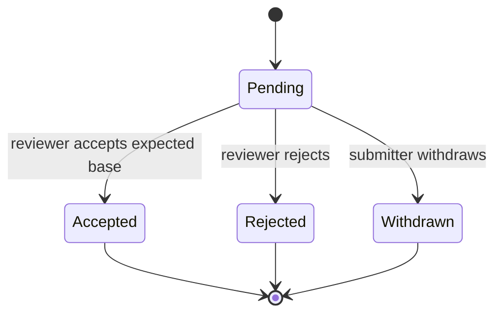
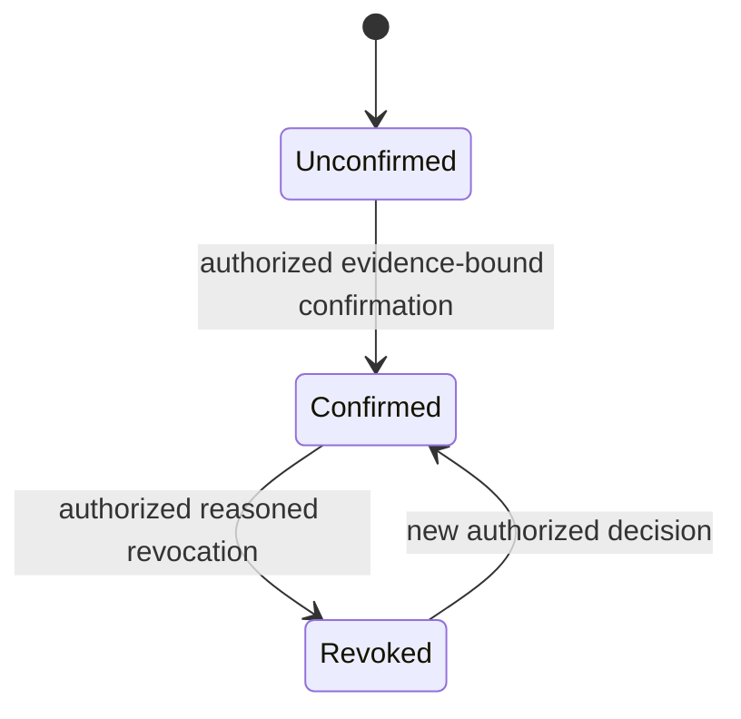
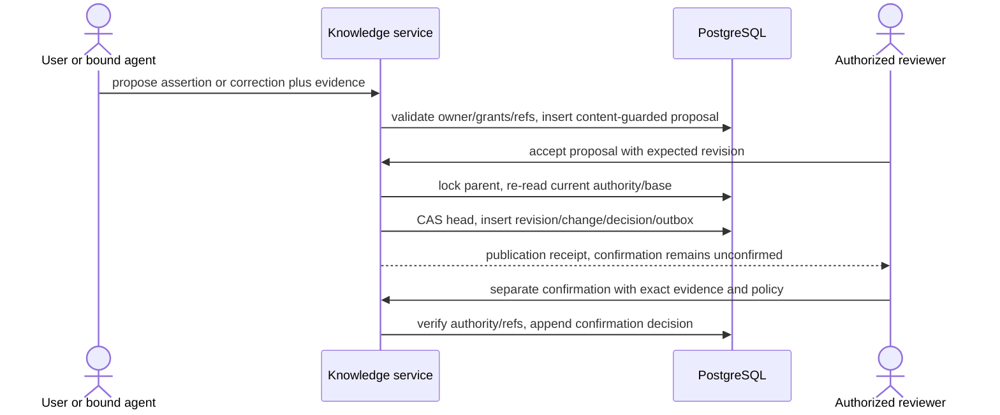

# Company Brain records and review

## Purpose

**Designed — ADR-202.** Structured company/project knowledge extends Project Brain. This domain owns record identity, publication and confirmation; [evidence](company-brain-evidence.md) owns source witnesses. Personal librarian and private agent memory are separate stores.

## Domain entities

- Company: one installation-owned identity without a repository.
- Owner: exactly one company or project, separate from access grants.
- Knowledge record: existing `brain_items.id`, current immutable revision and current retrieval projection.
- Record revision: immutable assertion, basis, metadata, evidence links and server attribution.
- Knowledge proposal: addition/correction against an exact base revision, distinct from existing improvement proposals.
- Confirmation decision: actor, policy version, exact record revision/evidence and confirm/revoke reason.
- Accepted-change event: immutable prior/new revision, proposal, originating run/attempt and submitting principal. See [persistence](../db/company-brain-domain.md).

## State machine

Publication and confirmation are independent; accepting a proposal does not confirm its assertion.

Confirmation decisions are append-only and apply only to the exact accepted revision.

## Process flows

The review transaction serializes on the stable record parent before publishing a new revision.

### Record and state contract

| Property | Closed contract |
| --- | --- |
| Owner | `{kind:company,companyId}` or `{kind:project,projectId}`; exactly one existing owner, server-generated company ID |
| Content kind | assertion, observation, decision, procedure; legacy lesson/state_fact/direction readable with their original kind |
| Lifecycle | active, expired, superseded, withdrawn; lifecycle does not express truth |
| Assertion basis | observed, inferred, unknown; pending proposal is publication state, not basis |
| Confirmation | unconfirmed, confirmed, revoked over one exact record revision; never derived from score |
| Attribution | server principal kind/ID, originating run/attempt where present; null with explicit legacy limitation where absent |
| Freshness | source/observation/capture times remain distinct UTC values; freshness current/stale/unknown and applicability known/unknown plus limitations; absent observation is unknown |
| Identity | stable item ID and positive integer revision; old revisions addressable under current access |
| Bounds | title 1–256 characters; content 1–32000; proposal/review reason <=2000; query <=2000; <=10 tags of <=64 characters; <=64 evidence refs per revision |
| Reads | default 20/max 50 records, <=256 KiB response; stable `(updatedAt,id)` cursor bound to owner/filter/access-policy digest; changed authorization invalidates cursor, never widens it |

### Authority

All grants are checked from current server state, including account availability and binding/assignment scope. A company owner does not imply visibility to platform members. Global administrators manage explicit grants through `/api/company/grants` (create/list and exact-revision revoke); a grant action is domain-qualified and a management request cannot nominate a privileged actor. Company policy starts restricted; an installation administrator can manage explicit company grants. Administration itself is not an implicit content-read grant. Project records retain current project membership/attachment floors and can add narrower record restrictions. A record/evidence read requires the intersection of owner grant, record/source restrictions and initiating principal/delegation grants.

| Action | Required authority | Actor and refusal |
| --- | --- | --- |
| Search/get/evidence | read knowledge plus source-derived restrictions | User or bound agent; unknown/hidden resource returns same safe 404; lists/counts contain only accessible rows |
| Propose/withdraw own pending | propose knowledge; ownership validated | User or bound agent; cannot nominate actor, run, permission or confirmation authority |
| Accept/reject | review knowledge, exact current pending proposal/base | Authorized reviewer; 409 on stale base/decision or content-changed idempotency key |
| Confirm/revoke | confirm knowledge plus named policy and exact evidence access | Default human authority; a configured verifier may act only within its explicit assertion class; ordinary agent cannot self-confirm |
| Manage access/policy | manage company knowledge or existing project management authority | Server validates policy revision; removal affects subsequent read/write/action, not past authorized disclosure |

### Mutations and refusal table

| Transition | Preconditions | Atomic effect | Refusal |
| --- | --- | --- | --- |
| Create proposal | Current propose grant, valid accessible refs, unused delivery key or exact replay | Insert proposal and submission receipt; same-key/same-body returns prior safe receipt | Invalid 400, concealed reference 404, changed digest 409, byte limit 413 |
| Accept addition | Pending proposal and review grant under lock | Create stable record/revision and publication decision/change/outbox in one transaction | Changed decision/base 409; removed grant 403 |
| Accept correction | Same plus exact current base revision | CAS head then insert immutable successor/change/decision in same transaction | Loser rolls back all writes, 409 |
| Reject/withdraw | Pending and proper reviewer/submitter authority | Append decision and settle pending proposal | Settled different decision 409; exact replay inert |
| Confirm | Current confirm policy permits actor/class, exact record and available supporting witnesses | Append decision with policy/evidence witnesses | Missing/forged/stale evidence cannot establish confirmation; explicit 400/409, never invented citation |
| Revoke | Current confirm authority and reason | Append revocation; retain original confirmation | Unauthorized 403, stale revision 409 |
| Expire/supersede/withdraw record | Policy expiry or attributed explicit lifecycle decision | Preserve original revision/history and update only projection/lifecycle | Similarity/relevance cannot invoke supersession |

Accepted/corrected revisions never inherit a previous revision's confirmation automatically. Evidence becoming stale/missing changes current support and applicability; historical confirmation remains inspectable as a past decision. Freshness is unknown unless observation/source policy establishes it; row creation or reinforcement time cannot manufacture historical observation.

### Source intake and compatibility

`POST /api/knowledge/sources` captures bounded submitted text through the same source/witness service and current propose grant. The server hashes received bytes and assigns capture identity/time. An optional reported external version stays reported metadata, not a verified external source version or independent corroboration. Source capture supports repository-free runbooks; record publication/confirmation remain separate.

### Compatibility and recovery

Legacy migration creates an imported baseline revision with unknown submitting actor/observation/confirmation and no historical review event. Existing improvement proposals keep their draft/task outcome. Existing retain endpoints enter the same source-aware claim policy; they cannot silently supersede claims. Exact content replay is deduplicated within the accessible owner/authority boundary, without revealing hidden duplicates or adding independent corroboration. No destructive migration deletes records or attachments. Brain does not block explicit project deletion: project-owned records and local history cascade with that project; ordinary record changes retain immutable history. Cross-owner evidence references become explicitly unavailable when their source owner is deleted.

DB changes are one transaction; the existing outbox publishes only after commit. Implemented internal storage emits `knowledge.record_changed` with owner, exact record revision, accepted change/confirmation decision identity and cause. General project pulse/attention, indexing and agent-trigger consumers do not treat this invalidation as project work. Crash before commit leaves the proposal pending; after commit returns the same content-guarded receipt. Failed projection/index refresh retries from the accepted revision; it cannot roll back the accepted fact history or bypass access. List/search failure does not mutate knowledge.

## Expectations

- **CBK-01:** Company/project ownership is exclusive and repository-free for company records, while current explicit grants independently gate access, enforced by owner CHECKs and the knowledge access service (`IT-CBK-01`).
- **CBK-02:** Record IDs and exact accepted revisions retain attributable correction/withdrawal history, enforced by immutable revision/change rows and parent-row CAS (`IT-CBK-02`).
- **CBK-03:** Publication and confirmation require separate current authority and evidence-bound receipts with inert exact replay, enforced by review/confirmation transactions (`IT-CBK-03`).
- **CBK-04:** Retrieval confidence/reinforcement never confirms or invents observation time, enforced by independent state projections and freshness evaluation (`IT-CBK-04`).
- **CBK-05:** Legacy records, proposals and project APIs retain usable identities and honest metadata limitations, enforced by preserving backfill and shared retain policy (`IT-CBK-05`).
- **CBK-06:** Search/list/get/evidence/propose/review enforce current grants and bounded authorization-scoped pagination, enforced by the shared service and HTTP contract (`IT-CBK-06`).
- **CBU-01:** Knowledge UI provides EN/RU owner/search/evidence/conflict/confirmation/review interactions with accessible URL-synchronized state, enforced by existing Brain UI extensions (`E2E-CBU-01`).
- **CBU-03:** Work completion creates at most one attributable proposal without implicit factual confirmation, enforced by assignment/result-bound write-back receipts (`IT-CBU-03`).

## Edge cases

- **EDGE-CBK-01:** Two reviewers of the same base produce one successor; the losing transaction returns `CONFLICT` without orphan revisions (`IT-CBK-02`).
- **EDGE-CBK-02:** Revocation after search invalidates subsequent reads/cursors and suppresses hidden counts/URLs, enforced by current access checks (`IT-CBK-06`).
- **EDGE-CBK-03:** Same decision key with changed body returns `CONFLICT`; exact replay cannot create a second confirmation/change event (`IT-CBK-03`).
- **EDGE-CBK-04:** An imported high-confidence legacy item remains unconfirmed with unknown attribution, enforced by migration/projection (`IT-CBK-05`).

## Linked artifacts

- [ADR-202](../decisions.md#adr-202-company-ownership-and-evidence-linked-knowledge-revisions), [Company Brain persistence](../db/company-brain-domain.md).
- [Evidence](company-brain-evidence.md), [Project Brain](project-brain.md), [web API](../api/web.openapi.yaml), [external operations](../api/external/operations.openapi.yaml).
- Owning implementation: `web/lib/brain/`, `web/lib/authz.ts`, `web/lib/tokens/`, `mcp/src/`; separate [private agent memory](agent-memory.md) and [personal librarian memory](librarian-memory.md).
