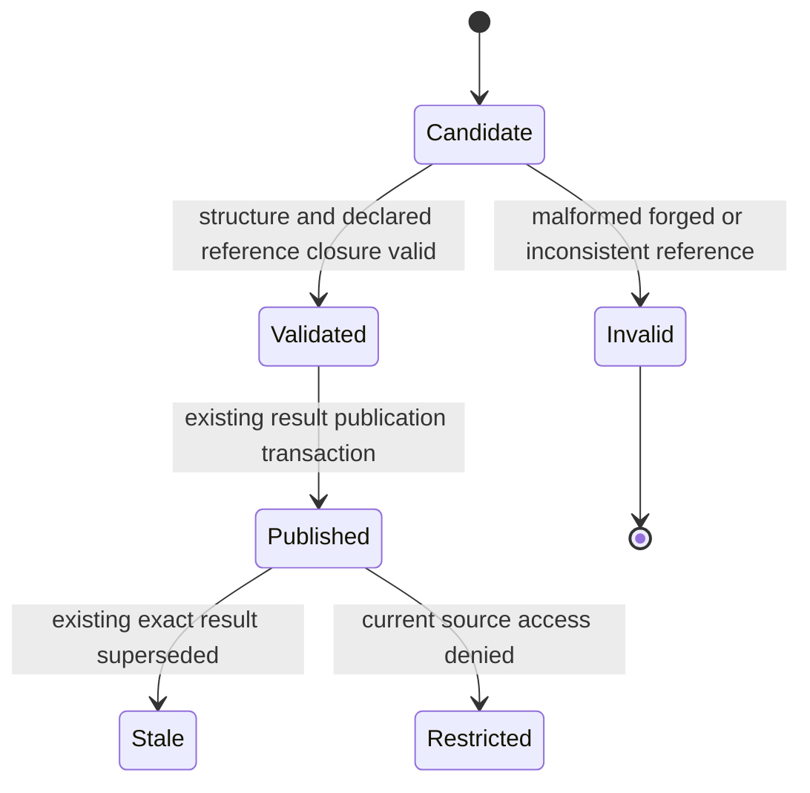
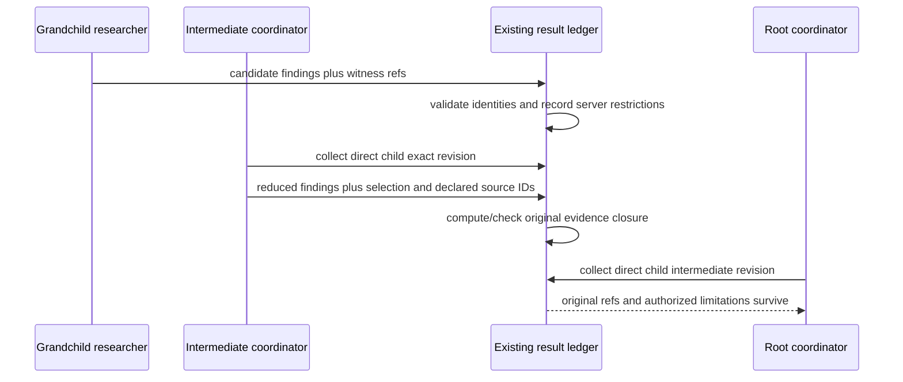

# Evidence-linked findings and reduction

## Purpose

**Designed — ADR-204.** Define one native versioned value for evidence-linked agent/RAH findings through the existing result plane. It applies to coordinator, subordinate researcher and specialist results; [Brain evidence](company-brain-evidence.md) owns source/witness identity.

## Domain entities

- Finding value: `evidence_findings_v1`, bounded native schema usable by agent profile and Flow export.
- Candidate reference: model-supplied identity/revision/digest selector only, never authority or authorship.
- Resolved reference: server-validated exact identity/access/version witness or explicit limitation.
- Selection manifest: consumed child result/finding revisions with retained/combined/omitted disposition.
- Result provenance: existing immutable result revision/schema/pin/producer plus server source-access restrictions.
- Operational evidence contract: separate new `operational_evidence_v2`, preserving operational_v1 rather than mutating it.

## State machine

Existing structural/result validity is composed with native reference validation; it does not confirm facts.

## Process flows

Depth-2 reduction carries original witnesses through each direct child's published value.

### Contract selection and frozen compatibility

A package opts a result profile into native findings with
`result_profiles.<name>.native_contract: evidence_findings_v1`; a Flow opts its
export in with `result.export.native_contract: evidence_findings_v1`. Both retain
their existing package-root `schema` document, exact-byte hash and producer/profile
resolution. This declaration requires the owning package and Flow's effective
`compat.engine_min >= 3.11.0`. An unsupported declaration or insufficient floor
is a configuration refusal before launch. Generic FormSchema and existing
operational_v1 declarations keep their meaning.

The loader preserves the native selector in the pinned profile/export metadata.
The launcher freezes it as `nativeContract` in the existing `runs.result_contract`.
Publication selects native validation only from this server snapshot. The result
body cannot select its validator, submitting actor, grants or confirmation policy.
Historical contracts without the selector retain their original validation even
when their JSON happens to resemble native findings; no content-based upgrade is
allowed. The engine capability is enabled only with the complete launch/disclosure
and derived-output read guards, not merely when the parser accepts the marker.

A `knowledge` reference identifies a record and its exact accepted `revision`.
A `result` reference identifies a child **run ID** and an exact result `revision`,
matching the fields actually returned by `run_collect`. A `witness` reference
identifies an immutable captured witness; supplied version/digest values must
match that witness. Missing exact revision or an unsupported reference field is
an explicit native-reference refusal, with guidance to retrieve the real version
or declare missing evidence. Operation/verification references require their
server resolvers and cannot become valid through producer prose.

For knowledge and result references, an optional `version` is the decimal exact
revision string. A knowledge digest is the accepted assertion's retained
`content_sha256`; a result digest is SHA-256 of its value serialized with the
platform's existing stable JSON key ordering. Neither is a retrieval score or a
confirmation. Witness digest/version values retain their immutable capture
meaning. Missing identities, denied access and witness mismatches share the safe
`reference_invalid` result failure class; diagnostic logs contain only the
candidate's structural path and reason class. Invalid candidates are not
published as a successful result or silently removed from it.

The existing child's immutable parent binding plus its exact `run_results` row's
write-once `first_collected_at` establish which direct parent was served that
revision. Reduction validation uses these facts; it does not introduce a parallel
collection or execution ledger. The original immutable child result remains the
source of depth-2 support, contradiction, missing-information and origin closure.

### Flow role attestation and source capture

Native Flow coordinators bind a catalog role with `settings.agent`; the role must
be a session agent with the existing Flow trigger, current attachment and trust
admission. Before its first prompt, the platform records an immutable version-1
`node_attempts.knowledge_actor` containing the actual agent ID, package install
ID/name and definition digest selected by the existing effective-definition
resolver. This is an extension of the existing attempt ledger. It does not set
`runs.source_agent_id`, which continues to mean the agent that launched a Flow.
A native ordinary Flow node receives the existing agent tool scopes without coordinator delegation scopes. An orchestrator retains its existing delegation scopes. Both credentials use the existing run-bound Flow token container and bind their exact node attempt in nullable
`project_tokens.knowledge_node_attempt_id` when issued. Native access requires
that exact attempt to remain active and current; a token from an earlier node
cannot impersonate the next node's role. Reissuing on wake preserves the same
attempt binding. The pointer cascades on attempt deletion and cannot be changed
after issuance. A bound Flow token resolves only that attempt's attested
identity. The current action may already be Succeeded while post-action gates and publication still belong to it; a newer attempt or node transition fences that authority. Ordinary agent tokens keep their immutable run identity. Neither a
model nor a result body can select an actor. A changed role/package on an
unfinished attested attempt requires an explicit fresh attempt; it cannot rewrite
the original attestation or silently switch the resumed session's authority.

Main migration `0233_native_knowledge_execution` adds the nullable actor snapshot
with a bounded shape CHECK and an immutable-on-update guard, plus the nullable
token/attempt binding and its scoped CHECK/update guard. It also aligns company principal identity bounds with the existing 192-character catalog role contract; native attribution and grant API inputs/outputs retain the full identity. Existing rows stay NULL;
there is no invented historical role or token binding. Role/package identity
pointers are logical values. The token's attempt FK uses ON DELETE CASCADE.
Attempt/project deletion continues through the existing
cascade without an immutable-delete guard or new Brain dependency. Main SQL does
not reference Brain tables. Remaining unapplied specialist/stand reservations
move to `0219`–`0223` before generation.

Launch-time source capture on existing `runs.knowledge_access` is separate from
this role identity. Native children inherit the server-recorded parent source
union; NULL/unknown parent capture cannot be upgraded to complete by a model's
citations. Ambient and explicit knowledge disclosure must add exact record/source
restrictions before delivering bytes. Capability 3.11 stays disabled until both
capture and every derived read guard are qualified.

Native capture also records two finite execution-context source classes, separate
from Brain ownership: `project_context {projectId}` for project inputs/repository
material and `agent_memory {projectId, agentId}` for private agent notes. Both are
server-only classifications on the existing restriction union, not producer
fields or searchable knowledge records. Users need the source project's current
`readRepoFiles` authority; private memory additionally requires the source agent
attachment to exist. An agent needs its current bound project or an explicit current source-project entry on its bound attachment's existing `context_repos` grant for project context;
private memory requires the same professional role and its enabled memory axis.
Company knowledge grants do not bypass either source policy. These finite native
classes do not introduce provider contracts or migrate private stores.

Project-owned native launches capture project context before queuing, and child
launches retain the entire parent union. Retained repository mounts add their source-project restrictions before dispatch and on continuation, and current attachment consent is rechecked. Actual private-memory consumption adds
its narrower source restriction before prompt snapshots or response bytes are
written. Current source authorization is checked again before dispatch/resume and
publication. The same union must constrain record/proposal search before LIMIT,
direct evidence reads and every outward derived field. Source pointers remain
logical; deleting their project leaves accepted company records retained but
source-dependent disclosure unavailable, without blocking deletion.

The initial native profile retrieves shared knowledge through the structured
`knowledge_*` tools after role binding. It does not inject the older unversioned
ambient projection or use the legacy Project Brain `memory_recall`,
`memory_retain`, `memory_clusters` and `memory_propose` transports. Those retain
their historical behavior for historical profiles; native callers receive an
explicit versioned-transport precondition before retrieval or writes. Historical
records remain inspectable through native tools with their honest limitations.
Native `run.json` advertises the result contract and structured retrieval mode;
this descriptor supplies neither permissions nor confirmation. Private agent
memory continues through its separate store and captures its own source policy.

Capture enrollment is independent of the result grammar. A child of an enrolled
execution inherits its complete source protocol even when its existing result
contract is generic; that contract is not upgraded to native findings. A wholly
historical execution with NULL capture remains unknown. An enrolled unknown or
unfinished parent cannot shed its classification by delegating generic work.

Result settlement uses a server-only, read-only execution principal anchored to
the immutable run role or exact current node attestation and current role/package
bindings and source grants. It does not depend on an ephemeral API credential
remaining live after work completes. API requests still require their presented
current token and scopes; expiry or revocation grants no further API access.
The inspection principal cannot propose, review, confirm or manage knowledge,
even when its professional role has those grants. Stopped execution, replaced
attempts, disabled bindings and revoked source grants still refuse inspection.
Recording a completed result therefore remains distinct from publishing or
confirming a Brain assertion.

### Native value and limits

The authoritative OpenAPI components prefixed `CB` describe each closed shape; [synthetic examples](../api/company-brain-examples.yaml) distinguish valid explicit missing evidence from forged authority/unsupported fields. Package FormSchema exposes the same named fields; native semantic validation supplies closure/identity/limit checks beyond the generic field grammar. New capability minimum is designed engine 3.11.0; existing historical profiles keep their frozen schema/digest and meaning.

| Field | Type/limit | Producer versus server |
| --- | --- | --- |
| `schemaVersion` | Literal integer 1 | Producer declares supported native version |
| `findings` | 0–32 findings | Each has local stable ID <=128, assertion 1–2000, basis observed/inferred/unknown |
| `supporting`, `contradicting` | 0–64 candidate refs each | kind knowledge/witness/result/operation/verification; ID <=128; optional positive revision/version <=256/64-hex digest |
| `missingEvidence` | 0–32 entries of state absent/stale/missing/inaccessible/unknown and reason 1–1000 | Explicit empty support is valid; no fake ID required |
| `limitations`, `openQuestions` | <=32 strings each, 1–1000 | Model-reported limitations; server may add safe access/version limitations separately |
| `knowledgeProposals` | <=16 per value | add/correct, assertion/basis/ref set; correction requires exact current target revision; no confirmation/actor fields |
| `selection` | <=256 entries | Exact childRunId/resultRevision/findingId; disposition retained/combined/omitted; <=32 outputFindingIds; omitted requires reason |
| Server enrichment | Stored result/producer/origin identity and inherited restrictions | Never accepted from a model as authority; exact source access recorded before delivering content |
| Entire value | Existing configured node/result output cap, default 262144 UTF-8 bytes | Existing depth/key/array/safe-key validator remains mandatory; no silent clipping or second bigger limit |

Each finding declares `sourceFindings` as <=64 exact child/run/result/finding pointers when derived. Server validates they were actually collected by that parent and computes their original support/contradiction/missing/open-question closure. Retained/combined source findings cannot drop declared contradictory links. Omitted findings remain auditable through exact child revisions and manifest reasons; no need to copy full omitted bodies. A selected finding can be referenced by several combined conclusions without becoming independent evidence.

Novel assertions with no declared child finding may be observed from directly validated source refs or explicitly inferred with limitations. Reference validation cannot prove they are semantically supported or that no relevant natural-language contradiction was overlooked. The coordinator/reviewer remains accountable; new claims never gain confirmation from schema/retrieval validity.

### Validation and sharing decisions

| Condition | Required outcome |
| --- | --- |
| Explicit missing evidence/no refs | Structurally valid finding with limitation; cannot satisfy an evidence-required verification obligation |
| Malformed/oversize/unsafe/unknown native key | Existing classified invalid result, safe reason/path only |
| Claimed submitting actor/authority/confirmed flag | Unknown field refuses; server identity cannot be overridden |
| Unknown/new forged reference or version/digest mismatch | Invalid native reference; no silent dropped citation |
| Stored historical missing/stale/inaccessible evidence | Safe explicit resolution limitation, never fabricated source/version/contents |
| Referenced result outside actual collected direct children | Reject ancestry/served-revision mismatch; root does not collect grandchild directly |
| Selection absent for consumed finding, invented origin or removed declared closure | Invalid reduction; output cannot be accepted as evidence-preserving |
| Manifest/body exceeds transport budget | Refuse with actionable smaller-work/batch guidance; no hidden truncation |
| Current recipient lacks inherited source grants | Withhold affected derived payload/summary/artifact/transcript/legacy outputText/export; safe limitation only |

Record every source-access restriction before the tool/ambient body reaches an agent. Persist turn/run inheritance, union child restrictions on collection and retain them on published results/context. Current read/action authorization rechecks these restrictions; delayed denied responses cannot be adopted into a newly selected context. Already authorized past disclosure is not retroactively erased. Public DTOs never serialize raw run/session/env/path data.

### Operational evidence composition

New `operational_evidence_v2` carries existing operational outcome/coverage/count semantics plus native findings, exact operation references and verification references. Server receipt resolvers bind referenced target incarnation/assignment/intent/result/probe. Model-reported `confirmed` never substitutes for those rows. Required restart success needs proved applied effect and independent healthy verification; unknown/unhealthy/inconclusive is actionable incomplete work. Operational_v1 remains byte-compatible, including supported original/revised appendices and queued/checkpointed runs.

## Expectations

- **CBE-04:** Bounded native findings permit explicit missing evidence and reject forged structure/authority without inventing truth, enforced by shared structural/native semantic validators (`IT-CBE-04`).
- **CBE-05:** Exact result revisions and declared original evidence closure survive depth-2 reduction with auditable omissions and direct-child access, enforced by collection/publication validation (`IT-CBE-05`).
- **CBE-06:** All derived outward content inherits server-recorded source restrictions and current access, enforced by source-access capture and shared result/read projections (`IT-CBE-06`).
- **CBE-07:** Private agent/librarian stores cannot be read/migrated as Company Brain, enforced by separate storage/tool scope and input resolvers (`IT-CBE-07`).

## Edge cases

- **EDGE-CBE-04:** Empty evidence with explicit missing reason is valid; a schema never pressures a researcher into inventing a citation (`IT-CBE-04`).
- **EDGE-CBE-05:** Intermediate summary dropping a declared contrary witness or referring to an unserved result is invalid (`IT-CBE-05`).
- **EDGE-CBE-06:** Citation omission, revoked read, legacy outputText or transcript access cannot launder a restricted source (`IT-CBE-06`).
- **EDGE-CBE-07:** Old private-memory refs are not accepted as shared knowledge identities (`IT-CBE-07`).

## Linked artifacts

- [ADR-204](../decisions.md#adr-204-native-evidence-findings-and-governed-reduction), [Company Brain evidence](company-brain-evidence.md), [cooperation](specialist-cooperation.md), [run results](run-results.md).
- [Web API](../api/web.openapi.yaml), [external API](../api/external/operations.openapi.yaml), [Flow DSL](../flow-dsl.md).
- Existing owners: `web/lib/run-results/`, `web/lib/brain/ambient.ts`, `web/lib/flows/graph/run-context.ts`, package result profile/export loaders and `run_collect`.
