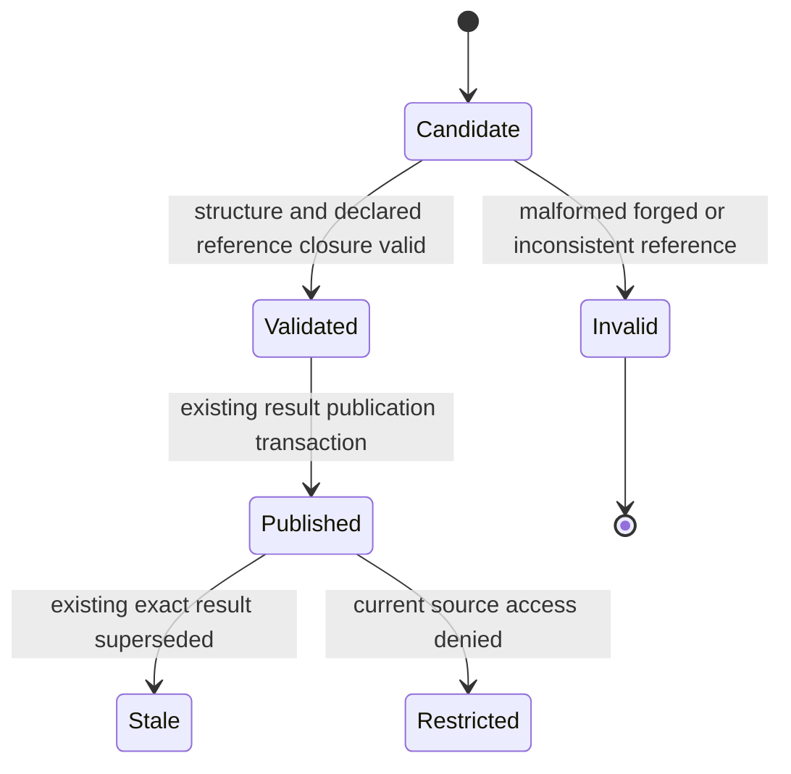
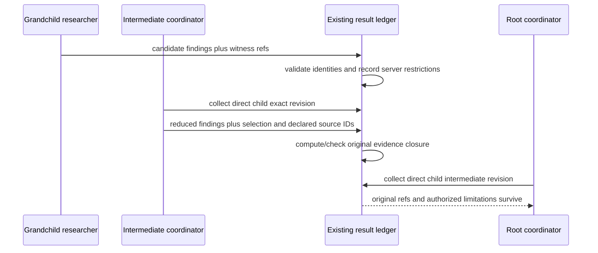

# Evidence-linked findings and reduction

## Purpose

**Native findings implemented locally — ADR-204; actual package release qualification pending.** Native contracts, reference validation, reduction and the qualified read/UI boundaries below extend one native versioned value for evidence-linked agent/RAH findings through the existing result plane. It applies to coordinator, subordinate researcher and specialist results; [Brain evidence](company-brain-evidence.md) owns source/witness identity.

## Domain entities

- Finding value: `evidence_findings_v1`, bounded native schema usable by agent profile and Flow export.
- Candidate reference: model-supplied identity/revision/digest selector only, never authority or authorship.
- Resolved reference: server-validated exact identity/access/version witness or explicit limitation.
- Selection manifest: consumed child result/finding revisions with retained/combined/omitted disposition.
- Result provenance: existing immutable result revision/schema/pin/producer plus server source-access restrictions.
- Operational evidence contract: separate new `operational_evidence_v2`, preserving operational_v1 rather than mutating it.

## State machine

Existing structural/result validity is composed with native reference validation; it does not confirm facts.

## Process flows

Depth-2 reduction carries original witnesses through each direct child's published value.

### Contract selection and frozen compatibility

A package opts a result profile into native findings with
`result_profiles.<name>.native_contract: evidence_findings_v1`; a Flow opts its
export in with `result.export.native_contract: evidence_findings_v1`. Both retain
their existing package-root `schema` document, exact-byte hash and producer/profile
resolution. This declaration requires the owning package and Flow's effective
`compat.engine_min >= 3.11.0`. An unsupported declaration or insufficient floor
is a configuration refusal before launch. Generic FormSchema and existing
operational_v1 declarations keep their meaning.

Native result-export Flows require explicit revision enablement after install
and trust, including reattachment of an already trusted cache. Installation does
not execute their setup hooks; deferred setup runs only through a trusted
trust/enable action. Legacy package auto-enable behavior retains its contract.
The ordinary enable/rollback source check treats an absolute cache path and its
exact file URL as the same source identity; it still refuses another directory
or repository. This supports retained package preinstall rows without rewriting
source history or granting cross-source trust.

The loader preserves the native selector in the pinned profile/export metadata.
The launcher freezes it as `nativeContract` in the existing `runs.result_contract`.
Publication selects native validation only from this server snapshot. The result
body cannot select its validator, submitting actor, grants or confirmation policy.
Historical contracts without the selector retain their original validation even
when their JSON happens to resemble native findings; no content-based upgrade is
allowed. The engine capability is enabled only with the complete launch/disclosure
and derived-output read guards, not merely when the parser accepts the marker.

A `knowledge` reference identifies a record and its exact accepted `revision`.
A `result` reference identifies a child **run ID** and an exact result `revision`,
matching the fields actually returned by `run_collect`. A `witness` reference
identifies an immutable captured witness; supplied version/digest values must
match that witness. Missing exact revision or an unsupported reference field is
an explicit native-reference refusal, with guidance to retrieve the real version
or declare missing evidence. Operation/verification references require their
server resolvers and cannot become valid through producer prose.

For knowledge and result references, an optional `version` is the decimal exact
revision string. A knowledge digest is the accepted assertion's retained
`content_sha256`; a result digest is SHA-256 of its value serialized with the
platform's existing stable JSON key ordering. Neither is a retrieval score or a
confirmation. Witness digest/version values retain their immutable capture
meaning. Missing identities, denied access and witness mismatches share the safe
`reference_invalid` result failure class; diagnostic logs contain only the
candidate's structural path and reason class. Reduction retry feedback preserves
the exact failing selection/finding path and a preservation instruction; it does
not misclassify a reduction mismatch as an unavailable source at `$`. Source
authority refusals retain their existence-concealing message. Invalid candidates are not
published as a successful result or silently removed from it.

The existing child's immutable parent binding plus its exact `run_results` row's
write-once `first_collected_at` establish which direct parent was served that
revision. Reduction validation uses these facts; it does not introduce a parallel
collection or execution ledger. The original immutable child result remains the
source of depth-2 support, contradiction, missing-information and origin closure.

### Flow role attestation and source capture

Native Flow coordinators bind a catalog role with `settings.agent`; the role must
be a session agent with the existing Flow trigger, current attachment and trust
admission. Before its first prompt, the platform records an immutable version-1
`node_attempts.knowledge_actor` containing the actual agent ID, package install
ID/name and definition digest selected by the existing effective-definition
resolver. This is an extension of the existing attempt ledger. It does not set
`runs.source_agent_id`, which continues to mean the agent that launched a Flow.
A native ordinary Flow node receives the existing agent tool scopes without coordinator delegation scopes. An orchestrator retains its existing delegation scopes. Both credentials use the existing run-bound Flow token container and bind their exact node attempt in nullable
`project_tokens.knowledge_node_attempt_id` when issued. Native access requires
that exact attempt to remain active and current; a token from an earlier node
cannot impersonate the next node's role. Reissuing on wake preserves the same
attempt binding. The pointer cascades on attempt deletion and cannot be changed
after issuance. A bound Flow token resolves only that attempt's attested
identity. The current action may already be Succeeded while post-action gates and publication still belong to it; a newer attempt or node transition fences that authority. Ordinary agent tokens keep their immutable run identity. Neither a
model nor a result body can select an actor. A changed role/package on an
unfinished attested attempt requires an explicit fresh attempt; it cannot rewrite
the original attestation or silently switch the resumed session's authority.

Main migration `0233_native_knowledge_execution` adds the nullable actor snapshot
with a bounded shape CHECK and an immutable-on-update guard, plus the nullable
token/attempt binding and its scoped CHECK/update guard. It also aligns company principal identity bounds with the existing 192-character catalog role contract; native attribution and grant API inputs/outputs retain the full identity. Existing rows stay NULL;
there is no invented historical role or token binding. Role/package identity
pointers are logical values. The token's attempt FK uses ON DELETE CASCADE.
Attempt/project deletion continues through the existing
cascade without an immutable-delete guard or new Brain dependency. Main SQL does
not reference Brain tables. Remaining unapplied specialist/stand reservations
start at `0234_specialist_assignments`; later owning slices allocate subsequent free journal numbers before generation.

Launch-time source capture on existing `runs.knowledge_access` is separate from
this role identity. Native children inherit the server-recorded parent source
union; NULL/unknown parent capture cannot be upgraded to complete by a model's
citations. Ambient and explicit knowledge disclosure must add exact record/source
restrictions before delivering bytes. Capability 3.11 stays disabled until both
capture and every derived read guard are qualified.

Native capture also records two finite execution-context source classes, separate
from Brain ownership: `project_context {projectId}` for project inputs/repository
material and `agent_memory {projectId, agentId}` for private agent notes. Both are
server-only classifications on the existing restriction union, not producer
fields or searchable knowledge records. Users need the source project's current
`readRepoFiles` authority; private memory additionally requires the source agent
attachment to exist. An agent needs its current bound project or an explicit current source-project entry on its bound attachment's existing `context_repos` grant for project context;
private memory requires the same professional role and its enabled memory axis.
Company knowledge grants do not bypass either source policy. These finite native
classes do not introduce provider contracts or migrate private stores.

Project-owned native launches capture project context before queuing, and child
launches retain the entire parent union. Retained repository mounts add their source-project restrictions before dispatch and on continuation, and current attachment consent is rechecked. Actual private-memory consumption adds
its narrower source restriction before prompt snapshots or response bytes are
written. Current source authorization is checked again before dispatch/resume and
publication. The same union must constrain record/proposal search before LIMIT,
direct evidence reads and every outward derived field. Source pointers remain
logical; deleting their project leaves accepted company records retained but
source-dependent disclosure unavailable, without blocking deletion.

The initial native profile retrieves shared knowledge through the structured
`knowledge_*` tools after role binding. It does not inject the older unversioned
ambient projection or use the legacy Project Brain `memory_recall`,
`memory_retain`, `memory_clusters` and `memory_propose` transports. Those retain
their historical behavior for historical profiles; native callers receive an
explicit versioned-transport precondition before retrieval or writes. Historical
records remain inspectable through native tools with their honest limitations.
Native `run.json` advertises the result contract and structured retrieval mode;
this descriptor supplies neither permissions nor confirmation. Private agent
memory continues through its separate store and captures its own source policy.

Capture enrollment is independent of the result grammar. A child of an enrolled
execution inherits its complete source protocol even when its existing result
contract is generic; that contract is not upgraded to native findings. A wholly
historical execution with NULL capture remains unknown. An enrolled unknown or
unfinished parent cannot shed its classification by delegating generic work.

Result settlement uses a server-only, read-only execution principal anchored to
the immutable run role or exact current node attestation and current role/package
bindings and source grants. It does not depend on an ephemeral API credential
remaining live after work completes. API requests still require their presented
current token and scopes; expiry or revocation grants no further API access.
The inspection principal cannot propose, review, confirm or manage knowledge,
even when its professional role has those grants. Stopped execution, replaced
attempts, disabled bindings and revoked source grants still refuse inspection.
Recording a completed result therefore remains distinct from publishing or
confirming a Brain assertion.

### Native value and limits

The authoritative OpenAPI components prefixed `CB` describe each closed shape; [synthetic examples](../api/company-brain-examples.yaml) distinguish valid explicit missing evidence from forged authority/unsupported fields. Package FormSchema exposes the same named fields; native semantic validation supplies closure/identity/limit checks beyond the generic field grammar. New capability minimum is designed engine 3.11.0; existing historical profiles keep their frozen schema/digest and meaning.

| Field | Type/limit | Producer versus server |
| --- | --- | --- |
| `schemaVersion` | Literal integer 1 | Producer declares supported native version |
| `findings` | 0–32 findings | Each has local stable ID <=128, assertion 1–2000, basis observed/inferred/unknown |
| `supporting`, `contradicting` | 0–64 candidate refs each | kind knowledge/witness/result/operation/verification; ID <=128; optional positive revision/version <=256/64-hex digest |
| `missingEvidence` | 0–32 entries of state absent/stale/missing/inaccessible/unknown and reason 1–1000 | Explicit empty support is valid; no fake ID required |
| `limitations`, `openQuestions` | <=32 strings each, 1–1000 | Model-reported limitations; server may add safe access/version limitations separately |
| `knowledgeProposals` | <=16 per value | add/correct, assertion/basis/ref set; correction requires exact current target revision; no confirmation/actor fields |
| `selection` | <=256 entries | Exact childRunId/resultRevision/findingId; disposition retained/combined/omitted; <=32 outputFindingIds; omitted requires reason |
| Server enrichment | Stored result/producer/origin identity and inherited restrictions | Never accepted from a model as authority; exact source access recorded before delivering content |
| Entire value | Existing configured node/result output cap, default 262144 UTF-8 bytes | Existing depth/key/array/safe-key validator remains mandatory; no silent clipping or second bigger limit |

Each finding declares `sourceFindings` as <=64 exact child/run/result/finding pointers when derived. Server validates they were actually collected by that parent and computes their original support/contradiction/missing/open-question closure. Retained/combined source findings cannot drop declared contradictory links. Omitted findings remain auditable through exact child revisions and manifest reasons; no need to copy full omitted bodies. A selected finding can be referenced by several combined conclusions without becoming independent evidence.

Novel assertions with no declared child finding may be observed from directly validated source refs or explicitly inferred with limitations. Reference validation cannot prove they are semantically supported or that no relevant natural-language contradiction was overlooked. The coordinator/reviewer remains accountable; new claims never gain confirmation from schema/retrieval validity.

### Validation and sharing decisions

| Condition | Required outcome |
| --- | --- |
| Explicit missing evidence/no refs | Structurally valid finding with limitation; cannot satisfy an evidence-required verification obligation |
| Malformed/oversize/unsafe/unknown native key | Existing classified invalid result, safe reason/path only |
| Claimed submitting actor/authority/confirmed flag | Unknown field refuses; server identity cannot be overridden |
| Unknown/new forged reference or version/digest mismatch | Invalid native reference; no silent dropped citation |
| Stored historical missing/stale/inaccessible evidence | Safe explicit resolution limitation, never fabricated source/version/contents |
| Referenced result outside actual collected direct children | Reject ancestry/served-revision mismatch; root does not collect grandchild directly |
| Selection absent for consumed finding, invented origin or removed declared closure | Invalid reduction; output cannot be accepted as evidence-preserving |
| Manifest/body exceeds transport budget | Refuse with actionable smaller-work/batch guidance; no hidden truncation |
| Current recipient lacks inherited source grants | Withhold affected derived payload/summary/artifact/transcript/legacy outputText/export; safe limitation only |

Record every source-access restriction before the tool/ambient body reaches an agent. Persist turn/run inheritance, union child restrictions on collection and retain them on published results/context. Current read/action authorization rechecks these restrictions; delayed denied responses cannot be adopted into a newly selected context. Already authorized past disclosure is not retroactively erased. Public DTOs never serialize raw run/session/env/path data.

### Operational evidence composition

New `operational_evidence_v2` carries existing operational outcome/coverage/count semantics plus native findings, exact operation references and verification references. Server receipt resolvers bind referenced target incarnation/assignment/intent/result/probe. Model-reported `confirmed` never substitutes for those rows. Required restart success needs proved applied effect and independent healthy verification; unknown/unhealthy/inconclusive is actionable incomplete work. Operational_v1 remains byte-compatible, including supported original/revised appendices and queued/checkpointed runs.

## Expectations

- **CBE-04:** Bounded native findings permit explicit missing evidence and reject forged structure/authority without inventing truth, enforced by shared structural/native semantic validators (`IT-CBE-04`).
- **CBE-05:** Exact result revisions and declared original evidence closure survive depth-2 reduction with auditable omissions and direct-child access, enforced by collection/publication validation (`IT-CBE-05`).
- **CBE-06:** All derived outward content inherits server-recorded source restrictions and current access, enforced by source-access capture and shared result/read projections (`IT-CBE-06`).
- **CBE-07:** Private agent/librarian stores cannot be read/migrated as Company Brain, enforced by separate storage/tool scope and input resolvers (`IT-CBE-07`).

## Edge cases

- **EDGE-CBE-04:** Empty evidence with explicit missing reason is valid; a schema never pressures a researcher into inventing a citation (`IT-CBE-04`).
- **EDGE-CBE-05:** Intermediate summary dropping a declared contrary witness or referring to an unserved result is invalid (`IT-CBE-05`).
- **EDGE-CBE-06:** Citation omission, revoked read, legacy outputText or transcript access cannot launder a restricted source (`IT-CBE-06`).
- **EDGE-CBE-07:** Old private-memory refs are not accepted as shared knowledge identities (`IT-CBE-07`).

## Linked artifacts

- [ADR-204](../decisions.md#adr-204-native-evidence-findings-and-governed-reduction), [Company Brain evidence](company-brain-evidence.md), [cooperation](specialist-cooperation.md), [run results](run-results.md).
- [Web API](../api/web.openapi.yaml), [external API](../api/external/operations.openapi.yaml), [Flow DSL](../flow-dsl.md).
- Existing owners: `web/lib/run-results/`, `web/lib/brain/ambient.ts`, `web/lib/flows/graph/run-context.ts`, package result profile/export loaders and `run_collect`.

### Reduction and disclosure contract

A native reducer accounts for every finding in the latest **actually collected**
native result revision of each direct child. It may also name an older collected
revision explicitly; each named revision then requires complete selection
accounting. The server-established parent edge and existing write-once collection marker
are the authority. A generic child result is not upgraded by resembling native
JSON. More than 256 consumed source findings or selected source identities is an
explicit bounded-contract refusal. Native reduction input is capped at 4 MiB across the selected result values and capture metadata before bodies are loaded.

Each `(childRunId, resultRevision, findingId)` appears once in the selection
manifest. An omitted finding has no output IDs and a nonblank reason. A retained
finding maps to one output with the same assertion and basis. A combined finding
maps to existing outputs; a changed conclusion is inferred. Output source-finding
links and non-omitted selection mappings agree in both directions. Every output
preserves the supporting and contradicting references, limitations, missing
evidence and open questions of its selected sources. Known version/digest fields
cannot disappear. A reducer may add evidence or limitations. Resolving an old
question requires an explicit omission reason and a separately supported finding;
it cannot silently erase the old source's unresolved information.

The next coordinator names its direct intermediate child; original witnesses
survive in that child's required evidence closure. Intermediate source-finding
edges remain inspectable on their exact retained result revisions. A root cannot
turn this lineage into direct access to a grandchild. An original result reference copied from a selected, actually collected intermediate finding may survive as an opaque reference: the server validates its exact retained revision and version/digest, checks the intermediate's ancestry proof and current original-source access, and does not expose a new collection endpoint or child body. An invented grandchild reference has no such proof and is refused. Stale in-progress rework
cannot be retained as current work; it can be accounted for as an explicit
omission. Previously collected superseded revisions remain identifiable.

All outward execution material from an enrolled run uses the run's complete
server-recorded source union, independently of whether citations were emitted or
the output contract is native. This includes legacy output text, inline artifact
locators, transcript pages/downloads, runtime objects, branch/file exports, live
events, RSC payloads and inspector summaries. Existing project/data-class gates
still apply. A current receiving user or presented token is required; the
server-only settlement inspector never substitutes for an outward recipient.
Legacy runs with NULL capture retain their existing read behavior. Unknown or
unfinished enrolled capture is explicitly unavailable. Source denial does not
expose the missing source's content or existence details.

Collection checks the parent recipient before revealing any child material and
records the child's complete source union on the existing parent capture before
response bytes. Denial cannot return result values through output text or artifact
metadata and cannot mark an unserved revision collected. Deferred/streamed
content rechecks current source authority before each emitted page/chunk; an
initial admission does not authorize bytes after revocation. No new collection,
execution or attempt ledger is introduced.

Execution read admission batches a page's run classifications and captures in one
transaction (at most 256 run identities), then authorizes the combined bounded
source closure. It does not issue one result-body query per run. Source-controlled
stream wrappers apply backpressure, recheck after each asynchronous read, and
cancel/release upstream readers on denial or consumer cancellation. They never
hold PostgreSQL locks while waiting for upstream chunks; deleting a project can
complete while its stream is open. Company-owned records survive that deletion.
The next chunk is unavailable because its project/run source no longer exists.

The native collection/reduction, source-aware input, protected outward channels
and evidence inspection use the 3.11.0 capability floor. The full platform
regression gate is required before activation is qualified. The installed-package
and live ACP gates remain separate; these platform boundaries alone do not
establish package or pilot readiness. Reduction metadata bounds aggregate retained
input at 4 MiB before loading bodies and admits at most 256 source findings.
Concurrent knowledge tools serialize the receiving run capture before reading
records, so each disclosed source remains in the durable union. Repeated reads of
one source neither advance an unchanged capture generation nor confirm its facts.

### Shared destination admission

Native enrollment applies to output destinations as well as direct reads. The
existing task-create/update/complete/triage, comment-create, relation-create/delete
and agent-question request routes have no retained source/recipient envelope.
An enrolled run (including a generic child inheriting native capture) receives
409 PRECONDITION `native_unclassified_sink` before effects on those routes,
independently of whether it included a citation or has read a source yet. This
prevents a concurrent read from making an already-admitted write unsafe. The
presented token is authenticated and its scope/project checked first; refusal is
recorded in the existing token audit. A task/comment is not created as a delivery
workaround. Existing NULL-capture execution remains compatible. Native findings,
source-aware knowledge proposals and bounded child cooperation remain separate
authorized channels; later assignment clarification/delivery must retain current
recipient authority before admitting a source-controlled message.

Private professional notes retain their existing attachment/role policy and
content-hash CAS. A native write may carry only that same project's repository
context and that same role's private-memory restrictions; company, record,
foreign-project or other-role restrictions cannot be dropped into the file.
Source admission locks the existing run capture until the existing memory CAS
and atomic local rename finish, so a concurrent tool cannot add a new source
between admission and effect. No network waits occur under this lock. Additional
restrictions return 409 `native_unclassified_memory` without modifying the file.
Safe native private writes and their CAS-conflict disclosure remain supported;
private notes are not migrated into shared knowledge.

The protected read slice also includes workbench file lists, prepared diffs and
change summaries, and external run summaries, readiness and activity. External
routes prove the server-held run belongs to the admitted project before source
inspection, and recheck the current token after delayed assembly. These resource GETs also admit global personal-user tokens through the existing
run-project resolver and live owner account/project-action admission. Project-bound
credentials remain restricted to their project and cannot acquire company source
authority through the owner's separate company grant. Native bearer inspection additionally requires the
knowledge:read scope and a supported human owner or attested professional role.
These routes do not grant publication/declassification authority over a repository
or replace the remaining source-aware export and aggregate-projection work.

The legacy automatic Project Brain distiller does not receive enrolled native
execution events, including generic children carrying inherited capture. It
classifies a dispatch batch's persisted run identities before resolving a model
provider; missing source runs are also ineligible. The existing event consumer
advances past this intentional non-consumption without a new attempt/skip ledger.
Native reusable knowledge is proposed through the attributed, source-aware
proposal API and reviewed under its explicit policy. Legacy NULL-capture harvest
retains its existing provenance, deduplication, retry and permanent-failure rules.

## Governed operational projections

**Implemented and platform-qualified locally.** Agent run/attempt history and automation list/detail hydrate diagnostic bodies and immutable input snapshots only after current receiving-source authorization. The shared operational projection checks the selected bounded run set and reads bodies in the same SQL transaction. Failed operational runs retain classified diagnostic results; failure does not make their prose public. Automation pagination selects control metadata before hydrating only the visible page, so an unrelated off-page result cannot disclose content or deny the selected page.

Internal activity-index repair uses an explicit server-only inspection function to maintain enum/status metadata; it cannot select a public bypass through request JSON. Historical runs with NULL knowledge profiles retain their existing project access rules. Enrolled runs require a current recipient and complete source capture. The history UI preserves safe control metadata and shows the existing EN/RU source-unavailable notice; project settings and deletion do not depend on reading that evidence.

Review-thread reads and edits preserve the run's source envelope, including retained anchor text after workspace cleanup. They recheck the current receiving user before emitting delayed responses. Project deletion and comment deletion do not acquire a new Brain authorization dependency.

Project/cross-project HITL lists filter enrolled rows through current receiving-source authorization before exposing prompts, schemas, responses or counts. Authorized unrelated legacy work remains visible; grants are rechecked before final serialization. Native rows lacking complete capture or an identified recipient cannot enter the content projection. Source-budget exhaustion fails explicitly rather than masquerading as a denied record. External Inbox uses the actual bearer credential; it cannot substitute the owner's broader authority. Private agent/librarian stores remain separate, and no new scheduler or attempt ledger is introduced.

## Findings inspection and retained results

Native result inspection uses the frozen `evidence_findings_v1` discriminator and the validated findings schema. Matching generic JSON remains an ordinary result. The EN/RU findings panel preserves observed/inferred/unknown basis, supporting and contradicting references, missing proof, limitations, open questions, source findings and coordinator selection/omission reasons. It displays proposed knowledge as drafts subject to the separate submission/review policy; viewing a finding cannot confirm a Brain record.

Evidence links name exact record revisions, immutable witnesses and exact run-result revisions. `/knowledge/results/{runId}/{revision}` and the session-only `GET /api/runs/{runId}/results/{revision}` inspect the requested existing ledger row under current project/source authority. Superseded or stale history keeps its value and explicit current validity; invalid publication attempts keep their reason and no value. The original schema digest, publication time, producer reference and first-collected timestamp remain attributable. Inspection never stamps collection or changes acceptance. Current source denial returns no retained payload; this human inspection path does not widen bearer/MCP direct-child collection.

### Carrier input boundary

Flow delegation and agent task-mode delegation create shared carrier tasks from model-supplied title/prompt input. The originating run's captured restrictions must govern that input before any shared task, activity, trigger, template or prompt disclosure. Child-run inheritance alone cannot protect an already visible carrier field. This boundary remains unqualified and keeps native capability disabled; required depth-2 Flow cooperation cannot be replaced with a permanent refusal. Existing legacy task/launcher behavior remains the compatibility baseline. No new execution engine or attempt ledger is required.

The native input contract reuses private `tasks.delegation_spec` for queued intent
and `runs.delegation_snapshot` for the exact execution input. The shared carrier's
title/prompt contain only the server-resolved target identity. A version-1
`nativeInput` retains the original title/prompt, source run, source capture
generation/restrictions, server-resolved professional actor, target kind/identity,
and canonical content digest. Bounds are 256 title characters, 32,000 prompt
characters, the existing source restriction limits, and a positive PostgreSQL
generation. Model-provided actor/authority is never accepted. These JSON additions
need no new ledger or migration and leave historical absent fields unchanged.

Immediate and deferred launches must bind the exact retained intent to the parent,
carrier and actual target before effects. An ordinary launch cannot execute the
public placeholder: missing or mismatched binding refuses with
`native_delegation_input_binding_required`. Runtime prompt composition reads the
frozen private input and validates its digest and inclusion in the run's source
capture. The input snapshot does not grant access; current source/role checks
still precede dispatch and outward inspection. It cannot enter shared task DTOs,
activity or board search. This contract does not add a Brain prerequisite to
cancellation, teardown or project deletion.

The existing run inspector exposes a separate read-only original-input section
in English and Russian. Its human-only reader requires current project repository
read authority and the child execution's current source authority, validates the
retained digest, target and parent/source binding, and returns only original
title/prompt, source-run link and input digest. It rechecks authority after
assembly. Absent historical input renders no section; malformed or unavailable
native input is explicit and never reconstructed from a public placeholder.
No private input is added to cached shared run/task DTOs. Company-only assignment
inspection extends this reader's owner admission in CB1 rather than fabricating
a project.

### Cross-recipient input and steering

Native run messages and rework requests admit private input only to an actual
direct agent child. Before turn acceptance, the platform locks the source before
the child, resolves the actual originating professional token, checks its current
sources, and authorizes the child's current professional role against the whole
source union. The same existing run capture retains that union before private
prompt bytes can be persisted. Missing/legacy target capture cannot be upgraded;
unknown sources, wrong ancestry and revoked receiver grants refuse without a
turn or source update. Legacy tree-wide addressing keeps its existing contract.
Input admission and execution dispatch both require current authority; steering
also rechecks at its own wire boundary. These are input/source checks, never
result acceptance or fact confirmation.

Source refusal before a steer's first wire attempt is definitive. If an earlier
attempt may already have been injected and its acknowledgement was lost,
withdrawn/unavailable source authority withholds another send and leaves the
existing command for read-only receipt reconciliation
(`native_steer_reconciliation_required`). Recovery may establish the already
applied effect without source-read authority; it must not label the prior effect
not-applied merely because the current source grant is absent. No second
command/attempt ledger is introduced.

### Project webhook delivery

Project webhook subscriptions have no Company Brain receiving principal.
For native executions, per-event `data` is therefore the explicit
`{contentState: "source_restricted"}` projection. The existing envelope retains
event identity/type/time and its server-controlled project/run status references;
private failure prose, gate decisions and model payloads remain in authorized
execution views. Capture uses the existing outbox INSERT and main run metadata,
without a Brain read or teardown dependency. Fanout and send/replay enforce the
same projection for retained native rows; legacy NULL-capture event payloads
and user-scoped numeric attention facts retain their existing contracts.

### Attention and gate chat

Portfolio attention summaries/counts and project activity HITL text use the same
current source policy as Inbox. Source-denied native questions are excluded;
unrelated legacy attention stays visible. The project page passes its actual
session recipient. A missing recipient never admits native prompt content.
Current source permission is rechecked before returning the assembled view.
Server-defined status, node identity, timestamps, branch and bounded numeric
progress remain control metadata; cross-project activity selects only its
explicit scalar whitelist and never arbitrary event/webhook bodies.

Gate-chat HTTP reads check project HITL authority and native sources before and
after loading retained messages. Sending checks current human source access
before a turn can be admitted; execution also rechecks the actual native role's
current sources before admission and prompt dispatch. Revocation during a wait
cannot authorize another prompt or response disclosure. Existing turn leases,
prompt owners, workspace recovery and failure settlement remain authoritative.
The guards do not add a source-read requirement to cleanup or deletion.

### Project publication boundary

Native capture is not publication authority. A complete native source union may
use existing project Git delivery only when every source is the destination's
`project_context`. Brain records/project knowledge, company knowledge, private
agent memory and foreign project contexts require a destination that retains
their source policy. Current unclassified Git publish/handoff/PR/promotion
refuses those sources with `native_publication_source_policy` before claiming or
mutating the repository. Unknown native capture also refuses; historical NULL
capture keeps the existing delivery contract. Result-only research/delegation
and protected findings are separate from Git delivery.

Preservation and deletion do not require Brain reads or confirmation. For native
sources that cannot be published, retention/operator cleanup keeps its existing
local preservation path and withholds the optional archive push; it does not
block local teardown because a knowledge grant was revoked. The source policy
is derived from retained capture metadata, without a live Brain dependency.

### Native recipient and reentry boundaries

Native child work requires an identifiable authorized professional role. The
legacy consensus participant selected only by a runner has no such role binding;
it refuses with `native_professional_role_required` before creating a child run,
session or execution assignment. It cannot become an unclassified child simply
by omitting a result profile. Legacy consensus behavior is unchanged; native RAH
cooperation delegates to declared agent/Flow targets through the qualified
source-inheriting launcher.

Legacy standalone pre-work retry and fresh-qualification recipes do not retain
native result/input/source bindings. Native sources explicitly report the
existing `retry_source_unsupported` disposition on those paths, including a
stale preview accepted before enrollment was detected. Same-run continuation
keeps its frozen sources and current dispatch checks. CB1 assignment recovery
extends the existing immutable retry recipe and ownership mechanisms before
qualifying native replacement attempts; silently launching a NULL-capture
replacement is forbidden.

### Physical workspace sharing

Native cooperation uses separate owned workspaces or workspace-none execution.
The legacy physical `workspaceMode: shared` has no recipient-aware source envelope
for every process reading its common files; native enrollment therefore refuses
that mode with `native_shared_workspace_unsupported` before carrier/worktree/run
creation. The check covers explicit native profiles, retained native input and
inherited native parent capture, independently of a child's result grammar.
Historical NULL-capture shared work retains its existing behavior.

Retained native shared rows cannot consume knowledge, dispatch/resume or disclose
derived workspace content through native read paths. Their source closure is not
declared complete for the common directory. Cleanup and cancellation remain
independent. This does not replace required depth-2 cooperation: separate-workspace
Flow/agent delegation and evidence-preserving collection remain supported. The
durable, versioned assignment working context is a separate contract from physical
Git workspace sharing.
