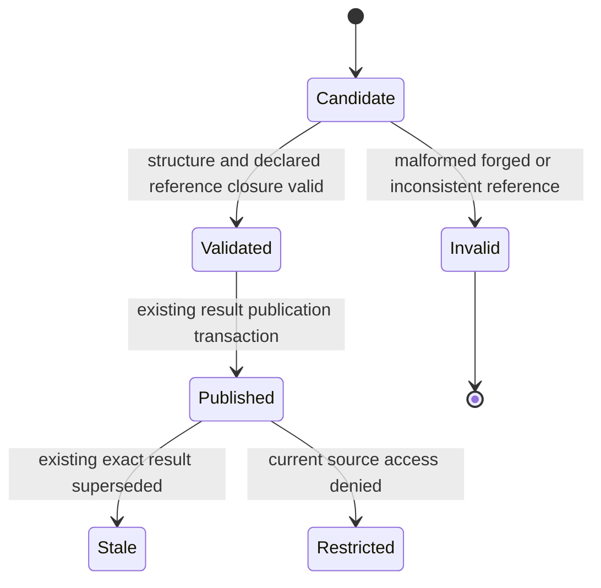
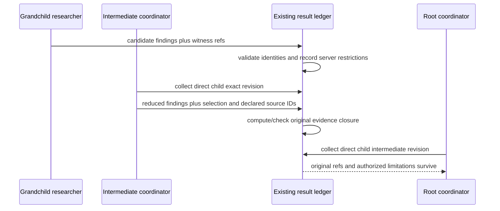

# Evidence-linked findings and reduction

## Purpose

**Designed — ADR-204.** Define one native versioned value for evidence-linked agent/RAH findings through the existing result plane. It applies to coordinator, subordinate researcher and specialist results; [Brain evidence](company-brain-evidence.md) owns source/witness identity.

## Domain entities

- Finding value: `evidence_findings_v1`, bounded native schema usable by agent profile and Flow export.
- Candidate reference: model-supplied identity/revision/digest selector only, never authority or authorship.
- Resolved reference: server-validated exact identity/access/version witness or explicit limitation.
- Selection manifest: consumed child result/finding revisions with retained/combined/omitted disposition.
- Result provenance: existing immutable result revision/schema/pin/producer plus server source-access restrictions.
- Operational evidence contract: separate new `operational_evidence_v2`, preserving operational_v1 rather than mutating it.

## State machine

Existing structural/result validity is composed with native reference validation; it does not confirm facts.

## Process flows

Depth-2 reduction carries original witnesses through each direct child's published value.

### Native value and limits

The authoritative OpenAPI components prefixed `CB` describe each closed shape; [synthetic examples](../api/company-brain-examples.yaml) distinguish valid explicit missing evidence from forged authority/unsupported fields. Package FormSchema exposes the same named fields; native semantic validation supplies closure/identity/limit checks beyond the generic field grammar. New capability minimum is designed engine 3.11.0; existing historical profiles keep their frozen schema/digest and meaning.

| Field | Type/limit | Producer versus server |
| --- | --- | --- |
| `schemaVersion` | Literal integer 1 | Producer declares supported native version |
| `findings` | 0–32 findings | Each has local stable ID <=128, assertion 1–2000, basis observed/inferred/unknown |
| `supporting`, `contradicting` | 0–64 candidate refs each | kind knowledge/witness/result/operation/verification; ID <=128; optional positive revision/version <=256/64-hex digest |
| `missingEvidence` | 0–32 entries of state absent/stale/missing/inaccessible/unknown and reason 1–1000 | Explicit empty support is valid; no fake ID required |
| `limitations`, `openQuestions` | <=32 strings each, 1–1000 | Model-reported limitations; server may add safe access/version limitations separately |
| `knowledgeProposals` | <=16 per value | add/correct, assertion/basis/ref set; correction requires exact current target revision; no confirmation/actor fields |
| `selection` | <=256 entries | Exact childRunId/resultRevision/findingId; disposition retained/combined/omitted; <=32 outputFindingIds; omitted requires reason |
| Server enrichment | Stored result/producer/origin identity and inherited restrictions | Never accepted from a model as authority; exact source access recorded before delivering content |
| Entire value | Existing configured node/result output cap, default 262144 UTF-8 bytes | Existing depth/key/array/safe-key validator remains mandatory; no silent clipping or second bigger limit |

Each finding declares `sourceFindings` as <=64 exact child/run/result/finding pointers when derived. Server validates they were actually collected by that parent and computes their original support/contradiction/missing/open-question closure. Retained/combined source findings cannot drop declared contradictory links. Omitted findings remain auditable through exact child revisions and manifest reasons; no need to copy full omitted bodies. A selected finding can be referenced by several combined conclusions without becoming independent evidence.

Novel assertions with no declared child finding may be observed from directly validated source refs or explicitly inferred with limitations. Reference validation cannot prove they are semantically supported or that no relevant natural-language contradiction was overlooked. The coordinator/reviewer remains accountable; new claims never gain confirmation from schema/retrieval validity.

### Validation and sharing decisions

| Condition | Required outcome |
| --- | --- |
| Explicit missing evidence/no refs | Structurally valid finding with limitation; cannot satisfy an evidence-required verification obligation |
| Malformed/oversize/unsafe/unknown native key | Existing classified invalid result, safe reason/path only |
| Claimed submitting actor/authority/confirmed flag | Unknown field refuses; server identity cannot be overridden |
| Unknown/new forged reference or version/digest mismatch | Invalid native reference; no silent dropped citation |
| Stored historical missing/stale/inaccessible evidence | Safe explicit resolution limitation, never fabricated source/version/contents |
| Referenced result outside actual collected direct children | Reject ancestry/served-revision mismatch; root does not collect grandchild directly |
| Selection absent for consumed finding, invented origin or removed declared closure | Invalid reduction; output cannot be accepted as evidence-preserving |
| Manifest/body exceeds transport budget | Refuse with actionable smaller-work/batch guidance; no hidden truncation |
| Current recipient lacks inherited source grants | Withhold affected derived payload/summary/artifact/transcript/legacy outputText/export; safe limitation only |

Record every source-access restriction before the tool/ambient body reaches an agent. Persist turn/run inheritance, union child restrictions on collection and retain them on published results/context. Current read/action authorization rechecks these restrictions; delayed denied responses cannot be adopted into a newly selected context. Already authorized past disclosure is not retroactively erased. Public DTOs never serialize raw run/session/env/path data.

### Operational evidence composition

New `operational_evidence_v2` carries existing operational outcome/coverage/count semantics plus native findings, exact operation references and verification references. Server receipt resolvers bind referenced target incarnation/assignment/intent/result/probe. Model-reported `confirmed` never substitutes for those rows. Required restart success needs proved applied effect and independent healthy verification; unknown/unhealthy/inconclusive is actionable incomplete work. Operational_v1 remains byte-compatible, including supported original/revised appendices and queued/checkpointed runs.

## Expectations

- **CBE-04:** Bounded native findings permit explicit missing evidence and reject forged structure/authority without inventing truth, enforced by shared structural/native semantic validators (`IT-CBE-04`).
- **CBE-05:** Exact result revisions and declared original evidence closure survive depth-2 reduction with auditable omissions and direct-child access, enforced by collection/publication validation (`IT-CBE-05`).
- **CBE-06:** All derived outward content inherits server-recorded source restrictions and current access, enforced by source-access capture and shared result/read projections (`IT-CBE-06`).
- **CBE-07:** Private agent/librarian stores cannot be read/migrated as Company Brain, enforced by separate storage/tool scope and input resolvers (`IT-CBE-07`).

## Edge cases

- **EDGE-CBE-04:** Empty evidence with explicit missing reason is valid; a schema never pressures a researcher into inventing a citation (`IT-CBE-04`).
- **EDGE-CBE-05:** Intermediate summary dropping a declared contrary witness or referring to an unserved result is invalid (`IT-CBE-05`).
- **EDGE-CBE-06:** Citation omission, revoked read, legacy outputText or transcript access cannot launder a restricted source (`IT-CBE-06`).
- **EDGE-CBE-07:** Old private-memory refs are not accepted as shared knowledge identities (`IT-CBE-07`).

## Linked artifacts

- [ADR-204](../decisions.md#adr-204-native-evidence-findings-and-governed-reduction), [Company Brain evidence](company-brain-evidence.md), [cooperation](specialist-cooperation.md), [run results](run-results.md).
- [Web API](../api/web.openapi.yaml), [external API](../api/external/operations.openapi.yaml), [Flow DSL](../flow-dsl.md).
- Existing owners: `web/lib/run-results/`, `web/lib/brain/ambient.ts`, `web/lib/flows/graph/run-context.ts`, package result profile/export loaders and `run_collect`.
