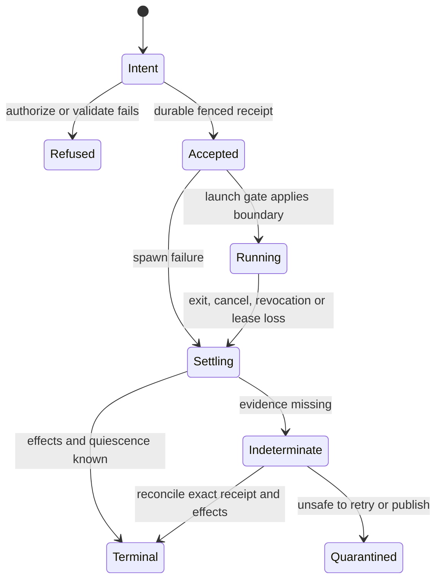
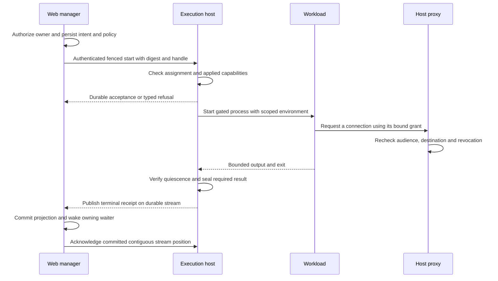

# Execution isolation

## Purpose

**Designed.** Constrain untrusted workload processes, network access and credentials on an execution host while retaining the existing Run, Flow and session contracts. [ADR-210](../decisions/adr-210.md)

## Domain entities

- **Manager.** The web service authorizes an owner and records immutable dispatch intent. The supervisor authenticates it independently of workspace or workload identity.
- **Host.** The trusted supervisor owns the process gate, private state database, outbox, credential connector, proxy and any narrow privilege-switch helper.
- **Workload.** An ACP session, CLI/check/gate command, requirement probe, package install or independent diagnostic. Descendants inherit its physical boundary.
- **Grant.** A revisioned ceiling, runner profile, project command override, or owner-scoped binding to an allowed credential, file or network service.
- **Evidence.** An immutable launch capture, applied policy receipt, process obligation, terminal receipt or sealed result. Each binds the actual owner and generation. [Execution-host ERD](../db/execution-hosts-domain.md)

## State machine

## Process flows

### Principals and process entry points

| Class | Present execution path | Required placement and owner |
| --- | --- | --- |
| Project and company Run sessions, scratch, librarian, gate chat and repair | `supervisor/src/spawn.ts` and the process gate | Logical Run session capture with an incarnation-specific assignment. |
| Version, model, smoke and MCP diagnostics | `supervisor/src/http-api.ts`, `model-catalog/sources/acp-probe.ts`, `mcp-probe.ts` | Bounded diagnostic operation. Explicit upstream credential scope where necessary. |
| CLI, check and automated gates | `web/lib/flows/runner-cli.ts`, `web/lib/flows/graph/gates-exec.ts` | Exact Run command attempt, immutable descriptor and captured command policy. |
| Requirement probes | `web/lib/flows/requirements-check.ts` | Project preflight operation using a scoped host handle. |
| Package and capability setup | `web/lib/flows.ts`, `web/lib/capabilities/import.ts` | Exact package revision operation with a private staging directory and publication receipt. |
| Privileged Git | `web/lib/project-config-persistence/git-process.ts`, `worktree.ts`, `worktree-provenance.ts` and direct repository consumers | Trusted, centralized invocation and actor-attributed ref updates. Keep repository execution inside workload isolation. |

Manager credential files belong to the manager and trusted host principals only. The trusted host owns provider credentials, deployment configuration, app secrets and private runtime state. Workloads receive an explicit environment and opaque grants. Reserve the manager, supervisor, databases, local credential stores, runtime state and privileged sockets from workload mounts and general egress. The brokered façade authorizes a specific audience, operation and resource.

### Local transport activation

The proposed P1 direct transport uses a dedicated manager bearer credential
on a loopback-only listener. Keep the manager and supervisor copies in
service-owned files outside repos and runtime roots. Rotate by atomically
replacing both copies and reopening manager connections. Refuse requests with
missing, malformed or mismatched credentials before route handlers run,
including SSE and byte-range reads. Disable redirects on manager requests.
Readiness requires the expected host key from an authenticated peer. A
single-user local install also needs its workload file boundary before this
credential can be treated as confidential from a workload.

The P1 Flow child policy uses the ADR-153 allow-list plus explicitly supplied
execution plumbing. Exclude the SSH agent socket and remove full inheritance.
Host-side ACP environment projection is a separate part of T07. The
pre-confinement deployment may still resolve deliberately configured
provider credentials and depends on OS identity and filesystem policy to
protect host configuration.

### Settlement and recovery

| Boundary | Durable action and owner | Observable outcome |
| --- | --- | --- |
| Edit under a stale revision | Manager rejects before write using CAS | 409 conflict and current revision on authorized refresh. |
| Delivery interrupted before acceptance | Manager retries identical bytes under the active assignment | Existing receipt or one execution. |
| Accepted process or output interrupted | Host recovers the obligation from its journal, then manager reconciles the exact receipt | Terminal only after quiescence and required output evidence. |
| Credential revoked or operation superseded | Host closes scoped listeners, connections and forwards, then fences execution | A later stale event remains forensic only. |
| Publish interrupted or unowned ref move observed | Trusted ref publisher locks the physical repository and compares expected OIDs before restoration | Current authorized ref preserved, unresolved effects quarantined. |
| Migration between peers | Stop admission, drain, expand both stores, negotiate and activate | Legacy v1 replay works. Unsupported peer or store version refuses writable activation. |

## Expectations

- **ISO-01:** Every host route must authenticate before accessing state or starting an effect under split service identities.
- **ISO-02:** Policy resolution must enforce the ceiling, apply the strictest approval and reject stale edits without a write.
- **ISO-03:** Both storage upgrades must retain v1 receipts and negotiate mixed-owner replay without duplicate application.
- **ISO-04:** Resume and later named-session startup must use the frozen capture while checking current resource and credential authority.
- **ISO-05:** A qualified driver must apply namespace or Seatbelt restrictions, sanitized environments and verified process teardown at every covered entry point.
- **ISO-06:** Git operations must preserve foreign refs and privilege boundaries while attributing each permitted update to an exact writer and receipt.
- **ISO-07:** Network and credential grants must enforce exact audiences and direct destination denials with attributable, redacted events.
- **ISO-08:** Provider readiness must bind a proven OS, adapter, version and credential mode, including native resume where claimed.
- **ISO-09:** Run commands must stream bounded evidence and advance graph state once after the declared result contract is satisfied.
- **ISO-10:** Preflight, setup and diagnostics must hold real operation ownership and reconcile effects without creating a Run.
- **ISO-11:** Admin and project surfaces must show effective authority, typed refusals and exceptions to authorized readers in EN and RU.
- **ISO-12:** Local toolchain, cache and preview grants must stay within the exact workload scope and release on teardown.

## Edge cases

- **EDGE-ISO-13:** Unconfirmed termination, an ambiguous effect, a mismatched receipt or expired enforcement evidence must block further effects until reconciled or quarantined. An unavailable driver refuses with `PRECONDITION/isolation_unavailable`. A host spawn failure uses `EXECUTOR_UNAVAILABLE`.

## Linked artifacts

- [Acceptance traceability](execution-isolation-traceability.md)
- [Execution hosts](execution-hosts.md)
- [Execution-host data model](../db/execution-hosts-domain.md)
- [Supervisor OpenAPI](../api/supervisor.openapi.yaml)
- [Web OpenAPI](../api/web.openapi.yaml)
- [Canonical execution-host events](../api/async/execution-host-events.asyncapi.yaml)
