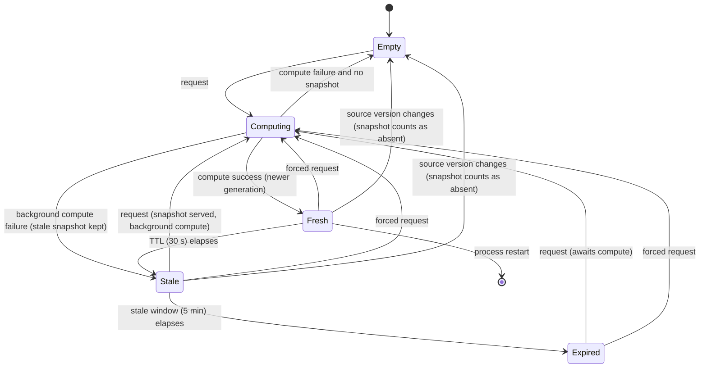
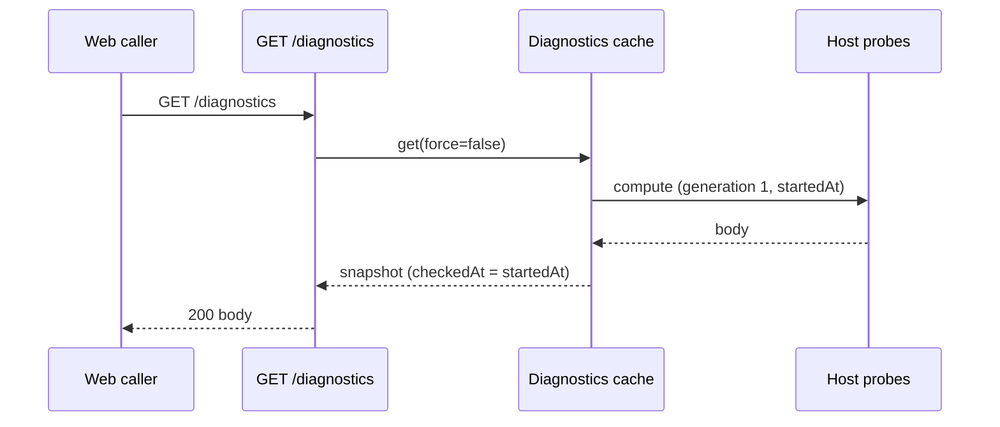
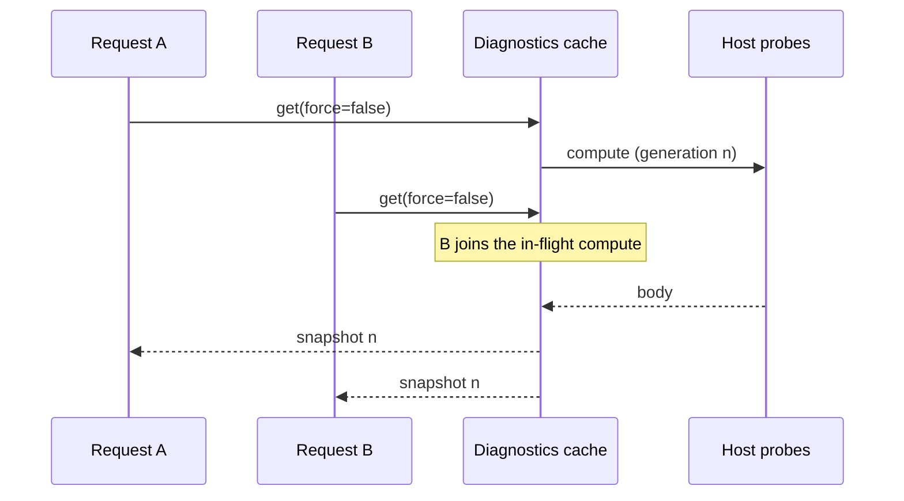
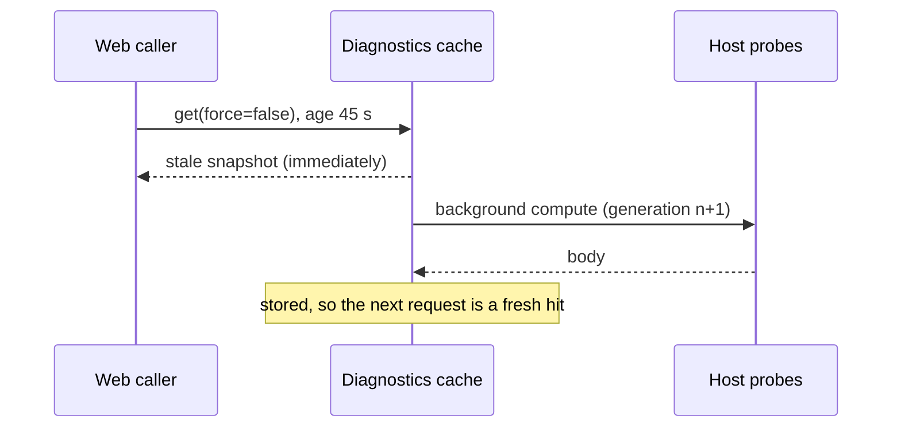
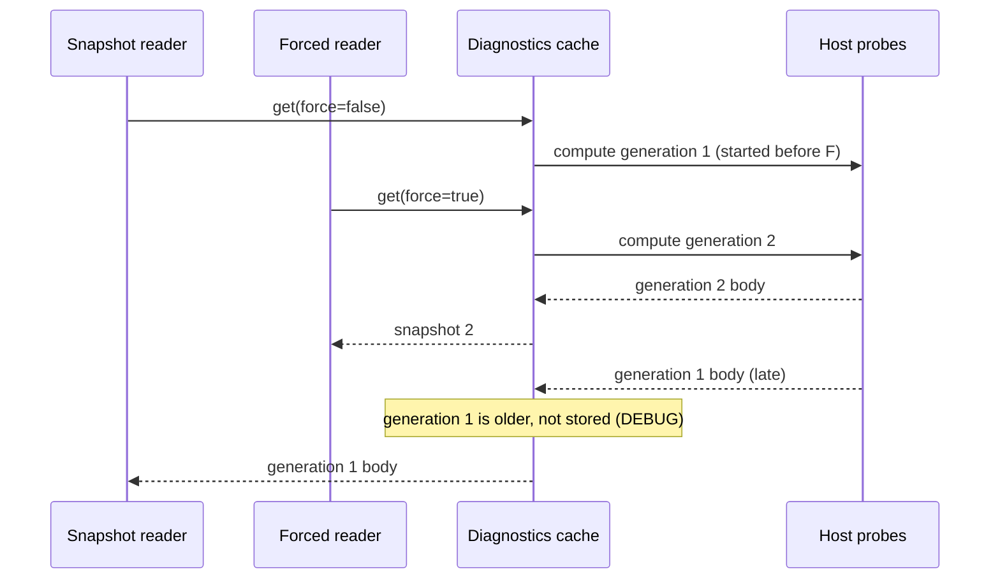
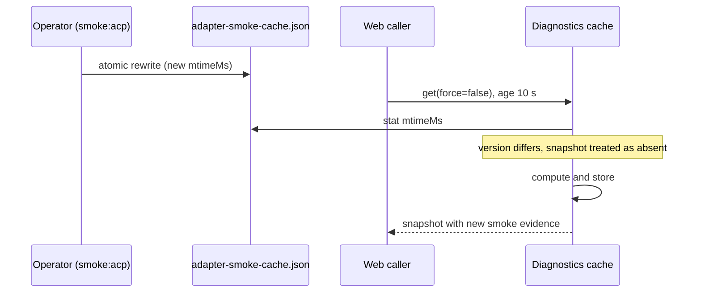
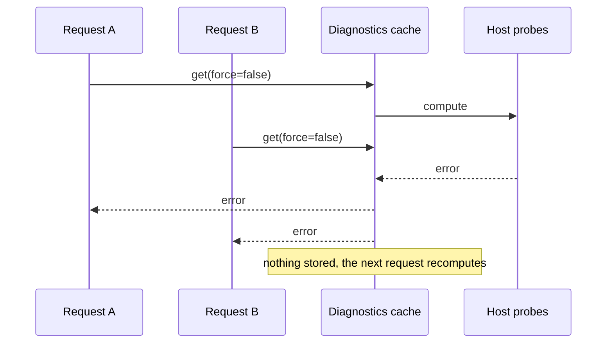

# Host diagnostics

> **Status: Implemented** — ADR-224
> ([record](../decisions/adr-224.md)).

## Purpose

This domain owns the read path of supervisor runtime diagnostics: how
`GET /diagnostics` turns host probes (adapter binaries on `PATH`, version
probes, the adapter smoke cache and env-ref presence) into one cached
snapshot, and which web callers accept that snapshot or demand a fresh compute.
It does not own the diagnostics body shape (see
[supervisor OpenAPI](../api/supervisor.openapi.yaml)), runner readiness
evaluation ([ACP runners](acp-runners.md)) or the smoke-cache writer
(`pnpm -C supervisor smoke:acp`, see [supervisor](../supervisor.md)).

## Domain entities

- **Snapshot** — the last successful diagnostics body plus its `startedAt`
  (probe start, exposed as `checkedAt`), its generation and the source version
  it was computed from. Process memory only; never persisted.
- **Generation** — a counter incremented when a compute starts. A result is
  stored only when its generation is newer than the stored snapshot's.
- **Source version** — the adapter smoke-cache file `mtimeMs`, or `null` when
  the file is absent. A snapshot computed from another version counts as
  absent.
- **In-flight compute** — at most one shared compute for non-forced readers;
  a forced reader may start its own.
- **Freshness class** — the caller's declared need: `snapshot` callers never
  send `refresh`; `fresh` callers always send `refresh: true`.

## State machine

The snapshot moves between these states; `Computing` overlays any of them while
a compute is in flight.

## Process flows

### Cold request (Implemented)

With no snapshot, the first request starts a compute and waits for it.

### Coalesced burst (Implemented)

Concurrent non-forced requests join the in-flight compute instead of probing
again.

### Stale-while-revalidate (Implemented)

A snapshot past its TTL but inside the stale window is served at once while one
background compute refreshes it.

### Forced refresh racing an older compute (Implemented)

A forced request never accepts a compute that started before it arrived, and a
late older result never replaces a newer snapshot.

### Smoke-cache rewrite (Implemented)

The smoke script rewrites the cache file; the next request sees a new source
version and recomputes even inside the TTL.

### Compute failure (Implemented)

A failure reaches every waiter and leaves the stored snapshot unchanged.

## Freshness classes

| Class | Call sites |
| ----- | ---------- |
| `snapshot` | `getPlatformDiagnostics` (app chrome layout), `web/lib/mcp/readiness-host.ts` |
| `fresh` (`refresh: true`) | `getFreshPlatformDiagnostics` (`/settings` default-runner reconcile), `web/app/api/admin/acp-runners/route.ts`, `web/app/api/admin/acp-runners/[runnerId]/route.ts`, `web/lib/flows/graph/runner-graph.ts`, `web/lib/services/runs.ts`, and the `checkDiagnostics` callbacks that feed `assertReadOnlySessionEvidence` / `assertReadOnlySessionCreateEvidence`: `web/lib/agents/launch.ts`, `web/lib/agents/company-agent-launch.ts`, `web/lib/agents/company-flow-launch.ts`, `web/lib/execution-host/client.ts`, `web/lib/execution-host/owned-session-create.ts` |

The `fresh` callers write runner readiness or record launch evidence, so they
must describe the host as it is now. The `snapshot` callers only display or
pre-check readiness.

## Expectations

- **DIAG-01:** A request within the TTL of a stored snapshot MUST spawn no process and MUST return the stored body unchanged.
- **DIAG-02:** At most one non-forced compute MUST be in flight; every non-forced request arriving meanwhile MUST join it.
- **DIAG-03:** A snapshot older than the TTL but inside the stale window MUST be returned immediately and MUST start exactly one background compute.
- **DIAG-04:** With no snapshot, or one older than the stale window, the request MUST await a compute.
- **DIAG-05:** A `refresh=1|true` request MUST NEVER return data from a compute that started before the request arrived.
- **DIAG-06:** A compute result MUST be stored only when its generation is newer than the stored snapshot's.
- **DIAG-07:** A smoke-cache `mtimeMs` that differs from the snapshot's source version MUST be treated as no snapshot.
- **DIAG-08:** A failed compute MUST NEVER be stored, MUST reject every request joined to it, and the next request MUST recompute.
- **DIAG-09:** `checkedAt` MUST equal the probe start time of the snapshot it describes.
- **DIAG-10:** Any `refresh` value other than one `1` or `true` MUST answer 409 `PRECONDITION` with `details.reason: "diagnostics_query_invalid"` and start no compute.
- **DIAG-11:** `fresh`-class callers MUST send `refresh: true` and `snapshot`-class callers MUST NEVER send it.
- **DIAG-12:** The snapshot MUST live in supervisor process memory only and MUST be empty after a restart.

## Edge cases

- **Supervisor unreachable** — the web client reports
  `SupervisorDiagnosticsStatus.kind = "unavailable"` unchanged; the
  `/settings` reconcile stays a no-op and preserves last-known readiness.
- **Background failure while serving stale** — the stale snapshot is still
  returned; the failure is logged at WARN and the next request past the TTL
  retries.
- **Smoke file deleted** — the source version becomes `null`, which differs
  from a stored numeric version, so the next request recomputes. Only a
  missing file is silent: any other `stat` failure is treated the same way and
  logged at WARN.
- **Clock regression** — a negative snapshot age is treated as expired, so the
  request awaits a compute.
- **Concurrent forced requests** — a forced request that arrives while a compute
  is in flight starts its own, because it must not join a compute that began
  before it arrived; forced requests that arrive together share the compute
  that starts after them. Admin and launch frequency bound the extra probes.
- **Invalid `refresh`** — `SupervisorError("PRECONDITION")` with
  `details.reason: "diagnostics_query_invalid"`, mapped to 409 by
  `httpStatusForCode`; see [error taxonomy](../error-taxonomy.md).

## Linked artifacts

- API: [supervisor OpenAPI `/diagnostics`](../api/supervisor.openapi.yaml),
  [supervisor prose](../supervisor.md).
- Decision: [ADR-224](../decisions/adr-224.md).
- Readiness writer: [ACP runners](acp-runners.md).
- Source: `supervisor/src/diagnostics-cache.ts`, `supervisor/src/http-api.ts`,
  `web/lib/supervisor-client.ts`, `web/lib/execution-host/client.ts`,
  `web/lib/execution-host/platform-status.ts`.
- Tests: `supervisor/src/__tests__/diagnostics-cache.test.ts`,
  `supervisor/src/__tests__/diagnostics-route.integration.test.ts`,
  `web/lib/execution-host/__tests__/diagnostics-freshness.test.ts`,
  `web/lib/__tests__/supervisor-client.test.ts`,
  `web/lib/execution-host/__tests__/diagnostics-steering-wire.integration.test.ts`.
