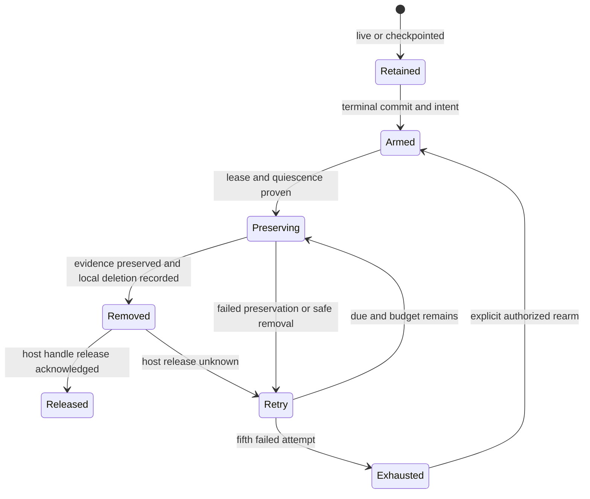
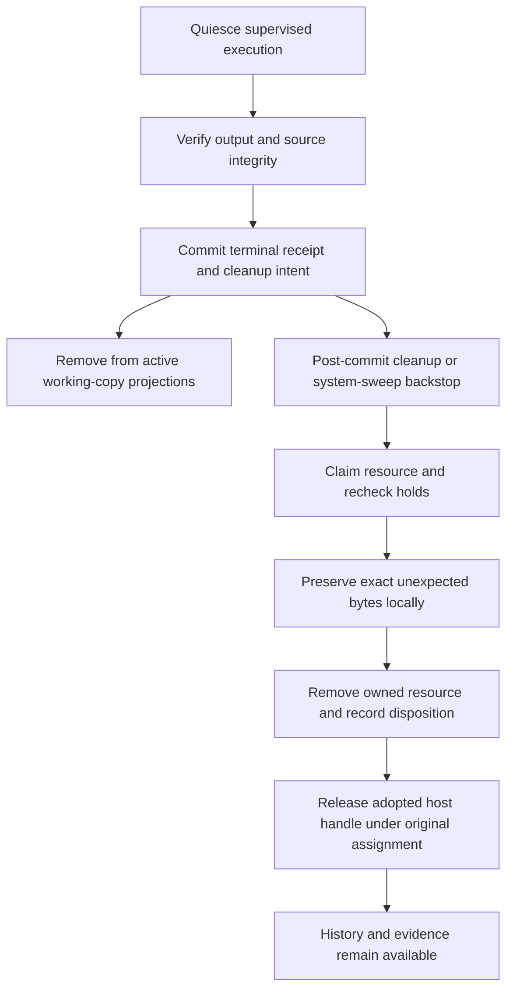

# Operational agent lifecycle

## Purpose

**Designed.** Own operational integrity, permission concurrency, resource disposition,
cleanup, retained evidence and actionable failure history. [Results](operational-agent-results.md)
owns business terminal mapping. This domain adds no new run status or tool approval.

## Domain entities

- Integrity baseline: platform-owned source/materialization content/type witnesses.
- Resource: owned worktree, plain none directory, detached read-only checkout, or shared-parent materialization.
- Cleanup intent: run-bound arming revision, due time, attempt budget and safe error.
- Lifecycle claim: existing workspace lease, or run-bound lease for rowless resources.
- Attention acknowledgement: per reader/run/reason/revision, independent of business state.
- Execution evidence: opaque runtime objects and protected host command receipts.

## State machine

Cleanup is independent of the committed business outcome.

## Process flows

The terminal owner and cleanup owner communicate through durable intent.

### Recovery and resource matrix

| Run state | Owned resource | Continuation / disposal |
| --- | --- | --- |
| Pending | allocation/preparation only | no cleanup while launch claim may win; failed allocation compensates its own resources |
| Running/NeedsInput | live session or business question | normal permission/question handling; no destructive cleanup |
| NeedsInputIdle or nonterminal host-pressure park | checkpoint and original contract | retain; request-bound continuation under existing admission cap |
| Done/Failed/Abandoned | owned worktree/plain/detached resource | verify quiescence, preserve unexpected bytes, dispose promptly |
| Crashed | owned resource | diagnostic hold until endedAt + gcAgeDays; then preserve/dispose unless command/recovery evidence holds remain |
| Any terminal | shared-parent repo_read | release only this run's leases/materialization/host handle; never reset/delete parent |
| Removed resource, release ACK missing | host handle only | retry original fenced teardown command; do not recreate cwd |

Terminal standalone Crashed has no graph Recover action. Diagnose and reconcile
receipts before an explicit new attempt; live re-observation/checkpoint continuation
is different. Retry never rewrites old history or blindly replays external effects.

### Integrity boundary

Before dispatch capture source HEAD/branch plus a protected baseline of exact
materialization paths, types, hashes/targets and prior ownership. Platform writes
append generation evidence under the existing ownership/run fences. Keep dynamic
runtime roots separate from immutable source. Home-redirect adapters use the server-derived managed sibling `<runId>-runtime`; the same cleanup intent owns its removal after quiescence. Cwd-based adapter files remain exact-hash materialization witnesses. Baselines live in manager-owned
metadata/opaque evidence, not agent-writable marker files.

After execution quiesces inspect history/HEAD (including commit-plus-revert), index,
tracked/untracked/ignored files, renamed paths and exact materialization contents.
No broad .claude/.maister path exclusion proves integrity. Unexpected/tampered bytes
are preserved before restore/delete; failed probes or limits fail closed and do not
prove misconduct. Only attributable source-contract violation quarantines the agent.
Shared-parent unrelated changes are conflict, never authority to reset the parent.
Use existing output/evidence caps; integrity traversal is capped at 100000 entries,
256 MiB hashed source/materialization bytes and 30s per probe; exceeding a cap is
indeterminate, not clean. Do not follow symlinks into foreign roots.

### Cleanup protocol

Every terminal/GC path first branches on frozen kind and resource ownership:
agent finalization, workspace GC, plain-directory GC, ephemeral-agent GC,
materialization GC and startup reconciliation. Worktrees keep the existing workspace
lifecycle claim. Rowless resources use a run-bound CAS lease; no fabricated branch
row or second competing worktree claim. Unknown ownership/orphan metadata preserves
bytes and records diagnostic refusal. Root validation and lease fencing precede
every destructive action. A resumed/live generation or protected command prevents it.

Preservation is local-only even when gcArchivePush is enabled. Git preservation
is supplemented by opaque evidence for ignored/binary/materialization bytes not
represented by its snapshot. Persist preservation evidence, remove locally,
record removal, then release the host workspace through its released assignment.
Unknown host liveness defers deletion; unknown release after deletion remains a
reconcilable command/cleanup state. Never set removedAt solely from a failed read.

Five attempts per arming; successive failure delays are 1m, 5m, 30m, 2h. Exhaustion
requires explicit re-arm. Renew long-operation leases and reject stale completion.
Durable keyset progress advances past held/missing/poison resources. Immediate
workspace cleanup cannot shorten endedAt + gcAgeDays runtime evidence retention;
existing stronger failure/command holds remain. Run/result/history rows are not GC'd.

### Human decisions and attention

Permissions retain run/session/request/option identity. One answered request cannot
settle another. Orphaned request persistence failure releases its deferred; ambiguous
delivery/ACK loss reconciles the same durable intent without cancellation or a
second answer. Checkpoint/reissue preserves original prompt provenance and SQL
supersession constraints. Normal business-question HITL remains separate and a
question answer never substitutes for required terminal output.

History distinguishes scheduler dispatch from business outcome. Terminal operational
rows leave every active-working-copy projection immediately, even while cleanup is
held/failed. Authorized diagnostic evidence reads remain, without delivery actions.
Attention reasons are operation_failure (terminal receipt revision 1) and
cleanup_failure (monotonic cleanup revision). Acknowledgement is per reader; it
does not hide another reader's item or alter outcome. New revisions reopen attention.
Re-arm compares the expected revision, persists its latest re-arm receipt and returns
202; identical latest retries do not reset budget again, older/different requests
conflict. Lifecycle mutations emit transactional content-free invalidation facts;
same-count reason replacement still refreshes UI, while notification count-delta
policy is unchanged. Acknowledgement is not general unseen activity.

## Expectations

- **OPL-01:** Every terminal operational run leaves all active-copy read models, enforced by one frozen-kind/disposition predicate while history remains queryable.
- **OPL-02:** Failed operations and cleanup failures have safe actionable history/attention, enforced by terminal/cleanup receipts and per-reader acknowledgement keys.
- **OPL-03:** Independent runs and parallel permission requests retain distinct decisions and normal HITL, enforced by request ownership, admission and delivery CAS/receipts.
- **OPL-04:** Unexpected source/materialization changes never become accepted or promoted output, enforced by protected baseline validation, preserved diagnostics and server delivery guards.
- **OPL-05:** Destructive cleanup acts only on quiescent owned resources after durable preservation, enforced by lifecycle/run leases, root guards and every cleaner's operational branch.
- **OPL-06:** Cancellation/crash/checkpoint/new-attempt paths follow the recovery table, enforced by terminal cause, original snapshot and nonterminal continuation owners.
- **OPL-07:** Workspace disposal does not shorten evidence lifetime, enforced by independent operational retention deadline and command/object holds.
- **OPL-08:** Cleanup has bounded intent-scoped retries, fair progress and live invalidation, enforced by durable attempts/cursor/fences and transactional lifecycle events.

## Edge cases

- **EDGE-OPL-01:** Two requests, two runs, out-of-order answers and checkpoint races preserve each request and pending state (`CONFLICT` for stale answers).
- **EDGE-OPL-02:** Lost input ACK reconciles original intent; only proven orphan/refusal releases a deferred, with no automatic allow (`ACP_PROTOCOL`/`EXECUTOR_UNAVAILABLE`).
- **EDGE-OPL-03:** Cancel/crash/finalization racers have one terminal winner; no late successful output overwrites failure/cancellation.
- **EDGE-OPL-04:** Ignored files, staged changes, commit-plus-revert, symlinks, forged ownership and probe limits cannot pass as clean (`PRECONDITION`/`CONFLICT`).
- **EDGE-OPL-05:** Before/after terminal, preserve/archive/delete/record/release crash windows each converge from durable facts without business replay.
- **EDGE-OPL-06:** Preservation failure, expired lease, poison rows and attempt exhaustion preserve bytes and remain actionable; no unchecked retry loop.
- **EDGE-OPL-07:** Immediate cleanup and global archive publication settings cannot remove evidence early or publish an operational archive.
- **EDGE-OPL-08:** Exact per-reader/revision ack, changed reasons and same-count replacement preserve queue/count/live-update fidelity and authorization.

## Linked artifacts

- [Definitions](operational-agents.md), [results](operational-agent-results.md), [traceability](operational-agents-traceability.md), [persistence](../db/operational-agents-domain.md).
- [Workspaces](workspaces.md), [reconciliation/GC](reconciliation-gc.md), [attention](attention.md), [execution runtime objects](execution-runtime-objects.md).
- Source seams: `web/lib/agents/`, `web/lib/gc/`, `web/lib/queries/`, `web/lib/execution-host/`.
