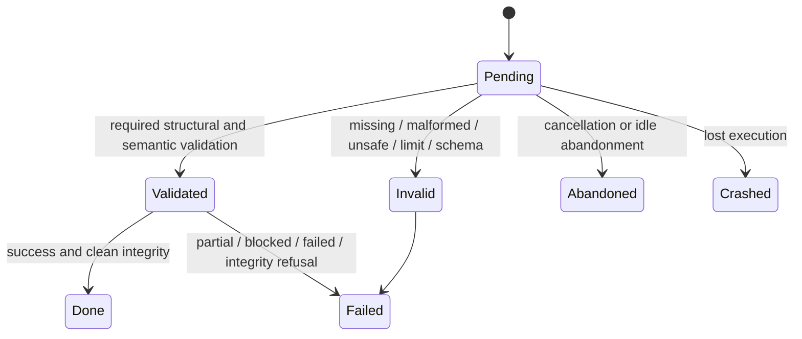
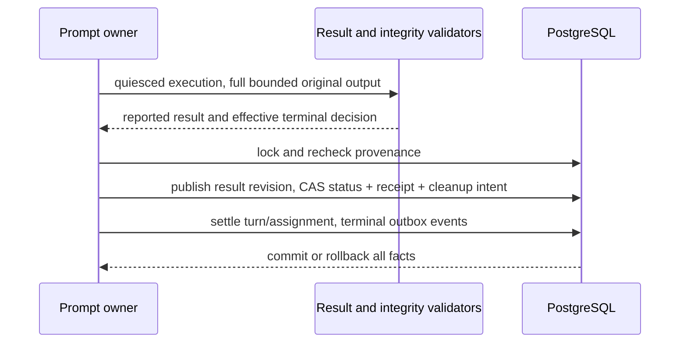

# Operational agent results

## Purpose

**Designed.** Own operational_v1 validation, reported versus effective outcome,
terminal mapping and diagnostic collection. [Definitions](operational-agents.md)
freeze the contract; [lifecycle](operational-agent-lifecycle.md) owns resource safety.

## Domain entities

- Reported value: one final `json maister:output` block using the existing bounded output transport.
- Result contract/revision: existing `runs.result_contract` and `run_results` ledger.
- Terminal receipt: immutable platform decision, integrity facts and evidence pointers.
- OperationalOutcome DTO: explicit diagnostic projection, never a second result ledger.

## State machine

Reported output cannot by itself select platform success.



## Process flows

All terminal facts commit under the existing run/provenance lock.



### Value schema and semantics

```json
{"schemaVersion":1,"outcome":"success","summary":"Complete scan; no new work.","coverage":{"state":"complete","remainingKnown":0},"counts":{"scanned":0,"attempted":0,"completed":0,"failed":0,"skipped":0,"created":0},"references":[],"diagnostics":[]}
```

The exact wire fields are specified in the web OpenAPI operational components.
Reuse FormSchema parsing, safe-key/depth/key/array and configured output byte caps;
add a closed operational semantic validator. Strings/arrays also have schema caps:
summary 2000 characters; references <=1000; diagnostics <=100; IDs <=512; URLs
<=2048; diagnostic code <=128, operation <=256, message/remediation <=2000.
Unknown fields refuse. References have kind task/external_issue/operation_receipt/
other, id, state confirmed/unresolved and optional URL. Diagnostics have code, severity warning/error,
operation, message, retryable, remediation and optional reference IDs/service/
HTTP status (100..599). URLs permit http/https only, with no embedded credentials.
Sensitive provider responses are sanitized before producing diagnostics.

Counts are distinct input work items, not HTTP calls; all are nonnegative safe
integers. attempted=completed+failed; attempted+skipped<=scanned; created<=attempted.
Creation can be confirmed before end-to-end completion: task creation followed by
receipt failure has scanned=1, attempted=1, completed=0, failed=1, skipped=0,
created=1 and partial outcome, with task and unresolved operation references.
Each counted creation requires a confirmed reference. Confirmed references can describe task creation or another external/platform object; the contract is not task-only. Unknown writes are not confirmed creations. References preserve reconciliation
receipts and every confirmed task identity; no invented remaining-work counts.

Coverage state is complete/incomplete/not_started; remainingKnown is null when
unknown, otherwise a nonnegative safe integer. Complete requires remainingKnown=0.
Success requires complete coverage, failed=0 and no error/unresolved-effect
diagnostic. Partial requires confirmed progress (completed/created/confirmed receipt)
and an error/incomplete remainder; receipt progress requires an explicitly confirmed
reference, never merely a pending marker. Blocked/failed require an error diagnostic with
remediation; unknown writes without confirmed progress are blocked. A partial scan
with unknown remaining size remains incomplete/null. A zero-item full scan succeeds.

### Terminal and read contract

| Cause | Status | Effective outcome / collection |
| --- | --- | --- |
| Valid reported success + clean integrity | Done | success, successful=true |
| Valid partial/blocked/failed | Failed | same outcome, successful=false, validated diagnostics readable |
| Invalid/missing result or integrity refusal | Failed | failed, classified reason; unvalidated payload never served |
| Cancel/idle expiry | Abandoned | cancelled, successful=false; confirmed effects remain evidence |
| Lost execution | Crashed | crashed, successful=false; diagnose/reconcile/new attempt |
| Cleanup failure | unchanged | separate cleanup diagnostic, no rewrite of terminal business fact |

`operational_terminal` stores platform metadata only: version, status/cause,
effectiveOutcome, successful, resultRevision, integrity verdict/baseline/evidence
references and reason codes. It is not copied reported output. Within one locked
transaction publish the result first, then CAS status/receipt/cleanup intent in
one UPDATE (immediate CHECKs apply), then settle owners and emit events. A loss or
error rolls back every write. Cleanup is post-commit. `operationalOutcome` joins
the receipt to the exact validated revision after workspace removal. Failed keeps
ordinary resultStatus=unavailable/result=null; diagnostic availability never makes
a failed code-delivery result usable. Live operations expose pending, not success.

## Expectations

- **OPR-01:** Valid complete success, including zero new tasks, becomes Done without promotion/merge/publication, enforced by terminal classification and delivery guards.
- **OPR-02:** The fixed versioned schema validates counts, coverage, references, limits and actionable diagnostics, enforced by structural plus semantic validation before terminal CAS.
- **OPR-03:** Existing statuses and exactly one effective terminal outcome are used, enforced by run/provenance lock, CAS and terminal/outbox transaction with parent wake and slot release.
- **OPR-04:** Failure diagnostics and platform integrity verdict survive cleanup without becoming successful answers, enforced by immutable terminal receipt and shared DTO/collect projection.

## Edge cases

- **EDGE-OPR-01:** Confirmed creation followed by receipt failure is partial, never erased by created<=completed arithmetic; unknown effects require reconciliation before retry.
- **EDGE-OPR-02:** Missing/malformed/oversize/unsafe output records classified failure and preserves original execution evidence; process exit/prose cannot replace it.
- **EDGE-OPR-03:** Negative/fractional/unsafe counts, contradictory coverage/outcomes, invalid links or absent remediation refuse; unknown remaining size is null, not fabricated zero.

## Linked artifacts

- [Lifecycle](operational-agent-lifecycle.md), [traceability](operational-agents-traceability.md), [persistence](../db/operational-agents-domain.md).
- [Web OpenAPI](../api/web.openapi.yaml), [external operations](../api/external/operations.openapi.yaml).
- Source seams: `web/lib/run-results/`, `web/lib/agents/finalization.ts`, `web/lib/agents/prompt-owner.ts`, `web/lib/runs/run-result-dto.ts`.
