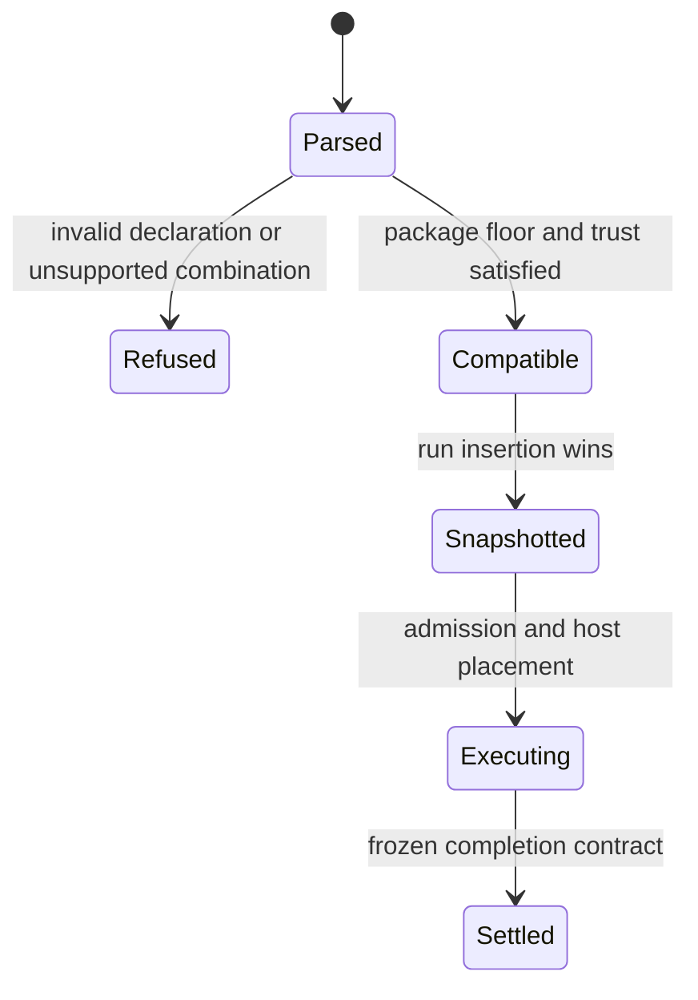
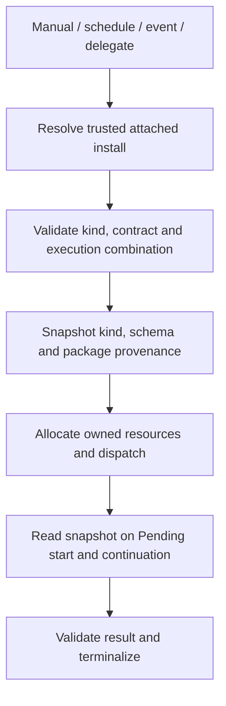

# Operational agents

## Purpose

**Designed.** Define agents whose deliverable is an external or MAIster operation
and its evidence. This domain owns definition/compatibility/launch semantics;
[results](operational-agent-results.md) and [lifecycle](operational-agent-lifecycle.md)
own terminal decisions and resources. See [ADR-194](../decisions/adr-194.md).

## Domain entities

- Definition: `kind`, `mode`, `workspace`, `completion` and independent execution policy.
- Effective agent: the trusted project-attached package definition.
- Launch contract: immutable run kind, result schema/version/digest and provenance.
- Package compatibility: declared engine interval, including packages with no flows.
- Catalog projection: mutable authoring/index state, never existing-run truth.

## State machine

Definition validation precedes launch allocation.



## Process flows

The same resolver serves every launch origin.



### Definition contract

```yaml
kind: operational
mode: session
workspace: worktree
completion:
  contract: operational_v1
```

Omitted kind resolves to code_delivery; its existing workspace/review/promotion
semantics are unchanged. Operational requires exactly operational_v1. Operational
subagent/persona-only binding, `flow:`, persistent session, shared writable
workspace and delegated resultProfile override are refused before allocation.
Independent finite delegated sessions remain supported with their own workspace.
`none` and `repo_read` retain their read-only tool restrictions; kind does not
make shell available in those modes. Both intake variants keep worktree/session.

Package `compat.engine_min` must be >=3.9.0 for operational declarations. Optional
engine_max is inclusive. Absent compat on legacy packages retains current behavior.
An older strict package parser refuses the new package floor. Remote/local install,
attach/update, Studio validation, registry projection, compatibility CLI and
effective launch enforce the same operational declaration. Unknown contracts fail.

Snapshot kind, exact schema, semantic-validator version, schemaRef/digest,
required=true, package install/revision and definition digest in the initial run
transaction. Built-in schemaRef is `maister:operational_v1@<sha256>`. Prompts always
include the frozen completion appendix, including overridePrompt, queued start and
resume. Package update/detach/resync cannot replace these facts. Legacy null run
kind means code_delivery; it never triggers operational reclassification.

## Expectations

- **OPA-01:** The definition parser, registry and Studio preserve kind independently of mode/workspace/completion and symmetrically handle SET, CLEAR and re-SET.
- **OPA-02:** Legacy/null/omitted kind retains existing Review/promotion/result behavior, enforced by default resolution and code-delivery integration regression.
- **OPA-03:** Permission policy, token scopes, isolation and admission remain independent of kind, enforced at existing launch/host/HITL gates.
- **OPA-04:** All dispatch, prompt, continuation and terminal readers use the immutable admitted run contract, enforced by DB mutation guards and queued/update/resume tests.
- **OPA-05:** Both GitHub intake definitions and their shared skill declare/emit operational_v1, enforced by exact-package compatibility and adopter qualification.
- **OPA-06:** Authoring, API/MCP projections, package compatibility and EN/RU copy agree, enforced by shared parsing, contract parity and browser acceptance.
- **OPA-07:** Fresh/incremental migrations preserve historical runs and reject contradictory new state, enforced by named constraints and seeded PostgreSQL upgrade tests.

## Edge cases

- **EDGE-OPA-01:** Package mutation while Pending/parked does not change snapshot or prompt appendix; the frozen-reader test enforces this boundary (`CONFLICT` on attempted mutation).
- **EDGE-OPA-02:** Unsupported mode/binding/profile/contract refuses before allocation or remote effect (`CONFIG`/`PRECONDITION`).
- **EDGE-OPA-03:** Existing attachments, schedules, results, HITL and execution commands survive upgrade; no agent-ID backfill is permitted.
- **EDGE-OPA-04:** A zero-flow package still validates every agent and its engine floor; removing declaration fields resets the projection, never leaves stale semantics (`CONFIG`).

## Linked artifacts

- [Results](operational-agent-results.md), [lifecycle](operational-agent-lifecycle.md), [traceability](operational-agents-traceability.md).
- [Agent ERD](../db/agents-domain.md), [operational persistence](../db/operational-agents-domain.md).
- Source seams: `web/lib/agents/definition.ts`, `effective.ts`, `registry.ts`, `launch.ts` and `web/scripts/validate-package-compatibility.ts`.
