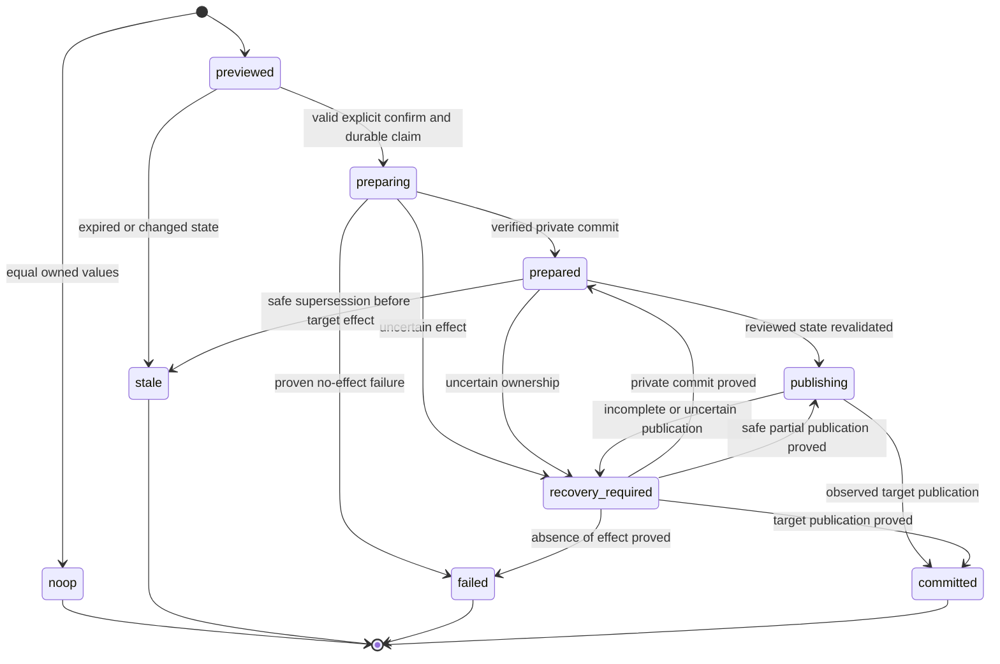
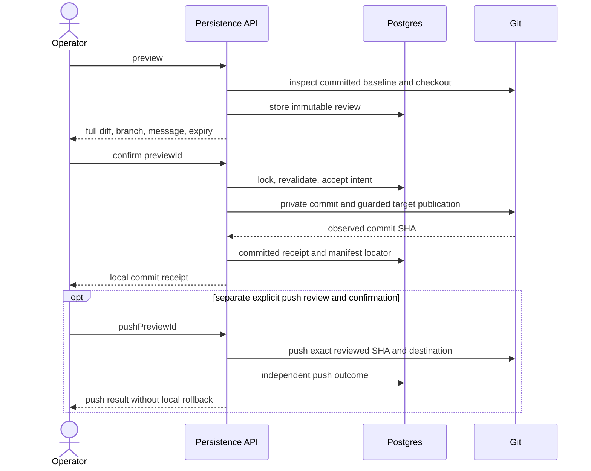

# Project configuration persistence

## Purpose

(Designed) Separate runtime application of project configuration from explicit,
reviewed repository persistence. This domain owns export status, review intent,
local commit publication, recovery and separate optional push. Registration and
runtime package/runner behavior keep their existing domain owners.

## Domain entities

- Project export projection and monotonic revision.
- Immutable configuration review / persistence operation and observed SHA receipt.
- Operation-owned private Git worktree/ref; never another configuration source.
- Separate immutable push intent and destination/outgoing-range review.
- See the [project ERD](../db/projects-domain.md) for storage ownership.

## State machine

The commit operation admits only the transitions shown; uncertain effects are
inspected before reentry, terminal outcomes replay without another effect.

## Process flows

A local commit is independent of any later push result.

## Publication protocol (Designed)

The target is the checked-out configured main branch. Preview performs no
repository write and no remote call. Git inspection disables optional index
refresh writes. A scalar status is observed or explicitly cached/unverified.

1. Acquire the canonical-common-directory repository fence and re-read the
   actor, project export revision, HEAD, source blob, index entries and status.
   Persist accepted intent before creating operation-owned private material.
2. Create a private linked worktree outside the tracked repository. For an
   unborn target, create a private empty root scaffolding commit; amend it with
   the real reviewed commit, resetting author identity. The scaffold never
   becomes a target ancestor. Normal commit hooks and signing apply to the
   reviewed commit. Verify its parent, complete path set, mode, bytes and message.
3. Anchor the prepared commit under `refs/maister/config-persist/<id>` and
   record its SHA. Recovery may also inspect the recorded private worktree HEAD
   if death preceded ref/DB acknowledgement. Never manufacture another commit
   before resolving that evidence.
4. Start `git update-ref --stdin`: `start`, conditional `update HEAD <new>
   <old>` (or `create HEAD <new>` on unborn HEAD), then `prepare`. Git holds
   HEAD and referent locks. Re-read symbolic HEAD after prepare; abort unless it
   is exactly the reviewed main-branch ref. The redundant `symref-verify HEAD`
   transaction command is not used because Git rejects overlapping HEAD updates.
5. Under the prepared ref transaction, recheck the canonical index/worktree and
   project revision. Run Git's guarded `read-tree -m -u <old-tree> <new-commit>`;
   an unborn baseline uses the empty tree. Never rename over a user file or use
   reset/stash/discard. Commit the prepared ref transaction only after successful
   tree publication; read back actual ref/blob and record the committed receipt.
6. Git and Postgres are separate stores. If interruption leaves the old ref with
   the operation's new index/file, complete forward only after proving all
   relevant state is exactly the stored old/new state. Unknown bytes, locks,
   ownership or a read failure means recovery_required, never overwrite/rollback.
   Once the ref advanced, finalization repairs DB metadata without another commit.

Git 2.54.0 local mechanical checks prove prepared HEAD/referent locking,
concurrent symbolic-HEAD refusal and clean publication for born/unborn targets.
These are design evidence, not feature acceptance. Implementation tests own
all interruption/race windows. The unborn scaffold+amend avoids a dependency
on newer `git worktree add --orphan`; no deployment Git upgrade is required.

## Lock and recovery contract (Designed)

Lock order is repository, project, operation. An exclusive ownership directory
under the canonical common Git directory fences all managed parent-repository
mutators without introducing database access into standalone Git helpers. A
short transaction locks the project row, rechecks the export revision and accepts
the durable active intent. Its trigger refuses concurrent export mutations until
completion or recovery. Git runs outside database transactions. The ownership
directory and active intent survive connection/process loss; neither expires.
Recovery may adopt only its own fence after proving the recorded process dead.
Unknown ownership or a still-live process requires explicit recovery guidance.

Each Git mutation starts behind an IPC gate. The host records its detached
process group in the fence before permitting Git to start. Owner death before
permission starts no Git command; owner death afterwards retains the group as
recovery evidence. Recovery refuses while any recorded group has a live member,
including orphaned hooks. Exited zombie members cannot issue effects. The
supported Linux/macOS process-table inspection uses `ps`; the container already
ships `procps`. Unreadable process evidence fails closed. Commands have bounded
execution and terminate their owned group on timeout.

GET status/receipt and new preview never advance earlier operations. Explicit
recover and a one-shot post-migration startup pass inspect accepted intents;
startup never commits an unused/expired preview or starts a push. Archive or
authority revocation blocks new Git effects; completed effects still reconcile.
Recovery uses keyset progress and isolates poison records without inventing a
terminal result from failed reads. No new watcher, polling loop or scheduler job.

## Wire and storage bounds (Designed)

Manifest limit is 1 MiB UTF-8; complete diff limit is 2 MiB; preview lifetime is
10 minutes. Never issue a confirmable truncated review. Revisions are decimal
strings on the wire. Git commands use a 30-second bounded execution window;
remote read-only inspection has at most three attempts with 250/1000 ms delays
and warnings. A potentially successful Git mutation is inspected before retry.

Commit states are previewed, preparing, prepared, publishing, committed, noop,
stale, failed, recovery_required. Active uniqueness covers preparing, prepared,
publishing and recovery_required. Terminal outcomes replay without effects.
Push intents have previewed, pending, succeeded, failed, unknown, stale states;
pending/unknown exclude another push intent for that parent/destination. Failed
push does not occupy the local commit slot. A fresh confirmed push review starts
a new attempt after known failure; unknown acknowledgement is reconciled first.

The exact DTO/schema tables live in OpenAPI and the project ERD/narrative.
The operation and push-intent snapshots are immutable and content-digest guarded.
FKs restrict destruction of retained evidence. Empty expired previews can be
pruned; nonterminal operations cannot. Committed receipts are retained with the
project; cleanup removes only proven operation-owned private material.

Scalar status may include the current actor's operation locator so an interrupted
save remains discoverable after reload. It never includes another actor's locator
or source content; the receipt route rechecks both stronger permissions. An active
own intent takes precedence over the latest own terminal receipt.

A no-op review records a terminal no-op and may repair a null manifest locator to
the proven committed root manifest under a short revision-checked transaction.
It changes no exportable/runtime setting, file, index, ref or commit. This keeps
legacy null-path readers usable when an operator already committed matching YAML
outside MAIster; path repair never becomes persistence-status authority.

## Expectations

- **CPC-01:** (Designed) Each successful package/runner change affects the intended runtime rows and advances export revision as specified; complete tracked/untracked manifest state, index and HEAD fingerprints are unchanged. DB-only edits neither write YAML nor falsely mark exported values different. Enforced by T2.1, T7.1 and IT-CPC-01 parameter table; see [traceability](project-config-persistence-traceability.md).
- **CPC-02:** (Designed) First save, existing-manifest update and repeated save use the permanent action; a confirmed change yields exactly one reviewed manifest-only commit/receipt, and a semantic no-op yields zero commits/writes. Enforced by T4.1, T6.1, T9.1 and IT-CPC-02; E2E-CPC-02 for durable entry wiring; see [traceability](project-config-persistence-traceability.md).
- **CPC-03:** (Designed) Fresh detail status compares normalized DB projection with target-branch committed content, independent of path presence; missing, pending, in-sync, blocked and cached/unverified remain distinguishable. Enforced by T3.1, T9.1 and IT-CPC-03; E2E-CPC-03 for last-observed presentation; see [traceability](project-config-persistence-traceability.md).
- **CPC-04:** (Designed) Before any effect the full diff, target branch, exact message and author policy are displayed; actual committed parent/blob/mode/path-set/message equal the approved review. Cancel/no-op/oversize never issue a commit. Enforced by T3.1, T4.1, T6.1, T9.1 and IT-CPC-04; E2E-CPC-04 for review-before-submit; see [traceability](project-config-persistence-traceability.md).
- **CPC-05:** (Designed) Save issues no remote request. Separate push confirmation binds destination, range and recorded SHA; rejection leaves the local commit and DB receipt intact and retry does not recommit or push later commits. Enforced by T2.1, T6.1, T9.1 and IT-CPC-05 with local bare remote; see [traceability](project-config-persistence-traceability.md).
- **CPC-06:** (Designed) Attach, detach, upgrade, downgrade, initial creation, and SET/CLEAR/SET through both runner APIs all pass the same mutation/export contract; no package member becomes a duplicate standalone flow. Enforced by T3.1, T7.1, T8.1 and IT-CPC-01 and IT-CPC-02, shared rather than duplicated; see [traceability](project-config-persistence-traceability.md).
- **CPC-07:** (Designed) Rich source fixture retains unrelated source bytes/comments, standalone flows/runner, every capability array, imports/trust, roles and promotion.remote; patch only owned leaves; malformed/unsupported structures refuse without effects. Enforced by T3.1 and IT-CPC-07 preservation/refusal table; see [traceability](project-config-persistence-traceability.md).
- **CPC-08:** (Designed) Dirty/staged/untracked/ignored target collisions and unsupported layouts refuse; before/after bytes, refs and full index fingerprint are identical. A final-seam concurrent edit/stage cannot enter the commit or be overwritten. Enforced by T4.1, T14.1 and IT-CPC-08 guarded-seam table; see [traceability](project-config-persistence-traceability.md).
- **CPC-09:** (Designed) Every bound DB/repository change, including exportable SET→CLEAR→SET, requires a fresh preview. Same accepted intent has one effect; changed payload/foreign identity is refused. A harmless Git index refresh with unchanged entries is not falsely treated as a user edit. Enforced by T2.1, T4.1, T6.1, T14.1 and IT-CPC-09 stale/idempotency/authorization table; see [traceability](project-config-persistence-traceability.md).
- **CPC-10:** (Designed) Each enumerated DB/FS/Git/push interruption reaches a specified outcome, releases or conservatively retains its fence, and has a tested retry/recovery path. No duplicate commit, reset, unrelated cleanup, or rollback of successful local commit occurs. Enforced by T2.1, T4.1, T5.1, T6.1, T14.1 and IT-CPC-10 process/DB-loss table; IT-CPC-05 for push windows; see [traceability](project-config-persistence-traceability.md).
- **CPC-11:** (Designed) Registration modes, source validation, owner/task-key defaults, package trust/pins and in-flight snapshots remain correct. Missing-manifest registration adds no file; existing-source bootstrap still materializes the same pins; actual launch observes the selected DB runner. Enforced by T7.1, T8.1 and IT-CPC-11 registration/execution table; retained owning pin/launch regressions; see [traceability](project-config-persistence-traceability.md).
- **CPC-12:** (Designed) EN/RU wiring, methods/bodies/errors, applied migration/trigger behavior and analytics match the frozen contract; every acceptance/edge has one primary runnable test and all required suites pass without hidden omissions. Enforced by T1.1, T13.1, T10.1, T2.1–T9.1, T11.1, T12.1, T14.1 and CT-CPC-12 contract/schema gate plus the owning IT/E2E reports; see [traceability](project-config-persistence-traceability.md).

## Edge cases

- **EDGE-CPC-01:** Omitted defaults versus explicit defaults; null/default runner and promotion SET/CLEAR/SET; clear package path; reordered mapping and semantically equal package order; no normalization-only commit. Owner: IT-CPC-03/07; T3.1. Refusal uses CONFIG/PRECONDITION/CONFLICT or explicit EXECUTOR_UNAVAILABLE; exact wire outcomes are in [OpenAPI](../api/web.openapi.yaml).
- **EDGE-CPC-02:** All four package actions; both runner routes; DB-only mutation; missing install consistency refusal; no package-member duplication; failed runtime mutation does not advance committed config state. Owner: IT-CPC-01; T2.1/T7.1. Refusal uses CONFIG/PRECONDITION/CONFLICT or explicit EXECUTOR_UNAVAILABLE; exact wire outcomes are in [OpenAPI](../api/web.openapi.yaml).
- **EDGE-CPC-03:** Leading/inline/deleted-entry comments, standalone runner/flows, all eight capability arrays, import trust, roles, promotion.remote, unknown siblings, aliases/merge/duplicate keys; safe patch or explicit refusal. Owner: IT-CPC-07; T3.1. Refusal uses CONFIG/PRECONDITION/CONFLICT or explicit EXECUTOR_UNAVAILABLE; exact wire outcomes are in [OpenAPI](../api/web.openapi.yaml).
- **EDGE-CPC-04:** Dirty/staged manifest and unrelated paths; untracked/ignored manifest; staged deletion/rename; user edit/stage at final publication seam; byte/ref/index nonmutation on refusal. Owner: IT-CPC-08; T4.1/T14.1. Refusal uses CONFIG/PRECONDITION/CONFLICT or explicit EXECUTOR_UNAVAILABLE; exact wire outcomes are in [OpenAPI](../api/web.openapi.yaml).
- **EDGE-CPC-05:** Wrong/detached/unborn branch; moved target ref; changed source blob/mode; active merge/rebase/cherry-pick/revert/bisect; symlink/nonregular target; sparse/skip-worktree/unsupported Git format/layout; non-ENOENT read errors. Owner: IT-CPC-08/09; T3.1/T4.1. Refusal uses CONFIG/PRECONDITION/CONFLICT or explicit EXECUTOR_UNAVAILABLE; exact wire outcomes are in [OpenAPI](../api/web.openapi.yaml).
- **EDGE-CPC-06:** Stale DB revision including change-and-reversal; stale index entries/flags, not stat-only refresh; changed author/message policy; expired review; external committed change/pull versus local dirty file; cached last-observed display. Owner: IT-CPC-09/03; T2.1/T3.1/T9.1. Refusal uses CONFIG/PRECONDITION/CONFLICT or explicit EXECUTOR_UNAVAILABLE; exact wire outcomes are in [OpenAPI](../api/web.openapi.yaml).
- **EDGE-CPC-07:** Same accepted ID/same content, same ID/different content, two confirmations and two different reviews; later HEAD advancement; no-op receipt replay; terminal failure replay requires new review for a new attempt. Owner: IT-CPC-09/02; T2.1/T4.1/T6.1. Refusal uses CONFIG/PRECONDITION/CONFLICT or explicit EXECUTOR_UNAVAILABLE; exact wire outcomes are in [OpenAPI](../api/web.openapi.yaml).
- **EDGE-CPC-08:** Unauthenticated/inactive/unauthorized actor; positive owner/admin; foreign project/principal IDs; malformed/unknown fields; archive/revocation between preview, confirm and recovery; no content disclosure through scalar status/logs. Owner: IT-CPC-09 and actual-response schema samples; T6.1. Refusal uses CONFIG/PRECONDITION/CONFLICT or explicit EXECUTOR_UNAVAILABLE; exact wire outcomes are in [OpenAPI](../api/web.openapi.yaml).
- **EDGE-CPC-09:** Upgrade and clean install; preserved legacy null/non-null paths and project/attachment data; semantic trigger bump/no-op/rollback; illegal state/receipt mutation; active uniqueness; pending-evidence deletion refusal. Owner: CT-CPC-12 migration portion; T2.1. Refusal uses CONFIG/PRECONDITION/CONFLICT or explicit EXECUTOR_UNAVAILABLE; exact wire outcomes are in [OpenAPI](../api/web.openapi.yaml).
- **EDGE-CPC-10:** Confirm versus package/runner transaction, pull/promotion/FF, unrelated repo progress; canonical-path aliases; DB lock-connection death while Git child is live; duplicate startup/explicit recovery owners. Owner: IT-CPC-10 concurrency portion; T14.1/T4.1. Refusal uses CONFIG/PRECONDITION/CONFLICT or explicit EXECUTOR_UNAVAILABLE; exact wire outcomes are in [OpenAPI](../api/web.openapi.yaml).
- **EDGE-CPC-11:** Death after accepted intent, private write, commit before private-ref/DB acknowledgement, prepared receipt; failed hook/signing/default author; no duplicate SHA or user-index contamination. Owner: IT-CPC-10 preparation portion; T4.1. Refusal uses CONFIG/PRECONDITION/CONFLICT or explicit EXECUTOR_UNAVAILABLE; exact wire outcomes are in [OpenAPI](../api/web.openapi.yaml).
- **EDGE-CPC-12:** Every specified target ref/index/worktree update window; post-publication DB failure; user edits before recovery; target advanced/reset; ambiguous effect, stale owner and unknown lock; cleanup failure after success. Owner: IT-CPC-10 publication portion; T4.1. Refusal uses CONFIG/PRECONDITION/CONFLICT or explicit EXECUTOR_UNAVAILABLE; exact wire outcomes are in [OpenAPI](../api/web.openapi.yaml).
- **EDGE-CPC-13:** Push off/success/auth/network/non-FF failure; changed origin/destination/remote base/range; later local commit excluded; known-failed retry via fresh push review; lost ACK/DB receipt; next local save despite failed/unknown push. Owner: IT-CPC-05; T6.1. Refusal uses CONFIG/PRECONDITION/CONFLICT or explicit EXECUTOR_UNAVAILABLE; exact wire outcomes are in [OpenAPI](../api/web.openapi.yaml).
- **EDGE-CPC-14:** GET status/receipt and new preview cause no Git/FS/recovery writes; recover cannot accept unused preview or authorize push; startup skips unconfirmed reviews, handles accepted intent only and issues no push. Owner: IT-CPC-10/09; T4.1/T6.1. Refusal uses CONFIG/PRECONDITION/CONFLICT or explicit EXECUTOR_UNAVAILABLE; exact wire outcomes are in [OpenAPI](../api/web.openapi.yaml).
- **EDGE-CPC-15:** Expired unused preview versus accepted/prepared/published operation; explicit stale prepared-operation replacement versus unresolved publication fence; retention/prune only owned terminal artifacts; poison recovery row cannot starve next row. Owner: IT-CPC-10; T2.1/T4.1/T5.1. Refusal uses CONFIG/PRECONDITION/CONFLICT or explicit EXECUTOR_UNAVAILABLE; exact wire outcomes are in [OpenAPI](../api/web.openapi.yaml).
- **EDGE-CPC-16:** Clone/local/new-empty with absent manifest; present-invalid refusal; naming/task-key/default-branch precedence; deferred git-init/compensation; existing package bootstrap and null-path CLI read handling. Owner: IT-CPC-11; T8.1. Refusal uses CONFIG/PRECONDITION/CONFLICT or explicit EXECUTOR_UNAVAILABLE; exact wire outcomes are in [OpenAPI](../api/web.openapi.yaml).
- **EDGE-CPC-17:** Launch with runtime settings before first save and after each version/runner change; actual resolved runner/pin provenance; existing in-flight snapshot unchanged; persistence performs no install/trust/setup/import. Owner: IT-CPC-11 plus existing launch/pin owners; T7.1/T8.1. Refusal uses CONFIG/PRECONDITION/CONFLICT or explicit EXECUTOR_UNAVAILABLE; exact wire outcomes are in [OpenAPI](../api/web.openapi.yaml).
- **EDGE-CPC-18:** Real Studio cut's deleted temporary source, mutable local directory changed since attachment, unsupported coordinate, supported source's attached revision match; no guessed/omitted source. Owner: IT-CPC-07 local-coordinate portion; T3.1. Refusal uses CONFIG/PRECONDITION/CONFLICT or explicit EXECUTOR_UNAVAILABLE; exact wire outcomes are in [OpenAPI](../api/web.openapi.yaml).
- **EDGE-CPC-19:** Exact full-diff byte/size boundaries; UTF-8/newline/mode preservation; empty or malformed bodies; broken filesystem/Git/DB/remote reads produce explicit unavailable/refusal rather than absence/no-op. Owner: IT-CPC-04/07 plus actual-response schema samples; T3.1/T6.1. Refusal uses CONFIG/PRECONDITION/CONFLICT or explicit EXECUTOR_UNAVAILABLE; exact wire outcomes are in [OpenAPI](../api/web.openapi.yaml).
- **EDGE-CPC-20:** EN/RU parity; cancel before confirm; busy double-submit/Escape/backdrop; timeout then reopen same receipt; focus restore; no-op; banner dismissal; repeated durable action; separate push review and local-success/push-failure feedback. Owner: E2E-CPC-02/03/04; T9.1. Refusal uses CONFIG/PRECONDITION/CONFLICT or explicit EXECUTOR_UNAVAILABLE; exact wire outcomes are in [OpenAPI](../api/web.openapi.yaml).

## Linked artifacts

- [ADR-194](../decisions/adr-194.md)
- [Feature SDD](../../.ai-factory/specs/project-config-git-workflow.md)
- [Traceability](project-config-persistence-traceability.md)
- [Configuration](../configuration.md), [projects](projects.md), [Git](git-integration.md)
- Existing service: `web/lib/persist-config.ts`; proposed internals:
  `web/lib/project-config-persistence/`.
