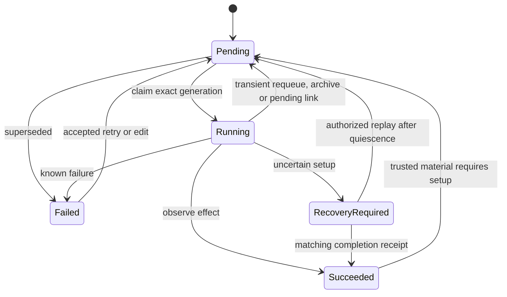
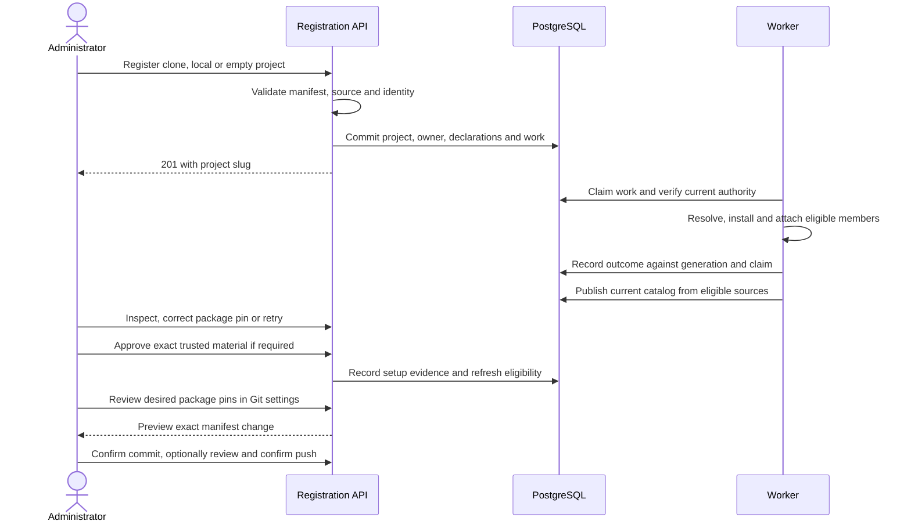

# Project dependency installation

**Status:** Implemented (ADR-218).

## Purpose

Registration accepts a repository after source preparation and validation. Each declared package, standalone Flow and capability import has an independent installation outcome. The project owner can use the project while dependencies are being installed.

## Domain entities

- A declaration identifies a desired dependency by project, kind and logical manifest ID. Its immutable generation contains its coordinates, ordinal and kind-specific settings. A package pin can be edited before its first successful resolution.
- An attempt belongs to one declaration generation. It records the authorizing actor, lease, stage, resolved material, outcome and actionable diagnostic. Migrated attachments have an effective revision and no synthetic attempt.
- Managed local packages, Flows and capabilities resolve from one private snapshot. The existing byte digest identifies local package and Flow revisions, and standalone capabilities retain their path-based revision. A separate layout digest records directory entries, regular-file executable bits and relative symlink targets. Each link must resolve inside the material being copied. The installer verifies source-owned files on cache reuse, allowing generated Flow and capability setup output. It upgrades historical seals after this verification. Package roots have no setup output: manual attach, upgrade and checkpoint recovery verify the whole root, including packages containing only agents. A pre-witness local install retains its original content-revision check; a pre-witness remote source must resolve to its recorded revision.
- The effective attachment and its members retain the runtime trust, setup and enablement decisions. Only eligible material may be used for a new run. Existing runs retain their snapshots.

## States

A worker persists intent before external effects. Lease renewal, publication and settlement require an unexpired claim measured by the database clock. The worker rechecks the authorizing account after fetch and checks its claim after waiting for the physical cache lock, before publishing staged material. Only safe, bounded transient failures are requeued automatically.

## Process flows

Repository acceptance precedes every external dependency install.

## Expectations

These acceptance criteria cover registration, dependency realization, recovery and reviewed publication.

| ID | Observable acceptance | Primary owner |
| --- | --- | --- |
| AC01 | With the worker held before fetch, clone/existing/new registration accepts a valid project. A mixed manifest produces exactly one owner, the three typed declarations and no installer invocation on the registration stack. A missing manifest yields zero items. A valid manifest containing only inline capabilities projects them without waiting for a worker item. Bad YAML, source, credentials or identifier collision retains its documented response and ownership-aware cleanup. | Registration route/clone integration suites, with both legal and illegal cross-kind IDs. |
| AC02 | A populated upgrade preserves each existing attachment, its coordinates and reviewed Git state, historical refs and export revision. New heads have the correct project links, no eligible attempts, and cross-project FK violations and duplicate claims fail in SQL. A genuinely inconsistent attachment/install join aborts atomically; an unresolved future declaration is valid. Demonstrate a migrated attachment in the management response with its actual identity and no invented attempt. Compare semantic export and revision before/after, including two tags pointing to the same commit. | PostgreSQL upgrade fixture and existing `web/lib/db/__tests__/{migration-journal-integrity.test,canonical-sql.integration.test}.ts`. |
| AC03 | A fresh web process finds committed work after loss of the HTTP wake-up. An unreachable package, malformed standalone Flow or failed capability import has its own terminal diagnostic. Kill the worker before its first effect once, and observe automatic safe reclamation; interruption after setup dispatch is covered by AC04. An independent valid item completes. Retry limits, fair progress, archive and shutdown release/expiry are observable with two workers. | Worker integration with DB barriers and controlled time. Use `web/test-support/__tests__/durable-workers-boot.integration.test.ts` for actual restart/boot wiring. |
| AC04 | Death after cache publication and after attach commit recovers the same revision and attachment. Concurrent duplicate retry/edit/detach cannot install the superseded pin. Two projects resolving the same cache destination retain correct bytes. A same-commit, same-name, different-subpath fixture with different package contents produces the specified conflict before any overwrite. Under concurrent trust confirmation and worker recovery, one eligible setup executes. Changed bytes at the same local capability path cannot satisfy a recorded attempt witness. An uncertain setup never repeats automatically; evidence-based resume or single authorized replay settles it. | Package/Flow/capability integration with process interruption at effect boundaries. Record global row, project row, disk contents and setup invocation count. |
| AC05 | A delayed or failed import never makes a dependent Flow launchable. A valid sibling remains usable. Declared role/runner mappings and explicit trust survive restart. Missing-runner, untrusted, failed setup and unresolved refs are refused at launch; resolving the blocker enables only eligible work. A full catalog rebuild retains configured, standalone, package-derived, platform and separately authored entries. | Mixed-manifest integration through the catalog and actual launch admission; one picker parity assertion. |
| AC06 | Direct HTTP read/edit/retry and recovery return the specified bodies and status codes for authorized, unprivileged, cross-project, stale and duplicate requests. Revocation between enqueue and effect stops the work. Build an edit/recovery command entirely from the authorized GET response. Re-submit after a lost response and assert exact identities and counts. Arbitrary local sources and trust cannot be authorized through project-only credentials. | `web/app/api/__tests__/projects-packages-routes.integration.test.ts` plus one worker-side revocation seam. |
| AC07 | Manual attach/upgrade, Studio cut, explicit detach and worker realization converge on one desired pin and at most one effective attachment per logical package. Status-only progress leaves the export revision unchanged. A failed replacement preserves the previous effective revision and pinned runs. A manual upgrade of a declaration linked to an alias retains that logical ID. A run-pinned detach refusal preserves pending replacement intent. Invoke the package CLI once with stale on-disk YAML beside a repaired platform pin and observe that the repair, sibling selections and effective attachments survive. | `web/lib/packages/__tests__/attach.integration.test.ts` and the existing Studio cut integration case. |
| AC08 | A corrected unresolved remote pin can be saved without fetching. An unchanged unresolved entry survives a different settings edit. Corrected/local/unavailable sources follow the documented witness policy. Omitted paths clear. Unowned YAML fields, Flow/import entries and comments survive. Status and preview agree on the same preserved unresolved pin. A preview becomes stale after a semantic edit; an accepted publication fences a conflicting edit. | Git persistence integration with real worktree, ref and index checks and retained v1 receipts. |
| AC09 | Installation, edit and retry leave tracked content, HEAD, index and remote ref unchanged. Confirmed save creates exactly one manifest-only commit; repeat save is a no-op. Only optional confirmed push advances the bare remote to the reviewed SHA. | Existing Git publication/push suites with dependency-aware projection. |
| AC10 | A remote-backed registration automatically opens the returned project slug even when it differs from the repository name. Initialized/no-remote registrations open their project with their existing Git guidance available there. The operator locates the failed item after reload, edits/retries it and opens the existing Git review. EN/RU show the required controls, stage and effective state. | One Playwright journey; use existing locale/component coverage for secondary labels. |
| AC11 | A production server finalizes a local capability and a package member with a supplied revision and stores the expected hash in both cases, including the incident's member path. | Isolated real-web build smoke. |

## Edge cases

An unreachable remote or invalid member manifest fails its declaration. An invalid project manifest still fails registration. A late attempt may update its own history but cannot publish a superseded generation. A known failure supports explicit retry. A lost response to an already accepted retry replays its original receipt. An uncertain setup can be rerun only after checking completion evidence, proving owner quiescence and receiving a fresh authorized recovery decision.

Registration, installation and cache lookup accept capability identifiers and manifest versions of up to 128 safe characters. If a package edit loses its HTTP response, Settings reads the declaration again. The requested coordinates at the expected successor generation confirm the save. A different edit stays visible as a conflict.

Package edits affect Postgres immediately. Settings → Git previews the desired pins, including unresolved remote pins. Status, preview and publication share the same validation basis. A local commit and any subsequent push have separate confirmation and evidence.

If setup is unfinished after an accepted package trust decision, the response
identifies the affected project and declaration. Settings retains the decision
across reload and distinguishes pending execution, known failure and an uncertain
outcome. A replay reservation belongs to the current generation. Superseding
or detaching it before dispatch allows another current owner to request
recovery. A recorded dispatch still requires proof of completion or an
authorized recovery decision after the previous process stops. Recovery checks
the original script digest before starting another process.

A missing required script produces `setup_material_changed` and identifies the member. Cancellation while the process is waiting for permission to run is retryable when the owner can prove the gate stayed closed. Trust and enablement apply to the Flow revision still attached when the decision commits. A global grant persists for an unattached package. Its setup starts with an eligible project attachment. A failed replacement in another project retains its own diagnostic and permits other current owners to proceed.

Flow links are published by member. PostgreSQL stores each pending link in the same transaction as the effective change. After a lost acknowledgement the worker reads the committed decision and the current project Flow before touching its link. A missing source does not prevent repair. An occupied path leaves the existing file intact. Package management returns the accepted mutation, member and operation ID, and retries publication after the obstruction clears.

Admission, bundle capture and worktree preparation use the same effective,
trusted, setup-ready inputs. An independent Flow can run while a sibling's
import awaits trust. The sibling's files enter the worktree only after that
import becomes eligible. A missing declared Flow runner requires a ready
binding before enabling or launching that Flow.

## Linked artifacts

[Web API](../api/web.openapi.yaml) · [Project lifecycle](projects.md) · [Configuration in Git](project-config-persistence.md) · [Database](../db/projects-domain.md) · [ADR-218](../decisions/adr-218.md)
