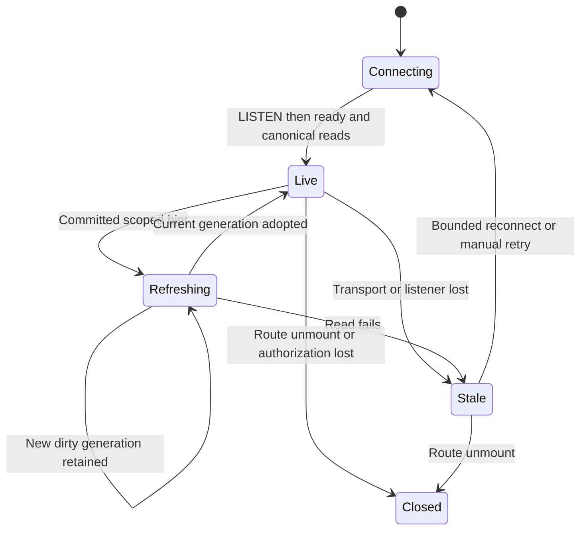

# Child Run peek data and live delivery (Implemented)

## Purpose

Inspect persisted MAIster descendant Runs while preserving the original main Run. This contract governs authorized bounded projections, advisory push delivery and additive migrations. Native runtime subagents without Run records are excluded.

## Domain entities

- Main Run: immutable navigation anchor for the mounted workbench.
- Selected Run: an independently authorized persisted descendant.
- Peek session: non-persisted URL selection and bounded visit history.
- Canonical Run, transcript and result records: see [Runs ERD](../db/runs-domain.md) and [public results](run-results.md).

## State machine

The listener and UI freshness are separate from persisted execution status.

## Process flows

### Authorized read surfaces

Add feature read services in `web/lib/runs/peek-read-model.ts` and serializable types in `web/lib/runs/peek-types.ts`; keep server-only imports out of client components. Reuse authorized route patterns and projections, rather than assuming `getChildRuns` is already gated.

| HTTP surface                                                                       | Response and authorization                                                                                                                                                 | Identifiers and validation                                                                                                                                                                                                                                                                 |
| ---------------------------------------------------------------------------------- | -------------------------------------------------------------------------------------------------------------------------------------------------------------------------- | ------------------------------------------------------------------------------------------------------------------------------------------------------------------------------------------------------------------------------------------------------------------------------------------ |
| New `GET /api/runs/{runId}/children?parent=<id>&cursor=<opaque>&limit=<n>`         | Bounded direct children with labels/status/result status and `nextCursor`; metadata uses `readBoard`. Authorize anchor and requested parent, then each returned Run.       | `runId`: url-param anchor; `parent`, `cursor`, `limit`: untrusted query inputs; principal: auth-context. Projects, target names and relationships: server-state. Parent defaults to anchor; otherwise prove descent. Cursor must match anchor/parent/sort. No body-controlled identifiers. |
| New `GET /api/runs/{runId}/peek?selected=<id>&node=<id>`                           | Selected summary, bounded authorized breadcrumbs, permission capabilities, read-only execution DTO and existing public-result DTO. No transcript or raw evidence embedded. | Anchor: url-param; selected/node: untrusted query inputs. Resolve project, pinned manifest, ancestry and node membership from server-state. Reject self/unrelated selection; validate every breadcrumb before returning identity.                                                          |
| Existing `GET /api/runs/{runId}/transcript` with opt-in `limit`, `before`, `after` | Bounded messages over existing canonical projections; retains `readRepoFiles` for all kinds. Legacy request/response remains compatible when paging keys are absent.       | Selected runId: url-param; optional node and opaque cursors: untrusted query inputs. Bind cursor to Run, node, attempt, direction and ordering. Before/after are mutually exclusive. No arbitrary path/attempt supplied by client.                                                         |
| New `GET /api/runs/{runId}/peek/stream?selected=<id>`                              | One workbench SSE carries scoped parent/child change ticks plus subtree invalidation; existing Run consumers receive isolated contexts.                                    | Anchor: url-param; optional selected: untrusted query input. Principal: auth-context. Authorize anchor, then independently validate selected descent/access. No trusted client project/root or ID list; an unavailable selected Run must not stop the readable parent channel.             |

Authorization rules:

- The anchor, selected Run, listed children and every breadcrumb must independently pass existing project/owner access checks. Preserve not-found concealment for non-members, missing and unrelated resources. A content-level 403 is shown only after Run metadata access is established. Session expiry uses existing authentication behavior.
- Current public-result DTO is explicitly shown on the full Run page after project membership, including for a viewer; retain that public projection policy. Raw transcripts, artifact/runtime-object bytes and repository-derived evidence require `readRepoFiles`. Do not treat “public” as unauthenticated or bypass stricter evidence routes.
- Flow detail is an explicit allow-list of existing read-model fields: no full `getRunDetail` serialization, raw HITL context, settings secrets, absolute host paths or hidden result payloads. Reuse existing redaction for user-visible facts. Operational evidence links obey the underlying content gate.
- For a readable selected Run whose conversation is forbidden, retain its header/result/execution summary and render the denied conversation section. Do not convert this to “no messages”. Reauthorize every HTTP load and stream connection, and before emitting an invalidation for the affected tree; an authorization denial clears cached protected child content and closes its subscriptions. This guarantees enforcement at those boundaries, not immediate revocation during a completely idle connection.
- New GETs have no lifecycle, activity, HITL, collection or workspace writes. Existing transcript projection may materialize canonical read data; this must not extend keepalive or create an execution.

Child summaries retain the existing `delegationTarget` kind/ref badge projection;
Run kind and delegation target remain separate facts.

The selected snapshot includes `terminalCause` using the existing token-only
`loadRunTerminalCause` projection and `TerminalCause` API schema. It does not
expose raw terminal event payloads or guess a cause for historical records.

### Concrete HTTP and event contract requirements

T1 must encode these decisions as OpenAPI 3.0.3 / AsyncAPI 2.6.0 schemas, not just prose. All new JSON responses use `Cache-Control: private, no-store`; SSE uses no-cache/no-transform, disabled proxy buffering and explicit abort handling. Authentication runs before resource lookup. Use the existing session gate explicitly on each new operation; the Web spec's global `security: []` must not imply public access. No new bearer/token grant is introduced.

| Contract                 | Required fields / variants                                                                                                                                                                                                                                                                                                                                                                                                                                                                                                              |
| ------------------------ | --------------------------------------------------------------------------------------------------------------------------------------------------------------------------------------------------------------------------------------------------------------------------------------------------------------------------------------------------------------------------------------------------------------------------------------------------------------------------------------------------------------------------------------- |
| `RunPeekChildPage`       | Required `anchorRunId`, `parentRunId`, `items`, `nextCursor` (nullable), `hasMore`, `totalCount`; each item is an explicit metadata DTO with `runId`, `label`, `runKind`, `taskRef` nullable, `status`, `resultStatus` nullable, `launchedAt` nullable, `startedAt`, `hasChildren`, `fullRunHref`. Counts include authorized direct children only. `nextCursor` is null exactly when no later page exists.                                                                                                                              |
| `RunPeekSnapshot`        | Required anchor/selected IDs, `breadcrumbs`, `summary`, `capabilities`, `content` discriminated by supported Run kind, `publicResult` nullable, `fullRunHref`. `content` distinguishes readable conversation descriptor, readable Flow node/attempt facts, operational diagnostic facts, forbidden section and incompatible history. No whole DB row, lifecycle action payload, raw HITL context or transcript body is embedded. Public result uses the existing DTO/status predicate, with explicit nullable keys.                     |
| `RunTranscriptPage`      | Opt-in paging keys select a distinct schema; requests without them keep the legacy response. Required `messages`, `usage` nullable, `attemptId` nullable, `beforeCursor`/`afterCursor` nullable, `hasEarlier`, `hasLater`, `window` (stable revalidation bounds), `projection` and compatibility discriminator. Messages are `oneOf` full existing message or explicit `bounded_preview` with stable ID/role, safe text preview, original byte count and `truncated: true`; partial tool JSON is never presented as a full tool record. |
| `projection`             | Existing consumer head, observed accepted canonical head (decimal strings or null), `state: caught_up\|pending\|poisoned`, and progress/continuation availability. Extend the read projection's current summary rather than inventing another worker. A continuation advances only toward the captured head; it must not chase an indefinitely growing stream.                                                                                                                                                                          |
| Child-page cursor        | Versioned opaque encoding bound to anchor, parent and the last `(launchedAt nullable,id)` key. Strictly validate length (maximum 2048 bytes), encoding and scope; reapply all authorized SQL predicates. Opacity is not authorization. Foreign/tampered scope refuses rather than changing parent.                                                                                                                                                                                                                                      |
| Transcript cursor/window | Versioned opaque encoding bound to Run, optional node, latest attempt ID, canonical ordering tuple and direction/window. `before` and `after` are exclusive; direction keys require `limit`. Refresh a visible page using the same stable upper bound, not a moving count offset. Null/empty scope and deleted/changed attempt states are explicit.                                                                                                                                                                                     |
| SSE ready                | `{type: "peek.ready", anchorRunId, selectedRunId: string\|null, selectionState: "none"\|"ready"\|"unavailable"}` after subscription registration; clients immediately reload canonical parent/selected/list snapshots.                                                                                                                                                                                                                                                                                                                  |
| SSE changes              | `{type: "run.changed", runId, kind: "execution"\|"summary"\|"transcript"}` only for authorized anchor/current selected IDs; `{type: "peek.changed"}` invalidates loaded subtree metadata. `peek.resync` includes a bounded reason enum; `peek.selection_unavailable` has no concealed child name/content. Close the affected logical channel, not the parent transport, when only child access fails.                                                                                                                                   |

Reject duplicate known parameters, invalid ID shapes, malformed encoding, noninteger/out-of-range limits, conflicting directions and unsupported query combinations with HTTP 400, existing `CONFIG` and a stable `reason`. Apply strict new parsing to new operations and the opt-in paging branch; legacy no-paging parsing stays compatible. Limits use the declared defaults when absent, not a silent clamp. New route failures use explicit typed errors; known auth statuses and generic safe not-found bodies match the existing auth policy. Do not expose a raw exception or private request data through a response.

| Condition                                          | HTTP / body decision                                                                                   | UI decision                                                                                       |
| -------------------------------------------------- | ------------------------------------------------------------------------------------------------------ | ------------------------------------------------------------------------------------------------- |
| Readable empty collection/history                  | 200, typed empty page and null cursors                                                                 | Empty explanation; not an error.                                                                  |
| Missing/nonmember/unrelated/self selected resource | 404, safe `PRECONDITION`, `reason: run_unavailable`                                                    | Retain parent and unavailable selection. No identifier/name leakage.                              |
| Readable Run, denied transcript/evidence           | 403, existing authorization code                                                                       | Denied section, retain other authorized sections.                                                 |
| Latest attempt changed since cursor                | 409, `CONFLICT`, `reason: transcript_attempt_changed`                                                  | Reset that child-node window to current latest; announce reset, do not mix attempts.              |
| Cycle or depth beyond 64 during relationship proof | 409, `PRECONDITION`, `reason: hierarchy_invalid\|hierarchy_limit` only after permitted metadata access | Explicit unsupported hierarchy; full Run link only if selected metadata independently authorized. |
| Pinned manifest incompatible                       | 200 typed `compatible: false` with the existing incompatibility schema; no guessed graph               | Summary/result and full Run remain; execution section explains incompatibility.                   |
| Transcript projection poisoned                     | 409, `CONFLICT`, `reason: transcript_projection_poisoned`                                              | Durable repair/error state, not empty history or an automatic retry loop.                         |
| SQL/service failure                                | 500 safe `CRASH`; unavailable listener before headers: 503 `EXECUTOR_UNAVAILABLE`                      | Explicit retry/error; transport loss after headers marks stale/disconnected.                      |

Bounded projection continuation: at most four request quanta per reload and only while the consumed projection cursor advances toward its fixed captured head. A held claim/no progress returns pending and waits for the projected-message notification or explicit user retry; it must not busy-loop. Publication after the final execution tick is covered by the `run_messages` notification. A missing runtime object or denied host access stays an explicit projection/content error; do not turn it into caught-up/empty.

Schema validation must execute against actual HTTP bodies and parsed SSE frames in the owning integration suite, including allowed/denied and nullable/result/preview variants. Validating only YAML examples or constructing a second hand-written DTO in the test is insufficient. Use installed contract-validation tooling or existing schema helpers; add a dependency only if no existing helper can validate the required schema, with a documented necessity.

### Bounded tree and transcript loading

- Direct-child pages: default 25, maximum 50, stable keyset by existing `launchedAt ASC NULLS LAST, id`. Scheduler admission rewrites `startedAt` (`scheduler.ts`), so it cannot be a cursor key. Some ordinary Flow/legacy Runs have no immutable launch timestamp: retain an explicit unknown-time group ordered by immutable ID, show no invented launch time, and encode the null group in cursor comparison. This intentionally replaces the old mutable start-time ordering without a new timestamp column. Fetch only active sibling/child lists and expanded ancestor context. Never use the cascade BFS or recursively preload all descendants. Bounded ancestry walk: maximum 64 edges, visited-ID cycle detection and explicit unsupported-depth/corrupt-chain state, with full-Run escape. This is a display limit, not an execution policy change.
- Keep at most 200 child-entry summaries and 32 previous selections in memory per anchor, evicting least recently used slices. Counts and result statuses come from the same authorized projection, not per-row HTTP fan-out. Use bounded batched result queries; do not load result values for list entries.
- On insertion beyond an already full oldest-first page, update the authorized count and show a localized “New children available” action that loads the new page on demand. Never silently skip the new child or automatically replace the user's current page/selection. Small lists update inline.
- Page transcripts by existing canonical ordering: Flow node uses event horizon, prompt tie-break and sequence; standalone uses creation time and sequence. Add an ID tie-break when needed. Preserve latest-attempt semantics; a cursor from a superseded node attempt returns an explicit reset-required response, not mixed messages.
- Initial window is the latest 100 messages, maximum 200 per request, rendered chronologically. Load earlier on demand while preserving the visible scroll anchor. Initial and live loads stay bounded; a bounded page must also enforce a serialized content budget (512 KiB). An oversized individual message uses a clearly labelled bounded preview; never silently drop messages or parse partial tool JSON as a complete record.
- Maintain one contiguous displayed segment of at most five 100-message pages. While earlier history is open, revalidate the displayed final page using its stable bounds instead of replacing it with the moving live window. Fetch the newest bounded window separately for current usage/projection facts and show a localized newer-messages notice with the existing Latest messages action. Loading a sixth earlier page evicts the newest displayed page, never a middle page; announce that eviction and retain the same action back to the live end. Preserve the visible DOM scroll anchor when notices or pages change. A stream tick also refreshes the currently visible older window; fresh records win duplicate IDs, including streaming-row updates. Other cached windows are marked dirty and revalidated before display; metadata-only ticks cannot identify which older message changed. A new latest attempt cancels pending earlier-page reads, clears all old windows and skips their revalidation; a late response cannot restore the superseded attempt. Preserve usage-summary semantics independently of paging.
- Coalesce events during a request into one pending reload. Use the bounded projection continuation protocol above even after execution settles; wait for the projection notification when progress stops. No interval, unbounded immediate retries, selection jump or automatic scroll to bottom while the user reads earlier messages.
- Public-result rendering respects existing result-size and validity rules; do not add raw-output log reads as a substitute for missing transcripts/results.

### Streams, notifications and cleanup

- One physical `/peek/stream` EventSource belongs to the mounted anchor workbench, including while peek is closed. It replaces that page's direct parent source and serves at most the parent and the admitted selected child plus tree metadata. It never subscribes to every descendant transcript. The standalone `/stream` endpoint and its replay contract remain unchanged.
- Separate context-value providers expose existing `UseRunStreamResult` tick/liveness semantics for parent and child. Extract a provider accepting an already-owned stream value from the existing connection-owning provider; do not add flag-driven multi-mode components. Key the child context by Run ID. AgentRunTranscript must use `useRunPageStream`; it cannot create a duplicate direct subscription under either provider. Correct the mismatched-provider lookup and guard all late callbacks by connection and selection generation.
- The composite route is a snapshot/invalidation channel, not a second event log. Frames are `peek.ready`, `run.changed`, `peek.changed`, `peek.resync`, and `peek.selection_unavailable`, with the exact shapes below. No SSE `id` or Last-Event-ID is used; the already persisted canonical events/messages/results own history. A malformed/unsupported frame is an explicit protocol error that marks the source stale and triggers bounded resync; never silently ignore it while claiming freshness. A newly ready or resynchronized parent/child context causes its existing bounded snapshot consumers to reload. Independent logical ticks cannot be mistaken for another Run's updates.
- Admission ordering: remove old child data/subscription immediately; keep an anchor-only transport while the next selected snapshot is loading/denied; admit a child channel only after authorized snapshot success, rechecked by the stream handler. A concurrent child denial/deletion emits selection-unavailable, removes that channel and clears protected caches while retaining parent updates and the selected error panel. Invalid anchor access ends the whole transport. Do not silently render a different child.
- On selection admission/removal, close the old source before opening its replacement; keep parent mounted, mark the brief reconnection and reload its canonical snapshots on ready. Never overlap old/new transports to avoid a reconnect race. Main `RunLiveRefresh` retains its parent refresh behavior; child snapshot changes never call parent `router.refresh()`.
- PostgreSQL notifications cover committed Run/result/workspace changes plus accepted canonical `execution_events` insertion or late assignment of `run_sequence`, `node_attempts` status/attempt/failure changes, and projected `run_messages` inserts/content changes. The latter is necessary when the autonomous projector finishes after the last ACP event or a competing projector holds its claim. Emit a bounded `{topic, runId, oldParentId, oldProjectId, newProjectId}` private hint, not content. Filter ordinary hints through current persisted relationships/access; deletion/reparenting may conservatively invalidate authorized loaded slices using old hints. Do not require a deleted row to invalidate its old display.
- One lazy process-wide dedicated LISTEN client in autocommit mode serves all workbench subscriptions; derive its connection settings from the existing database configuration, but do not hold a connection from the query pool. A query pool with maximum one must still make progress beside the listener. Start LISTEN and register the scoped subscriber before the initial canonical snapshot; retain a monotonic in-memory dirty generation during reads and drain pending ticks afterward. The dirty marker must be set before awaiting any reload and checked again after it completes; do not clear a newer mark with an older response. Coalesce bursts with one in-flight read and one pending tick per scope, not an unbounded queue.
- Notification loss/connection error marks every dependent browser stale and closes that transport. A new listener establishes LISTEN before a `peek.resync`/ready snapshot handshake, repairing any offline gap. No persistent replay cursor, transaction-ID scan or polling interval is added. Heartbeats and retry backoff are transport-only; they do not query Run state. Use existing `advanceRunStreamLifecycle`/`reconnectDelayMs` limits (500ms, 1s, 2s, then disconnected); retain one manual reconnect action after exhaustion.
- Execution completion/failure marks the corresponding logical Run state settled and requests a final bounded snapshot, but leaves the composite transport and panel active for result/projection changes. Delayed projection completion therefore still wakes a finished child. New descendants refresh only visible/loaded metadata slices; no Run completion can choose another child.
- On switch/close, abort selected HTTP requests, release its waiter/channel and clear child-only tab/node data. Each child-list slice retains an owner count: its last release aborts and removes its pending request immediately, while shared parent/sibling slices remain active until their own last release. A returning slice acquires a fresh request; every response, refusal and finalizer is fenced by controller identity so an old A→B→A request cannot publish over or remove its replacement. Check Run ID, request generation, scope and active transport before adopting any response/frame. Closing retains parent/tree channels. On main-route unmount, release the whole source, pending reads/timers, LISTEN subscription and librarian suspension; integrate final listener release before pool shutdown. Acquisition error, auth refusal, response-body cancellation and peer disconnect each release their pending waiter/client explicitly.
- Connection gate: while peek is open, each visible workbench owns one composite source, uses the existing attention source, and suspends librarian owner SSE. Two visible workbenches therefore consume at most four persistent HTTP/1.1 connections, leaving request capacity. Hidden tabs disconnect composite sources and refetch on visibility return. Reopening librarian first closes peek and tears down selected resources; verify GET progress on that handoff, too. Unlimited simultaneous visible workbenches and cross-tab app-wide stream sharing are outside V1; do not claim that the two-workbench bound covers arbitrary windows.

### Loading and failure states

| State                                        | Visible behavior                                                                                                                                                                       |
| -------------------------------------------- | -------------------------------------------------------------------------------------------------------------------------------------------------------------------------------------- |
| Initial load / fast switching                | New identity skeleton with `aria-busy`; previous child's protected content is removed immediately; header Close remains usable.                                                        |
| No children / no messages / no contract      | Distinct localized empty explanations; no fabricated result glyph or transcript. No workspace still supports status/conversation/result.                                               |
| Pending / completed / failed Run             | Render the corresponding execution facts independently from result state; completion does not close, select a sibling or steal focus.                                                  |
| Missing, deleted, unrelated or concealed Run | Generic selected-Run unavailable state, retained parent and Close. Offer ancestor navigation only from already authorized facts. Do not disclose an inaccessible ID/name.              |
| Forbidden content                            | Localized permission notice in that content section; readable sections/full-Run link remain. Full Run does not imply greater permissions.                                              |
| Unsupported Flow/history/depth               | Existing compatibility explanation or explicit navigation limit, known summary and full-Run action; no guessed graph or runtime-log fallback.                                          |
| Request error                                | Localized retryable section error; preserve current child identity/parent. Retain stale data only for the same authorized child and label it stale. Never reuse previous child's data. |
| Disconnected / reconnecting                  | Independent parent and child liveness labels plus metadata freshness notice; known facts remain marked stale. Reconnect does not mutate persisted status.                              |

## Migration specification and upgrade gates

Allocation follows the rebased local `master` migration 0210 (`agent_retry_strategies`). Paging and notification migrations were regenerated against that snapshot lineage; master migration SQL is unchanged. The chronological dependency is paging migration **0211** in T3, then notification migration **0212** in T4; do not allocate 0212 before its predecessor exists or amend an already-applied historical migration.

| Migration                      | Exact planned change                                                                                                                                                                                                                                                                                                                                                                                                                                                                                              | Integrity / compatibility proof                                                                                                                                                                                                                                                                                                                                                                                       |
| ------------------------------ | ----------------------------------------------------------------------------------------------------------------------------------------------------------------------------------------------------------------------------------------------------------------------------------------------------------------------------------------------------------------------------------------------------------------------------------------------------------------------------------------------------------------- | --------------------------------------------------------------------------------------------------------------------------------------------------------------------------------------------------------------------------------------------------------------------------------------------------------------------------------------------------------------------------------------------------------------------- |
| `0211_run_peek_paging_indexes` | Add `run_messages_peek_node_order_idx` on `(run_id,node_attempt_id,COALESCE(supervisor_event_id,'0')::bigint,(prompt_dispatch_key IS NOT NULL),sequence,id)` for non-null node attempts; add `run_messages_peek_run_order_idx` on `(run_id,created_at,sequence,id)` for whole-Run ordering. Also add `runs_peek_parent_launch_idx` on `(parent_run_id,launched_at ASC NULLS LAST,id)` for bounded direct-child pages. No content column in an index; preserve existing uniqueness/NULLS NOT DISTINCT constraints. | Mirror all three indexes/expressions/predicates in `schema.ts`, SQL, journal and 0211 snapshot. Validate all existing indexed event positions before building the cast expression; invalid legacy values fail with a clear diagnosis rather than being rewritten. Real seeded query plans must use a bounded indexed range for large history, not a full-history sort; verify semantics, not exact planner cost text. |
| `0212_run_peek_notifications`  | Add one private bounded notification function/channel plus table triggers listed below. No domain-event kind, per-root counter, table or column.                                                                                                                                                                                                                                                                                                                                                                  | Register SQL/journal/0212 snapshot, preserving 0211 snapshot ancestry; snapshots carry the same table shape plus the 0211 indexes. Catalog assertions prove function/trigger definitions because Drizzle snapshots do not represent trigger SQL. No result/lifecycle data updates or history backfill.                                                                                                                |

Notification allow-list and source inventory (write it literally in the data spec):

- `runs`: INSERT/DELETE; semantic UPDATE of `status`, `current_step_id`, `parent_run_id`, `root_run_id`, `task_id`, `delegation_snapshot`, `result_contract`, `promoted_head_sha`, `merge_commit_sha` and the existing execution/workspace reference columns actually consumed by the snapshot. These cover agent launch in `web/lib/agents/launch.ts`, Flow launch in `web/lib/services/runs.ts` and scheduler/HITL/terminal status writers without patching every caller.
- `run_results`: INSERT/DELETE; UPDATE of validity, revision, schema identity, collection and supersession facts. Cover `publishRunResult`, invalid/stale/collected helpers in `web/lib/run-results/ledger.ts` plus direct agent rework invalidation. Exclude payload bytes from the hint.
- `workspaces`: INSERT/DELETE and ownership/status/removal fields used by the existing workspace-presence model. Resolve shared readers through that model; do not presume each child owns a different workspace.
- `execution_events`: notify only on INSERT with accepted non-null `run_sequence`, or transition into that accepted state. `ingest.ts` may assign sequences in an UPDATE after initial insertion; INSERT-only is incomplete. Other disposition/projection bookkeeping must not create execution noise.
- `node_attempts`: INSERT/DELETE and semantic status/attempt/decision/error/finished facts consumed by read-only Flow details; no unrelated cost/heartbeat fields.
- `run_messages`: INSERT/DELETE and changed display content/role/order/scope fields; this covers autonomous projection completion after the last execution event and updates of an existing streaming message. No trigger loops or writes back into the source row.

Use null-safe `IS DISTINCT FROM` comparisons; unchanged writes produce no hints. Notification payloads contain bounded IDs/topic only (under PostgreSQL's payload limit), never column values containing content. Notifications commit/rollback with their source transactions. They are advisory UI invalidation, not audit evidence. A notification failure is surfaced explicitly; never swallow a database error and claim live delivery. Listener clients must not hold an open transaction that delays notifications/queue cleanup.

Fresh/incremental qualification: migrate an empty database through HEAD and, separately, a real database stopped at 0209 containing existing Runs, messages, results and shared/removed workspaces. Apply 0211→0212 through the normal migrated-test harness, compare all pre-existing content/state/constraints, inspect the catalogs and run the same read/notification scenarios on both. Re-running the normal migrator is a no-op with one ledger row per hash. Assert strictly increasing idx/tag/when, a new UUID snapshot with valid prevId, and newest snapshot presence via the existing journal-integrity suite. `db:generate` must report no schema drift; generated DBML must match the schema.

Rollout: use the existing maintenance/migration workflow, bound index-build lock wait and statement duration using the existing migration session mechanisms, and report a refusal rather than changing to an unplanned concurrent-index recipe. Old binaries already reject an ahead-of-binary migration ledger; do not promise application rollback onto a newer DB. Do not write down migrations or remove live data to recover. A failed migration leaves no partially installed triggers/index catalog; recover through the normal forward migration path. Listener startup validates required trigger/index catalog presence and fails visibly if the upgrade is incomplete.

## Expectations

- **PKD-01:** Each returned content class obeys its own existing project/owner/content grant, including positive grants and concealment. Enforced by T2,T3,T5 and IT-PKD-01, actual HTTP role matrix (Implemented).
- **PKD-02:** Server-validated persisted parent chains constrain selection, siblings, lists, breadcrumbs and cursor scope. Enforced by T2 and IT-PKD-02, relationship matrix (Implemented).
- **PKD-03:** Existing derived result states and valid-payload-only exposure remain authoritative for every Run status. Enforced by T2,T7 and IT-PKD-03, extend existing result DTO suite (Implemented).
- **PKD-04:** Read-only Flow/conversation/operational content handles task-less, workspace-free, historic and unsupported Runs explicitly. Enforced by T2,T7 and IT-PKD-04, snapshot content matrix (Implemented).
- **PKD-05:** Child pages, ancestry and caches obey count limits, deterministic order and new-child discovery without eager tree loading. Enforced by T2,T8 and IT-PKD-05, query/page bounds (Implemented).
- **PKD-06:** Transcript windows obey canonical order, byte/count bounds, mutable-row updates, attempt isolation and bounded projection progress. Enforced by T3 and IT-PKD-06, real transcript pages (Implemented).
- **PKD-07:** Parent/child contexts and generations are isolated; late requests/frames cannot overwrite the current selection. Enforced by T5,T7 and E2E-PKD-07, delayed-response race (Implemented).
- **PKD-08:** Committed creation/status/result/execution/projection changes wake the right active view without polling or hidden transcript subscriptions. Enforced by T4,T5 and IT-PKD-08, committed-notification route chain (Implemented).
- **PKD-09:** Disconnect/reconnect/abort/shutdown release waiters and connections and resynchronize missed changes without lost-wake windows. Enforced by T4,T5 and IT-PKD-09, real listener/stream lifetime (Implemented).
- **PKD-10:** Validated requests and no-store typed responses distinguish empty, forbidden, unavailable, incompatible, error and disconnected states. Enforced by T2,T3,T5,T7 and IT-PKD-10, HTTP/schema and wire parity (Implemented).
- **PKD-11:** Fresh and incremental migrations preserve existing records, enforce the intended indexes/triggers and have consistent journals/snapshots/schema. Enforced by T3,T4 and IT-PKD-11, real migration qualification (Implemented).
- **PKD-12:** Two visible peek workbenches keep content GETs progressing under HTTP/1.1 without duplicate per-Run sources. Enforced by T5,T6 and E2E-PKD-12, two-open-peek HTTP/1.1 journey and one-window handoff (Implemented).

## Edge cases

- **EDGE-PKD-01:** Auth-first active/disabled/password-change sessions, positive owner/member/viewer grants, nonmember concealment, foreign same-root selection and independently denied breadcrumb/content. Primary checks: IT-PKD-01, IT-PKD-02, IT-PKD-10. Refusals use existing [error codes](../error-taxonomy.md); empty/terminal states are supported outcomes (Implemented).
- **EDGE-PKD-02:** Equal/unknown immutable launch times, Pending→Running between pages, full-page insertion, deletion/reparenting and a selected sibling outside the loaded first page produce no duplicates/skips or false chronology. Pin the selected summary independently of its page. Primary checks: IT-PKD-02, IT-PKD-05. Refusals use existing [error codes](../error-taxonomy.md); empty/terminal states are supported outcomes (Implemented).
- **EDGE-PKD-03:** Empty, malformed, duplicate, oversized, cross-Run/node/parent and stale-attempt cursors refuse with the declared status/reason; maximum depth and a cycle cannot cause an unbounded walk or identity leak. Primary checks: IT-PKD-02, IT-PKD-06, IT-PKD-10. Refusals use existing [error codes](../error-taxonomy.md); empty/terminal states are supported outcomes (Implemented).
- **EDGE-PKD-04:** Giant tool JSON, multibyte UTF-8, 100/200/500 row boundaries, mutable streaming rows, old visible windows and usage outside the page obey byte/count/ordering/preview semantics. Primary checks: IT-PKD-06. Refusals use existing [error codes](../error-taxonomy.md); empty/terminal states are supported outcomes (Implemented).
- **EDGE-PKD-05:** No attempt yet, recorded-prompt tie, incompatible pinned manifest, historical unsupported content and no repository workspace yield distinct supported/empty/incompatible facts. Primary checks: IT-PKD-04, IT-PKD-06. Refusals use existing [error codes](../error-taxonomy.md); empty/terminal states are supported outcomes (Implemented).
- **EDGE-PKD-06:** All existing result states, failed Run with an older valid row, stale/superseded/invalid revision and required/optional/no contract keep payload/status fidelity without collect/promotion. Primary checks: IT-PKD-03. Refusals use existing [error codes](../error-taxonomy.md); empty/terminal states are supported outcomes (Implemented).
- **EDGE-PKD-07:** Last event before projection, a held projection claim, no-progress head, more than four quanta, poisoned projection and post-terminal publication eventually show data or an explicit pending/repair state; never spin or claim empty/caught-up falsely. Primary checks: IT-PKD-06, IT-PKD-08. Refusals use existing [error codes](../error-taxonomy.md); empty/terminal states are supported outcomes (Implemented).
- **EDGE-PKD-08:** Commit vs rollback, INSERT vs late acceptance UPDATE, unchanged/noise fields, message updates, shared-workspace removal and delayed projection trigger the correct scope without content in notifications. Primary checks: IT-PKD-08. Refusals use existing [error codes](../error-taxonomy.md); empty/terminal states are supported outcomes (Implemented).
- **EDGE-PKD-09:** Commit between LISTEN/registration/ready/GET, commit during in-flight refresh, two transactions committing in reverse order and notification lost during process restart converge without an event-ID cursor or lost dirty mark. Primary checks: IT-PKD-09. Refusals use existing [error codes](../error-taxonomy.md); empty/terminal states are supported outcomes (Implemented).
- **EDGE-PKD-10:** Acquisition failure, query-pool max one, exhausted retries, abort/body cancel/unmount/shutdown and grant loss release only owned resources; child denial retains parent updates and clears protected cache at the next auth boundary. Primary checks: IT-PKD-09, IT-PKD-10. Refusals use existing [error codes](../error-taxonomy.md); empty/terminal states are supported outcomes (Implemented).
- **EDGE-PKD-11:** Fresh and 0209 upgrade, invalid legacy indexed event position, repeated migrate, unchanged old records/constraints, catalog/snapshot/journal collision and missing migration readiness fail or pass explicitly. Primary checks: IT-PKD-11. Refusals use existing [error codes](../error-taxonomy.md); empty/terminal states are supported outcomes (Implemented).
- **EDGE-PKD-12:** Two actually visible HTTP/1.1 peek workbenches keep bounded GETs completing during sustained updates, A→B switching and a one-window librarian handoff; both logical contexts retain correct identities. Primary checks: E2E-PKD-07, E2E-PKD-12. Refusals use existing [error codes](../error-taxonomy.md); empty/terminal states are supported outcomes (Implemented).

## Linked artifacts

- [Web HTTP API](../api/web.openapi.yaml) and [browser Run streams](../api/async/web-runs.asyncapi.yaml).
- [Acceptance traceability](run-peek-traceability.md).
- [Peek screen](../screens/runs/child-run-peek.md).
