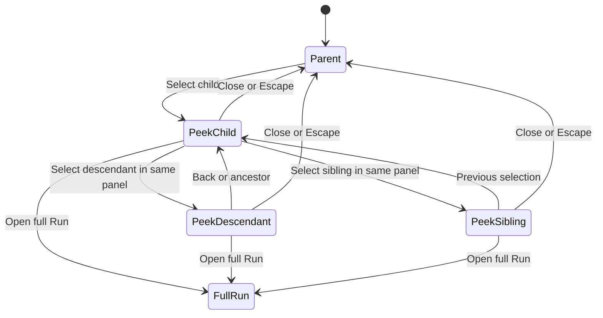

# Child Run peek navigation (Implemented)

## Purpose

Inspect persisted MAIster descendant Runs while preserving the original main Run. This contract governs navigation, panel ownership and accessibility. Native runtime subagents without Run records are excluded.

## Domain entities

- Main Run: immutable navigation anchor for the mounted workbench.
- Selected Run: an independently authorized persisted descendant.
- Peek session: non-persisted URL selection and bounded visit history.
- Canonical Run, transcript and result records: see [Runs ERD](../db/runs-domain.md) and [public results](run-results.md).

## State machine

## Process flows

### One auxiliary surface

When the parent Flow is fullscreen, peek is a modal sheet at every width above that retained fullscreen surface. Otherwise, at viewport widths of at least 1536px, peek occupies the existing inspector side of RunShell, widened to 480px; the main Run remains mounted to its left. Below 1536px, use one modal sheet: 560px maximum width from 768px upward, full screen below 768px. This follows the librarian's workbench breakpoint rather than squeezing three columns into the Run screen. The parent's DOM, state and stream stay mounted beneath the sheet. No horizontal document overflow at 320px or 200% zoom.

- Opening peek retains the inspector's open/closed state, selected tab, expanded sections and scroll, and hides its mounted subtree. No inspector lifecycle control remains focusable behind peek.
- Retain the librarian's logical open state, conversation, draft and scroll; register a scoped suspension with its existing provider. During peek, suspend its owner SSE and effective visibility/modal/read-through effects to reserve HTTP connections. On resume, reconnect using its existing durable cursor and refresh conversation/settings/indicator before declaring it current. Queued turns continue server-side. Hidden messages must not be marked read.
- Closing peek releases suspension and restores the inspector exactly. Restore an open librarian when its current mode is docked. If viewport changes would restore it as a modal over the restored child trigger, retain it collapsed with its existing indicator and an explicit reopen action; its draft/conversation remain intact. This exception preserves focus restoration and prevents a second modal from immediately replacing the dismissed peek.
- Activating the librarian trigger while peek is open explicitly switches to librarian: remove peek URL state, release peek resources, then open librarian. Do not reopen peek automatically on librarian dismissal.
- The parent inspector toggle stays visible but disabled with a localized explanation while peek owns the slot. Changing descendants never creates another slot/panel. Parent Flow fullscreen requests first close peek through the same close transition; an already-fullscreen Flow is retained beneath a sheet.

The navigation states keep the route Run as the anchor throughout a peek session.

See the navigation state machine above.

### Entries, hierarchy and selected content

- Use the same enriched entry model in the inspector, subtree and peek lists: task key plus task title when present; otherwise immutable launch/agent/Flow/runner display name, plus short Run ID. Generic localized Run-kind text plus short ID is the explicit label for older records without a name. Do not expose raw prompts as labels.
- Show localized execution status as text plus dot; independently show public-result status with existing accessible glyph/label semantics. No glyph for no result contract/history. Use existing Run status helpers rather than another terminal-status set.
- Panel header: selected label, short ID, kind, execution status, public-result indicator, Close and **Open full Run**. A breadcrumb starts with the original main Run, followed by authorized persisted ancestors and selected Run; abbreviate visually on narrow screens while retaining accessible full labels.
- Provide a Previous-selection button, ancestor breadcrumbs, a paginated sibling chooser and the selected Run's paginated direct children. The main-anchor breadcrumb closes peek. Selection history is temporal; breadcrumbs express ancestry. They must not be confused.
- Default tab is Conversation for a standalone conversation Run and Execution for a Flow. Also offer Public result where a contract/history exists. Use `peekNode` for Flow node selection. Read-only execution facts include kind, target/current node, latest attempt, failure/terminal cause and relevant workspace presence; show “No repository workspace” when applicable.
- Reuse TranscriptView for messages/tools/thoughts/permission notices, without composers or response controls. Extract controlled Flow node details with run/node props and a selection callback; no parent pathname/search-param reads inside it. Failed/unsupported nodes retain facts and a full-Run link.
- Reuse public-result rendering for schema, revision, collection, failure reason and valid payload; distinguish `pending`, `valid`, `absent`, `missing`, `stale`, `invalid`, `unavailable`, and no contract. Preserve result-only completion semantics. Operational outcome facts use their existing projection with acknowledgement, cleanup retry and other mutation controls omitted.
- Do not instantiate full Run layouts, scratch dialogs, HITL forms, lifecycle actions or review/promotion surfaces in peek. Do not call result `collect` operations, which stamp collection state. Use the non-mutating result loader.
- Full-Run action is a normal anchor to `/runs/<selected>` using existing kind redirects and no query parameters. The parent history entry retains peek for browser Back. Support modifier-click/new-tab behavior; V1 deliberately has no child-tab translation into full-page query state.

### Routing, history and parent preservation

Canonical URL: `/runs/<main>?<existing-parent-params>&peek=<selected>&peekView=conversation|execution|result&peekNode=<node>`.

- Extend `web/lib/runs/run-query-state.ts` with these namespaced keys. Existing `node`, `wb`, `file`, diff, inspector and Flow parameters continue to describe the parent. Query patches preserve unrelated parameters and fragments.
- Use Next-compatible native History API updates for peek-only changes, letting its public adapter retain framework state while passing only feature-owned visit metadata. This is a new use of the installed router integration and needs an early browser smoke check. It avoids rerunning the `?file=` server page solely to switch children. Selection handlers never call `router.refresh()`; the stream-ready/resync handshake can independently reload canonical parent facts through its existing refresh consumer.
- Push one entry for opening, selecting another descendant/sibling/ancestor, or closing. Replace for changes of selected-child tab/node. Duplicate selections do not add entries. Closing pushes a URL with only peek keys removed; Back can reopen the prior selection. Browser Back/Forward renders exactly the URL selection, including the closed state.
- Previous-selection uses a bounded visit stack (maximum 32 entries containing ID, selected view/node and a non-authoritative visit token, keyed to the main Run). Child tab/node changes replace the current visit. New selections push; Previous pops the current entry and navigates to the preceding entry without appending another stack entry, so repeated Previous cannot oscillate A↔B. Browser popstate restores a known visit token without appending; an unknown/direct entry starts a new stack. A parent server refresh may replace custom history metadata; the controller reattaches its current known visit without pushing or appending a visit. Disable Previous when no prior visit exists; breadcrumbs still work. Every resulting selection remains URL-addressable.
- A direct link/refresh reads the three query keys in the stable client controller and resolves ancestry/authorization server-side. It does not trust a serialized browser tree. Default invalid tab/node choices explicitly to supported display state; malformed, self-selected or unrelated Run IDs show an unavailable state, preserving the parent URL/context until Close.
- Keep parent RunShell, provider, main view, composer/HITL draft owners and hidden inspector mounted with stable keys. Reserve the pre-peek body scroll extent while the inspector is hidden, and restore only the owned layout reservation on close or unmount; tall inspector content must not clamp the parent scroll. Key only selected-child content by Run ID. Native history changes must not focus/scroll the main page. Preserve document/parent scroll bookmarks around column reflow; restore focus with `preventScroll`. If the user deliberately scrolls the parent while docked, preserve that latest position on close.
- Parent refreshes caused by its existing execution events may update facts but must reconcile into these same mounted owners. Do not depend on remounting or serializing a draft to preserve it.

### Keyboard and focus

- Use ordinary labelled links/buttons/lists, not a tree widget requiring a second arrow-key model. Enter activates a link; Space activates a button; Tab/Shift+Tab traverse controls; tabs follow the existing accessible tab convention. Selected navigation entry uses `aria-current`.
- Opening moves focus to the labelled panel heading (`tabIndex=-1`), after hidden surfaces release focus. In modal presentation, Tab from that programmatic focus enters the first control and Shift+Tab enters the last; neither may escape to the document. Changing children focuses/announces the new heading, without scrolling the parent. Use a polite live region for selected identity/status and explicit alerts for failed loads.
- Docked peek is a labelled complementary region without a trap; Escape closes only when focus is inside it. Sheet/fullscreen is a labelled modal dialog with focus containment, body scroll lock and inert background, following `use-modal-a11y.ts` conventions.
- Escape dismisses the innermost open chooser/popover first; a handled Escape cannot also close peek. A second Escape closes peek. Switching responsive mode keeps the current child and focused control where possible; it is not a Close transition and must not restore focus to the opener.
- Final close first restores the inspector DOM visibility, then focuses the original main-page child trigger. If it disappeared after a live refresh, focus the retained child-list heading or Run heading. A direct link with no trigger uses the Run heading. Restoring focus never triggers navigation or mutates a Run.

## Expectations

- **PKN-01:** Exactly one peek uses the route Run as an immutable anchor, including for nested main Runs. Enforced by T6 and E2E-PKN-01, browser navigation (Implemented).
- **PKN-02:** Every child entry identifies the Run, kind and execution status separately from public-result status. Enforced by T8 and E2E-PKN-02, entry-point labels (Implemented).
- **PKN-03:** Descendant, sibling, previous-selection and ancestor actions update the same panel and correct breadcrumb. Enforced by T6 and E2E-PKN-03, nested journey (Implemented).
- **PKN-04:** Peek changes preserve mounted parent view, latest intentional scroll, draft and inspector state. Enforced by T6 and E2E-PKN-04, context preservation (Implemented).
- **PKN-05:** All peek operations produce zero lifecycle/HITL/activity/result-collection/workspace mutations. Enforced by T2,T7 and IT-PKN-05, real read-side state comparison (Implemented).
- **PKN-06:** The selected Run has an explicit correct full-Run link; interactive actions exist only there. Enforced by T7,T8 and E2E-PKN-06, action boundary/link (Implemented).
- **PKN-07:** Deep links and Back/Forward preserve parent keys and restore the URL's selected child/view/node. Enforced by T6 and E2E-PKN-07, routing (Implemented).
- **PKN-08:** Peek suspends competing inspector/librarian presentation without losing state and restores the specified visibility/focus. Enforced by T6 and E2E-PKN-08, coexistence (Implemented).
- **PKN-09:** Dock/sheet/fullscreen transitions retain selection and avoid document overflow at declared widths/zoom. Enforced by T6 and E2E-PKN-09, viewport matrix (Implemented).
- **PKN-10:** Keyboard/focus/inner-first Escape and final trigger restoration satisfy the declared modal/docked rules. Enforced by T6 and E2E-PKN-10, keyboard (Implemented).
- **PKN-11:** Both EN and RU expose equivalent controls, status names, errors and accessible announcements. Enforced by T8 and E2E-PKN-11, locale parameter of labels/keyboard scenario (Implemented).
- **PKN-12:** Completion, failure and transient connectivity do not close, switch or refocus peek unexpectedly. Enforced by T7 and E2E-PKN-12, terminal/disconnected journey (Implemented).

## Edge cases

- **EDGE-PKN-01:** Direct deep link, nested main anchor, branch to sibling then ancestor, missing prior visit and invalid selected URL keep the original main Run. Primary checks: E2E-PKN-01, E2E-PKN-03, E2E-PKN-07. Refusals use existing [error codes](../error-taxonomy.md); empty/terminal states are supported outcomes (Implemented).
- **EDGE-PKN-02:** A→B→C, Previous twice yields B then A; tab replace/popstate do not append visits or create A↔B oscillation. Primary checks: E2E-PKN-03, E2E-PKN-07. Refusals use existing [error codes](../error-taxonomy.md); empty/terminal states are supported outcomes (Implemented).
- **EDGE-PKN-03:** Parent live refresh, unsent draft, scrolled file/HITL view, inspector tab and vanished opener preserve context and restore a safe focus target. Primary checks: E2E-PKN-04, E2E-PKN-10. Refusals use existing [error codes](../error-taxonomy.md); empty/terminal states are supported outcomes (Implemented).
- **EDGE-PKN-04:** Open docked librarian, resize during peek, suspend queued replies/settings/read-through, then close or switch to librarian; retained draft and canonical state converge. Primary checks: E2E-PKN-08. Refusals use existing [error codes](../error-taxonomy.md); empty/terminal states are supported outcomes (Implemented).
- **EDGE-PKN-05:** Inner popover consumes first Escape; sheet traps Tab; 320px/200% zoom and sheet↔dock transitions do not close/reset or focus a hidden trigger. Main Flow fullscreen forces peek sheet presentation at every width. Primary checks: E2E-PKN-09, E2E-PKN-10. Refusals use existing [error codes](../error-taxonomy.md); empty/terminal states are supported outcomes (Implemented).
- **EDGE-PKN-06:** Task-less/no-workspace/non-coding and terminal children have correct full-Run links; modifier click works and no interactive child mutation request occurs. Primary checks: E2E-PKN-02, E2E-PKN-06, E2E-PKN-12, IT-PKN-05. Refusals use existing [error codes](../error-taxonomy.md); empty/terminal states are supported outcomes (Implemented).
- **EDGE-PKN-07:** Every introduced empty/error/denied/reconnect/control label has EN/RU parity and an accessible name; an icon/color alone is insufficient. Primary checks: E2E-PKN-11. Refusals use existing [error codes](../error-taxonomy.md); empty/terminal states are supported outcomes (Implemented).

## Linked artifacts

- [Web HTTP API](../api/web.openapi.yaml) and [browser Run streams](../api/async/web-runs.asyncapi.yaml).
- [Acceptance traceability](run-peek-traceability.md).
- [Peek screen](../screens/runs/child-run-peek.md).
