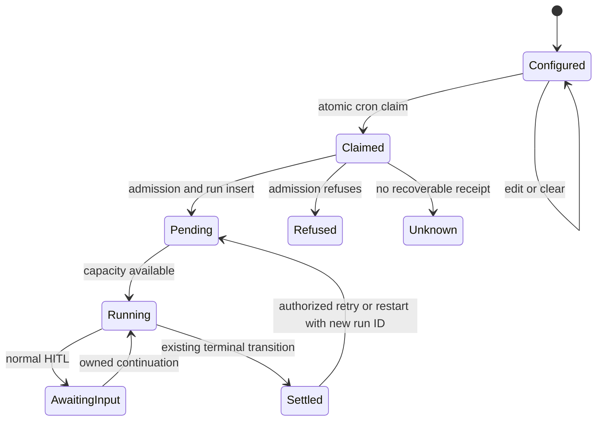
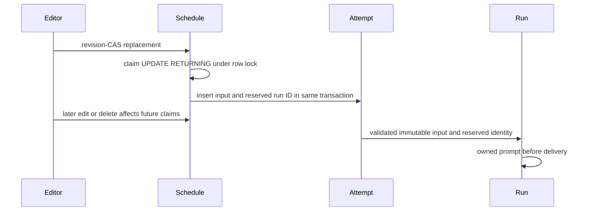
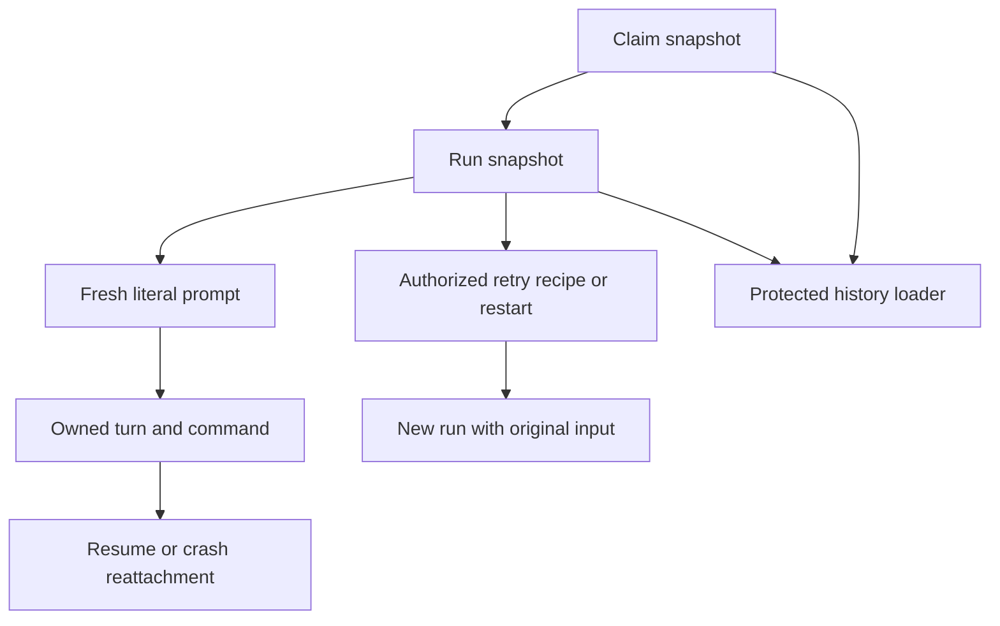

# Scheduled requests for platform agents

**Status: Implemented.** Request-bearing writes require the compatible migration and complete runtime on every worker; follow the release and rollback procedure below.

## Purpose

A cron schedule may contribute a literal current request without changing its reusable agent definition, project context, configuration, memory, permission policy or completion contract. This domain owns desired schedule input, immutable claimed input and protected historical disclosure; existing scheduler, agent and Flow lifecycles remain their owners.

## Domain entities

- Schedule: mutable per-binding input in agent_schedules.
- Trigger attempt: durable claim and immutable request envelope, including captured-empty input.
- Run: immutable copy of the original input, including authorized successor lineage.
- Owned prompt: persisted execution input used for replay and continuation.
- Authorized reader: live project membership plus readRepoFiles for raw request bodies.

Persisted contracts: [agents ERD](../db/agents-domain.md), [activity ERD](../db/agent-activity-domain.md).

## State machine

Configuration, invocation and execution have separate state; no new run status is introduced.



## Process flows

The winning schedule row, rather than the earlier candidate scan, owns claimed request bytes.



Continuation and successor input come from immutable evidence, never current schedule state.



## Input contract and normalization

Public schedule property: `requestAtLaunch?: string | null`; persisted column: `agent_schedules.request_at_launch text NULL DEFAULT NULL`.

Use the client-safe `web/lib/agents/scheduled-request.ts` helper for normalization/validation, snapshot parsing and request-block formatting through single-purpose functions. No mode flags, framework/service imports or mutable parameters. Reuse it at UI/domain boundaries without duplicating constants. Server validation is authoritative.

The pure helper throws client-safe `MaisterError("CONFIG")` with content-free validation messages; HTTP/domain boundaries preserve the code, while client feedback uses localized validation and length messages. Do not import server-only errors/db/config into the textarea. Normalization is idempotent. `trim()` removes outer whitespace, including indentation at the very start/end; only interior indentation is promised to survive. Unsupported characters are rejected even in otherwise whitespace-only input.

1. Normalize CRLF and lone CR to LF, then apply ECMAScript `trim()` to outer whitespace. Preserve internal newlines, spacing, indentation, Unicode and combining sequences; do not apply NFC/NFKC or template expansion.
2. Normalized empty text becomes null. No request section is appended for null, preserving the existing cron prompt.
3. Maximum **8,000 Unicode code points after normalization**, not grapheme clusters or UTF-16 code units. Count with code-point iteration; do not use native textarea maxLength as the authoritative limit. Accept exactly 8,000, reject 8,001 without truncation. Reject NUL and unpaired surrogate input before persistence; valid supplementary characters are supported.
4. Invalid types/unsupported characters/length → `MaisterError("CONFIG")`, HTTP 422 on settings PATCH, with safe field path and reason/limit, never the submitted value. Malformed HTTP bodies follow existing boundary behavior. UI localizes the same validation reasons.

Replacement/clearing semantics, enforced inside the revision-CAS transaction:

| Input                                               | Existing retained ID                      | New schedule           |
| --------------------------------------------------- | ----------------------------------------- | ---------------------- |
| Top-level `schedules` omitted                       | All schedules untouched                   | No creation            |
| `requestAtLaunch` omitted                           | Preserve stored value                     | Default null           |
| Explicit null, empty or whitespace-only string      | Clear to null                             | Null                   |
| Nonempty valid string                               | Replace normalized value                  | Store normalized value |
| Schedule ID omitted from supplied replacement array | Delete that binding, preserve claims/runs | N/A                    |

Resolve omitted-field preservation from the transaction's current row, never a stale pre-transaction view. A retained binding changed to event/mention with an existing nonempty request must explicitly clear it in the same PATCH or fail 422. Nonempty request on any non-cron binding always fails, even if disabled. Null/empty is permitted as a clear. Clearing/deleting/repairing invalid configuration must remain possible without a resolvable agent definition.

Do not reset cadence as a side effect of editing request text. `normalizeSchedule` currently computes next_fire_at for every submitted cron row; retained IDs with unchanged triggerType/cronExpr/timezone/enabled must omit next_fire_at from their UPDATE so a request-only save (or another row in the replacement array) preserves the claim's advanced timestamp. Do not read then write back a stale next_fire_at. New bindings and genuine timing/enabling changes retain existing rearm semantics. Preserve telemetry/fences and stable row IDs. A real race test verifies request-only save after claim leaves both the captured input and advanced next_fire_at intact.

## Persistence and immutable invocation input

Use the existing attempt ledger, not a new invocation table. Keep protected user input separate from the viewer-safe binding/telemetry snapshot:

| Store                    | Additive field                          | Owner and invariant                                                                                                                                                                    |
| ------------------------ | --------------------------------------- | -------------------------------------------------------------------------------------------------------------------------------------------------------------------------------------- |
| `agent_schedules`        | `request_at_launch text NULL`           | Mutable desired input for future cron claims only. CHECK allows null or nonempty text of at most 8,000 code points on cron only. Canonical normalization belongs to the shared helper. |
| `agent_trigger_attempts` | `scheduled_request_snapshot jsonb NULL` | Claim-time immutable input, retained even when admission fails or schedule/catalog is deleted. Separate protected column; do not widen `binding_snapshot` into a raw-input DTO.        |
| `runs`                   | `scheduled_request_snapshot jsonb NULL` | Exact immutable copy of the claim input; retries/restarts copy the source run value. Never resolve it through `agent_schedule_id`.                                                     |

Both snapshot columns use one strict versioned shape:

```typescript
type ScheduledAgentRequestSnapshot = {
  version: 1;
  scheduleId: string;
  triggerAttemptId: string;
  requestAtLaunch: string | null;
};
```

Generate attempt ID before insert so the envelope is complete in the claim transaction. New cron claims always write an envelope, including captured-empty null text. Existing attempts/runs keep SQL NULL, meaning legacy or no scheduled origin; never backfill from current schedules. Distinguish legacy-unrecorded from captured-empty in authorized evidence. New event attempts keep SQL NULL.

IDs inside snapshots are durable audit values, **no schedule/catalog FK or cascade**. Existing `runs.agent_schedule_id ON DELETE SET NULL` remains unchanged; snapshots remain intact. Existing project-level retention/cascade rules remain unchanged. No new index is needed: fetch by existing attempt/run IDs and bounded history pages.

Schedule deletion must not invalidate a claimed launch through the existing nullable FK. In each run-insert transaction, resolve the optional live `agent_schedule_id` with a project/agent-scoped `SELECT ... FOR KEY SHARE`: if the matching row is already gone, insert NULL; if present, hold the key lock through insert so concurrent deletion waits and then applies ON DELETE SET NULL. The original scheduleId always remains in the immutable snapshot. This existence read is solely for the optional FK, never for request content, enabled state or cadence. Apply it to both standalone and Flow inserts; absence/disablement of a schedule after claim is not a launch refusal. Agent/attachment/project trust or authorization revocation is a separate existing admission refusal with retained evidence. Schedule FK resolution precedes run INSERT and does not introduce a schedule→attachment lock.

DB CHECKs must reject malformed JSON shape, unsupported version, invalid text type/length and missing identifiers using explicit null-safe predicates (`IS TRUE`); attempt snapshot IDs must equal its own ID/schedule_id and require cron origin. Run snapshots may survive into authorized manual restart descendants, so do not constrain them to current `trigger_source='cron'`. Extend the existing attempt identity guard and add a run snapshot immutability guard: UPDATE cannot change either column, including NULL→value. Set snapshots only on insert. Parse snapshots on action/read paths; corrupt/unsupported input refuses with safe CONFIG reason, never silently drops text or reads today's schedule.

For new cron launch, server-internal claim handoff carries attempt ID, reserved run ID and snapshot. Verify persisted attempt project/source-agent/origin and exact input identity before effects. Persist the run snapshot and run identity in the ordinary launch transaction. Preserve existing reservation uniqueness and receipt settlement. No public API accepts this handoff or snapshot.

At the insert boundary revalidate that the claim and snapshot agree, using canonical JSON equality rather than object property order or raw JSON.stringify. Existing receipt adoption runs before the fresh-insert schedule-FK helper, retaining the existing run/attempt lock order and avoiding an inverse lock with ON DELETE SET NULL. Same reserved identity plus identical snapshot may adopt the existing receipt; different project/agent/content under that identity is CONFLICT, never a second run or an overwrite. Reconciliation continues to adopt receipts without redispatching uncertain external work. A settled refusal/failed attempt cannot be silently rearmed by passing its old reservation.

Keep launch lifecycles separate: initial cron handoff consumes the attempt's reservedRunId; explicit retry is owned by its existing retry intent; relaunch/budget restart derives from an authorized source run; consensus draft input derives from its owning parent/cell. Use separate single-purpose derivation helpers and trusted typed results, not a multi-mode flag resolver. Only the initial cron path requires new run ID = original reservedRunId. Successors receive their normal new IDs, copy the original request envelope/provenance, and must not settle/rearm the original attempt again. Claim metadata supplied on event/manual/webhook or mismatched inherited lineage is refused, even when request text is empty. This separation prevents a legitimate retry from failing initial-claim identity validation or stealing the original reservation.

Migration design is explicit: add only the three nullable columns and named constraints/guards in one new migration; never recreate/delete existing schedules or increment schedulesRevision as a backfill. Request text CHECK is `request_at_launch IS NULL OR (trigger_type='cron' AND char_length(request_at_launch) BETWEEN 1 AND 8000)`, with canonical trim/newline/surrogate checks enforced at trusted application boundaries. Snapshot CHECKs allow SQL NULL or a JSON object with exactly the four required keys, integer version 1, string origin identifiers of 1..256 code points and requestAtLaunch JSON null or string of 1..8000 code points; distinguish missing keys from JSON null and wrap nullable predicates with IS TRUE. Application parser also verifies canonical string normalization. Extend `guard_agent_trigger_attempt_identity` by adding the new column to both compared ROWs; run guard compares only scheduled_request_snapshot and permits unrelated lifecycle/FK/cleanup updates. No DELETE guard or new retention rule is added. Test missing key, extra key, wrong scalar type, JSON null versus SQL NULL, wrong version, mismatched attempt IDs, overlong text and legal settlement/status updates. PostgreSQL cannot store NUL/unpaired surrogates; boundary tests assert safe CONFIG before SQL errors. Check SQL against schema/journal/snapshot and fresh/populated real Postgres, not only the TypeScript schema.

## State transitions, races and recovery

The intended sequence is schedule revision-CAS → atomic cron claim → admission/run insert → queue/start → owned prompt → resume/terminal. No new status or clock is introduced.

| Transition/window                            | Required behavior and owner                                                                                                                                                                                        |
| -------------------------------------------- | ------------------------------------------------------------------------------------------------------------------------------------------------------------------------------------------------------------------ |
| Save request A                               | Attachment transaction validates/normalizes, preserves IDs, updates schedule and schedulesRevision atomically.                                                                                                     |
| Edit/delete wins before claim                | Claim UPDATE sees the committed new row or no row; new request B is captured, or no invocation is claimed.                                                                                                         |
| Claim wins before edit/delete                | Claim UPDATE locks schedule, inserts immutable A and reserves run ID in the same transaction. Editor waits; its later B/deletion affects later fires only.                                                         |
| Due scan precedes edit                       | Due-list data is only a candidate. Claim returns authoritative agent/project/request; do not launch from the candidate's request or identity. Retain current cadence semantics; avoid broad scheduler refactoring. |
| Death before claim commit                    | Neither next-fire advance nor attempt exists; ordinary next tick may claim.                                                                                                                                        |
| Death after claim commit, before run receipt | Attempt retains A. Existing grace/reconcile marks unknown without redispatching uncertain work; no automatic replay from current schedule.                                                                         |
| Run exists, settlement missing               | `reconcileAgentTriggerAttempts` adopts reserved run receipt and A, including flow runs; newer schedule telemetry remains fence-protected.                                                                          |
| Pending → Running after edits/deletion       | Scheduler dispatch reads run snapshot A. Schedule-only changes never refuse/cancel the claim; separate live definition/attachment/trust gates may refuse, but cannot mutate A or erase evidence.                   |
| Prompt admission / host create / send crash  | Persist the composed input in existing owned turn/command protocol before delivery. Reattach/replay uses retained prompt; no second request block or unowned create.                                               |
| NeedsInput / NeedsInputIdle → Running        | Normal HITL/ACP session resume restores original input or retained turn prompt; add confirmed human answers through existing continuation. Do not re-read schedules or reappend A.                                 |
| Crashed/recovered session                    | Existing generation fencing and retained command recovery own dispatch. Original snapshot/prompt survives; unavailable resume fails explicitly rather than dropping input.                                         |
| Explicit safe agent Retry                    | Source snapshot A enters immutable recipe, preview digest and successor insert; later schedule B does not affect it. Existing effects/flow/shared/persistent retry refusals stay.                                  |
| Flow relaunch / budget restart               | Authorize source run and derive A server-side, copy on successor insert even when trigger becomes manual. A fresh unrelated manual launch carries no snapshot.                                                     |
| Terminal / detach / catalog deletion         | Run and attempt evidence retain A; stop/cleanup/receipt settlement never rewrite it. Authorization still uses live project membership.                                                                             |

Lock scope: schedule-row claim lock serializes that schedule's edits/deletion; attachment revision CAS serializes replacement writers. Keep lock order attachment→schedule for editor and schedule-only for claim; do not make claim acquire attachment locks in reverse. Existing global cap/admission locks remain authoritative, never replace them with per-schedule counts. Deterministic invalid-input/unsupported-mode failures are per-attempt refusals, not singleton-job failures; reuse existing bounded claim/recovery budget and no-redispatch policy. Do not add background retry loops.

## Delivery and execution-mode matrix

| Mode/path                                                                                     | Input contract / support                                                                                                                                                                               |
| --------------------------------------------------------------------------------------------- | ------------------------------------------------------------------------------------------------------------------------------------------------------------------------------------------------------ |
| Standalone session, code_delivery, workspace none/repo_read/worktree                          | Supported. Definition → existing scope/config/memory/task/trigger → identified current request. Preserve all existing workspace/read-only/trust gates.                                                 |
| Standalone session, operational                                                               | Supported. Same current-request block, followed by unchanged frozen operational completion appendix. Request never selects a completion contract.                                                      |
| Session driving a same-package Flow                                                           | Supported under the precise consumer admission rule below. Persist snapshot on run; propagate to all actual AI prompt seams, including nodes with explicit agentBinding, AI gates and consensus roles. |
| Flow node using a subagent binding                                                            | Outer flow request still reaches the driver via the shared prompt seam; preserve normal subagent materialization/adapter gates. Do not turn the subagent into a separately cron-triggered agent.       |
| Direct cron of mode=subagent                                                                  | Unsupported; retain explicit CONFIG/PRECONDITION refusal before run/workspace effects.                                                                                                                 |
| Nonempty request on flow with no applicable AI consumer, or unknown execution mode/input seam | Explicit CONFIG refusal before task/workspace/run side effects; no configured-but-ignored request. Empty legacy flows retain existing behavior.                                                        |
| Manual, event, mention, webhook, flow-node launches with no scheduled source lineage          | Unchanged input/prompt behavior; cannot accept arbitrary scheduled-request fields.                                                                                                                     |

Use a shared pure formatter with a heading such as `## Current request (scheduled invocation)` and explicit origin/permission framing. Treat text as literal current user input subordinate to standing instructions, permission/isolation policy and completion rules. Render as text, never as configuration or a tool-approval instruction. For no request, formatter returns no block.

Standalone initial composition adds the block once before `operationalCompletionPrompt`. Existing overridePrompt/agentTurn, permission-resume, persistent follow-up, consensus and recovered-command paths need explicit lifecycle guards: reuse their retained prompt, not a second append. A new initial path that cannot preserve required input must refuse before dispatch.

Flow: thread the run snapshot through `RunAgentStepCtx`, graph dispatch, `gates-exec.ts` and every caller of `runAgentStep`. Append after **both** `renderStrict` and capability-token normalization, before immutable resolved-prompt/owner persistence. `{{...}}`, fences and capability-like strings in request text remain literal. Do not concatenate into a Mustache template, replace task.prompt, depend on optional package templates or rely on best-effort run.json. Existing owner reattachment runs before composition. Preserve node-specific instructions, runner policy and supported memory/config behavior; do not introduce flow agent memory as a side effect.

The continuation branch is explicit: choose the existing `actionPrompt` first. Append scheduled input only to an ordinary newly composed action prompt; leave `PERMISSION_RESUME_PROMPT` unchanged for permission_resume/resumed gate turns, because session/resume already restores the original request. Persist the final selected prompt. Reattachment returns its retained prompt without composition. A genuinely new session after lost context must receive the frozen input through the existing explicit new-session recovery branch, or refuse; never treat a bare continuation prompt as a fresh invocation.

Consumer admission is conservative and deterministic: on the pinned compiled graph, identify reachable primary `ai_coding`, `judge` and `orchestrator` actions dispatched through `runAgentStep`. Remove these nodes and test reachability from graph entry to every successful terminal; if any successful path remains, refuse nonempty scheduled input with CONFIG before effects. At least one primary consumer must be reachable. Optional gates, unreachable AI nodes and consensus-only graphs do not satisfy this admission predicate; these unsupported graph combinations receive an explicit refusal. Failure/cancellation before consumption remains a failed/cancelled invocation with retained evidence, never reported as successful request execution. Cover conditional success branches that bypass consumers. Rework/resume of the same run uses its existing prompt evidence, not a new admission against a mutable package.

Use `FlowGraph`/`resolveTransition` in `web/lib/flows/graph/compile.ts:63,530` and existing route/decide semantics rather than parsing a second graph model. An omitted transition is also terminal; checking only explicit `done` edges is insufficient. Traverse all feasible declared outcomes/decide targets conservatively, add implicit successful termination for non-consumer actions with no success continuation, track visited nodes for cycles, and reject unknown routing semantics. Tests cover implicit termination, explicit done, conditional bypass, loop-before-consumer and unreachable AI; no graph with a bypass can be admitted by type-presence alone. This bounded eligibility predicate does not change the Flow DSL or decide execution semantics.

Preflight must inspect the **same immutable flow revision that launchRun executes**. Resolve the agent's same-package Flow revision once before auto-task creation, parse/compile through the existing manifest parser/compiler, and carry its server-owned revision ID in the internal agent trigger reservation. Extend the existing pinned-revision resolution idiom in `services/runs.ts:850–889` with this distinct source (do not use evaluationFlowRevisionId or repurpose an evaluation grant). In launchRun, validate flow/package/project ownership, mutual exclusion with other revision overrides, and normal trust/engine/readiness gates; run the same request-consumer validator before Git/workspace effects and persist that revision on the run. A concurrent enabled-pin update cannot swap the graph after eligibility was checked. Public routes cannot submit this reservation/revision. A definition or graph change between claim and initial launch may be admitted/refused normally, but never changes the claimed request. A subsequent queued dispatch executes the pinned run revision. Request-bearing relaunch resolves and validates its new execution revision with the same gate; original request bytes remain frozen.

Also propagate input to consensus roles within admitted graphs: `web/lib/flows/graph/consensus/runtime.ts:647,1176` has verifier/synthesis `runAgentStep` callers; draft prompts are separately assembled and handed to child agent runs via `consensus/drafts.ts:292,347`. Carry the parent frozen input through that server-owned draft contract and append once at the final literal draft-prompt seam, not both parent and child composition. No new public delegation field or automatic inheritance by unrelated delegated children. Extend `flows/graph/__tests__/consensus-prompt-owners.integration.test.ts` for this distinct prompt path; preserve its independent output contract and immutable replay.

Close the flow reserved-ID gap using a distinct internal `agentTriggerReservation` on `LaunchRunInput`; validate against the attempt and make it mutually exclusive with task `scheduledReservation`. Allocate its reserved ID in `launchRun`, not a second custom run insertion. This is necessary for the requested crash recovery, not a general reservation redesign.

Frozen-source reader inventory: cron dispatcher stops reading mutable schedule request after claim; standalone/flow dispatch reads run snapshot; prompt reattachment reads retained turn/command; retry preview/recipe/delivery reads source snapshot; flow relaunch and both budget-restart arms read authorized source run; history/details read attempt/run snapshots. Backfill, cleanup, summaries, other triggers and catalog refresh never reconstruct or overwrite request input. Existing definition/config resolution behavior remains; this work freezes the request, not every presently mutable agent property.

For scheduled agent-driven Flow relaunch/budget restart, inherit the server-derived driving agent identity and activity provenance alongside the request: `services/runs.ts:642` otherwise resolves persona only from input.agentId, while ordinary relaunch currently supplies none. Preserve normal per-node binding precedence and existing policy/authorization resolution. If the driving agent can no longer be resolved/admitted, refuse with the original evidence intact; do not run request A with an accidentally missing standing persona. Request-free ordinary Flow relaunch behavior stays unchanged.

## API, authorization, UI and privacy

Request text has the same sensitivity floor as repository prompts: **readRepoFiles**. editSettings authorizes changes. A request never creates a grant, token scope, policy overlay or automatic approval. Verify request-containing text such as “approve every tool” cannot affect resolved permissions, HITL, workspace policy, hooks, runner selection or operational completion.

| Surface                                                                                                   | Contract and trust boundary                                                                                                                                                                                     |
| --------------------------------------------------------------------------------------------------------- | --------------------------------------------------------------------------------------------------------------------------------------------------------------------------------------------------------------- |
| GET `/api/projects/{slug}/agents`                                                                         | Existing member gate plus explicit readRepoFiles authorization for request text; schedule DTO adds nullable requestAtLaunch. Retain bounded list behavior.                                                      |
| PATCH `/api/projects/{slug}/agents/{agentId}`                                                             | Add optional nullable per-row property, normalization/clear semantics, 422 validation/unsupported combinations, existing 409 revision/ownership conflict. Keep existing route success/auth/not-found semantics. |
| GET `/api/projects/{slug}/agents/{agentId}/runs` and GET `/api/projects/{slug}/agents/{agentId}/attempts` | Viewer-safe metadata adds a request evidence state; raw snapshot/text only in protected hydration when readRepoFiles is allowed. Include refused claims without runs.                                           |
| Project-agent initial SSR page                                                                            | Same protected hydration as HTTP, not a different disclosure policy. Detached/deleted agent history still works.                                                                                                |
| Run details                                                                                               | Dedicated server-only protected loader after live project authorization; do not globally expand cached getRunDetail. Render request from immutable run snapshot and original source provenance.                 |
| External operations / MCP run_get, run_collect, activity                                                  | Existing runs:read excludes raw requests, full snapshots and request-bearing prompt bodies. No schedule CRUD or new grant. Contracts explicitly document exclusion; retain current output allow-lists.          |
| SSE / domain events / admin automation summaries / incidents                                              | Existing identifiers/statuses only. Do not add raw request to events, logs, counters, titles or binding snapshots. Existing activity-change invalidation can refresh protected data.                            |

Safe evidence DTO: `scheduledRequestState: 'present' | 'empty' | 'legacy_unrecorded' | 'not_applicable'`; restricted users may see this state but no text, snippet or digest. Protected hydration may add `scheduledRequest: ScheduledAgentRequestSnapshot`; omit it entirely without readRepoFiles. Run legacy cron NULL means legacy_unrecorded; noncron NULL means not_applicable; snapshot-null text means empty. Do not guess an old run's request from a current schedule. For old attempts, provenance/source plus absent snapshot gives legacy_unrecorded for cron. Do not return origin metadata via a raw jsonb object without projection.

Run and attempt history retain their existing pagination/filter/cursor scope and query bounds. Add a separate protected attempt hydrator: `getAgentAttemptHistory` and its `/attempts` route currently never call `loadAgentHistoryEvidence`, so changing the run hydrator alone is incomplete. Hydrate only the requested page using one scoped batch query, after live membership/readRepoFiles; apply identically to the SSR `attempts` tab and `AgentAttemptHistory`. Derive safe state with SQL projection without selecting raw text into viewer DTOs. Shared caches may hold server-private data but cannot decide access or serialize it; never cache an authorization result across users or role revocation.

HTTP/OpenAPI decisions are fixed: keep `AgentScheduleBody` as the write schema with optional nullable requestAtLaunch; define a distinct schedule **view** schema with required server ID and required nullable normalized requestAtLaunch, plus attachment schedulesRevision. Add ScheduledAgentRequestSnapshot (read-only outputs, additionalProperties:false), ScheduledRequestState, and protected optional properties to both AgentHistoryItem and AgentAttemptItem. Write request accepts an oversized string through normalization before applying the code-point limit; do not put a pre-normalization maxLength=8000 on raw input, which would wrongly reject whitespace/CRLF variants that normalize within limit. The normalized read/snapshot schema uses maxLength=8000. Document write limit in description and validate example payloads against actual route behavior. Keep max 16 schedules and existing strict unknown-field rejection. No public request schema includes reservation or snapshot fields.

Wire response changes belong to `AttachedAgent.schedules`/`schedulesRevision`, `AgentHistoryItem` and `AgentAttemptItem` in `docs/api/web.openapi.yaml`; schedule input changes belong to PATCH `schedules[]`/`schedulesRevision` and AgentScheduleBody. Retain currently optional fields outside this feature; do not accidentally make unrelated existing response fields required. The error body remains existing `{code,message}`; typed validation reasons/field paths may be rendered in safe messages but are not a new uncontracted response property. The snapshot origin identifier schemas use minLength=1/maxLength=256 consistently with DB/parser constraints.

Settings PATCH returns 200 `{ok:true}`; invalid JSON/shape/text/mode is 422 CONFIG; stale revision/foreign retained schedule is 409 CONFLICT; missing attachment is existing 404 PRECONDITION; unauthenticated 401; unauthorized 403; unexpected failure sanitized 500. History/attempt GET retain existing invalid-filter CONFIG→400 and unavailable-history 404 plus 401/403; invalid stored input is a safe corruption diagnostic, never a live-source substitute. GET run/attempt pages remain 200 for authorized viewers with protected properties omitted, not blanket 403 for the whole history. No new SSE/AsyncAPI shape is introduced. Test actual route/page responses against these schema examples rather than a new duplicate DTO-only test suite.

Identifiers consumed by changed HTTP surfaces:

- `slug`, `agentId`, `runId`: **url-param**, validated/decoded; project/run/attachment association must be **server-state** joins before data access.
- Actor ID/role: **auth-context**, revalidated against live project membership; sourceAgentId and retained history association: **server-state**.
- PATCH schedule `id`, schedulesRevision and trigger fields: **body-controlled**; retained IDs must belong to the authorized attachment, duplicates rejected, new IDs server-generated; revision exact CAS.
- `relaunchOfRunId`: existing **body-controlled** source locator; resolve same project/task and source-run visibility/launch authorization server-side before inheriting the snapshot; reject mismatch with PRECONDITION/CONFLICT before effects.
- Claim IDs/reservedRunId/snapshot and restart source IDs: **server-state** only, never public body fields; compare source content/identity on reentry. No body path components are introduced.

UI: cron row gets HeroUI multiline textarea, accessible label/help/error, Unicode-aware counter and explicit clearing through empty save. Changing trigger type clears local text only as an explicit saved edit; avoid silently losing unsaved input. Preserve modal focus, narrow layout, one aggregating PATCH and revision-conflict feedback. History/details use text nodes with preserved newlines, wrapping and disclosure for long content; never HTML/Markdown interpretation. Generic history rows show safe state only.

EN label: **Request at launch**. Help: “Optional request for each invocation of this schedule. Leave empty to use the agent’s usual instructions. This request does not change its permissions or approval requirements.” RU label: **Запрос при запуске**. Help: “Необязательный запрос для каждого запуска по этому расписанию. Оставьте поле пустым, чтобы использовать обычные инструкции агента. Запрос не меняет права агента и требования к подтверждению действий.” Add matching validation, empty/legacy/restricted states and history label in the owning EN/RU namespaces.

## Compatibility, migration, release and rollback

- Existing rows: all three added columns nullable/default NULL; no request inferred, no historical snapshot fabricated. Existing prompts and other triggers remain byte-equivalent when no current-request block applies.
- Old clients: omitted per-row field preserves existing request for retained IDs; explicit null clears. Strict older servers cannot accept the field, so deploy server support before exposing the editor. Existing-row migration preserves scheduling cadence, IDs, revisions, attempts and evidence.
- Retry recipe compatibility: add optional frozen snapshot only when present; absent means legacy null. Preserve canonical serialization/digest of already persisted version-1 recipes exactly. Do not rewrite pending recipe hashes; test reading/delivering pre-upgrade intents and new request-bearing intents. Version-1 recipes without the new property retain their original serialized shape and digest.
- Digest compatibility includes both recipe bytes and retry contextDigest: for a legacy source with SQL NULL snapshot, omit the new property from every hash input, rather than adding a null-valued key. For a new envelope (including captured-empty), include the canonical full snapshot in context/recipe equality. Same source request and reordered JSON object keys compare equal; changed input under the same used identity conflicts. A current schedule edit must not invalidate a retry preview of an unchanged source run.
- Allocated records: ADR-199 and migration 0210_scheduled_agent_requests. Recheck allocation against integration HEAD before merging; never renumber an applied migration or a published ADR.
- Additive migration package: Drizzle schema, new SQL, journal entry and matching snapshot. Trigger/CHECK SQL belongs to the new migration, never edits applied migrations. Validate schema↔snapshot↔SQL and generated ERD; fresh DB and populated upgrade DB must both pass. Budget a post-rebase numbering/conflict pass before merge; never renumber published ADRs or applied migrations.
- Release order: enter existing upgrade/admission maintenance; quiesce old scheduler/queue/retry workers and settings writes; apply additive migration; deploy all new web workers/readers/dispatchers; run migration/legacy and request-bearing smoke checks; expose new editor/API writes and release maintenance. Supervisor API is unchanged: existing immutable prompt/command envelope carries delivered text. No new deployment wiring is needed.
- No mixed old/new claimers after requests are enabled: old binaries cannot honor input snapshots. An additive DB alone does not make mixed operation safe. Existing pre-upgrade NULL claims/runs keep legacy behavior; do not infer text for them after deploy.
- Rollback keeps added columns and evidence. Before old runtime admission, disable request-bearing schedules and finish/cancel request-bearing Pending/active/continuation/retry work with the new runtime; schedule disable alone does not drain Pending runs. If such work cannot safely settle, keep the compatible runtime and admission maintenance; do not run old workers that silently ignore input. Restore request-aware UI/history when returning to the new release. No down-migration/drop or evidence rewriting.

## Enforcement owners

| Boundary                                                         | Source                                                                                                          |
| ---------------------------------------------------------------- | --------------------------------------------------------------------------------------------------------------- |
| Normalization, literal framing, strict envelope                  | `web/lib/agents/scheduled-request.ts`                                                                           |
| Per-binding replacement, omitted/clear semantics and mode checks | `web/lib/agents/project-links.ts`                                                                               |
| Atomic claim and locked receipt equality                         | `web/lib/agents/trigger-attempts.ts`                                                                            |
| Reservation identity and deletion-safe navigation FK             | `web/lib/agents/scheduled-request-store.ts`                                                                     |
| Flow consumer reachability and pinned revision preflight         | `web/lib/agents/scheduled-request-flow.ts`, `web/lib/services/runs.ts`                                          |
| Authorized successor derivation                                  | `web/lib/agents/scheduled-request-lineage.ts`, `retry-preparation.ts`, `retry-ownership.ts`, `services/hitl.ts` |
| Standalone and retained owned prompts                            | `web/lib/agents/launch.ts`                                                                                      |
| Flow action/gate/consensus input and matching evidence digest    | `web/lib/flows/runner-agent.ts`, `graph/runner-graph.ts`, `graph/gates-exec.ts`, `graph/consensus/runtime.ts`   |
| Safe states and scoped protected hydration                       | `web/lib/agents/activity-queries.ts`, activity routes and SSR page                                              |
| Immutable SQL evidence                                           | migration `0210_scheduled_agent_requests.sql`                                                                   |

Trigger payload keys do not establish scheduled lineage. Ordinary manual, event and webhook payloads retain their existing meaning; only the explicit internal input contract carries a protected envelope. Source derivation checks project/task/agent ownership, and origin equality includes captured-empty envelopes. Malformed or conflicting evidence is refused rather than reconstructed from a live schedule.

## Expectations

- Request input MUST belong to one cron schedule, enforced by its row and CHECK.
- Canonical Unicode input and its 8000-code-point limit MUST be validated before persistence by the shared helper.
- Omission MUST preserve retained-ID input while explicit null/empty clears it in the revision-CAS transaction.
- A cron claim MUST capture winning row input and reserved run identity atomically through UPDATE RETURNING and attempt insert.
- Attempt/run request evidence MUST be immutable under database guards.
- Schedule-only edits/deletion MUST NOT change or invalidate claimed input, enforced by snapshots and the nullable-FK insertion protocol.
- Every supported fresh prompt MUST receive literal current input exactly once through the shared formatter and mode gates.
- Resume/replay MUST use retained owned input, enforced by existing turn and command ownership.
- Retry/restart MUST inherit only authorized source input and preserve legacy recipe digests through source derivation and canonical equality.
- Raw request input MUST require live readRepoFiles before hydration/serialization through protected loaders, including both API history pages, SSR history/attempts, project Agents client props and execution details.
- Request text MUST NOT participate in permission, approval or completion-policy resolution, verified at the existing policy and actual permission seams.
- Legacy/noncron behavior and retention MUST remain unchanged through nullable defaults and owning regression suites.

## Edge cases

- Invalid text/shape/unsupported graph or corrupt snapshot: CONFIG, safe field/reason only; never truncate or reconstruct.
- Stale revision, foreign schedule or changed payload under used identity: CONFLICT before effects.
- Deleted schedule: retain original input and insert a null navigation FK; no schedule-only launch refusal.
- Revoked project/attachment/trust authority: existing admission refusal with immutable input retained.
- Missing run after claim: unknown evidence through existing grace recovery; never redispatch uncertain external effects. A conflicting run snapshot refuses CONFLICT under the settlement lock, retains the attempt unchanged and logs only scoped IDs/code. Claim persistence failures retain safe SQLSTATE/constraint metadata without propagating query parameters into scheduler diagnostics; cron/settings failure logs exclude raw provider/database messages.
- Required permission: ordinary HITL and explicit deferred settlement; no request-derived automatic approval.

## Linked artifacts

- [Web HTTP contract](../api/web.openapi.yaml)
- [External operations contract](../api/external/operations.openapi.yaml)
- [Database schema](../database-schema.md)
- [ADR-199](../decisions.md#adr-199-immutable-per-schedule-agent-requests)
- [Agents](agents.md), [activity history](agent-activity-history.md), [scheduler](scheduler.md)
- [Implementation and acceptance plan](../../.ai-factory/plans/codex-scheduled-agent-requests.md)
- Source: web/lib/agents/project-links.ts, trigger-attempts.ts, launch.ts, retry-preparation.ts; web/lib/services/runs.ts; web/lib/flows/runner-agent.ts.
