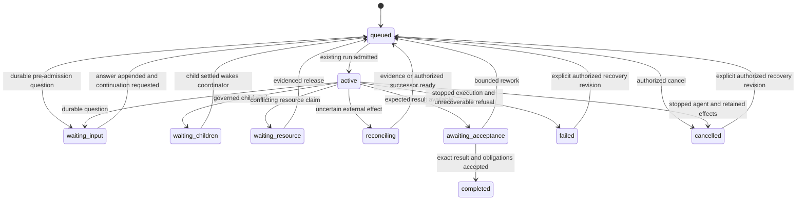
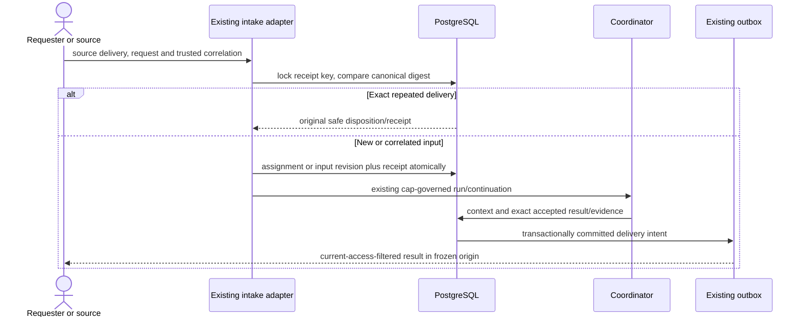

# Durable specialist assignments

## Purpose

**Implemented: persistence, input/state services and native company execution; Designed: complete invocation routing and verified assignment completion — ADR-203.** A specialist assignment preserves requested work, responsibility, input and outcome across runs. It is distinct from [human work assignments](assignments.md), execution-host placement, private memory and long-term [Company Brain](company-brain.md).

## Domain entities

The base store supports company-only assignments without a repository or run,
current user authority, pinned standing definitions, immutable input inspection
and append, exact business CAS, existing-run links, cancellation and reopening.
Current source access also gates historical input bytes; a content-free cancel
receipt requires cancellation authority without redisclosing inaccessible input.
Input append preserves standing instructions, recurring request and result
requirements, and refuses overflow rather than truncating. Recurring snapshots
must identify the exact scheduled origin. Linking a successful run never
completes its assignment. New company execution admission, intake receipt
deduplication, context/HITL cooperation, owner fencing and verified acceptance
remain in their owning slices; their public routes are still designed.

- Specialist assignment: objective, expected outcome, requester, responsible specialist/coordinator, company/project owner, targets, references, constraints, result/verification requirements and origin/destination.
- Input/authority revision: immutable standing-definition, recurring-request, current assignment input, retrieved references and historical grants in separate fields.
- Intake receipt: trusted source delivery identity and canonical payload digest mapped to a disposition/assignment.
- Working context revision: objective/constraints, sources, hypotheses/findings, questions, decisions/authors, accepted work and blockers.
- Question: exact assignment/input/owner/turn and existing HITL/human assignment reference.
- Acceptance: actor, expected input/context, exact result revision, required verification receipts and decision.
- Delivery receipt: server-bound destination and idempotent outbox intent. See [ERD](../db/specialist-assignments-domain.md).

## State machine

Assignment transitions are business state, not additional `runs.status` values.

## Process flows

Every existing intake entry resolves meaning before reserving work.

### Input/transition contract

The assignment read model exposes a positive business `revision`. Assignment
state/input mutations compare the caller's `expectedRevision` against it in the
same transaction. It is separate from `inputRevision` (frozen inputs) and
`contextRevision` (working context). Context patches compare their
`expectedRevision` against the context revision, work decisions against the work
revision, and answers against the question revision. Each accepted change to the
assignment advances its business revision under the stable parent lock. A client
reads the exact subject revision rather than substituting another counter.

Assignment reads also return the exact specialist binding, current input
references and constraints, and server-recorded origin and frozen destination.
Origin variants carry the identity of the actual manual interaction, task
comment, scheduled trigger, event subscription, webhook delivery or delegated
work. Destination variants identify a user Inbox, task thread or configured
outbound subscription; they never contain a caller-supplied endpoint URL.
An accepted result is an exact `{id, revision}` reference, not a floating result
identity. Its assignment/run membership and verification obligations are
validated before acceptance. Historical input/authority revision contents remain
separate immutable snapshots; the current read projection must not replace them.
The assignment's expected result exposes the server-selected schema reference,
version and digest with `required: true`. Launch must match that descriptor using
the existing `RunResultContract` builder and immutable binding. This is a business
requirement pointing to the existing result contract, not another output grammar.

All assignments require nonblank objective (<=8000 characters), expected outcome (<=4000), explicit requester/responsible principal, owner, <=32 canonical targets, <=64 input/knowledge refs, <=16 typed verification obligations and one server-validated origin/destination. Pure research may declare zero operation obligations; configured restart policy always injects required effect and independent-health obligations. A model cannot clear them. Context <=128 KiB, update <=32 KiB/64 entries, per-entry text <=8000; no silent truncation.

| Incoming meaning | Correlation/admission | Durable result |
| --- | --- | --- |
| Duplicate delivery | Owner/source/stable delivery ID and same canonical digest | Return original safe receipt; no run, input, alert or operation repeated |
| Same ID/different body | Existing key with changed canonical payload | `CONFLICT` before dependent writes |
| Clarification/update | Trusted assignment/question/work/thread reference plus current grant and expected revision | Append input/context revision; preserve attempts and previous evidence |
| Independent request | New delivery/logical request, even if role is busy | Separate queued assignment under existing capacity |
| Missing/ambiguous input | Durable assignment/receipt, no guessed target/correlation | Existing human question; wait with exact owner/input revision |
| Conflicting mutation | Canonical resource claim conflicts | Wait or actionable conflict, never simultaneous mutation |
| Unknown external outcome | Existing operation identity/receipt uncertain | Reconcile before any original mutation retry |

| Transition group | Allowed source and current authority | Commit and wake |
| --- | --- | --- |
| Admit | queued, active company/project binding and expected input | Existing run reservation/claim linked atomically; active only after actual admission |
| Park for input/children/resource/reconcile | active with current coordinator epoch | Persist question/work/blocker/operation pointer and state/CAS/outbox together; release slot only by owning run contract |
| Continue parked work | corresponding wait state, expected input and evidence/reply, current authority | Append input or accepted evidence; queue existing governed continuation; cap-gated activation |
| Result ready | active or reconciling after coordinator evaluation | Exact valid result revision and obligation set; awaiting_acceptance, never completed automatically |
| Accept | awaiting_acceptance, responsible/current acceptance authority, exact input/context/result and satisfied policy obligations | Acceptance/state/completion timestamp/delivery outbox in one transaction |
| Request rework | awaiting_acceptance or settled work item, current responsible actor, remaining budget | New work/input revision; old result immutable; governed continuation |
| Cancel | Any non-completed state, current cancel authority, expected revision; stop owned agents first | Record cancelled with reason, close owned waits/claims/outbox; preserve confirmed/unknown effects for independent reconciliation |
| Fail | Nonterminal state, stopped execution and classified unrecoverable error | Preserve diagnostic/effect history; failed reason/time, never infer not-applied |
| Explicit reopen | failed/cancelled only, current recovery authority and fresh recovery/input revision | New owner epoch; preserve original terminal event; outstanding unknown effect routes to reconciling, not dispatch |
| Completed replay | completed and exact original request/decision | Safe existing receipt only; independent new objective is new assignment |

Business transitions append the existing transactional `specialist.assignment_changed`
outbox fact with business revision, previous/current state, safe cause and server
actor in the same transaction as the assignment head. Agent-authored context facts also retain the actual Run/node in an optional content-free `originExecution` payload pointer; lifecycle ownership metadata remains unchanged and no model-provided origin is accepted. Historical facts acquire no invented origin. Reopening cannot erase a
prior failed/cancelled fact. Facts contain no objective, input, source excerpt or
free-text terminal reason and are not agent triggers. Input/context/result
contents remain in their current-access-controlled owning stores; this is not an
additional execution or attempt ledger.

### Canonical intake receipt boundary

The intake service receives a validated request containing owner, specialist binding,
objective, expected outcome, literal input, targets, references, constraints and
verification requirements. The authenticated source adapter supplies the canonical
origin; no caller-supplied origin, requester, standing definition, permissions or
content digest enters the public create contract. Manual input defaults to an
explicit empty string when omitted. Provider pins, expected result schema and
historical authority are prepared by the server and frozen separately.

One immutable `specialist_intake_receipts` row binds the source kind/key, original
request digest, server actor and exact assignment/input revision. The key hashes
the owner and canonical origin; manual interactions additionally include the
current user identity. Task-comment delivery additionally includes the addressed
specialist binding, allowing one comment to request independent work from
multiple specialists. Other adapters retain their existing canonical delivery,
trigger, event/subscription or parent/work identities. Payload hashing
uses the original normalized request, excluding mutable standing/authority data.
The transaction serializes the key before lookup. Concurrent identical requests
produce one assignment; changed payload conflicts without dependent writes.
Replay checks current assignment/source and submission authority and returns the
original input receipt without resolving a changed or disabled provider again.

Adapters prepare new work only after the receipt lookup and persist any Run
reservation in the same outer transaction. There is no external mutation inside
that transaction and no additional execution scheduler or attempt ledger. Receipt
storage and manual admission are qualified independently of source dispatch.
Native company cron/event creation and registered dispatch plus authenticated
company/project webhook intake are qualified. Correlated clarification and updates
retain their context/HITL tasks (T23–T26); native agent delegation retains T27. A matching source identity alone never authorizes an
adapter to act as another principal.

### Company manual reservation

The server accepts the original bounded request and manual idempotency key. It
derives the interaction identity and requester from the authenticated user,
resolves the exact current owned specialist binding and its declared coordinator,
and builds the expected result from the actual pinned provider. Caller-supplied
actors, grants, result schemas, package pins and origin/destination are refused.
New reservations require current company read, submit and update authority;
exact duplicate inspection requires current read/submit and source access and
performs no new reservation. A changed/disabled provider is not re-resolved for
duplicate work.

Receipt creation, the assignment/input and the existing agent or Flow reservation
share one outer database transaction, reusing the existing launchers' transaction
helpers. Host/event-consumer activation uses a stable pooled database before that
transaction; a background consumer must never retain a transaction handle after
commit. Exact replay is inspected before any host/provider preflight. Reconnect
diagnostics retain sanitized error type, SQLSTATE and constraint, without query
parameters, raw database causes or input content. Failure rolls back Run/session/placement/link/state/receipt
data together. The returned assignment includes the actual retained Run links.
Business responsibility becomes active at reservation; the existing Run remains
Pending until its existing scheduler pool grants capacity. This does not grant
an execution slot or start an agent process inside the intake transaction.
Actual source/API adapters wake existing dispatch after commit and never repeat
reservation for an exact duplicate. Project repository admission remains its own
existing project boundary.

### Native recurring intake checkpoint

The registered company cron path uses the same canonical receipt and native
reservation as manual work, with its existing source claim/fence and reserved Run
identity. Its complete scheduled request stays in the existing v1 input plane.
Current source/configuration/creator authority is checked before reservation;
replay preserves the original assignment/input. Shared recovery adopts a committed
exact Run or records unknown without blind redispatch. Native source creation can
enable qualified cron work only with current creator authority, declared cron
trigger, enabled reviewed bindings and a nonempty recurring request. Native event
source creation and registered standalone/coordinator dispatch are also qualified,
with explicit current recipient sharing authority. Company webhook input is
server-attributed and content-guarded across personal token rotation through the
existing agent-event entry point. Legacy invocation adapters and assignment
clarification remain open. See the [runtime contract](specialist-runtime.md#native-company-cron-intake-checkpoint).

### Native project webhook intake

**Implemented native platform intake; installable stand qualification remains separate.**

`POST /api/agents/{agentId}/event` negotiates native project assignments with
`X-Maister-Owner-Kind:project`. The branch requires a verified global personal user
and both `agents:trigger` and `assignments:submit` token scopes. Project/agent/
librarian credentials cannot impersonate a human requester. The closed version-one
body is `{schemaVersion:1,assignment:<project specialist request>}`; ownership and
binding remain explicit validated references. The current user's project authority
and exact addressed attachment must agree before new work. The server supplies
attribution, expected result, Inbox destination, standing/policy snapshots and
native invocation origin. Raw body and caller-declared actors are not launch authority.

`Idempotency-Key` identifies the delivery. Endpoint identity includes the actual
user, project and addressed specialist, independent of personal token rotation.
Exact replay checks current read/submit/source access before adopting the retained
receipt; it does not resolve a disabled or changed provider again. Changed content
under a used delivery conflicts. Different deliveries queue separate assignments.
The existing project request intake retains original input before repository/Run
admission and rechecks current permissions, pin, configuration and result contract.
An unavailable runner preserves queued input for exact retry after repair.

Native transport requires JSON, bounded to 32 KiB while reading, and rejects invalid
UTF-8/JSON, unsupported versions, extra fields, missing delivery identity and
`X-Maister-Trigger-Event-Id`. Domain-event identity is never accepted as webhook
delivery authority. The source payload retains validated delivery metadata only;
private objective/input remains in the original assignment input. A valid request
returns the assignment with 201, exact replay 200; safe refusal uses existing
no-store error/audit behavior. The branch shares bounded transport and verified
personal identity with the company webhook path. Omitting owner negotiation retains
the existing project-token legacy payload/202 contract. No scheduler, migration or
execution ledger is added. Technical completion remains separate from acceptance
and result delivery.

### Existing project launch entry — Implemented (T22)

`POST /api/projects/{slug}/agents/{agentId}/launch` additionally accepts a closed
version-one envelope `{schemaVersion:1, assignment, idempotencyKey}`. The assignment
contains the bounded canonical objective, expected outcome, literal input, targets,
references, constraints and verification requirements; owner and attachment are
resolved from the authenticated route, not accepted from the body. The new branch
has no runner/workspace override, requester, authority or expected-result override.
It returns the canonical private/no-store assignment receipt (201 or replay 200).
The existing task/runner/workspace launch body and its 202 response remain compatible.

Both manual entry points use the same authenticated user/idempotency identity and
canonical digest. Concurrent browser, bearer and routed deliveries therefore adopt
one original assignment/input/Run. Exact completed replay does not require current
execution enablement or provider readiness; current project/source authority still
applies. New standalone and coordinator work uses the already qualified project
native admission, repository rules, exact provider witnesses and existing carrier
Task policy. Source identity lookup does not preflight mutable execution settings.

Three concurrent browser/bearer/routed deliveries qualify one assignment and Run
for standalone work; routed/native coordinator deliveries likewise share one
carrier and required result. The atomic intake result is inspected again for an
existing Run: a caller that missed its initial receipt lookup can adopt work
created before its later transaction, without re-entering queued-only admission.
Configuration, provider, payload and authority conflicts remain explicit failures.
Current project permission loss refuses routed replay, while an encoded role ID
and disabled current attachment preserve authorized completed-history replay.
Existing legacy workspace/runner launch overrides retain their original contract.

### Project automation review

**Implemented source review and native cron/event admission; installable stand qualification remains separate.**

Historical project schedules have no recorded human authority. Migration leaves
their new `assignmentReview` null, without changing `createdBy`, original request
bytes or prior invocation snapshots. An explicit schedule-collection save by an
authenticated operator records a review only for cron/event sources carrying
explicit `reviewForAssignments:true` whose
effective installed project definition declares a specialist. The server checks
the current active operator's project settings authority inside the save
transaction. Ordinary sources and mentions retain null review metadata.

The read-only base review contains `reviewerUserId`, UTC `reviewedAt`, the
accepted collection `sourceRevision` and `sourceSha256`. The digest covers the
normalized selector and literal recurring request, with sorted event kinds;
enabled state, runtime counters and next-fire time are separate eligibility data.
Review records authorization now, not original authorship, a permission grant,
or knowledge confirmation. Request bodies cannot supply review metadata.
An explicit review request without an identified operator is refused. Replacing
a source with false/omitted review intent clears the witness;
unrelated attachment changes preserve it. Schedule revision CAS still governs
the complete save, including review SET/CLEAR, so concurrent editors cannot
combine one user's authority with another user's request.
Ordinary source edits and clearing without approval preserve the existing broken-pin
repair path. Approval requires the actual current pin; no catalog substitute or
inferred historical approver is used. The cron/event editor's review checkbox sends only
intent. It never submits reviewer identity, permission or confirmation metadata.
The existing API requires repository-input visibility for this projection. The
project server component withholds both literal request and review metadata from
readers without that visibility; a content digest cannot bypass that boundary.

Native project cron dispatch validates the reviewed source and current initiating
authority, captures the review in a versioned invocation snapshot and preserves
the existing version-one recurring request in its separate input plane. The next
section defines its canonical claim/Run admission. Native event review additionally
captures enrollment and separate sharing approval under the event contract below;
source review alone is not a general knowledge or execution grant.

### Reviewed project cron invocation

**Implemented native platform cron intake; installable stand-pilot qualification remains separate.**

A newly claimed reviewed project source uses binding snapshot version 3: the
existing selector fields, explicit project owner and exact version-one `review`.
Company version 2 and historical project version 1 remain byte-compatible. The
existing version-one scheduled request remains a separate immutable input plane.
Claim insertion matches the actual source owner, selector, review, fence and recurring
request; current content must match the reviewed digest. Review is not inferred
for old claims. A native professional without review receives a named refusal,
and a reviewed source cannot silently fall through ordinary-agent execution if
the professional declaration becomes unavailable.

Native cron work uses origin `{kind:schedule,scheduleId,triggerAttemptId}`, the
actual reviewing user as requester, an invocation objective label, literal input
in the scheduled-request plane and server-required result verification. The
original destination is that user's Inbox. Current read/submit/update authority
is checked before intake and again at existing Run admission; historical approval
never restores a revoked permission. A server-only appointment binds the real
open claim, review, source and reserved Run, with matching cron trigger fields in
standalone and coordinator insertion. Repository work retains project admission.

Independent fires retain independent assignments; duplicate delivery adopts the
existing receipt/Run. The original claim and Run ledgers handle uncertain launch
responses and interruption: reconciliation inspects the exact reserved Run, never
blindly relaunches. The existing scheduler/pool performs deferred dispatch.
Malformed source capture records safe source telemetry and a bounded retry under
a configuration witness so a poison due row cannot indefinitely starve healthy
work. Actual registered ticks, default drivers, immutable input, current reviewer
revocation, changed-source refusal, reserved identity and lost-settlement recovery
are qualified through the actual registered scheduler, default standalone and
coordinator drivers, real supervisor and controlled ACP processes. These platform
checks do not establish real-model or installable stand-pilot readiness.

### Reviewed project event invocation

**Implemented native platform contract; installable stand qualification remains separate.**

New native project event reviews use review version 2, retaining the existing
reviewer/time/collection revision/content digest and adding `eventCursor` and
`sourceSharing`. The cursor is the server-observed maximum event ID for this
project at review, represented as a canonical decimal string (zero means an
observed empty outbox). Native subscriptions consume only greater event IDs.
Rereview of an unchanged selector retains its observed enrollment cursor, including
sharing changes and ordinary attachment saves; queued matching events are not
silently skipped. A new, previously unreviewed or changed selector captures a new
cursor. Review timestamps do not invent a temporal validity interval. Existing event
review v1 remains inspectable and requires an explicit new review before native
event admission. Cron reviews remain v1, and no old attribution is backfilled.

`reviewForAssignments:true` approves source selection. The separate event-only
`shareEventContext:true` approves `sourceSharing:producing_run`; omission/false
records `sourceSharing:none`. Sharing cannot be requested without review intent
or through a cron/mention source. The server records both under the existing
collection CAS and actual operator authority. This authorizes only the matching
producing Run's classified context for the appointed professional/Flow roles.
Each recipient still needs current access to underlying records, company sources
and private memory. It does not create general assignment or Brain read access.

The common version-3 project binding snapshot captures this review. Native event
origin is `{kind:event,eventId,subscriptionId}` and the requester/destination come
from the actual review operator. Input and stored trigger payload contain only
validated event/kind/project/task/Run identifiers, never an unvalidated payload
body. Server-recorded source restrictions survive into the assignment and Run
independently of model citations. A user-authored project fact without a producing
Run has its project context; an agent/system fact with missing or unclassified
provenance refuses explicitly. A foreign/missing producing Run is never treated
as a public project event.

The source appointment validates the actual open claim, current source/review,
watermark, event, producing Run and exact reserved identity at fresh admission.
The registered consumer retains existing claim/replay ledgers, with independent
native subscriptions, bounded source pages, explicit malformed-source handling,
self-exclusion using the producing professional and current chain caps. Native
project coordinators record their actual chain depth. A historical default zero
without a classified native appointment does not prove a chain root; system-authored
terminal facts inherit their producing chain. Existing per-professional event-kind
exclusivity remains; distinct professionals consume their own subscription independently.

Permission to inspect a producing assignment input is constrained by the real
event appointment, exact source closure, current receiving appointment/provider,
initiating authority and live sharing approval. Unrelated inputs remain denied.
Withdrawing sharing also governs already admitted event work before disclosure or
effects; reapproval can restore access without rewriting its original input or
executing a duplicate delivery. Selector/enrollment changes govern fresh intake.
Real registered-consumer qualification covers standalone and coordinator completion,
cursor rewind, old-event exclusion, sharing revocation/reapproval, unrelated input
refusal, missing sharing, direct user facts, unknown provenance, self/depth bounds,
25 malformed sources before healthy work and preserved evidence. These checks use
local PostgreSQL and the real supervisor with controlled ACP; they do not establish
installable stand-pilot readiness.

### Native task-comment intake

**Implemented native platform intake; correlated clarification and result delivery remain their explicit later contracts.**

A user-authored stored task comment addressing a pinned professional is an
independent source `{kind:task_comment,projectId,taskId,commentId}` for each
addressed attachment. The registered consumer retains its existing mention
configuration, actual event claim/fence and reserved Run; canonical source identity
additionally includes the addressed binding. A native professional receives an
assignment before execution. Ordinary agents retain their legacy summon behavior.
An active native assignment never silently suppresses independent comment work.

The server validates the actual event, stored comment/author/task, current project
membership, enabled mention source, exact claim selector and installed professional.
A human comment cannot be supplied by claiming another actor in event payload.
Agent-authored native requests require governed principal admission (T27); they
cannot impersonate the human requester. Input retains the canonical stored comment
text without truncation, with a stable original source identity and immutable
input digest. An oversized native objective is refused explicitly. The expected
result is the reviewed specialist's mandatory contract; required-result verification
is server-injected. Destination is the originating task comment, frozen separately
from the work input. Actual durable result delivery remains T25.

New work uses the common project request transaction and existing native launch,
repository admission and pool. A server-only source appointment binds existing
attempt/event/source/reserved Run identities to the actual comment origin during
Run insertion; current source selectors and authority are rechecked. Redelivery
adopts the original receipt and never creates a second Run. Source/configuration
conflict is explicit, not resolved by selecting another provider or caller. Manual
source identities and legacy project v1 trigger snapshots remain unchanged.
Clarification and updates use explicit assignment correlation (T23–T26); the
adapter does not guess another assignment from prose or current busy status.

Actual settings/comment HTTP routes and the registered consumer qualify independent
queued work, default standalone/coordinator execution and same-comment replay.
A source probe uses the real existing claim in a rolled-back transaction: forged
reserved Run identity and selector changes explicitly refuse. Current author
permission loss creates no unauthorized assignment or ACP work. Native input over
8,000 stored characters keeps its posted source and records the safe reason token
`project_comment_input_too_large`, with localized incident remediation. The
ordinary 38-case trigger suite retains its existing summon semantics. No new
migration, scheduler or attempt ledger is introduced.

### Project manual admission

Project manual work resolves `specialistBindingId` through the current project
agent attachment, with current read/launch authority and the actual trusted
project package pin. The original receipt, assignment and input commit together
before the existing launcher performs repository/workspace admission. An unavailable
selected runner or refused repository admission leaves one queued assignment;
retrying the same request can admit that retained work after the precondition is
repaired. No fallback runner or fabricated project is selected.

Inside the existing Run transaction, the service locks the assignment revision,
rechecks current attachment/package/configuration/policy and compares its frozen
expected result. Run, session, placement and initial assignment link/state commit
atomically. Concurrent admission adopts the winner; the losing allocator follows
the launcher's existing owned-worktree cleanup. Original assignment input is a
separate prompt section and exact input inspection, alongside standing configuration,
recurring request and permissions. Current source policy shares only the exact
server-appointed input with the active role and initiating user; it grants no
general Brain read access or confirmation authority. Later input heads cannot
rewrite the retained prompt. Technical Done leaves business acceptance separate.

A declared project coordinator additionally retains standing snapshot v2 with the
exact project Flow ID/ref, installed revision ID, resolved revision and manifest
witness. Existing v1 snapshots remain byte-for-byte unchanged. The current trusted,
enabled provider and mandatory public-result contract are checked separately from
physical runner availability. A provider change refuses admission instead of
silently selecting a different graph.

The assignment retains its initial existing Task identity once. Task creation and
that link commit under the assignment lock; retries reuse it. Its shared title is
the role name and its stored prompt is only the role identity. The runtime overlays
the private original assignment input without copying it to the task board. The
existing Flow reservation transaction binds the exact task/provider/input, source
role/configuration and result contract, then links and activates the assignment.
A duplicate arriving between task retention and Run reservation can observe the
same queued assignment; it cannot mint a second task. Later continuations retain
separate work/Run links rather than replacing this initial identity.

The session `POST /api/specialist-assignments` exposes company-owned and project operational-specialist/coordinator manual
submission with the bounded original request and idempotency key. It returns the
existing assignment DTO (201 for new work, 200 for exact replay), then uses the
existing pool scheduler after the reservation commits. Host pressure/capacity can
leave execution Pending. A replay can signal interrupted pending admission without
allocating another execution. `GET /api/specialist-assignments/{id}` supports
currently authorized company/project inspection; both responses are private and
no-store. Personal user-token `POST /api/v1/ext/specialist-assignments` and exact GET reuse the same intake/reader and immutable manual identity, so switching between browser and API does not repeat work. Both require the corresponding token scope and current owner/source authority; project/agent/librarian tokens cannot impersonate the user. The existing token audit records authenticated success/refusal, CONFIG/JSON validation uses external 422, and responses remain private/no-store. Source-specific and governed agent-principal adapters remain Designed. Fresh company standalone submission is qualified through the actual
session route, default scheduler dispatch, real supervisor/ACP process, validated
operational result and physical cleanup. Completed HTTP replay issues no second
create/prompt command. Coordinator intake is qualified through queued HTTP
admission and its existing driver. Project coordinator intake uses the actual attached Flow, repository admission and native result-only terminal path; the stand pilot remains unqualified.

### Clarification and context

Existing agent-question/HITL services gain an assignment subject without a task requirement. Human `assignments` retains claim/answer ownership; company actor scope and role mapping come from the company Flow binding. A question stores assignment, expected input revision, coordinator epoch, prompt/turn and source principal. Same answer replay is inert; changed/late/wrong-assignment/terminal answer returns 409. Persist answer intent before delivery and mark delivered only after ACK. Failed DB/delivery handling explicitly cancels/releases the supervisor's owned permission deferred; no hidden promise waits.

The assignment subject extends the existing `hitl_requests` row with nullable
`specialistAssignmentId`, `specialistInputRevision` and `specialistAnswerInputRevision`.
Existing task questions keep their exact data and NULL native fields. New native
questions retain a closed server `assignmentQuestion` snapshot beside the existing
FormSchema and `agentPrompt` checkpoint proof: exact input ID/revision/SHA, context
revision, requesting business revision, actual user/Run author, stable principal
and delivery digests, and complete consumed source restrictions. Native subject,
form, prompt, authorship and committed answer cannot be overwritten or deleted.
Question creation uses the current root appointment; multiple unsettled roots
refuse explicitly until the governed business-owner claim exists (T29).

Checkpoint ACK is followed by the existing canonical quiescence wait before
releasing the execution assignment, so late exit evidence is not discarded as a
stale epoch. If activation persistence fails, the question remains pending, its
process is already stopped, and recovery adopts the exact successful checkpoint
receipt instead of issuing another checkpoint. An answer requires its exact new
input revision; terminal lifecycle closure with NULL response is a distinct
unanswered closure and creates no invented answer or input revision. Public
question routes, assignment answer/continuation and graph subjects remain Designed
until their owning T24 runtime checks pass.

The response body carries `response` as a bounded object validated against the exact stored native question FormSchema, not a replacement free-text-only grammar or caller-supplied schema. Required string answers are nonblank; human question suggestions permit custom text as the existing contract specifies, while permission/transition enums stay closed. Work `clarify` decisions may omit resultRevision when no result exists; accept/reject/rework of a result require the exact ready result revision at the service boundary. Context entry IDs are assignment/revision-local logical keys, not caller-authoritative global database row IDs.

Context changes lock the stable assignment, check expected context revision/epoch and current source grants, then append one immutable revision and attributed decision. A losing patch returns 409 and must be explicitly rebased; no automatic last-writer merge. Accepted findings refer to exact child result revisions. Server-derived source restrictions propagate through summaries and context even if a model omits citations. Current permission is rechecked at read/share/accept/action; snapshots are history, not grants.

### Versioned context persistence and attribution

**Implemented: retained history, session-user and scoped execution read/update, and authorized runtime projection. Governed child/result acceptance remains Designed (T27/T28).**

Context has its own CAS revision and an exact assignment input revision. An update
must name both the expected context revision and expected input revision; an
unrelated business-head change is not permission to overwrite newer context.
Revision zero means no recorded context, including migrated assignments, and projects
the current input without inventing historical findings, an author, timestamp or
context digest. Positive history retains its exact input revision;
`currentInputRevision` exposes the latest input head independently for update CAS. Positive revisions retain a closed
version-one snapshot, exact base/input references, server actor/time, source
restrictions, request key/digest and content digest. A deferred database invariant
requires each positive context head to have its exact immutable history row;
advancing the head alone is invalid. Existing input/history and execution ledgers
remain unchanged. The migration adds no Brain foreign key or execution attempt.

The current snapshot includes objective/constraints through its exact frozen input
reference and bounded entries for sources, findings/hypotheses, questions,
decisions, work and blockers. Finding entries carry the common
`evidence_findings_v1` structure; ordinary text cannot declare confirmation or a
verified work acceptance. Accepted-work entries require the work-decision owner's
exact result/acceptance receipt (T28), separate from an author's working note.
Input and standing instructions remain separate planes. A replacement explicitly
names the current entry it supersedes; old revisions remain inspectable. Duplicate
entry IDs or two replacements of the same entry refuse instead of choosing a winner.

Public updates contain no actor, grants, timestamps, source restrictions or owner
epoch. A human edit is attributed to its current user and records no execution
ownership epoch. Executing-agent attribution comes from the actual current bound
Run/node appointment and credentials, with source closure inherited independently
of citations. Assignment owner fencing belongs to T29; a host assignment epoch is
not silently relabeled as a business ownership epoch, and earlier revisions never
receive a fabricated epoch. The remaining ownership/agent integration stays
explicitly unqualified until its owning checks pass.

An update is at most 32 KiB/64 entries; a retained context is at most 128 KiB of
PostgreSQL `jsonb::text`/256 entries, with per-entry text at most 8,000 characters. Unsupported versions, empty
updates, malformed/superseded identities and missing/stale/unauthorized evidence
refuse without partial history. Missing evidence can be expressed as an explicit
finding limitation or question without inventing a reference. Current source
access gates the whole context response and retained replay before any text is
returned; previews do not bypass that policy. Removing or superseding an entry
cannot erase inherited restrictions. Same actor/key/payload returns its original
currently accessible revision; changed payload conflicts. Concurrent distinct
patches against one base have one winner and one actionable conflict.

The native facade exposes `assignment_context_get` with the same closed assignment/revision selector as HTTP. The external route authenticates and audits the real token, then resolves its current native principal without requiring a knowledge token scope. Company credentials include `assignments:read` only when the reviewed role permits it. A machine reads through its exact Run/node appointment and frozen input, never through the initiating user's identity; arbitrary foreign assignment selectors are withheld. Context source closure is recorded on the existing Run capture before returning content, so omitted citations do not remove downstream restrictions. Human authorization preserves its existing current company/project policy. Agent writes use the current professional authority described below. Governed child/result lineage remains unqualified until T27/T28.

Executing-agent context updates require a current credential carrying both context read and update scopes, an active Run (queued/reviewed executions refuse), exact assignment/input appointment and current source access. A company role additionally needs its reviewed `assignments:update` limit, an explicit current professional update grant and current initiating-user update authority. Project appointments retain current initiating membership/launch authority independently from Brain flags. The author is always the server-resolved Run/node role. Every new snapshot inherits the consuming Run's complete source closure, including sources omitted from submitted citations. Replay and response disclosure retain current access checks. Ownership epoch remains NULL until the business owner-claim writer is introduced in T29; a host epoch is not substituted. T29 must add current business-fence checks at this same persistence boundary before owner recovery is qualified.

### Runtime projection and cooperation boundary

**Implemented: authorized context projection through the existing agent and Flow prompt paths.**

A native execution resolves its own immutable assignment link from server state.
Every execution context read/update requires that same root appointment; an event's
authorized producer-input reference does not grant the producer's later working context.
No link means no assignment context is injected or fabricated. A company role
without its reviewed context-read limit retains the existing assigned-input
prompt and receives no additional context bytes. This is an explicit enrollment
state, not a fallback after a source refusal. An enrolled projection requires the
exact current Run/node professional, current appointment/input and every inherited
source permission; an unavailable source refuses dispatch rather than returning a
partial summary. The complete source union commits to the existing Run capture
before context enters a newly assembled standalone-generation or Flow-node prompt.
This includes newly assembled override and resume prompts. Reattachment of an
existing owner request preserves its original immutable prompt bytes; ongoing
executions can retrieve current context through the authorized native tool. The
version-one DTO preserves evidence references and original authors. Standing
instructions, current input, working context and permissions remain separate.

The T23 foundation does not manufacture bounded child work or acceptance records.
T27 supplies authorized child appointments and context sharing; T28 enables exact
collected/sourceFinding and accepted-work references through those real records,
using the existing result ledger and reduction validator. Until then the context
writer explicitly refuses result-lineage and accepted entries. CBA-04 spans these
writers; finishing the foundation alone does not qualify accepted cooperation.
This ordering removes the T23-to-T28 dependency cycle without removing any result,
evidence-preservation or acceptance requirement.

### Delivery and cancellation windows

Destinations are a task/comment thread, current user Inbox, or existing configured outbound subscription/event reply. Endpoint/credentials come from server configuration, not model-supplied URL. Internal comment/Inbox delivery has a unique receipt key and is idempotent. External delivery carries a stable ID and is at-least-once unless the peer proves stronger semantics. Lost delivery ACK retries delivery only; never reruns the assignment/effect. Current access gates content before delivery, including changed recipients.

Crash before intake commit leaves no assignment orphan; after commit reuses source receipt/reserved run. Crash after answer intent but before ACK leaves delivery retryable under its exact binding. Crash after acceptance but before message delivery is owned by the existing outbox. Cancelling the assignment never deletes its operation/accepted evidence; reconciliation can continue under a dedicated current recovery grant without reviving the cancelled agent. Missing access results in a safe blocker and actionable authorized-owner incident.

## Expectations

- **CBA-01:** Assignment responsibility and all required request/result/origin fields survive retries/cancellation with existing run links, enforced by the assignment store and versioned input rows (`IT-CBA-01`).
- **CBA-02:** All six origins classify duplicate/update/clarification/independent/missing/conflicting/unknown requests without losing work, enforced by canonical intake receipts and adapters (`IT-CBA-02`).
- **CBA-03:** Standing, recurring, assignment, knowledge and authority inputs remain separately frozen and inspectable, enforced by launch/input snapshots (`IT-CBA-03`).
- **CBA-04:** Context preserves attributed structured work and rejects conflicting updates, enforced by assignment-row lock and revision/epoch CAS (`IT-CBA-04`).
- **CBA-05:** Clarification resumes the exact assignment/question/input and releases failed owned deferreds, enforced by existing human-ask/HITL delivery with assignment subjects (`IT-CBA-05`).
- **CBA-06:** Origin delivery is current-access-filtered, durable and cannot repeat business effects, enforced by typed destinations/outbox receipts (`IT-CBA-06`).
- **CBA-07:** Completion requires exact expected result and verification acceptance, enforced by transactional acceptance and terminal CHECKs (`IT-CBA-07`).
- **CBU-02:** EN/RU assignment UX exposes responsibility, questions, children, accepted evidence and authorized recovery, enforced by existing agent/history/Inbox extensions (`E2E-CBU-02`).

## Edge cases

- **EDGE-CBA-01:** Identical and changed-payload retries are distinct; changed payload rolls back dependent writes (`IT-CBA-02`).
- **EDGE-CBA-02:** Out-of-order/late answers cannot resume a newer input or different assignment (`IT-CBA-05`).
- **EDGE-CBA-03:** Two context writers cannot silently lose a decision; loser sees `CONFLICT` with safe current revision (`IT-CBA-04`).
- **EDGE-CBA-04:** Child Done, stale result or missing independent verification cannot satisfy completion (`IT-CBA-07`).
- **EDGE-CBA-05:** Lost origin ACK repeats only delivery, not accepted work or external mutation (`IT-CBA-06`).

## Linked artifacts

- [ADR-203](../decisions.md#adr-203-durable-specialist-assignments-and-company-coordinator-flows), [persistence](../db/specialist-assignments-domain.md), [runtime](specialist-runtime.md), [cooperation](specialist-cooperation.md).
- [Human assignments](assignments.md), [HITL](hitl.md), [scheduled requests](scheduled-agent-requests.md), [web API](../api/web.openapi.yaml), [error taxonomy](../error-taxonomy.md).
- Implementation: `web/lib/specialist-assignments/` (base store implemented), existing agent-question, prompt-owner, result and outbox services; invocation/cooperation remain designed.
