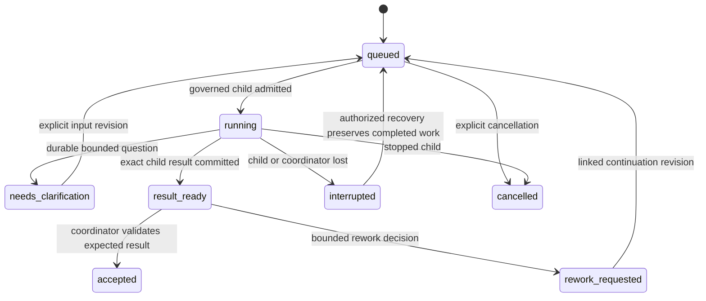
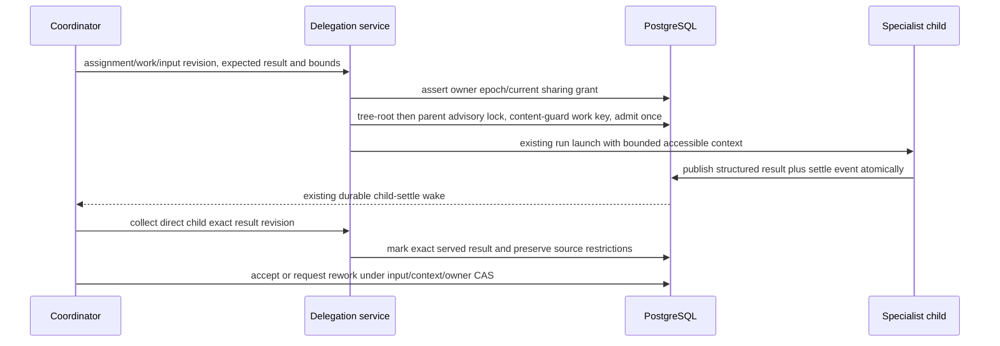

# Governed specialist cooperation

## Purpose

**Designed — ADR-203.** Extend the existing RAH delegation, structured result collection and prompt-owner recovery with assignment-scoped responsibility and working context. This domain does not introduce another scheduler, run kind, execution attempt ledger or native unbounded subagent channel.

## Domain entities

- Responsible principal: stable specialist/coordinator accountable for overall assignment acceptance.
- Executor claim: renewable assignment owner lease with positive epoch, distinct from responsibility and host placement.
- Logical work: assignment/input revision/work ID, bounded objective/constraints, authorized recipients and expected result.
- Child link: existing direct parent/child run relation plus logical-work revision identity.
- Accepted intermediate: exact result/finding revisions and original witnesses plus accepting server principal.
- Budget: effective ancestor/instance ceiling and accumulated usage from existing run/session/turn facts.
- Context: [assignment-owned versioned document](specialist-assignments.md), not long-term Brain.

## State machine

Work-item acceptance is separate from child execution and assignment completion.

## Process flows

Delegation reserves one logical child under existing parent/tree-root admission locks.

### Bounds and identity

Logical delegation identity is `(assignmentId,inputRevision,logicalWorkId,workRevision)`; `logicalWorkId` is the caller's bounded assignment-scoped key, while the server-generated work subject `id` is returned by the first receipt. The canonical request digest includes target specialist/Flow binding, objective, refs, constraints, required result and effective bounds. Exact replay returns the same child; changed payload under the key returns 409. Existing `run_delegate` and plan admission must share this guarded seam. Children are direct children of their current coordinator; merely sharing assignment ownership never permits collecting a foreign branch/grandchild.

Delegation advisory locks use tree-root-then-parent order at the shared helper,
including explicit pre-admission locks used by task/plan paths. The root case
locks its key once; repeated admission in one transaction is reentrant. Given
one transaction holding the root and a second admitting a nested coordinator,
the second must wait before acquiring the nested parent key. The first can then
admit that nested parent and commit; both finish without a deadlock. After a
wait the actual ancestry and bounds are reread under the locks. Changed ancestry
refuses with `CONFLICT/delegation_lineage_changed` rather than counting under a
stale root. Assignment/Run row-lock ordering and current source authority remain
additional requirements at each decisive admission boundary.

The shared delegation seam must resolve the actual parent chain to a known root
before it counts or creates child work. The resolution bound is 64 distinct Run
ancestors, including the immediate parent and root. Missing Runs, repeated Run
identities and a chain exceeding that bound refuse with `CONFIG` and
`reason=delegation_lineage_invalid`; a truncated chain cannot become a guessed
root or shed an ancestor budget. Given a real 64-ancestor chain and otherwise
permissive bounds, admission may proceed; adding a 65th ancestor must refuse
without allocating child records. Self-cycles, two-Run cycles and an unknown
parent receive the same explicit safe refusal. This guard extends the existing
Run-tree admission helper; it supplies neither assignment permission nor a new
execution ledger. Logical work/receiving-role admission and assignment-wide
budgets remain the T27/T29 contracts above.

Company coordination resolves company agent/Flow children through explicit installed bindings. Project children use actual project admission. Cross-repository automatic delivery is not added. Context/evidence sharing intersects initiating principal, current child binding, source restrictions and assignment grant; the model cannot widen recipients or assert permission.

Designed default maxima are depth 2 (absolute from root), fanout 4, active children 2, total child attempts 8, tokens 100000, wall-clock 30 minutes and consecutive failures 3, all min-merged with existing instance/ancestor ceilings. A declared smaller limit remains binding. Operator policy may explicitly choose another bounded value before launch; a child or retry cannot raise it. Wall-clock includes parked/HITL/resource time from first assignment admission; expiration stops new work and requests confirmed teardown, never declares external effect failure. A current authorized human can append an explicit policy/budget revision without erasing already consumed time/tokens.

Usage projects from existing run/session/turn usage with stable identity, including all coordinator replacements/rework attempts. Cumulative updates charge only the monotonic delta once; replay cannot double-charge. Assignment budget projection is not a new attempt ledger. Existing global pool locks/counters gate new and resumed work, including company rows. Parent WaitingOnChildren/Review/NeedsInputIdle release capacity as existing run predicates specify; continuation reacquires capacity rather than directly writing Running.

Canonical intake checks assignment usage before it reserves new work. It
uses the earliest Run appointment for elapsed time, counts each reserved or
linked child identity once, and reads base token totals from existing Run
rollups. Resume counters are subsets of those totals. Exact replay returns the
existing reservation before charging any new work. Later reservations inherit
the strictest retained bounds for the assignment. At exhaustion, intake
returns `PRECONDITION/assignment_budget_exhausted` with the meter, observed
value and limit. Binding a project child rechecks the current budget under the
same assignment fence and credits the child’s existing reservation. A refusal
rolls back Run creation and leaves the logical work receipt available for
inspection. Current ancestor ceilings also constrain new reservations. The
existing scheduler checks assignment usage and open work before a direct start
or queued promotion. A budget-blocked child stays Pending and does not take a
slot or occupy the eligible queue window. Teardown of already-running work and
replacement admission remain open.
Shared tree admission also counts open native reservations against the parent
fanout and ancestor child-attempt ceilings. The binding transaction credits
only its exact open reservation when it rechecks those ceilings.

Project coordinators can use `run_delegate` with `assignmentWork` to appoint a
workspace-none agent with a required pinned result contract. The server binds
the Run, source closure and appointment together. The current originating role
can collect its direct child. An exact nested appointment preserves the
initiating user’s authority and attributes new work to the executing child
through the retained source chain.

The company reservation service can bind a repository-free standalone agent
child to exact retained work. It uses the reviewed receiving binding, current
receiving assignment-read grant, existing Pending lifecycle, and a required
operational result. The child prompt uses the delegated objective and omits the
parent’s standing request. The existing HTTP and MCP delegate and collect tools
support this company scope through an active execution credential. Collection
applies the same exact originating-role and source checks as project collection.
The shared input admission service can capture source-bearing input for the
exact same-company child when both roles still have current authority.
The existing scheduler and owned agent driver execute a standalone company
child in its own company directory. Child credentials bind the receiving role
and become unusable when its grant is revoked. A valid typed child result is
collectable while the assignment remains active for a separate acceptance
decision.

`run_delegate` also accepts a reviewed company result-only Flow. The existing
graph driver restores the delegated objective and frozen runner sessions. It
checks inherited source restrictions against the current node before prompt
delivery, and `run_collect` serves the valid pinned export. The originating
professional can send a live clarification to a finite agent child using
`run_message` with its exact Run ID, `mode: steer`, and a stable request key.
The shared steer command retains the input and reads back its receipt. A
definitive refusal creates no successor turn or delivered transcript entry.
For completed company result-only work, `run_collect` returns the exact work,
business, input and result revisions. The originating professional uses those
witnesses with `run_rework` to create an attributed decision and the next
request revision under the same logical work ID. The original result remains
attached to its original Run. The continuation uses the original receiving
pin, current source authorization and the remaining assignment budget. The
existing scheduler and driver run the new child. Rework for native project work
and work with external-effect obligations remains open.

### Decisive execution fences (T27)

Tree-root-then-parent advisory keys serialize admission counts. Before deciding,
lock each actual Run from root toward parent with `FOR NO KEY UPDATE NOWAIT`,
then reread the complete ancestry, bounds and statuses. These non-key fences stay
held until the carrier/child transaction commits and remain compatible with
execution-event foreign-key locks. A terminal ancestor refuses new admission with
`PRECONDITION/delegation_ancestor_inactive`. An already held execution row yields
`CONFLICT/delegation_execution_busy`; the transaction rolls back rather than
waiting while holding the tree key and creating a root/nested-writer deadlock.
After the competing writer settles, the caller must re-enter current admission;
a stale snapshot or guessed child outcome is not used.

Task-parent qualification acquires the same rooted fence before its parent row.
Input/source classification locks use non-key mode as well, retaining existing
source and current-authority validation without foreign-key lock upgrades.
These fences protect the admission decision. They do not replace current token,
assignment-owner, receiving-role or source authorization, and do not qualify the
full cancellation/recovery protocol reserved for T27/T29.

### Logical-work persistence and revision axes

Storage and canonical intake are implemented. Native child dispatch and work
decisions remain T27/T28 work.

A work subject has a server-generated `id` scoped to its assignment and one
caller-supplied bounded `logicalWorkId`. `workRevision` identifies an immutable
request definition; `revision` is the optimistic state/decision counter for that
exact definition. These counters are independent. A child starting or publishing
through the existing execution ledger does not rewrite either request definition.
Decision requests name the expected business `revision`, `workRevision`, exact
assignment input and, when required, exact result revision. A newer request
revision makes an old definition historical; inspecting it never authorizes a
new decision on it.

`specialist_work` uses the composite key `(id, work_revision)`, with a unique
assignment/logical-work/request-revision key. Each revision retains the actual
parent/Run-node actor, exact assignment input/digest and context witness, bounded
objective/constraints/targets/evidence references, pinned receiving role and
optional Flow, required result contract witness, effective bounds, inherited
source policy and original content digest. Rework appends the next request
revision under the same stable subject; it cannot overwrite the old child,
result, actor or definition. No guessed legacy work subject or author is backfilled.

Persist only business decision state. Queued/running/interrupted/result-ready
views derive from the retained reservation and existing Run/result facts; a
second execution status or attempt ledger is not introduced. A reserved Run
identity is an admission intent, not an executed child. Binding requires that
same owned reservation and actual direct parent relation. A result-ready view
requires an exact validated result. The assignment stays active pending a
separate acceptance decision.

Delegated requests extend the existing canonical intake receipt with a distinct
`delegated` disposition and exact work/request revision. Its source identity binds
assignment, input, logical work and request revision, independently of ephemeral
token rotation. The first receipt retains the actual originating agent/Run/node;
no initiating human is substituted as its author. Same identity and content
adopts the original subject/reservation after current authority checks; changed
content returns a conflict. Replaying historical work does not reapply assignment
CAS, re-reserve a child or reset a budget. New work requires the current assignment,
input and context witnesses. Receipt, definition and business state fact commit
atomically; incomplete writes roll back.

The delegated intake service checks the current credential, originating
appointment, and source permissions before returning any receipt. Rotation
within the same authorized Run can recover its reservation without changing the
retained actor. The same key with different bounded work input, receiving pin,
or effective limits conflicts. First admission requires a running responsible
professional and the exact assignment business, input, and context heads.
Replay uses the recorded request witnesses and still checks current authority.
The assignment row is acquired without waiting after the rooted Run fences
and before company credential resolution reads the assignment. A concurrent
human transition can then settle without a lock inversion.

Historical run links with only unqualified work labels remain historical unknown
references. New native work enrollment uses an explicit exact work witness;
an old label or an inherited assignment selector cannot manufacture a current
appointment. Main-store reference guards validate available identities and version
witnesses without a Brain FK. Source access, receiving-role authority and current
coordinator ownership remain required checks in the T27 native service. Storage
alone grants no delegation capability. Main migration `0267` requires atomic work
and attributed intake retention, refuses bare acceptance/rework decisions, and
binds any executed child to its exact role/Flow pin and native Run link. Main
`0272` records immutable company result-only rework decisions and requires the
exact next work revision in the same transaction. Acceptance and accepted
context entries remain open. Forward migration `0268` closes
nullable source/context/target comparisons under the
[persistence guard contract](../db/specialist-assignments-domain.md#backfill-guards-and-lifetime);
retained company source identity survives catalog FK removal.

### Ownership, rework and acceptance

Assignment executor lease is 120 seconds, renewed every 40 seconds by one fenced owner; each claim/renew/write checks current epoch, owner ID and fresh expiry in a transaction. A stable assignment-row CAS increments epoch when replacing an owner. Execution-host assignment epoch remains a separate lower boundary. Current permissions are checked in addition to both fences. A stale owner yields with a typed conflict; it cannot finalize another run's current work or classify itself as a new failure.

Acceptance stores responsible server principal, exact input/work/result revision, original evidence refs, limitations and verification decision. Schema validity, child Done or process exit alone cannot accept work. Agent children use supported existing message/rework. Flow children do not gain an unsupported message mutation: work rework creates a linked governed continuation, preserving the previous result and effect receipts. Rework references the new expected input revision and consumes remaining assignment/ancestor budget. Completed external effects are adopted as evidence, not replayed.

### Exhaustive interruption/recovery table

These rows cover every current run-status value. Recovery runs through existing event dispatch/startup/scheduler owners and is keyed to the assignment owner epoch. Any terminal coordinator status triggers ownership review, not only Crashed.

| Run status | Agent child after owner loss | Flow child after owner loss | Coordinator recovery |
| --- | --- | --- | --- |
| Pending | Cancel unadmitted reservation or adopt under current new owner; no duplicate launch | Same, preserving pin/work ID | New claim adopts reserved run and queue position under cap |
| Running | Fence old owner; retain live child if authorized or stop/observe quiescence before replacement | Same; preserve exact node_attempt and prompt application | Resolve live host/session ownership first; no parallel replacement executor |
| NeedsInput | Preserve question only when assignment/input/owner correlation remains valid; otherwise close owned wait explicitly | Same for permission/form/human node | Rebind authorized continuation or issue new attributed question; release invalid remote deferred |
| NeedsInputIdle | Preserve checkpoint and exact question; resume only proper agent idle path under cap | Preserve graph checkpoint/input; graph idle claim under cap | Adopt checkpoint, never generic prompt replay |
| HumanWorking | Retain human claim and work for explicit review, never overwrite | Same | Surface durable human blocker to responsible current actor |
| WaitingOnChildren | Preserve nested child/result tree and wake owner | Same with exact graph node/attempt | Adopt durable wake intent under new epoch; existing child events remain replayable |
| Review | Preserve result/evidence, require current acceptance or supported rework | Preserve review result and existing graph decision contract | New owner evaluates expected result; no implicit promotion/assignment completion |
| Crashed | Keep partial/accepted evidence, reconcile effects, bounded explicit continuation | Same with graph attempt/run recovery | Replace owner only after live execution/effects are classified |
| Done | Adopt exact result revision without rerun | Same | Evaluate acceptance; Done is not assignment completion |
| Abandoned | Close owned waits; retain effects/accepted findings; no blind relaunch | Same | Record cancellation, reconcile independent operations, explicit recovery only |
| Failed | Preserve classified failure and partial results; bounded authorized rework if safe | Same | Retain responsibility and diagnostics; retry cannot reset budget or unknown effects |

### Crash/transaction boundaries

- Logical work key, child reservation/link and parent admission facts commit atomically under tree-root-then-parent delegation advisory locks; loser writes nothing.
- Child result publication and collectable settle event commit together in existing result/run/attempt transaction. A failed publication cannot emit a successful wake.
- Collection records the exact served result revision; a concurrent supersession cannot silently mark a different result collected.
- Context/acceptance decisions check current assignment epoch/input and exact child revision under stable parent lock; losing owner cannot accept.
- Lease expiry triggers reconciliation, not a proof of process death or effect outcome. Timeout/read contention is liveness evidence; keep original terminal/application outcome distinct from diagnostic retries.
- Cancellation stops owned live sessions before terminalizing/cascading, checks status CAS result, closes all owned waits and releases/promotes slots through existing mechanisms. Independent operation reconciliation retains its own current authority/claim.

## Expectations

- **CBC-01:** Replayed logical work admits one authorized bounded child and changed payload conflicts, enforced at the shared parent/root admission seam (`IT-CBC-01`).
- **CBC-02:** Nested/retried/replaced work cannot raise/reset depth/concurrency/time/token/failure budgets or double-charge usage, enforced by effective bounds and monotonic assignment projection (`IT-CBC-02`).
- **CBC-03:** Durable responsibility and current fenced executor ownership survive interruption without stale-owner writes, enforced by assignment claim CAS/renewal and guarded action paths (`IT-CBC-03`).
- **CBC-04:** Rework/clarification/acceptance retain exact result/evidence revisions and Flow continuations, enforced by work decisions and existing supported child contracts (`IT-CBC-04`).
- **CBC-05:** All child/parent parked/terminal recovery modes preserve work, wake correctly and reclaim capacity safely, enforced by the exhaustive recovery matrix and existing prompt/scheduler owners (`IT-CBC-05`).

## Edge cases

- **EDGE-CBC-01:** Two distinct parents in one ancestor tree cannot both exceed the same root bound; real-Postgres racer asserts loser blocking and no extra child (`IT-CBC-02`).
- **EDGE-CBC-02:** An expired coordinator completing after replacement is fenced at context/result acceptance/dispatch, not merely warned (`IT-CBC-03`).
- **EDGE-CBC-03:** Flow-child rework creates a linked continuation and does not resend already applied restart (`IT-CBC-04`).
- **EDGE-CBC-04:** Child settles before parent parks or wake races coordinator replacement; durable wake/result remains adoptable exactly once (`IT-CBC-05`).
- **EDGE-CBC-05:** Deferred prompt application/health read timeout does not consume an unrelated business-failure budget or fabricate not-applied (`IT-CBC-05`).

## Linked artifacts

- [ADR-203](../decisions.md#adr-203-durable-specialist-assignments-and-company-coordinator-flows), [runtime](specialist-runtime.md), [assignments](specialist-assignments.md), [persistence](../db/specialist-assignments-domain.md).
- [Orchestrator](orchestrator.md), [run results](run-results.md), [execution prompt lifecycle](execution-prompt-lifecycle.md), [web API](../api/web.openapi.yaml).
- Existing implementations: `web/lib/orchestrator/`, `web/lib/run-results/`, `web/lib/domain-events/orchestrator-resume.ts`, `web/lib/flows/graph/`, `web/lib/scheduler/`.
